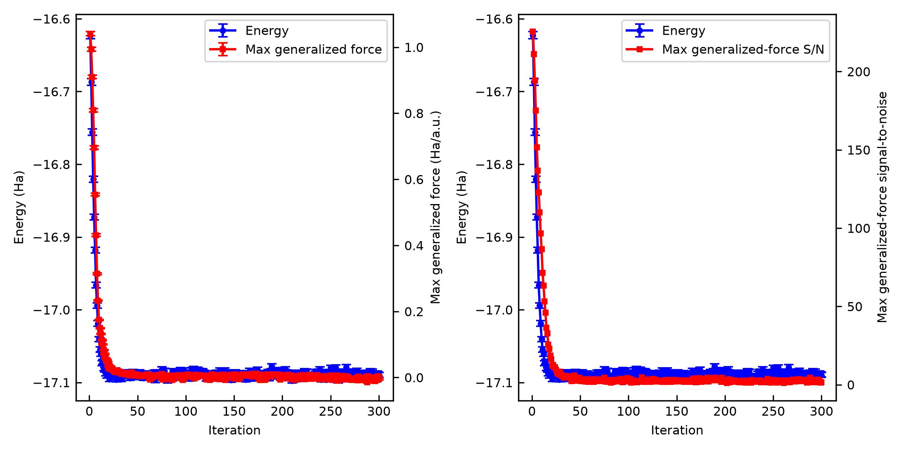
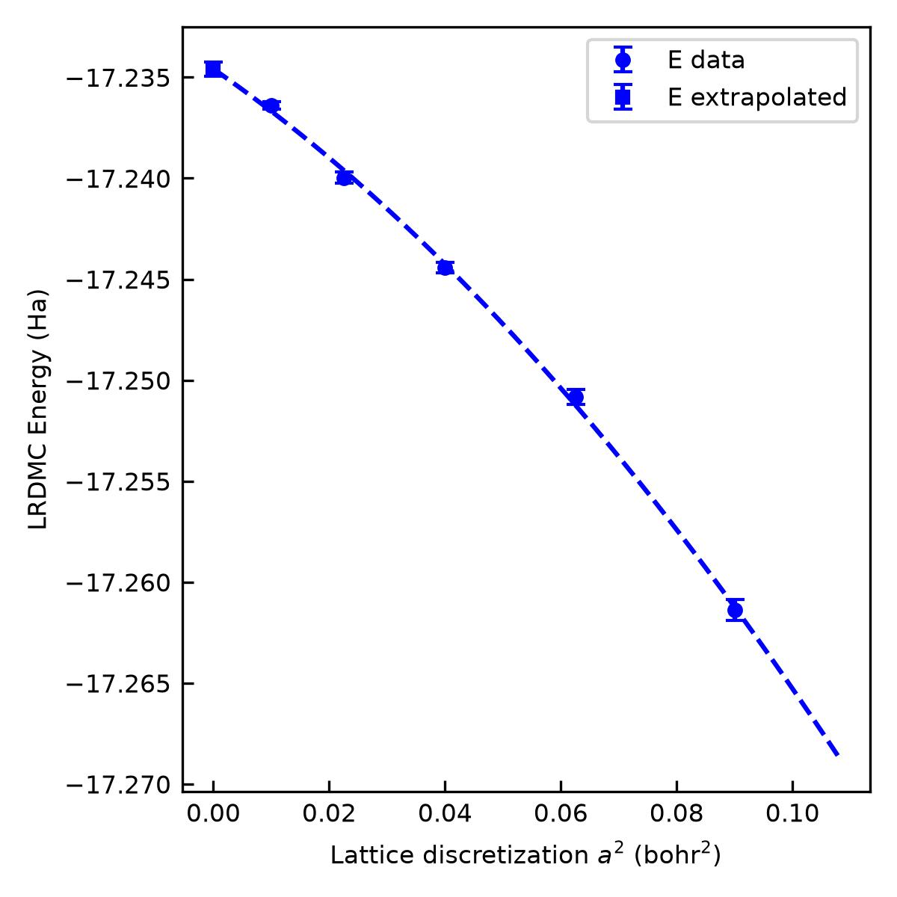
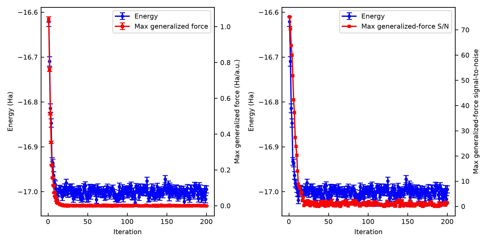
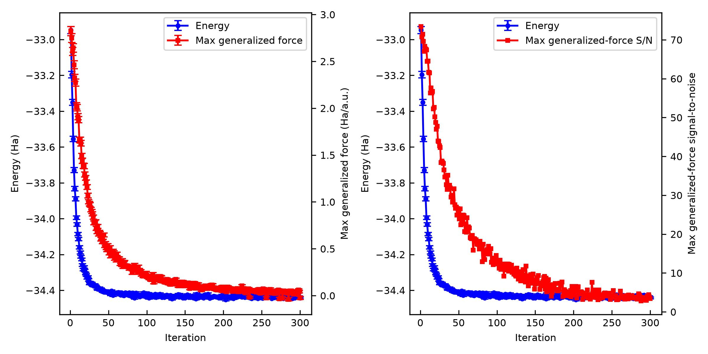
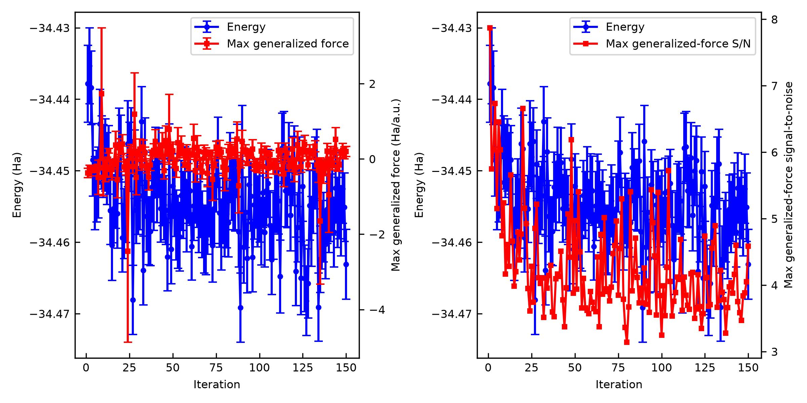
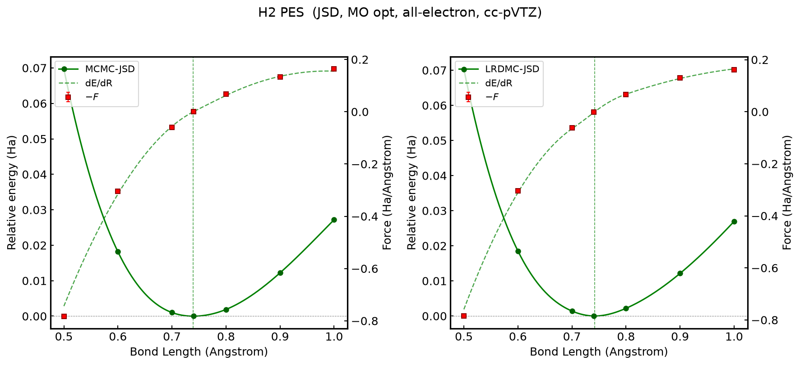

(examples_link)=

# Examples

Example files for **jQMC** are found at
<https://github.com/jqmc-project/jQMC/tree/main/examples>.

The examples are grouped by interface and physical scope. Commands assume that
`jqmc` and `jqmc-tool` come from the same checkout/version as the example
files. Mean-field and workflow examples also require their explicitly listed
external programs and machine configuration.

## Running an example

Use a checkout or source archive matching the installed jQMC version: a
`pip install` alone does not provide this examples tree. Run each tutorial
inside its own directory, `examples/<example>`, and follow its `cd` commands
in order. Some tutorials read shared files from sibling directories (QE
inputs and outputs, the downloaded `Si.ccECP.upf` of `jqmc-example07`,
`copy_optimized_hamiltonian.py`), so keep the tree intact. Pseudopotential
(UPF) files are not shipped; each tutorial that needs one gives its download
URL and where to place it. Generated
files (HDF5 checkpoints, logs) are written next to the inputs; use `git clean`
or a separate checkout if you want to keep the tree pristine. The listings of
whole Python files in the tutorials omit the licence header that every shipped
`.py` file carries; the rest of each listing is the file as shipped.

VMC leaves its original `hamiltonian_data.h5` unchanged and writes
`hamiltonian_data_opt_step_N.h5`. Before MCMC or LRDMC the tutorials run
`copy_optimized_hamiltonian.py --average-last 20`, which selects the 20
dumps with the largest **numeric** step and writes their uniform parameter
average with `jqmc-tool vmc average-wf` to the downstream input name (see
"Averaging the last optimization steps" in
[`doc/notes/wavefunction_optimization.md`](notes/wavefunction_optimization.md)).
The VMC inputs that feed such a hand-off therefore dump every step
(`wf_dump_freq = 1`). The helper refuses when fewer than 20 dumps exist
(`--allow-fewer` accepts them), when the destination already exists, and
whenever `average-wf` refuses the dumps. Without `--average-last` it copies
the single largest numeric step; the tutorials still do that where an
optimized wave function only starts a further optimization or a conversion.
Both forms work after partial or continued runs. Review optimization
convergence first: the averaged steps must lie on the energy plateau. Use
`--step N` to end the window at (or, without `--average-last`, to copy) a
particular reviewed dump, for example the last step before an optimizer
rollback. Use a fresh downstream directory for a different trial; never mix
its input with an old `restart.h5`.

Each command-line tutorial ends its MCMC and LRDMC steps with an **Analyze**
block. Two places report the energy:

- the `Final output(s):` block at the end of the run log (`out_mcmc`,
  `out_lrdmc`), which prints `Total Energy: E = ... +- ... Ha.` and
  `Variance: Var = ... +- ... Ha^2.` (and the atomic forces when
  `atomic_force = true`), computed with the warmup and bin settings of the
  TOML;
- `jqmc-tool mcmc compute-energy` / `compute-force` and
  `jqmc-tool lrdmc compute-energy` / `compute-force` / `extrapolate-energy`,
  which re-analyze the saved `restart.h5` checkpoint with the settings you
  pass on the command line.

The `jqmc-tool` commands do **not** read the TOML, and their default
options are below the minimums, so always pass them explicitly: `-w`
(warmup measurements to discard), `-b` (number of bins) and, for LRDMC,
`-c` (the correcting-factor history `num_gfmc_collect_steps`: the number of
past measurements whose walker weights are multiplied together to correct
the bias introduced by population control). The minimums are 30 warmup /
10 bins for MCMC and 25 warmup / 10 bins / 5 history for LRDMC. Each
tutorial shows the values that match its TOML. `jqmc-tool` prints the
number of jackknife samples as `Total number of binned samples = M`; for
MCMC $M$ = bins x walkers x MPI ranks, for LRDMC $M$ = bins. A finite error
bar is not evidence that these settings are converged: check that the
energy and its error bar stay stable when you change `-w` and `-b`.

## Before you start (all command-line tutorials)

- Launch lines are written as `mpirun -np N jqmc ...`; replace them with the
  launcher of your MPI library and queueing system. A serial run
  (`jqmc input.toml`) uses the same inputs but takes N times longer.
- Keep the supplied TOML files. They are the inputs behind the quoted
  numbers; `jqmc-tool * generate-input` templates use different settings.
- `jqmc` warns about unknown TOML sections and keys, and about sections
  that the selected `job_type` ignores. Read these warnings and the
  `Input parameters are::` echo at the top of each log before trusting a run.
- Mean-field inputs: the molecular tutorials, example06 and examples 11 to 13
  need PySCF with TREXIO export (for example
  `pip install pyscf pyscf-forge trexio`; check with
  `python -c "from pyscf.tools import trexio"`). The QE tutorials need a
  `pw.x` built with HDF5 so that it writes `wfc*.hdf5`.
- Every quoted number was produced on one 128-core CPU node (AMD EPYC 7713)
  with 128 MPI ranks unless the tutorial says otherwise; the wall times in
  the table below refer to that setup.

## What the main input keys mean

| Key | Meaning and how to choose it |
|---|---|
| `number_of_walkers` | Independent Markov chains per MPI rank. More walkers give more samples per step; on GPUs they are evaluated in parallel. |
| `num_mcmc_steps` | Number of measurements per rank and walker (the run length). |
| `num_mcmc_per_measurement` | MCMC: electron moves between two measurements. Larger values reduce the correlation between successive measurements. |
| `tau` | LRDMC (`lrdmc-tau`): imaginary time between two branchings (Ha^-1). All tutorials use `tau = 0.10`; the number of projections per branching then follows from the system and `alat`. |
| `num_mcmc_warmup_steps`, `num_gfmc_warmup_steps` | Initial measurements discarded before averaging (equilibration). |
| `num_mcmc_bin_blocks`, `num_gfmc_bin_blocks` | Number of bins of the jackknife error estimate. Each bin must be longer than the autocorrelation time, so at fixed run length fewer, longer bins are safer. |
| `Dt` | MCMC trial-move length (bohr). Too small explores slowly; too large lowers the acceptance ratio. |
| `epsilon_AS` | Attaccalite-Sorella reweighting parameter. A value $> 0$ tames the infinite variance of the determinant-parameter derivatives near the nodal surface; it matters when the determinant is optimized (`opt_geminal = true`). |
| `optimizer_kwargs` | Stochastic reconfiguration (SR) settings: `delta` is the step prefactor and `epsilon` the regularization added to the overlap matrix. `use_lm = true` with `lm_subspace_dim = 0` (the default) is accelerated SR (aSR), which chooses the length of each SR step from a model of the energy along that step; `lm_subspace_dim > 0` selects a reduced linear method and `-1` the full linear method; `use_lm = false` gives plain SR with the fixed step `delta`. Keys that a TOML does not set keep their documented defaults. |
| `alat` | LRDMC lattice spacing $a$ (bohr). The energy has an $O(a^2)$ bias: extrapolate to $a \to 0$, or use the same $a$ for every term of an energy difference. |
| `non_local_move` | Treatment of the non-local ECP term in LRDMC: `tmove` (T-move) or `dltmove` (determinant locality approximation with T-move). It has no effect in an all-electron calculation. |
| `num_gfmc_collect_steps` | Correcting-factor history (see above). |
| `atomic_force`, `use_swct` | Compute atomic forces; the space-warp coordinate transformation (SWCT) reduces the variance of the force estimator. |

The `-j3` option of `jqmc-tool trexio convert-to` selects the basis of the
three-body Jastrow factor: `mo` uses the molecular orbitals; `ao-small`,
`ao-medium` and `ao-large` use increasingly large subsets of the atomic
orbitals; `ao` and `ao-full` use all of them; `none` disables the three-body term.

## Restarting a run

Set `restart = true` in `[control]` (with `restart_chk` naming the
checkpoint) and run `jqmc` again in the same directory. For a VMC
optimization, `num_opt_steps` is then the number of **additional** steps,
and the `hamiltonian_data_opt_step_N.h5` dumps continue the step numbering.
Keys restored from the checkpoint (`mcmc_seed`, `number_of_walkers`,
`hamiltonian_h5`, `num_mcmc_per_measurement`, `Dt`, `epsilon_AS`; for LRDMC
also `tau`, `alat`, `non_local_move`, `num_gfmc_collect_steps` and the force
and stress switches) must
not be changed: `jqmc` refuses a restart in which an explicitly written
frozen key differs from the checkpoint value.

## Choose a periodic input route: PySCF or Quantum ESPRESSO

| Mean-field input | Conversion to the jQMC determinant | Start here |
|---|---|---|
| PySCF periodic Gaussian orbitals | PySCF -> TREXIO -> pGTO, using `jqmc-tool trexio convert-to`; no QE calculation is needed. | `jqmc-example06`: ice Ih at a non-Gamma complex twist, VMC optimization, MCMC and LRDMC. |
| QE plane waves, converted to B-splines | QE `.save` -> `jqmc-tool qe --kind bspline`. | `jqmc-example07`: Gamma-point silicon, VMC optimization, MCMC, LRDMC and MPC. Also used by `jqmc-example09`, `jqmc-example10` (LSDA) and `jqmc-workflow-example04`/`06`. |
| QE or PySCF k cosets tiled into a supercell | Add `--tiling "2 1 1"` to QE PW/B-spline/pGTO/PW+pGTO or TREXIO GTO conversion; select a supertwist or weighted ensemble, with frozen Slater orbitals. | `jqmc-example14`: common primitive k blocks and independent supercell J3 or DTN. |
| QE plane waves, converted to pGTO+PW | QE `.save` -> `jqmc-tool qe --kind pgto+pw --ecutwfc auto`. | `jqmc-example08`: all-electron hydrogen at a non-Gamma twist, VMC optimization, MCMC and LRDMC with forces; `jqmc-workflow-example05` is its workflow counterpart. |

The fragments above only identify the converter options; use the complete
commands in the selected tutorial. A B-spline mesh or a pGTO+PW cutoff is an
approximation, so inspect the conversion diagnostics and converge observables,
not just the orbital-fit residual.

Example07 ships the QE save directory of its small run without the
pseudopotential: download `Si.ccECP.upf` from
<https://pseudopotentiallibrary.org/recipes/Si/ccECP/Si.ccECP.upf> into
`jqmc-example07/01DFT/` and copy it into `01DFT/silicon.save/` (step 1 of the
tutorial), and the conversion needs no local QE run. The other QE tutorials
run `pw.x` first. For **multiple twists**,
use `jqmc-example09` (CLI) or `jqmc-workflow-example06` (workflow); example06
and example08 are single-twist tutorials. A multi-k PySCF state exported to
TREXIO is converted with `jqmc-tool trexio convert-to --twist-average` or
`WF_Workflow(twist_average=True)`; the downstream steps are those of the QE
tutorials.

All periodic tutorials use insulating or fixed-occupation mean-field states.
jQMC has no grand-canonical twist averaging, and `jqmc-tool qe` rejects
smeared occupations, so metals are not a supported production target; see
"Fixed electron numbers and metals" in the wave-function technical note.

## Command-line tutorials

Each example lives in the directory of the same name under `examples/`
(browse them at <https://github.com/jqmc-project/jQMC/tree/main/examples>,
or in the source archive of your installed version).

| Example | System and purpose |
|---|---|
| `jqmc-example01` | Water (ccECP): PySCF to TREXIO, JSD optimization, MCMC, and LRDMC (`lrdmc-tau`) at five lattice spacings with continuum extrapolation. |
| `jqmc-example02` | Water with a two-body Jastrow only: VMC optimization (with a restart) and MCMC energy and atomic forces. |
| `jqmc-example03` | Water: Jastrow-only optimization followed by geminal/MO optimization through `opt_geminal`, and the MCMC energies of both trials. |
| `jqmc-example04` | S22 water-dimer binding energy (aug-cc-pVDZ) with JSD and JAGP: VMC, MCMC and LRDMC for two monomers and the dimer. |
| `jqmc-example05` | All-electron H2: energies and analytic atomic forces with JSD and JAGP, MCMC and LRDMC. |
| `jqmc-example06` | Periodic ice Ih from PySCF pGTOs at a non-Gamma complex twist: VMC, MCMC, and LRDMC at three lattice spacings with continuum extrapolation. |
| `jqmc-example07` | Periodic silicon from QE with a B-spline determinant and DTN Jastrow: VMC, MCMC, LRDMC, and mixed-precision MCMC with MPC. |
| `jqmc-example08` | Periodic all-electron hydrogen from QE (pGTO+PW, DTN cusp): VMC optimization, MCMC and LRDMC energies and forces. |
| `jqmc-example09` | Eight-twist silicon (QE, B-spline): twist-averaged MCMC and `lrdmc-tau` with stress, pressure and BZ-averaged MPC in mixed precision, extrapolation, and restart of a twist checkpoint directory. |
| `jqmc-example10` | Unrestricted open shells: nitrogen atom with ccECP (PySCF UHF) optimization and sampling, and a silicon atom from QE LSDA (B-spline) in mixed precision. |
| `jqmc-example14` | QE/PySCF orbital tiling with frozen Slater coefficients, Gamma/general supertwists and ensembles; independent supercell AO J3 or DTN. |

Size of the shipped inputs and wall time of the reference runs (one 128-core
node, 128 MPI ranks, per job):

| Example | External programs | Shipped size | Wall time of the reference run |
|---|---|---|---|
| `jqmc-example01` | PySCF | VMC 300 steps; MCMC 300 walkers/rank x 5000; LRDMC 5 spacings x 300 walkers/rank x 1500 | VMC 55 min, MCMC 20 min, LRDMC 20 min (a = 0.30) to 153 min (a = 0.10) |
| `jqmc-example02` | PySCF | VMC 200 steps; MCMC with forces 100 walkers/rank x 3000 | VMC 4 min, MCMC 19 min |
| `jqmc-example03` | PySCF | VMC 150 (Jastrow) + 200 (geminal) steps; two MCMC runs of 100 walkers/rank x 10000 | 19 min + 83 min, MCMC about 9 min each |
| `jqmc-example04` | PySCF | Three systems x (JSD, JAGP) x (VMC, MCMC, LRDMC) | about 3 h for both monomers, about 9 h for the dimer |
| `jqmc-example05` | PySCF | 4 walkers/rank; JSD and JAGP VMC, MCMC and LRDMC | about 50 min in total |
| `jqmc-example06` | PySCF (`pyscf.pbc`) | VMC 150 steps; MCMC 5000; LRDMC 3 spacings | VMC 1 h 41 min; MCMC 8 min; LRDMC 53 to 102 min each |
| `jqmc-example07` | QE (optional; save directory shipped, UPF downloaded) | VMC 200 steps; MCMC 5000; LRDMC 5000; MPC MCMC 5000 | VMC 80 min; the others 1 to 7 min |
| `jqmc-example08` | QE | VMC 200 steps; MCMC and LRDMC 20000 with forces | VMC 81 min; MCMC 2.5 min; LRDMC 6.5 min |
| `jqmc-example09` | QE | 8 twists x 8 walkers; MCMC 1000; LRDMC 2000 at three spacings | see the tutorial |
| `jqmc-example10` | PySCF, QE | N: VMC 100 steps, MCMC 5000; Si LSDA: MCMC 5000 | VMC 39 min; MCMC 2 to 6 min |

## Feature index

| Feature | Start here |
|---|---|
| Molecular all-electron calculation | `jqmc-example05` |
| Periodic Gamma calculation | `jqmc-example07` |
| Non-Gamma complex Bloch orbitals | `jqmc-example06` or `jqmc-example08` |
| Twist averaging | `jqmc-example09` (CLI) or `jqmc-workflow-example06` (workflow) |
| Supercell orbital tiling with Gamma/general supertwists or twist averaging | `jqmc-example14` |
| Mixed precision | `jqmc-example07/05mcmc_JSD_mixed_mpc`, `jqmc-example09`, or `jqmc-example10` |
| Atomic forces | `jqmc-example02`, `jqmc-example05` (molecules), `jqmc-example08` (periodic), `jqmc-workflow-example01`, `03`, `05` |
| Stress and pressure | `jqmc-example09` |
| MPC finite-size energy correction | `jqmc-example07/05mcmc_JSD_mixed_mpc` (single twist) or `jqmc-example09` (twist average) |
| Open-shell / unrestricted determinant (UHF and LSDA) | `jqmc-example10` |
| Jastrow optimization | `jqmc-example01`, `jqmc-example02`, `jqmc-example07` |
| Determinant (geminal/MO, JAGP) optimization | `jqmc-example03`, `jqmc-example04`, `jqmc-example05`, `jqmc-example08` |
| Multi-twist VMC optimization and downstream handoff | `jqmc-workflow-example06` |
| Equation of state (volume scan) | `jqmc-workflow-example04` |
| LRDMC continuum extrapolation | `jqmc-example01`, `jqmc-example06`, `jqmc-example09`, `jqmc-workflow-example04` |
| Restart and continuation | [Restarting a run](#restarting-a-run) above; VMC restart in `jqmc-example02` and `jqmc-example04`; twist checkpoint directory in `jqmc-example09` |
| Serial / MPI Python API | `jqmc-example12` / `jqmc-example13` |
| Orbital and Hamiltonian kernels from Python (AOs, MOs, Coulomb, ECP) | `jqmc-example11` |

## Python API tutorials

| Example | System and purpose | Wall time of the reference run |
|---|---|---|
| `jqmc-example11` | Low-level Python API: read a TREXIO file into the jQMC data containers and evaluate AOs, MOs, bare Coulomb, and ECP local/non-local terms at one electron configuration. | 10 s, serial |
| `jqmc-example12` | Serial end-to-end Python API for water: TREXIO conversion, VMC optimization and sampling, LRDMC at three spacings, and extrapolation (2000 walkers). | 61 min, one process |
| `jqmc-example13` | MPI version of `jqmc-example12` using `mpi4py` and `run_jqmc_mpi.py` (2000 walkers in total). | 32 min, 125 ranks |

## jqmc_workflow tutorials

| Example | System and purpose |
|---|---|
| `jqmc-workflow-example01` | H2 potential-energy surface at seven bond lengths and force/PES-derivative comparison. |
| `jqmc-workflow-example02` | GPU walker/MPI vectorization benchmark. |
| `jqmc-workflow-example03` | Molecular water VMC, MCMC, and LRDMC energy/force pipeline. |
| `jqmc-workflow-example04` | Silicon equation of state: QE, B-spline conversion, VMC, MCMC and LRDMC over five lattice constants with a Birch-Murnaghan fit, plus an LRDMC lattice-spacing extrapolation. |
| `jqmc-workflow-example05` | Periodic all-electron hydrogen QE-to-jQMC workflow with DTN and forces (workflow counterpart of `jqmc-example08`). |
| `jqmc-workflow-example06` | Eight-twist QE conversion, mixed-precision VMC optimization, publication of the complete optimized Hamiltonian, and downstream MCMC handoff. |

The workflow engine submits ready jobs until the number of the driver's jobs
in a scheduler queue reaches `max_job_submit`; further submissions wait and
retry every `poll_interval` seconds until a slot frees. By default only the
jobs submitted by this driver are counted; `max_job_submit_scope = "user"`
counts all of your jobs in that queue.

## Files at the top of `examples/`

- `copy_optimized_hamiltonian.py`: hands the optimized VMC trial to the
  next step, either the average of the last N dumps (`--average-last N`)
  or a copy of one `hamiltonian_data_opt_step_N.h5`; used by the
  command-line tutorials.
- `sync_examples.py`: copies the input files named by the README include
  markers into the code blocks that follow them; running the examples does
  not need it.

## About the quoted numbers

Energies and forces quoted in the tutorials are statistical results of one
reference run made with the shipped inputs, except where a note says
otherwise (see the setup recorded in each tutorial). Your run uses different random numbers (and possibly a
different number of MPI ranks), so expect agreement within a few error bars,
not digit-by-digit equality. The warmup, bin and history settings of the
shipped TOMLs are starting points, not evidence of decorrelation or
convergence; at fixed run length more bins means shorter bins.

The MCMC and LRDMC numbers quoted after a hand-off were not sampled from
the average of the last 20 optimization steps that the shown commands
write: those reference runs sampled the single last dump. Each such
hand-off carries a note naming the dump that was used. Where the reference
VMC run dumped only every 10, 20 or 50 steps, the shipped input dumps every
step, which the averaged hand-off needs; the dump frequency does not change
the optimization itself.

## jqmc-example01: Water VMC and LRDMC energies

Total energy of a water molecule with the ccECP pseudopotential. This
example starts from a PySCF Hartree-Fock (HF) calculation, optimizes a
Jastrow-Slater determinant (JSD) trial wave function with two- and
three-body Jastrow factors (J2 + J3), and obtains the VMC energy and the
LRDMC energy extrapolated to zero lattice spacing.

### Before you start

- You need PySCF with TREXIO export (`python -c "from pyscf.tools import trexio"`
  must succeed).
- All numbers below come from one run of the shipped inputs on one
  128-core CPU node, 128 MPI ranks
  (`mpirun -np 128`), no GPU, except that the MCMC and LRDMC steps sampled
  the single last optimization dump instead of the averaged trial (see the
  note at the MCMC hand-off). Wall times: PySCF a few seconds, VMC
  optimization 55 min, MCMC 20 min, LRDMC 20 min to 2.5 h per lattice
  spacing (see the LRDMC section). Results and timings can vary with the
  machine and software environment. Scale the walker and step counts to your
  machine.
- The analysis commands, the meaning of the main TOML keys and the restart
  rules are summarized in the examples index (`examples/README.md`).

All paths below are relative to `examples/jqmc-example01`; follow the displayed `cd`
commands.

### Generate a trial WF

The first step of ab initio QMC is to generate a trial wave function with a
mean-field method such as DFT or HF. jQMC reads mean-field results through
the TREXIO file format. The following script runs an HF calculation for the
water molecule with PySCF (Cartesian GTOs, because `mol.cart = True`) and
writes a TREXIO file.

:::{note}
PySCF is an optional dependency and is not installed with jQMC. Verify that
`python -c "from pyscf.tools import trexio"` succeeds before running this
example; otherwise install a PySCF build that includes TREXIO support.
:::

<!-- include: 01DFT/run_pyscf.py -->
```python
from pyscf import gto, scf
from pyscf.tools import trexio

filename = "water_ccecp_ccpvtz.h5"

mol = gto.Mole()
mol.verbose = 5
mol.atom = """
               O    5.00000000   7.14707700   7.65097100
               H    4.06806600   6.94297500   7.56376100
               H    5.38023700   6.89696300   6.80798400
               """
mol.basis = "ccecp-ccpvtz"
mol.unit = "A"
mol.ecp = "ccecp"
mol.charge = 0
mol.spin = 0
mol.symmetry = False
mol.cart = True
mol.output = "water.out"
mol.build()

mf = scf.HF(mol)
mf.max_cycle = 200
mf_scf = mf.kernel()

trexio.to_trexio(mf, filename)
```

```bash
cd 01DFT
python run_pyscf.py > out_pyscf
cd ..
```

The SCF log is written to `01DFT/water.out`; `out_pyscf` ends with

```text
converged SCF energy = -16.9437549661298
```

:::{note}
One can start from any HF/DFT code that can write a TREXIO file. See the [TREXIO website](https://github.com/TREX-CoE/trexio) for details.
:::

You can see the content of a TREXIO file with `jqmc-tool`:

```bash
jqmc-tool trexio show-info 01DFT/water_ccecp_ccpvtz.h5
```

```text
pbc_flag = False
num_ele_up = 4, num_ele_dn = 4, spin_polarized = False
spin_dependent MOs = False
Cartesian basis functions.
**Structure_data
  PBC flag = False
  --------------------------------------------------
  element, label, Z, x, y, z in cartesian (Bohr)
  --------------------------------------------------
  O, O, 8.0, 9.44863062, 13.50601812, 14.45823978
  H, H, 1.0, 7.68753060, 13.12032124, 14.29343676
  H, H, 1.0, 10.16717442, 13.03337116, 12.86522522
  --------------------------------------------------
**AOs_cart_gto_data**
  Number of AOs = 64
  Number of primitive AOs = 110
...
**Coulomb_potential_data
  ecp_flag = True
...
```

You can also inspect the TREXIO HDF5 container with `h5dump -n` (or the
interactive viewer `h5tui`) if it is installed on your machine.

### Optimize a trial WF (VMC)

The next step is to optimize the variational parameters of the generated
wave function: here the two-body Jastrow parameter and the matrix elements
of the three-body Jastrow factor. The determinant is kept fixed
(`opt_geminal = false`) and no one-body Jastrow factor is used
(`opt_J1_param = false`, and the conversion below adds none).

Enter the supplied VMC optimization directory and convert the TREXIO file
to a jQMC wave function:

```bash
cd 02vmc_JSD
cp ../01DFT/water_ccecp_ccpvtz.h5 .
jqmc-tool trexio convert-to water_ccecp_ccpvtz.h5 -j2 1.0 -j3 mo
```

```text
...
Hamiltonian data is saved in hamiltonian_data.h5.
```

The generated `hamiltonian_data.h5` is a wave-function file in the jQMC
format. `-j2` sets the initial value of the two-body Jastrow parameter and
`-j3` the basis of the three-body Jastrow factor: `mo` uses the molecular
orbitals (its matrix starts at zero), the `ao-*` choices use subsets of the
atomic orbitals (see the command-line reference).

Settings in `vmc.toml`: every optimization step samples 500 measurements per
walker (4 walkers per rank), discards 30 and uses 10 bins; `delta = 0.15` is
the SR step prefactor and `use_lm = true` (with the default
`lm_subspace_dim = 0`) selects accelerated SR (aSR), which chooses the
length of each step automatically. `num_opt_steps = 300` is an upper bound,
not a guarantee of convergence. Directly edit `vmc.toml` if you want to
change a parameter.

<!-- include: 02vmc_JSD/vmc.toml -->
```toml
[control]
job_type = "vmc" # Specify the job type. "mcmc", "vmc", "lrdmc-bra", or "lrdmc-tau".
mcmc_seed = 34456 # Random seed for MCMC
number_of_walkers = 4 # Number of walkers per MPI process
max_time = 86400 # Maximum time in sec.
restart = false
restart_chk = "restart.h5" # Restart checkpoint file. If restart is True, this file is used.
hamiltonian_h5 = "hamiltonian_data.h5" # Hamiltonian checkpoint file. If restart is False, this file is used.
verbosity = "high" # Verbosity level. "low", "high", "devel", "mpi-low", "mpi-high", "mpi-devel"

[vmc]
num_mcmc_steps = 500 # Number of observable measurement steps per MPI process and walker. The global total is num_mcmc_steps * mpi_size * number_of_walkers.
num_mcmc_per_measurement = 40 # Number of MCMC updates between successive observable measurements.
num_mcmc_warmup_steps = 30 # Number of initial observable measurements discarded as warmup.
num_mcmc_bin_blocks = 10 # Number of blocks for binning per MPI and Walker. i.e., the total number of binned blocks is num_mcmc_bin_blocks * mpi_size * number_of_walkers.
Dt = 2.0 # Step size for the MCMC update (bohr).
epsilon_AS = 0.0 # Epsilon parameter for Attaccalite-Sorella regularization.
num_opt_steps = 300 # Number of optimization steps.
wf_dump_freq = 1 # Frequency of wavefunction (i.e. hamiltonian_data) dump.
optimizer_kwargs = { method = "sr", delta = 0.15, epsilon = 0.001, cg_flag = true, cg_max_iter = 10000, use_lm = true } # SR optimizer configuration (method plus step/regularization).
opt_J1_param = false
opt_J2_param = true
opt_J3_param = true
opt_geminal = false
fix_geminal_rank = 0
opt_J3_basis_exp = false
opt_J3_basis_coeff = false
opt_lambda_basis_exp = false
opt_lambda_basis_coeff = false

# [precision]
# mode = "full"  # "full" (default, all float64) or "mixed" (recommended mixed precision)
```

Launch the job (on a GPU machine use the launch line of your queueing
system, e.g. `mpiexec -n 4 -map-by ppr:4:node jqmc ...`):

```bash
mpirun -np 128 jqmc vmc.toml > out_vmc 2> out_vmc.e
```

With 128 ranks one optimization step took 11 s (55 min for 300 steps).
Check the convergence with `jqmc-tool`:

```bash
jqmc-tool vmc analyze-output out_vmc
```

```text
------------------------------------------------------
Iter     E (Ha)     Max generalized force (Ha/a.u.)  Max force S/N
------------------------------------------------------
   1  -16.6225(48)  +1.0410(60)   225.449
   2  -16.6867(45)  +0.9940(60)   211.009
   3  -16.7560(43)  +0.9100(50)   194.321
   4  -16.8205(42)  +0.8090(50)   175.197
   5  -16.8727(40)  +0.6960(50)   151.466
...
  10  -17.0404(35)  +0.1740(20)    86.461
...
  20  -17.0900(34)  +0.0350(30)    16.113
...
  30  -17.0899(33)  +0.0170(30)     6.629
...
  50  -17.0901(34)  +0.0050(30)     2.429
...
 100  -17.0867(34)  +0.0030(30)     2.075
...
 200  -17.0919(34)  +0.0040(30)     1.832
...
 296  -17.0919(34)  -0.0110(30)     3.227
 297  -17.0960(33)  -0.0030(30)     2.186
 298  -17.0874(34)  -0.0080(30)     2.827
 299  -17.0884(33)  +0.0040(30)     1.292
 300  -17.0896(33)  -0.0050(30)     1.499
------------------------------------------------------
```

The important criteria are `Max generalized force` and `Max force S/N`.
The generalized forces are the energy derivatives with respect to the
variational parameters; `Max generalized force` should be zero within its
error bar. A practical criterion is `Max force S/N` < 4-5, because then all
residual forces are zero in the statistical sense. The energy should also
have stopped decreasing. Here the energy drops by 0.47 Ha in the first
20 steps, S/N drops to about 2-4 after 40-50 steps (with occasional
statistical excursions above 4), and the remaining steps only fluctuate
around -17.09 Ha; the dumps after step ~50 are converged.

:::{tip}
If the optimization does not converge well, try the following:
- Adjust the `delta` parameter in `optimizer_kwargs`. A smaller `delta` (e.g., `0.05`) makes the optimization more conservative but stable, while a larger one (e.g., `0.30`) is more aggressive but may cause instabilities.
- Set `use_lm = false` in `optimizer_kwargs` to switch off accelerated SR (aSR) and use plain SR with the fixed step `delta`. This can sometimes help in difficult cases.
:::

You can also plot the energy and forces:

```bash
jqmc-tool vmc analyze-output out_vmc -p -s vmc.jpg
```



If an optimization has not converged, restart it: set `restart = true` in
`vmc.toml` (with `restart_chk = "restart.h5"`) and run
`jqmc vmc.toml > out_vmc_cont 2> out_vmc_cont.e`. With `restart = true`,
`num_opt_steps` is the number of **additional** steps, and the new
`hamiltonian_data_opt_step_N.h5` dumps continue the step numbering. Do not
change `num_mcmc_per_measurement`, `Dt`, `epsilon_AS`, `mcmc_seed` or
`number_of_walkers`: they are restored from `restart.h5`.
`jqmc-tool vmc analyze-output out_vmc out_vmc_cont` analyzes both runs
together. (This run did not need a restart.)

### Compute Energy (MCMC)

The next step is an MCMC (VMC sampling) calculation with the optimized trial
wave function. Enter the supplied MCMC directory; the helper averages the
last 20 optimization dumps by step number (`--step N` ends the window at
another reviewed step; without `--average-last` it copies a single dump).

```bash
cd ../03mcmc_JSD
python ../../copy_optimized_hamiltonian.py --average-last 20 ../02vmc_JSD hamiltonian_data.h5
```

:::{note}
The helper averages the wave-function parameters of the last 20 dumps (here steps 281-300) with
`jqmc-tool vmc average-wf`; see [Averaging the last optimization steps](notes/wavefunction_optimization.md). The numbers quoted below were not sampled from this average: the reference run handed over the single last dump with
`python ../../copy_optimized_hamiltonian.py ../02vmc_JSD hamiltonian_data.h5`, which printed
`Copied optimized trial: ../02vmc_JSD/hamiltonian_data_opt_step_300.h5 -> hamiltonian_data.h5`.
:::

Settings in `mcmc.toml`: 300 walkers per rank, 5000 measurements, 40
electron moves between measurements (to reduce the correlation between
measurements) and a move length `Dt = 2.0` bohr; the first 30 measurements
are discarded and 10 bins per walker are used for the error bar.

<!-- include: 03mcmc_JSD/mcmc.toml -->
```toml
[control]
job_type = "mcmc" # Specify the job type. "mcmc", "vmc", "lrdmc-bra", or "lrdmc-tau".
mcmc_seed = 34456 # Random seed for MCMC
number_of_walkers = 300 # Number of walkers per MPI process
max_time = 86400 # Maximum time in sec.
restart = false
restart_chk = "restart.h5" # Restart checkpoint file. If restart is True, this file is used.
hamiltonian_h5 = "hamiltonian_data.h5" # Hamiltonian checkpoint file. If restart is False, this file is used.
verbosity = "low" # Verbosity level. "low", "high", "devel", "mpi-low", "mpi-high", "mpi-devel"
[mcmc]
num_mcmc_steps = 5000 # Number of observable measurement steps per MPI process and walker. The global total is num_mcmc_steps * mpi_size * number_of_walkers.
num_mcmc_per_measurement = 40 # Number of MCMC updates between successive observable measurements.
num_mcmc_warmup_steps = 30 # Number of initial observable measurements discarded as warmup.
num_mcmc_bin_blocks = 10 # Number of blocks for binning per MPI and Walker. i.e., the total number of binned blocks is num_mcmc_bin_blocks * mpi_size * number_of_walkers.
Dt = 2.0 # Step size for the MCMC update (bohr).
epsilon_AS = 0.0 # Epsilon parameter for Attaccalite-Sorella regularization.

# [precision]
# mode = "full"  # "full" (default, all float64) or "mixed" (recommended mixed precision)
```

```bash
mpirun -np 128 jqmc mcmc.toml > out_mcmc 2> out_mcmc.e
```

The run took 20 min (201 ms per MCMC step). The end of `out_mcmc`:

```text
Acceptance ratio is 47.93 %.  Ideal is ~ 50.00%. Adjust Dt.

Final output(s):
  Total Energy: E = -17.08901 +- 0.00012 Ha.
  Variance: Var = 1.86448 +- 0.00079 Ha^2.
```

#### Analyze (MCMC)

To re-analyze the checkpoint with other warmup or bin settings, start from
the TOML values and then discard more measurements:

```bash
jqmc-tool mcmc compute-energy restart.h5 -w 30 -b 10
jqmc-tool mcmc compute-energy restart.h5 -w 500 -b 10
```

```text
Found 128 MPI ranks.
Total number of binned samples = 384000
E = -17.089008181622354 +- 0.00011966281626325541 Ha.
...
Found 128 MPI ranks.
Total number of binned samples = 384000
E = -17.089014065264873 +- 0.00012560763233290353 Ha.
```

The number of binned samples is 10 bins x 300 walkers x 128 ranks. The
energy does not move when 500 instead of 30 measurements are discarded, so
the warmup is sufficient. The VMC (J2 + J3) energy is
**E = -17.08901(12) Ha**, 145 mHa below HF.

### Compute Energy (LRDMC)

The final step is lattice-regularized diffusion Monte Carlo (LRDMC). LRDMC
projects the trial wave function onto the lowest-energy state with the same
nodal surface (fixed-node approximation), so it improves on the VMC energy.
The Hamiltonian is discretized on a lattice of spacing $a$, which introduces
a bias of order $a^2$; we therefore run five spacings and extrapolate to
$a \rightarrow 0$. Extrapolation removes the lattice bias, not the
fixed-node or ECP-localization approximations.

Settings in `lrdmc.toml`: `job_type = 'lrdmc-tau'` with 300 walkers per
rank; the walkers are projected for an imaginary time `tau = 0.10` Ha$^{-1}$
between two branching (population control) steps, and 1500 branching steps
are run, i.e. 150 Ha$^{-1}$ of projection per walker.
`non_local_move = "dltmove"` treats the non-local ECP term; 50 warmup steps,
10 bins and a correcting-factor history of 20 steps are used for the
analysis. `hamiltonian_h5 = '../hamiltonian_data.h5'` points to one shared
optimized trial.

Create one subdirectory per lattice spacing from the supplied TOML (which
has `alat = 0.30`):

```bash
cd ../04lrdmc_JSD
cp ../03mcmc_JSD/hamiltonian_data.h5 .  # the optimized trial used by MCMC
mkdir -p alat_0.10 alat_0.15 alat_0.20 alat_0.25 alat_0.30
cp lrdmc.toml alat_0.30/lrdmc.toml
for a in 0.10 0.15 0.20 0.25; do sed "s/alat = 0.30/alat = ${a}/" lrdmc.toml > alat_${a}/lrdmc.toml; done
grep alat alat_*/lrdmc.toml
```

```text
alat_0.10/lrdmc.toml:  alat = 0.10
alat_0.15/lrdmc.toml:  alat = 0.15
alat_0.20/lrdmc.toml:  alat = 0.20
alat_0.25/lrdmc.toml:  alat = 0.25
alat_0.30/lrdmc.toml:  alat = 0.30
```

<!-- include: 04lrdmc_JSD/lrdmc.toml -->
```toml
[control]
  job_type = 'lrdmc-tau'
  mcmc_seed = 34467
  number_of_walkers = 300
  max_time = 10400
  restart = false
  restart_chk = 'restart.h5'
  hamiltonian_h5 = '../hamiltonian_data.h5'
  verbosity = 'low'

[lrdmc-tau]
  num_mcmc_steps  = 1500
  tau = 0.10
  alat = 0.30
  non_local_move = "dltmove"
  num_gfmc_warmup_steps = 50
  num_gfmc_bin_blocks = 10
  num_gfmc_collect_steps = 20

# [precision]
# mode = "full"  # "full" (default, all float64) or "mixed" (recommended mixed precision)
```

Run `jqmc` in each directory; on a cluster, submit one job per directory.

```bash
for a in 0.10 0.15 0.20 0.25 0.30; do
  (cd alat_${a}; mpirun -np 128 jqmc lrdmc.toml > out_lrdmc 2> out_lrdmc.e)
done
```

The cost of one branching step grows roughly as $1/a^2$, because more
lattice moves fit into the same imaginary time `tau`. With 128 ranks:

| a (bohr) | Projection time per branching | Wall time (1500 steps) | Survived walkers ratio |
|----------|-------------------------------|------------------------|------------------------|
| 0.10     | 5767 msec                     | 153 min                | 96.39 %                |
| 0.15     | 2650 msec                     | 68 min                 | 96.37 %                |
| 0.20     | 1553 msec                     | 40 min                 | 96.33 %                |
| 0.25     | 1048 msec                     | 28 min                 | 96.28 %                |
| 0.30     | 774 msec                      | 20 min                 | 96.20 %                |

The `Final output(s):` blocks of `alat_<a>/out_lrdmc` (analyzed with the
TOML values, i.e. 50 warmup steps):

| a (bohr) | Total Energy (Ha)       | Variance (Ha^2)        |
|----------|-------------------------|------------------------|
| 0.10     | -17.23639 +- 0.00027    | 2.17904 +- 0.00267     |
| 0.15     | -17.23997 +- 0.00028    | 2.19439 +- 0.00190     |
| 0.20     | -17.24452 +- 0.00026    | 2.21629 +- 0.00735     |
| 0.25     | -17.25080 +- 0.00029    | 2.24118 +- 0.01278     |
| 0.30     | -17.26132 +- 0.00035    | 2.26941 +- 0.01102     |

#### Analyze (LRDMC)

LRDMC starts from the VMC walker distribution and needs some projection
time to equilibrate. Re-analyze each checkpoint with a longer warmup and
check that the energy is stable, e.g. for the smallest spacing:

```bash
jqmc-tool lrdmc compute-energy alat_0.10/restart.h5 -w 50 -b 10 -c 20
jqmc-tool lrdmc compute-energy alat_0.10/restart.h5 -w 100 -b 10 -c 20
jqmc-tool lrdmc compute-energy alat_0.10/restart.h5 -w 200 -b 10 -c 20
```

```text
...
E = -17.236386025325892 +- 0.00026579190013760977 Ha.
...
E = -17.23639391409489 +- 0.00019703137887340245 Ha.
...
E = -17.236338373194535 +- 0.0002512492725141796 Ha.
```

(For LRDMC the number of jackknife samples equals the number of bins, so
`Total number of binned samples = 10`.) At $a = 0.10$ bohr the energy stays
within its error bar when 50, 100 or 200 steps are discarded, so 50 warmup
steps (5 Ha$^{-1}$) are enough at this spacing; repeat the check at the
other spacings.

Extrapolate to $a \rightarrow 0$ with `jqmc-tool`, from `04lrdmc_JSD`,
discarding 100 steps:

```bash
jqmc-tool lrdmc extrapolate-energy alat_0.10/restart.h5 alat_0.15/restart.h5 alat_0.20/restart.h5 alat_0.25/restart.h5 alat_0.30/restart.h5 -w 100 -b 10 -c 20 -s lrdmc_ext.jpg
```

```text
------------------------------------------------------------------------
Read restart checkpoint files from ['alat_0.10/restart.h5', 'alat_0.15/restart.h5', 'alat_0.20/restart.h5', 'alat_0.25/restart.h5', 'alat_0.30/restart.h5'].
Found 128 MPI ranks in alat_0.10/restart.h5.
  Total number of binned samples = 10
  For a = 0.1 bohr: E = -17.23639391409489 +- 0.00019703137887340245 Ha.
Found 128 MPI ranks in alat_0.15/restart.h5.
  Total number of binned samples = 10
  For a = 0.15 bohr: E = -17.239975493555548 +- 0.00027244700659658796 Ha.
Found 128 MPI ranks in alat_0.20/restart.h5.
  Total number of binned samples = 10
  For a = 0.2 bohr: E = -17.244418390247013 +- 0.0002627092228603692 Ha.
Found 128 MPI ranks in alat_0.25/restart.h5.
  Total number of binned samples = 10
  For a = 0.25 bohr: E = -17.250840571173086 +- 0.0003642624617848744 Ha.
Found 128 MPI ranks in alat_0.30/restart.h5.
  Total number of binned samples = 10
  For a = 0.3 bohr: E = -17.261365411064236 +- 0.0005180799863716069 Ha.
------------------------------------------------------------------------
Extrapolation of the energy with respect to a^2.
  Polynomial order = 2.
  For a -> 0 bohr: E = -17.23458485850484 +- 0.0003580752958172443 Ha.
------------------------------------------------------------------------
Graph is saved in lrdmc_ext.jpg.
------------------------------------------------------------------------
Extrapolation is finished.
```

The command fits $E(a) = E_0 + E_2 a^2 + E_4 a^4$ (`-p 2`, the default
polynomial order in $a^2$) and propagates the error bars of the input
energies in closed form to the error of $E_0$, so repeating the command
gives the same result. A linear fit in $a^2$ (`-p 1`) gives
`For a -> 0 bohr: E = -17.232773149305523 +- 0.0002368512401591743 Ha.`;
the data show a clear curvature (see the plot), so the quadratic fit is
the right choice here.



The energy rises towards $a \rightarrow 0$: the lattice bias is about
-27 mHa at $a = 0.30$ and -1.8 mHa at $a = 0.10$. The final LRDMC (J2 + J3,
fixed-node) energy is **E = -17.2346(4) Ha**, 146 mHa below the VMC energy
-17.08901(12) Ha with the same trial wave function.

## jqmc-example02: Water with a two-body Jastrow factor

VMC energy and atomic forces of the water molecule (ccECP) with a trial
wave function that has only a two-body Jastrow factor (J2) on top of the
HF Slater determinant, starting from a PySCF HF calculation with Cartesian
GTOs. Comparing it with `jqmc-example01` (J2 + J3) shows what the
three-body Jastrow factor adds.

### Before you start

- You need PySCF with TREXIO export
  (`python -c "from pyscf.tools import trexio"` must succeed).
- The outputs quoted below were obtained with 128 MPI ranks on one 128-core
  CPU node. Wall times: VMC optimization
  4 min, MCMC with forces 19 min (job wall time). Scale `number_of_walkers` or
  `num_mcmc_steps` for other machines. The MCMC checkpoint `restart.h5`
  is about 9 GB; make sure there is enough disk space.
- The analysis commands, the meaning of the main TOML keys and the restart
  rules are summarized in the examples index (`examples/README.md`).

All paths below are relative to `examples/jqmc-example02`; follow the displayed `cd`
commands.

### Generate a trial WF

The first step of ab initio QMC is to generate a trial wave function with a
mean-field method such as DFT or Hartree-Fock (HF). jQMC reads mean-field
results through the TREXIO file format. The following script runs an HF
calculation for the water molecule with PySCF and writes a TREXIO file.

<!-- include: 01DFT/run_pyscf.py -->
```python
from pyscf import gto, scf
from pyscf.tools import trexio

filename = "water_ccecp_ccpvtz.h5"

mol = gto.Mole()
mol.verbose = 5
mol.atom = """
               O    5.00000000   7.14707700   7.65097100
               H    4.06806600   6.94297500   7.56376100
               H    5.38023700   6.89696300   6.80798400
               """
mol.basis = "ccecp-ccpvtz"
mol.unit = "A"
mol.ecp = "ccecp"
mol.charge = 0
mol.spin = 0
mol.symmetry = False
mol.cart = True
mol.output = "water.out"
mol.build()

mf = scf.HF(mol)
mf.max_cycle = 200
mf_scf = mf.kernel()

trexio.to_trexio(mf, filename)
```

Run it in a terminal.

```bash
cd 01DFT
python run_pyscf.py
cd ..
```

The SCF log is written to `water.out`:

```bash
grep "converged SCF energy" 01DFT/water.out
```

```text
converged SCF energy = -16.9437549661298
```

### Optimize a trial WF (VMC)

The next step is to optimize the variational parameters of the generated
wave function; here only the two-body Jastrow parameter. Convert the TREXIO
file to the jQMC format in the VMC optimization directory.

```bash
cd 02vmc
cp ../01DFT/water_ccecp_ccpvtz.h5 .
jqmc-tool trexio convert-to water_ccecp_ccpvtz.h5 -j2 1.0 -j3 none
```

```text
pbc_flag = False
num_ele_up = 4, num_ele_dn = 4, spin_polarized = False
spin_dependent MOs = False
Cartesian basis functions.
Hamiltonian data is saved in hamiltonian_data.h5.
```

The generated `hamiltonian_data.h5` is a wave-function file in the jQMC
format. `-j2` sets the initial value of the two-body Jastrow parameter;
`-j3 none` disables the three-body Jastrow factor.

Settings in `vmc.toml`: 200 optimization steps; each step samples 100
measurements per walker (4 walkers per rank), discards 30 and uses 10 bins;
`delta = 0.15` with `use_lm = true` (default `lm_subspace_dim = 0`) is
accelerated SR (aSR). A dump `hamiltonian_data_opt_step_<N>.h5` is written
every step (`wf_dump_freq = 1`), so that the hand-off below can average the last 20 steps. The reference run behind the quoted numbers wrote a dump every 50 steps; the dump frequency does not change the optimization.

<!-- include: 02vmc/vmc.toml -->
```toml
[control]
job_type = "vmc" # Specify the job type. "mcmc", "vmc", "lrdmc-bra", or "lrdmc-tau".
mcmc_seed = 34456 # Random seed for MCMC
number_of_walkers = 4 # Number of walkers per MPI process
max_time = 42000 # Maximum time in sec.
restart = false
restart_chk = "restart.h5" # Restart checkpoint file. If restart is True, this file is used.
hamiltonian_h5 = "hamiltonian_data.h5" # Hamiltonian checkpoint file. If restart is False, this file is used.
verbosity = "low" # Verbosity level. "low", "high", "devel", "mpi-low", "mpi-high", "mpi-devel"

[vmc]
num_mcmc_steps = 100 # Number of observable measurement steps per MPI process and walker. The global total is num_mcmc_steps * mpi_size * number_of_walkers.
num_mcmc_per_measurement = 40 # Number of MCMC updates between successive observable measurements.
num_mcmc_warmup_steps = 30 # Number of initial observable measurements discarded as warmup.
num_mcmc_bin_blocks = 10 # Number of blocks for binning per MPI and Walker. i.e., the total number of binned blocks is num_mcmc_bin_blocks * mpi_size * number_of_walkers.
Dt = 2.0 # Step size for the MCMC update (bohr).
epsilon_AS = 0.0 # Epsilon parameter for Attaccalite-Sorella regularization.
num_opt_steps = 200 # Number of optimization steps.
wf_dump_freq = 1 # Frequency of wavefunction (i.e. hamiltonian_data) dump.
opt_J1_param = false
opt_J2_param = true
opt_J3_param = false
opt_geminal = false
fix_geminal_rank = 0
opt_J3_basis_exp = false
opt_J3_basis_coeff = false
opt_lambda_basis_exp = false
opt_lambda_basis_coeff = false
optimizer_kwargs = { method = "sr", delta = 0.15, epsilon = 0.001, cg_flag = true, cg_max_iter = 10000, use_lm = true }
```

Launch the job.

```bash
jqmc vmc.toml > out_vmc 2> out_vmc.e # w/o MPI on CPU
mpirun -np N jqmc vmc.toml > out_vmc 2> out_vmc.e # w/ MPI (N = 128 for the outputs below)
```

You can see the outcome using `jqmc-tool`.

```bash
jqmc-tool vmc analyze-output out_vmc
```

```text
------------------------------------------------------
Iter     E (Ha)     Max generalized force (Ha/a.u.)  Max force S/N
------------------------------------------------------
   1  -16.621(11)  +1.041(14)    75.162
   2  -16.710(11)  +0.761(11)    70.306
   3  -16.8144(98)  +0.5140(80)    63.758
   4  -16.8472(93)  +0.3540(60)    60.000
   5  -16.9326(86)  +0.2260(40)    51.786
...
  15  -16.9938(82)  +0.0070(10)     4.853
  16  -16.9961(82)  +0.0080(10)     5.602
  17  -17.0037(80)  +0.0030(10)     2.274
  18  -17.0115(80)  +0.0050(10)     3.620
  19  -16.9979(81)  +0.0000(10)     0.326
  20  -17.0022(81)  +0.0030(10)     2.112
...
 196  -17.0125(80)  -0.0020(10)     1.272
 197  -17.0015(82)  +0.0020(10)     1.580
 198  -16.9944(81)  -0.0010(10)     0.475
 199  -17.0170(81)  -0.0010(10)     1.104
 200  -16.9950(80)  -0.0020(10)     1.454
------------------------------------------------------
```

The important criteria are `Max generalized force` and `Max force S/N`.
`Max generalized force` (the largest energy derivative with respect to a
variational parameter) should be zero within its error bar. A practical
criterion is `Max force S/N` < 4-5, because then all residual forces are
zero in the statistical sense. With a single variational parameter this
is reached after about 20 steps; the remaining steps only fluctuate around
the optimum (the per-step energies have error bars of about 8 mHa because
each step uses few samples).

You can also plot them and make a figure.

```bash
jqmc-tool vmc analyze-output out_vmc -p -s vmc.jpg
```



If the optimization has not converged, restart it; `num_opt_steps` then
counts **additional** steps (see "Restarting a run" in the examples index).

```toml
[control]
...
restart = true
restart_chk = "restart.h5" # Restart checkpoint file. If restart is True, this file is used.
...
```

```bash
jqmc vmc.toml > out_vmc_cont 2> out_vmc_cont.e
jqmc-tool vmc analyze-output out_vmc out_vmc_cont
```

For example, restarting the 200-step run above with `num_opt_steps = 10`
continues the numbering at step 201, writes dumps up to `hamiltonian_data_opt_step_210.h5`
and gives

```text
...
 199  -17.0170(81)  -0.0010(10)     1.104
 200  -16.9950(80)  -0.0020(10)     1.454
 201  -17.0029(82)  +0.0010(10)     1.147
 202  -17.0081(81)  +0.0000(10)     0.050
...
 210  -16.9978(80)  -0.0000(10)     0.370
------------------------------------------------------
```

The MCMC step below uses the 200-step run without this continuation.

### Compute Energy and Forces (MCMC)

The next step is an MCMC (VMC sampling) calculation of the energy and the
atomic forces with the optimized wave function. Enter the MCMC directory and
hand over the average of the last 20 VMC dumps (steps 181-200) as its input.

```bash
cd ../03mcmc
python ../../copy_optimized_hamiltonian.py --average-last 20 ../02vmc hamiltonian_data.h5
```

:::{note}
The helper averages the wave-function parameters of the last 20 dumps (here steps 181-200) with
`jqmc-tool vmc average-wf`; see [Averaging the last optimization steps](notes/wavefunction_optimization.md). The numbers quoted below were not sampled from this average: the reference run handed over the single last dump with
`python ../../copy_optimized_hamiltonian.py ../02vmc hamiltonian_data.h5`, which printed
`Copied optimized trial: ../02vmc/hamiltonian_data_opt_step_200.h5 -> hamiltonian_data.h5`.
The reference VMC run also wrote a dump only every 50 steps; the shipped VMC input sets `wf_dump_freq = 1` because this hand-off needs one dump per step (the dump frequency does not change the optimization).
:::

<!-- include: 03mcmc/mcmc.toml -->
```toml
[control]
job_type = "mcmc" # Specify the job type. "mcmc", "vmc", "lrdmc-bra", or "lrdmc-tau".
mcmc_seed = 34456 # Random seed for MCMC
number_of_walkers = 100 # Number of walkers per MPI process
max_time = 86400 # Maximum time in sec.
restart = false
restart_chk = "restart.h5" # Restart checkpoint file. If restart is True, this file is used.
hamiltonian_h5 = "hamiltonian_data.h5" # Hamiltonian checkpoint file. If restart is False, this file is used.
verbosity = "low" # Verbosity level. "low", "high", "devel", "mpi-low", "mpi-high", "mpi-devel"
[mcmc]
num_mcmc_steps = 3000 # Number of observable measurement steps per MPI process and walker. The global total is num_mcmc_steps * mpi_size * number_of_walkers.
num_mcmc_per_measurement = 40 # Number of MCMC updates between successive observable measurements.
num_mcmc_warmup_steps = 30 # Number of initial observable measurements discarded as warmup.
num_mcmc_bin_blocks = 10 # Number of blocks for binning per MPI and Walker. i.e., the total number of binned blocks is num_mcmc_bin_blocks * mpi_size * number_of_walkers.
Dt = 2.0 # Step size for the MCMC update (bohr).
epsilon_AS = 0.0 # Epsilon parameter for Attaccalite-Sorella regularization.
atomic_force = true
use_swct = true # Apply Space Warp Coordinate Transformation (SWCT) to atomic forces.
```

`atomic_force = true` adds the atomic forces to the output, and
`use_swct = true` applies the space-warp coordinate transformation, which
reduces the variance of the force estimator.

```bash
jqmc mcmc.toml > out_mcmc 2> out_mcmc.e # w/o MPI on CPU
mpirun -np N jqmc mcmc.toml > out_mcmc 2> out_mcmc.e # w/ MPI (N = 128 for the outputs below)
```

With 128 ranks x 100 walkers x 3000 measurements the sampling took 15 min
(0.30 s per measurement step) and writing `restart.h5` (9.2 GB, it stores
every per-walker sample including the force terms) a few more minutes.

#### Analyze (MCMC)

The `Final output(s):` block at the end of `out_mcmc` gives the energy, the
variance and the atomic forces $F = -dE/dR$ in Ha/bohr:

```bash
grep -A12 "Final output" out_mcmc
```

```text
Final output(s):
  Total Energy: E = -17.00159 +- 0.00027 Ha.
  Variance: Var = 1.40782 +- 0.00062 Ha^2.
  Atomic Forces:
  ------------------------------------------------
  Label   Fx(Ha/bohr) Fy(Ha/bohr) Fz(Ha/bohr)
  ------------------------------------------------
  O       +0.0043(4)   +0.0041(4)   +0.0069(4)
  H       -0.00969(31) -0.00206(21) +0.00092(22)
  H       +0.00543(22) -0.00200(26) -0.00786(30)
  ------------------------------------------------
```

To re-analyze the checkpoint, pass the TOML's warmup and bin values:

```bash
jqmc-tool mcmc compute-energy restart.h5 -w 30 -b 10
jqmc-tool mcmc compute-force restart.h5 -w 30 -b 10
```

```text
Read restart checkpoint file(s) from restart.h5.
Found 128 MPI ranks.
Total number of binned samples = 128000
E = -17.001588596404698 +- 0.00026770324544977525 Ha.
```

```text
Read restart checkpoint file(s) from restart.h5.
Found 128 MPI ranks.
Total number of binned samples = 128000
Atomic Forces:
------------------------------------------------
Label   Fx(Ha/bohr) Fy(Ha/bohr) Fz(Ha/bohr)
------------------------------------------------
O       +0.0043(4)   +0.0041(4)   +0.0069(4)
H       -0.00969(31) -0.00206(21) +0.00092(22)
H       +0.00543(22) -0.00200(26) -0.00786(30)
------------------------------------------------
```

The number of binned samples is 10 bins x 100 walkers x 128 ranks. Both
commands reproduce the run-log values; `compute-energy` does not print the
variance. Reading the 9 GB checkpoint took about 10 s for the energy and
1 min for the forces.

The forces are of order 0.01 Ha/bohr and resolved well beyond their error
bars: the input geometry is not the equilibrium geometry of this J2 trial
wave function. Their sum over the three atoms vanishes within the error
bars (e.g. $F_x$: 0.0043 - 0.00969 + 0.00543 = 0.00004 Ha/bohr), as
required by translational invariance.

Because this trial has no three-body Jastrow factor, its VMC energy is
expected to be higher (less negative) than in `jqmc-example01`, which uses
J2 + J3 with the same determinant. Compare the `Total Energy` and
`Variance` lines of the two `out_mcmc` files to see the effect of the
three-body term.

## jqmc-example03: Water with geminal and Jastrow optimization

Optimization of the determinant (MO coefficients) together with the Jastrow
factors for the water molecule, using the `opt_geminal` interface. Starting
from the same PySCF Hartree-Fock (HF) calculation as `jqmc-example01`, the
example first optimizes a Jastrow-only trial wave function (HF orbitals
fixed), then switches on `opt_geminal = true` and optimizes the orbitals as
well, and finally compares the VMC energies of the two trial wave functions
with the same MCMC setup.

### Before you start

- You need PySCF with TREXIO export
  (`python -c "from pyscf.tools import trexio"` must succeed).
- All numbers below come from runs with 128 MPI ranks on one 128-core CPU
  node. Wall times on that node:
  Jastrow-only VMC 19 min (150 steps), geminal VMC 83 min (200 steps),
  each MCMC about 9 min.
- The analysis commands, the meaning of the main TOML keys and the restart
  rules are summarized in the examples index (`examples/README.md`).

All paths below are relative to `examples/jqmc-example03`; follow the displayed `cd`
commands.

### Generate a trial WF

jQMC reads mean-field results through the TREXIO file format. The following
script (identical to `jqmc-example01`) runs an HF calculation for the water
molecule with PySCF and writes a TREXIO file.

<!-- include: 01DFT/run_pyscf.py -->
```python
from pyscf import gto, scf
from pyscf.tools import trexio

filename = "water_ccecp_ccpvtz.h5"

mol = gto.Mole()
mol.verbose = 5
mol.atom = """
               O    5.00000000   7.14707700   7.65097100
               H    4.06806600   6.94297500   7.56376100
               H    5.38023700   6.89696300   6.80798400
               """
mol.basis = "ccecp-ccpvtz"
mol.unit = "A"
mol.ecp = "ccecp"
mol.charge = 0
mol.spin = 0
mol.symmetry = False
mol.cart = True
mol.output = "water.out"
mol.build()

mf = scf.HF(mol)
mf.max_cycle = 200
mf_scf = mf.kernel()

trexio.to_trexio(mf, filename)
```

```bash
cd 01DFT
python run_pyscf.py
cd ..
```

`01DFT/water.out` reports the HF energy:

```text
converged SCF energy = -16.9437549661298
```

### Step 1: optimize the Jastrow factors only (VMC)

Convert the TREXIO file into a jQMC wave function with a two-body Jastrow
(`-j2 1.0`, initial parameter) and a three-body Jastrow on a compact AO
basis (`-j3 ao-small`, e.g. `3s` for H, `3s1p` for O; see the command-line
reference for `ao`, `ao-medium`, `ao-large`, `ao-full`, `mo`).

```bash
cd 02vmc_jastrow
cp ../01DFT/water_ccecp_ccpvtz.h5 .
jqmc-tool trexio convert-to water_ccecp_ccpvtz.h5 -j2 1.0 -j3 ao-small
```

```text
pbc_flag = False
num_ele_up = 4, num_ele_dn = 4, spin_polarized = False
spin_dependent MOs = False
Cartesian basis functions.
Hamiltonian data is saved in hamiltonian_data.h5.
```

In this step only the J2 parameter and the J3 matrix are optimized
(`opt_geminal = false`); the determinant keeps the HF orbitals.
Every optimization step samples 500 measurements per walker (4 walkers per
rank), discards 30 and uses 10 bins; `use_lm = true` (with the default
`lm_subspace_dim = 0`) selects accelerated SR (aSR).

<!-- include: 02vmc_jastrow/vmc.toml -->
```toml
[control]
job_type = "vmc" # Specify the job type. "mcmc", "vmc", "lrdmc-bra", or "lrdmc-tau".
mcmc_seed = 34456 # Random seed for MCMC
number_of_walkers = 4 # Number of walkers per MPI process
max_time = 86400 # Maximum time in sec.
restart = false
restart_chk = "restart.h5" # Restart checkpoint file. If restart is True, this file is used.
hamiltonian_h5 = "hamiltonian_data.h5" # Hamiltonian checkpoint file. If restart is False, this file is used.
verbosity = "low" # Verbosity level. "low", "high", "devel", "mpi-low", "mpi-high", "mpi-devel"

[vmc]
num_mcmc_steps = 500 # Number of observable measurement steps per MPI process and walker. The global total is num_mcmc_steps * mpi_size * number_of_walkers.
num_mcmc_per_measurement = 40 # Number of MCMC updates between successive observable measurements.
num_mcmc_warmup_steps = 30 # Number of initial observable measurements discarded as warmup.
num_mcmc_bin_blocks = 10 # Number of blocks for binning per MPI and Walker. i.e., the total number of binned blocks is num_mcmc_bin_blocks * mpi_size * number_of_walkers.
Dt = 2.0 # Step size for the MCMC update (bohr).
epsilon_AS = 0.0 # Epsilon parameter for Attaccalite-Sorella regularization.
num_opt_steps = 150 # Number of optimization steps.
wf_dump_freq = 1 # Frequency of wavefunction (i.e. hamiltonian_data) dump.
optimizer_kwargs = { method = "sr", delta = 0.15, epsilon = 0.001, cg_flag = true, cg_max_iter = 10000, use_lm = true } # SR optimizer configuration (method plus step/regularization).
opt_J1_param = false
opt_J2_param = true
opt_J3_param = true
opt_geminal = false
fix_geminal_rank = 0
opt_J3_basis_exp = false
opt_J3_basis_coeff = false
opt_lambda_basis_exp = false
opt_lambda_basis_coeff = false
```

```bash
mpirun -np 128 jqmc vmc.toml > out_vmc 2> out_vmc.e
jqmc-tool vmc analyze-output out_vmc
```

```text
------------------------------------------------------
Iter     E (Ha)     Max generalized force (Ha/a.u.)  Max force S/N
------------------------------------------------------
   1  -16.6225(48)  +1.3170(60)   254.362
   2  -16.7217(43)  +1.1840(50)   245.330
   3  -16.8193(39)  +1.0580(50)   227.848
...
 146  -17.1949(16)  +0.0060(40)     2.494
 147  -17.1937(16)  +0.0120(60)     3.264
 148  -17.1963(16)  +0.0030(10)     2.255
 149  -17.1928(15)  -0.0110(40)     2.520
 150  -17.1954(16)  +0.0050(30)     3.104
------------------------------------------------------
```

The log reports `Number of variational parameters = 157.` (1 J2 + 156 J3).
The energy is flat within the error bar over the last steps and
`Max force S/N` is around 2-3 (< 4-5), so the Jastrow-only optimization is
converged. `jqmc-tool vmc analyze-output out_vmc -s vmc.jpg` saves a plot of
the curve.

### Step 2: optimize the orbitals and the Jastrow factors (VMC, `opt_geminal`)

Start from the last Jastrow-only wave function and switch on the
determinant optimization.

```bash
cd ../03vmc_geminal
python ../../copy_optimized_hamiltonian.py ../02vmc_jastrow hamiltonian_data.h5
```

```text
Copied optimized trial: ../02vmc_jastrow/hamiltonian_data_opt_step_150.h5 -> hamiltonian_data.h5
Selection is by saved step, not a test of scientific convergence.
```

The only differences from `02vmc_jastrow/vmc.toml` are `opt_geminal = true`
and `num_opt_steps = 200`:

- `opt_geminal = true` optimizes the determinant's MO coefficients together
  with J2 and J3. The TREXIO conversion produces a single Slater determinant;
  with `fix_geminal_rank = 0` the number of occupied orbitals stays fixed and
  only their coefficients change. This moves the nodal surface of the trial
  wave function, which a Jastrow-only optimization cannot do. (Older inputs
  that used `opt_with_projected_MOs` or `opt_lambda_param` must be migrated
  to `opt_geminal`.)

<!-- include: 03vmc_geminal/vmc.toml -->
```toml
[control]
job_type = "vmc" # Specify the job type. "mcmc", "vmc", "lrdmc-bra", or "lrdmc-tau".
mcmc_seed = 34456 # Random seed for MCMC
number_of_walkers = 4 # Number of walkers per MPI process
max_time = 86400 # Maximum time in sec.
restart = false
restart_chk = "restart.h5" # Restart checkpoint file. If restart is True, this file is used.
hamiltonian_h5 = "hamiltonian_data.h5" # Hamiltonian checkpoint file. If restart is False, this file is used.
verbosity = "low" # Verbosity level. "low", "high", "devel", "mpi-low", "mpi-high", "mpi-devel"

[vmc]
num_mcmc_steps = 500 # Number of observable measurement steps per MPI process and walker. The global total is num_mcmc_steps * mpi_size * number_of_walkers.
num_mcmc_per_measurement = 40 # Number of MCMC updates between successive observable measurements.
num_mcmc_warmup_steps = 30 # Number of initial observable measurements discarded as warmup.
num_mcmc_bin_blocks = 10 # Number of blocks for binning per MPI and Walker. i.e., the total number of binned blocks is num_mcmc_bin_blocks * mpi_size * number_of_walkers.
Dt = 2.0 # Step size for the MCMC update (bohr).
epsilon_AS = 0.0 # Epsilon parameter for Attaccalite-Sorella regularization.
num_opt_steps = 200 # Number of optimization steps.
wf_dump_freq = 1 # Frequency of wavefunction (i.e. hamiltonian_data) dump.
optimizer_kwargs = { method = "sr", delta = 0.15, epsilon = 0.001, cg_flag = true, cg_max_iter = 10000, use_lm = true } # SR optimizer configuration (method plus step/regularization).
opt_J1_param = false
opt_J2_param = true
opt_J3_param = true
opt_geminal = true
fix_geminal_rank = 0
opt_J3_basis_exp = false
opt_J3_basis_coeff = false
opt_lambda_basis_exp = false
opt_lambda_basis_coeff = false
```

```bash
mpirun -np 128 jqmc vmc.toml > out_vmc 2> out_vmc.e
jqmc-tool vmc analyze-output out_vmc
```

```text
------------------------------------------------------
Iter     E (Ha)     Max generalized force (Ha/a.u.)  Max force S/N
------------------------------------------------------
   1  -17.1943(16)  +0.126(12)    15.294
   2  -17.1949(15)  +0.112(39)    17.083
   3  -17.2020(15)  +0.1060(70)    16.886
   4  -17.2029(14)  +0.100(17)    16.052
   5  -17.2065(14)  -0.083(27)    14.396
...
 196  -17.2171(13)  +0.026(12)     3.034
 197  -17.2197(14)  +0.0190(90)     2.599
 198  -17.2179(13)  +0.024(11)     2.769
 199  -17.2174(13)  +0.042(32)     3.626
 200  -17.2167(13)  -0.038(22)     2.874
------------------------------------------------------
```

The number of variational parameters grows from 157 to 413 (the log
reports `Number of variational parameters = 413.`): the extra 256 are the
MO coefficients, which the log shows as the update block
`block=mo_coefficients_up size=256` (the conversion reported
`spin_dependent MOs = False`, so there is no separate down-spin block).
Step 1 of this run starts at the Jastrow-only energy (-17.1943(16) Ha); the
energy drops by about 20 mHa within the first ~10 steps and then stays
around -17.217 Ha. `Max force S/N` falls from about 15 to about 3 by the
end of the run.

> If the optimization does not converge well, try the following:
> - Adjust `delta` in `optimizer_kwargs`. A smaller `delta` (e.g., `0.05`) is more conservative but stable; a larger one (e.g., `0.30`) is more aggressive but may cause instabilities.
> - Set `use_lm = false` in `optimizer_kwargs` to switch off aSR and use plain SR with the fixed step `delta`.
> - Determinant parameters have derivatives that diverge near the nodal surface. If the optimization is noisy, a small `epsilon_AS > 0` (Attaccalite-Sorella reweighting; `jqmc-example04` uses `0.05` for its JAGP step) can stabilize it. This example runs with `epsilon_AS = 0.0`.

If an optimization has not converged, restart it with `restart = true` in
`[control]`; `num_opt_steps` then counts **additional** steps (see
"Restarting a run" in the examples index), and both outputs are analyzed
together with `jqmc-tool vmc analyze-output out_vmc out_vmc_cont`.

### Step 3: compare the energies (MCMC)

Run the same MCMC input (100 walkers per rank, 10000 measurements, 30 warmup,
10 bins) for both trial wave functions.

<!-- include: 04mcmc_jastrow/mcmc.toml -->
```toml
[control]
job_type = "mcmc" # Specify the job type. "mcmc", "vmc", "lrdmc-bra", or "lrdmc-tau".
mcmc_seed = 34456 # Random seed for MCMC
number_of_walkers = 100 # Number of walkers per MPI process
max_time = 86400 # Maximum time in sec.
restart = false
restart_chk = "restart.h5" # Restart checkpoint file. If restart is True, this file is used.
hamiltonian_h5 = "hamiltonian_data.h5" # Hamiltonian checkpoint file. If restart is False, this file is used.
verbosity = "low" # Verbosity level. "low", "high", "devel", "mpi-low", "mpi-high", "mpi-devel"
[mcmc]
num_mcmc_steps = 10000 # Number of observable measurement steps per MPI process and walker. The global total is num_mcmc_steps * mpi_size * number_of_walkers.
num_mcmc_per_measurement = 40 # Number of MCMC updates between successive observable measurements.
num_mcmc_warmup_steps = 30 # Number of initial observable measurements discarded as warmup.
num_mcmc_bin_blocks = 10 # Number of blocks for binning per MPI and Walker. i.e., the total number of binned blocks is num_mcmc_bin_blocks * mpi_size * number_of_walkers.
Dt = 2.0 # Step size for the MCMC update (bohr).
epsilon_AS = 0.0 # Epsilon parameter for Attaccalite-Sorella regularization.
```

`05mcmc_geminal/mcmc.toml` is identical.

Jastrow-only trial (HF orbitals):

```bash
cd ../04mcmc_jastrow
python ../../copy_optimized_hamiltonian.py --average-last 20 ../02vmc_jastrow hamiltonian_data.h5
mpirun -np 128 jqmc mcmc.toml > out_mcmc 2> out_mcmc.e
grep -A2 "Final output" out_mcmc
jqmc-tool mcmc compute-energy restart.h5 -w 30 -b 10
```

:::{note}
The helper averages the wave-function parameters of the last 20 dumps (here steps 131-150) with
`jqmc-tool vmc average-wf`; see [Averaging the last optimization steps](notes/wavefunction_optimization.md). The numbers quoted below were not sampled from this average: the reference run handed over the single last dump with
`python ../../copy_optimized_hamiltonian.py ../02vmc_jastrow hamiltonian_data.h5`.
:::

```text
Final output(s):
  Total Energy: E = -17.19387 +- 0.00007 Ha.
  Variance: Var = 0.42656 +- 0.00078 Ha^2.
```

```text
Read restart checkpoint file(s) from restart.h5.
Found 128 MPI ranks.
Total number of binned samples = 128000
E = -17.1938684065841 +- 6.838095707855326e-05 Ha.
```

Trial with optimized orbitals:

```bash
cd ../05mcmc_geminal
python ../../copy_optimized_hamiltonian.py --average-last 20 ../03vmc_geminal hamiltonian_data.h5
mpirun -np 128 jqmc mcmc.toml > out_mcmc 2> out_mcmc.e
grep -A2 "Final output" out_mcmc
jqmc-tool mcmc compute-energy restart.h5 -w 30 -b 10
```

:::{note}
The helper averages the wave-function parameters of the last 20 dumps (here steps 181-200) with
`jqmc-tool vmc average-wf`; see [Averaging the last optimization steps](notes/wavefunction_optimization.md). The numbers quoted below were not sampled from this average: the reference run handed over the single last dump with
`python ../../copy_optimized_hamiltonian.py ../03vmc_geminal hamiltonian_data.h5`.
:::

```text
Final output(s):
  Total Energy: E = -17.21680 +- 0.00006 Ha.
  Variance: Var = 0.35156 +- 0.00081 Ha^2.
```

```text
Read restart checkpoint file(s) from restart.h5.
Found 128 MPI ranks.
Total number of binned samples = 128000
E = -17.216803234544454 +- 5.8779783969021e-05 Ha.
```

The `jqmc-tool` line re-analyzes the checkpoint with the TOML's warmup and
bin values; the number of binned samples is 10 bins x 100 walkers x 128
ranks = 128000.

| Trial wave function | VMC energy (Ha) | Variance (Ha^2) |
|---|---|---|
| HF orbitals + J2/J3 (`04mcmc_jastrow`) | -17.19387(7) | 0.42656(78) |
| optimized orbitals + J2/J3 (`05mcmc_geminal`) | -17.21680(6) | 0.35156(81) |

With the same Jastrow form (J2 + J3 `ao-small`) and the same MCMC setup,
optimizing the orbitals with `opt_geminal = true` lowers the VMC energy by
22.9(1) mHa and reduces the variance by about 18%. Both trial wave functions
can be used as the starting point of an LRDMC calculation (see
`jqmc-example01`).

## jqmc-example04: Water-dimer binding energies with JSD and JAGP

Binding energy of the water dimer with the Jastrow-Slater determinant (JSD)
and Jastrow antisymmetrized geminal power (JAGP) ansatzes. Starting from
PySCF LDA calculations, you compute the VMC and LRDMC energies of the dimer
and of the two monomers and combine them into binding energies,

$$E_{\rm bind} = E_{\rm dimer} - E_{\rm monomer1} - E_{\rm monomer2},$$

to see how optimizing the nodal surface (JAGP) and projecting with LRDMC
change the result. The geometries are those of the S22
dataset[^2006JURpccp], whose CCSD(T)/CBS binding energy of the water dimer
(-4.97 kcal/mol) is the usual reference.

[^2006JURpccp]: P. Jurecka, et al. Phys Chem Chem Phys, 8, 1985-1993 (2006) [https://doi.org/10.1039/B600027D](https://doi.org/10.1039/B600027D)

### Before you start

- You need PySCF with TREXIO export
  (`python -c "from pyscf.tools import trexio"` must succeed).
- This is the largest molecular tutorial: three systems, each with
  DFT -> VMC (JSD) -> MCMC -> LRDMC -> VMC (JAGP) -> MCMC -> LRDMC.
- All numbers below were obtained on one 128-core CPU node per job (128 MPI
  ranks, no GPU).
  Wall times of the individual steps:

  | Step                                  | monomer (each) | dimer        |
  |---------------------------------------|----------------|--------------|
  | PySCF LDA                             | 1 s            | 2 s          |
  | VMC JSD, 150 + 150 steps              | 7 + 8 min      | 79 + 111 min |
  | MCMC JSD (8 walkers x 40000 steps)    | 3 min          | 8 min        |
  | LRDMC JSD (8 walkers x 40000 steps)   | 22 min         | 80 min       |
  | VMC JAGP, 150 steps                   | 20 min         | 150 min |
  | MCMC JAGP (8 walkers x 40000 steps)   | 4 min          | 13 min |
  | LRDMC JAGP (8 walkers x 40000 steps)  | 25 min         | 95 min       |

  The JAGP VMC output and timings quoted below were produced with
  `cg_max_iter = 200` instead of the shipped 2000 (see the JAGP VMC step).
  Timings depend on the jQMC version and the machine.

  Everything scales with the number of MPI ranks (walkers per rank x ranks
  is the sample size), so with fewer cores reduce `num_mcmc_steps` and
  expect larger error bars.
- The analysis commands, the meaning of the main TOML keys and the restart
  rules are summarized in the examples index (`examples/README.md`).

All paths below are relative to `examples/jqmc-example04`; follow the
displayed `cd` commands. The directory structure is:

```text
jqmc-example04/
|-- 01_S22_water_monomer_1/     # monomer 1
|   |-- S22_water_monomer_1.xyz
|   |-- 01DFT/run_pyscf.py
|   |-- 02vmc_JSD/vmc.toml, vmc_cont.toml
|   |-- 03mcmc_JSD/mcmc.toml    04lrdmc_JSD/lrdmc.toml
|   `-- 05vmc_JAGP/vmc.toml     06mcmc_JAGP/mcmc.toml   07lrdmc_JAGP/lrdmc.toml
|-- 02_S22_water_monomer_2/     # monomer 2, same layout
|-- 03_S22_water_dimer/         # dimer, same layout
`-- binding_energy.py           # collects the binding energies
```

The `S22_*.xyz` files hold the S22 geometries (in Angstrom) that the
`run_pyscf.py` scripts contain inline; they are for reference and
visualization only. The monomer and dimer TOMLs are identical.

### Generate trial WFs (DFT)

The trial wave functions come from PySCF LDA calculations with the ccECP
pseudopotential and the ccECP aug-cc-pVDZ basis in Cartesian form
(`mol.cart = True`), written to TREXIO files. The double-zeta basis keeps
the JAGP step affordable: the full AGP pairing matrix has one parameter per
pair of atomic orbitals, i.e. 84 x 84 = 7056 for the dimer (with
aug-cc-pVTZ, 208 x 208 = 43264, and the first optimization step took about 18 min
on one node).

:::{note}
PySCF is an optional dependency and is not installed with jQMC. Verify that
`python -c "from pyscf.tools import trexio"` succeeds before running this
example; otherwise install a PySCF build that includes TREXIO support.
:::

#### Water dimer

<!-- include: 03_S22_water_dimer/01DFT/run_pyscf.py -->
```python
from pyscf import gto, scf
from pyscf.tools import trexio

filename = "water_dimer.h5"

mol = gto.Mole()
mol.verbose = 5
mol.atom = """
	    O  -1.551007  -0.114520   0.000000
	    H  -1.934259   0.762503   0.000000
	    H  -0.599677   0.040712   0.000000
	    O   1.350625   0.111469   0.000000
	    H   1.680398  -0.373741  -0.758561
	    H   1.680398  -0.373741   0.758561
"""
mol.basis = "ccecp-aug-ccpvdz"
mol.unit = "A"
mol.ecp = "ccecp"
mol.charge = 0
mol.spin = 0
mol.symmetry = False
mol.cart = True
mol.output = "water_dimer.out"
mol.build()

mf = scf.KS(mol).density_fit()
mf.max_cycle = 200
mf.xc = "LDA_X,LDA_C_PZ"
mf_scf = mf.kernel()

trexio.to_trexio(mf, filename)
```

```bash
cd 03_S22_water_dimer/01DFT
python run_pyscf.py
cd ../..
```

`water_dimer.out` ends with

```text
converged SCF energy = -34.302944090687
```

#### Water monomer 1

<!-- include: 01_S22_water_monomer_1/01DFT/run_pyscf.py -->
```python
from pyscf import gto, scf
from pyscf.tools import trexio

filename = "water_monomer_1.h5"

mol = gto.Mole()
mol.verbose = 5
mol.atom = """
	    O  -1.551007  -0.114520   0.000000
	    H  -1.934259   0.762503   0.000000
	    H  -0.599677   0.040712   0.000000
"""
mol.basis = "ccecp-aug-ccpvdz"
mol.unit = "A"
mol.ecp = "ccecp"
mol.charge = 0
mol.spin = 0
mol.symmetry = False
mol.cart = True
mol.output = "water_monomer_1.out"
mol.build()

mf = scf.KS(mol).density_fit()
mf.max_cycle = 200
mf.xc = "LDA_X,LDA_C_PZ"
mf_scf = mf.kernel()

trexio.to_trexio(mf, filename)
```

```bash
cd 01_S22_water_monomer_1/01DFT
python run_pyscf.py
cd ../..
```

```text
converged SCF energy = -17.1451612472242
```

#### Water monomer 2

<!-- include: 02_S22_water_monomer_2/01DFT/run_pyscf.py -->
```python
from pyscf import gto, scf
from pyscf.tools import trexio

filename = "water_monomer_2.h5"

mol = gto.Mole()
mol.verbose = 5
mol.atom = """
	    O   1.350625   0.111469   0.000000
	    H   1.680398  -0.373741  -0.758561
	    H   1.680398  -0.373741   0.758561
"""
mol.basis = "ccecp-aug-ccpvdz"
mol.unit = "A"
mol.ecp = "ccecp"
mol.charge = 0
mol.spin = 0
mol.symmetry = False
mol.cart = True
mol.output = "water_monomer_2.out"
mol.build()

mf = scf.KS(mol).density_fit()
mf.max_cycle = 200
mf.xc = "LDA_X,LDA_C_PZ"
mf_scf = mf.kernel()

trexio.to_trexio(mf, filename)
```

```bash
cd 02_S22_water_monomer_2/01DFT
python run_pyscf.py
cd ../..
```

```text
converged SCF energy = -17.1450880561159
```

The LDA binding energy, $-34.302944 - (-17.145161) - (-17.145088) = -0.012695$
Ha $= -7.97$ kcal/mol, overbinds, as LDA usually does for hydrogen bonds.

:::{note}
One can start from any HF/DFT code that can write a TREXIO file. See the [TREXIO website](https://github.com/TREX-CoE/trexio) for details.
:::

---

The following sections show the full workflow for the **water dimer**
(`03_S22_water_dimer`). Repeat every step in `01_S22_water_monomer_1` and
`02_S22_water_monomer_2`, replacing `water_dimer.h5` by `water_monomer_1.h5`
or `water_monomer_2.h5` in the `cp` and `convert-to` commands. All other
commands, including the relative path of `copy_optimized_hamiltonian.py`,
are the same. The monomer results are collected in [Results](#results).

```bash
cd 03_S22_water_dimer
```

### Optimize a trial WF (VMC) -- JSD

The next step optimizes the Jastrow factor (the two-body parameter and the
matrix elements of the three-body Jastrow factor) with the determinant
fixed.

```bash
cd 02vmc_JSD
cp ../01DFT/water_dimer.h5 .
jqmc-tool trexio convert-to water_dimer.h5 -j2 1.0 -j3 ao-medium
```

```text
pbc_flag = False
num_ele_up = 8, num_ele_dn = 8, spin_polarized = False
spin_dependent MOs = False
Cartesian basis functions.
Hamiltonian data is saved in hamiltonian_data.h5.
```

`-j2` sets the initial two-body Jastrow parameter and `-j3 ao-medium` builds
the three-body Jastrow factor on a moderate subset of the atomic orbitals
(`ao-small`, `ao-large`, `ao`/`ao-full` and `mo` are the other choices; see
the command-line reference).

<!-- include: 03_S22_water_dimer/02vmc_JSD/vmc.toml -->
```toml
[control]
job_type = "vmc" # Specify the job type. "mcmc", "vmc", "lrdmc-bra", or "lrdmc-tau".
mcmc_seed = 34456 # Random seed for MCMC
number_of_walkers = 4 # Number of walkers per MPI process
max_time = 10800 # Maximum time in sec.
restart = false
restart_chk = "restart.h5" # Restart checkpoint file. If restart is True, this file is used.
hamiltonian_h5 = "hamiltonian_data.h5" # Hamiltonian checkpoint file. If restart is False, this file is used.
verbosity = "low" # Verbosity level. "low", "high", "devel", "mpi-low", "mpi-high", "mpi-devel"

[vmc]
num_mcmc_steps = 100 # Number of observable measurement steps per MPI process and walker. The global total is num_mcmc_steps * mpi_size * number_of_walkers.
num_mcmc_per_measurement = 40 # Number of MCMC updates between successive observable measurements.
num_mcmc_warmup_steps = 30 # Number of initial observable measurements discarded as warmup.
num_mcmc_bin_blocks = 10 # Number of blocks for binning per MPI and Walker. i.e., the total number of binned blocks is num_mcmc_bin_blocks * mpi_size * number_of_walkers.
Dt = 2.0 # Step size for the MCMC update (bohr).
epsilon_AS = 0.0 # Epsilon parameter for Attaccalite-Sorella regularization.
num_opt_steps = 150 # Number of optimization steps.
wf_dump_freq = 1 # Frequency of wavefunction (i.e. hamiltonian_data) dump.
optimizer_kwargs = { method = "sr", delta = 0.15, epsilon = 0.001, cg_flag = true, cg_max_iter = 10000, use_lm = true } # SR optimizer configuration (method plus step/regularization).
opt_J1_param = false
opt_J2_param = true
opt_J3_param = true
opt_geminal = false
fix_geminal_rank = 0
opt_J3_basis_exp = false
opt_J3_basis_coeff = false
opt_lambda_basis_exp = false
opt_lambda_basis_coeff = false
```

Each optimization step samples 4 walkers x 100 measurements per rank
(51200 samples on 128 ranks, 35840 after the 30 warmup measurements).
Launch the job:

```bash
mpirun -np 128 jqmc vmc.toml > out_vmc 2> out_vmc.e
```

and inspect it with

```bash
jqmc-tool vmc analyze-output out_vmc
```

`Max generalized force` (the largest energy derivative with respect to a
variational parameter) should be zero within its error bar; a practical
criterion is `Max force S/N` below about 4-5. After 150 steps the dimer was
not there yet (S/N = 7.1, energy still drifting down), so the run was
continued for another 150 steps with `vmc_cont.toml`, which differs from
`vmc.toml` only by `restart = true` (`num_opt_steps` then counts
**additional** steps):

```bash
mpirun -np 128 jqmc vmc_cont.toml > out_vmc_cont 2> out_vmc_cont.e
jqmc-tool vmc analyze-output out_vmc out_vmc_cont
```

```text
------------------------------------------------------
Iter     E (Ha)     Max generalized force (Ha/a.u.)  Max force S/N
------------------------------------------------------
   1  -32.947(20)  +2.823(50)    73.443
   2  -33.196(18)  +2.749(47)    70.725
   3  -33.351(16)  +2.606(43)    71.460
...
 150  -34.4429(54)  +0.103(14)     7.148
...
 296  -34.4300(52)  +0.042(13)     4.013
 297  -34.4366(52)  +0.015(14)     3.593
 298  -34.4413(52)  +0.059(13)     4.452
 299  -34.4372(53)  +0.042(14)     3.858
 300  -34.4428(53)  -0.025(15)     3.448
------------------------------------------------------
```

The same protocol (150 + 150 steps) was applied to the monomers, which have
813 instead of 3193 Jastrow parameters; they ended at S/N = 4.1 (monomer 1)
and 3.9 (monomer 2).

```bash
jqmc-tool vmc analyze-output out_vmc out_vmc_cont -s vmc_JSD.jpg
```



:::{tip}
If the optimization does not converge well, adjust `delta` in
`optimizer_kwargs` (smaller is more conservative) or set `use_lm = false`
to switch off accelerated SR and use plain SR with the fixed step `delta`.
:::

### Compute Energy (MCMC) -- JSD

Average the last 20 saved optimized wave functions and sample the result:

```bash
cd ../03mcmc_JSD
python ../../../copy_optimized_hamiltonian.py --average-last 20 ../02vmc_JSD hamiltonian_data.h5
```

:::{note}
The helper averages the wave-function parameters of the last 20 dumps (here steps 281-300) with
`jqmc-tool vmc average-wf`; see [Averaging the last optimization steps](notes/wavefunction_optimization.md). The numbers quoted below were not sampled from this average: the reference run handed over the single last dump with
`python ../../../copy_optimized_hamiltonian.py ../02vmc_JSD hamiltonian_data.h5`, which printed
`Copied optimized trial: ../02vmc_JSD/hamiltonian_data_opt_step_300.h5 -> hamiltonian_data.h5`.
The reference VMC run also wrote a dump only every 10 steps; the shipped VMC input sets `wf_dump_freq = 1` because this hand-off needs one dump per step (the dump frequency does not change the optimization).
:::

<!-- include: 03_S22_water_dimer/03mcmc_JSD/mcmc.toml -->
```toml
[control]
job_type = "mcmc" # Specify the job type. "mcmc", "vmc", "lrdmc-bra", or "lrdmc-tau"
mcmc_seed = 34456 # Random seed for MCMC
number_of_walkers = 8 # Number of walkers per MPI process
max_time = 10800 # Maximum time in sec.
restart = false
restart_chk = "restart.h5" # Restart checkpoint file. If restart is True, this file is used.
hamiltonian_h5 = "hamiltonian_data.h5" # Hamiltonian checkpoint file. If restart is False, this file is used.
verbosity = "low" # Verbosity level. "low", "high", "devel", "mpi-low", "mpi-high", "mpi-devel"
[mcmc]
num_mcmc_steps = 40000 # Number of observable measurement steps per MPI process and walker. The global total is num_mcmc_steps * mpi_size * number_of_walkers.
num_mcmc_per_measurement = 40 # Number of MCMC updates between successive observable measurements.
num_mcmc_warmup_steps = 30 # Number of initial observable measurements discarded as warmup.
num_mcmc_bin_blocks = 10 # Number of blocks for binning per MPI and Walker. i.e., the total number of binned blocks is num_mcmc_bin_blocks * mpi_size * number_of_walkers.
Dt = 2.0 # Step size for the MCMC update (bohr).
epsilon_AS = 0.0 # Epsilon parameter for Attaccalite-Sorella regularization.
```

```bash
mpirun -np 128 jqmc mcmc.toml > out_mcmc 2> out_mcmc.e
```

#### Analyze (MCMC)

Read the `Final output(s):` block at the end of `out_mcmc`, or re-analyze
the checkpoint with the TOML's settings:

```bash
grep -A2 "Final output" out_mcmc
jqmc-tool mcmc compute-energy restart.h5 -w 30 -b 10
```

```text
Final output(s):
  Total Energy: E = -34.43756 +- 0.00017 Ha.
  Variance: Var = 0.63560 +- 0.00149 Ha^2.
```

```text
Read restart checkpoint file(s) from restart.h5.
Found 128 MPI ranks.
Total number of binned samples = 10240
E = -34.437560563299506 +- 0.00016807299033927607 Ha.
```

:::{note}
Error bars needed for the binding energy. 1 mHa = 0.6275 kcal/mol and the
binding energy combines three total energies, so its error bar is
$\sqrt{\sigma_{\rm dimer}^2 + \sigma_{\rm mono1}^2 + \sigma_{\rm mono2}^2}$.
The MCMC inputs give 0.17 mHa (dimer) and 0.10 mHa (monomers), i.e. 0.14
kcal/mol on the binding energy. The error bar decreases as $1/\sqrt{N}$
with the number of samples $N$ (steps x walkers x ranks).
:::

### Compute Energy (LRDMC) -- JSD

Lattice-regularized diffusion Monte Carlo (LRDMC) projects the trial wave
function onto the lowest state with the same nodal surface (fixed-node
approximation).

```bash
cd ../04lrdmc_JSD
cp ../03mcmc_JSD/hamiltonian_data.h5 .
```

<!-- include: 03_S22_water_dimer/04lrdmc_JSD/lrdmc.toml -->
```toml
[control]
  job_type = 'lrdmc-tau'
  mcmc_seed = 34467
  number_of_walkers = 8
  max_time = 10800
  restart = false
  restart_chk = 'restart.h5'
  hamiltonian_h5 = 'hamiltonian_data.h5'
  verbosity = 'low'

[lrdmc-tau]
  num_mcmc_steps  = 40000
  tau = 0.10
  alat = 0.20
  non_local_move = "dltmove"
  num_gfmc_warmup_steps = 50
  num_gfmc_bin_blocks = 50
  num_gfmc_collect_steps = 20
```

`job_type = "lrdmc-tau"` runs LRDMC with a fixed imaginary-time
projection `tau = 0.10` Ha$^{-1}$ between two branchings (measurements);
the number of lattice moves per branching then follows from the system
(the output reports `Average of the number of projections = 60` for a
monomer and 119 for the dimer).

The LRDMC energy has a lattice-spacing bias of order $a^2$. For total
energies one runs several spacings and extrapolates to $a \rightarrow 0$
(see `jqmc-example01`). Here a single $a = 0.20$ bohr is used for all three
systems, assuming that most of the bias cancels in the energy difference;
this assumption is not checked here (repeat the three LRDMC runs with a
second spacing if you need to verify it). `non_local_move = "dltmove"`
treats the non-local ECP term, and the analysis uses 50 warmup
measurements, 50 bins and a correcting-factor history of 20.

```bash
mpirun -np 128 jqmc lrdmc.toml > out_lrdmc 2> out_lrdmc.e
```

#### Analyze (LRDMC)

```bash
grep -A2 "Final output" out_lrdmc
jqmc-tool lrdmc compute-energy restart.h5 -w 50 -b 50 -c 20
```

```text
Final output(s):
  Total Energy: E = -34.47914 +- 0.00018 Ha.
  Variance: Var = 0.78471 +- 0.00183 Ha^2.
```

```text
Read restart checkpoint file(s) from restart.h5.
Found 128 MPI ranks.
Total number of binned samples = 50
E = -34.47913743163413 +- 0.00018422227273138286 Ha.
```

For LRDMC the number of binned samples equals the number of bins. The
output also reports the cost per branching step and the fraction of walkers
that survive a branching:

```text
  Projection time per branching =  106.340 msec.
...
Survived walkers ratio = 97.79 %
Average of the number of projections  = 119
```

### Optimize a trial WF (VMC) -- JAGP

The antisymmetrized geminal power (AGP) generalizes the Slater determinant:
the electron pairs are described by a pairing function (the geminal)
expanded on the atomic orbitals, instead of a fixed set of occupied
orbitals. Optimizing the geminal together with the Jastrow factor changes
the nodal surface and therefore the fixed-node LRDMC energy.

Convert the optimized JSD wave function to JAGP:

```bash
cd ../05vmc_JAGP
cp ../03mcmc_JSD/hamiltonian_data.h5 ./hamiltonian_data_JSD.h5
jqmc-tool hamiltonian conv-wf --convert-to jagp hamiltonian_data_JSD.h5
mv hamiltonian_data_conv.h5 hamiltonian_data.h5
```

```text
Convert SD to AGP.
Hamiltonian data is saved in hamiltonian_data_conv.h5.
```

<!-- include: 03_S22_water_dimer/05vmc_JAGP/vmc.toml -->
```toml
[control]
job_type = "vmc" # Specify the job type. "mcmc", "vmc", "lrdmc-bra", or "lrdmc-tau".
mcmc_seed = 34456 # Random seed for MCMC
number_of_walkers = 4 # Number of walkers per MPI process
max_time = 10800 # Maximum time in sec.
restart = false
restart_chk = "restart.h5" # Restart checkpoint file. If restart is True, this file is used.
hamiltonian_h5 = "hamiltonian_data.h5" # Hamiltonian checkpoint file. If restart is False, this file is used.
verbosity = "low" # Verbosity level. "low", "high", "devel", "mpi-low", "mpi-high", "mpi-devel"

[vmc]
num_mcmc_steps = 100 # Number of observable measurement steps per MPI process and walker. The global total is num_mcmc_steps * mpi_size * number_of_walkers.
num_mcmc_per_measurement = 40 # Number of MCMC updates between successive observable measurements.
num_mcmc_warmup_steps = 30 # Number of initial observable measurements discarded as warmup.
num_mcmc_bin_blocks = 10 # Number of blocks for binning per MPI and Walker. i.e., the total number of binned blocks is num_mcmc_bin_blocks * mpi_size * number_of_walkers.
Dt = 2.0 # Step size for the MCMC update (bohr).
epsilon_AS = 0.05 # Epsilon parameter for Attaccalite-Sorella regularization.
num_opt_steps = 150 # Number of optimization steps.
wf_dump_freq = 1 # Frequency of wavefunction (i.e. hamiltonian_data) dump.
optimizer_kwargs = { method = "sr", delta = 0.15, epsilon = 0.001, cg_flag = true, cg_max_iter = 2000, use_lm = true } # SR optimizer configuration (method plus step/regularization).
opt_J1_param = false
opt_J2_param = true
opt_J3_param = true
opt_geminal = true
fix_geminal_rank = 0
opt_J3_basis_exp = false
opt_J3_basis_coeff = false
opt_lambda_basis_exp = false
opt_lambda_basis_coeff = false
```

:::{important}
Differences from the JSD optimization:
- `opt_geminal = true` optimizes the AGP pairing matrix (7056 parameters
  for the dimer, 1764 for a monomer) together with the Jastrow factor.
- `epsilon_AS = 0.05` switches on the Attaccalite-Sorella reweighting. The
  derivatives with respect to determinant parameters diverge near the
  nodal surface, which makes their variance infinite; the reweighting
  regularizes them. It is a stabilizer, not a requirement
  (`jqmc-example03` and `jqmc-example05` optimize determinant parameters
  with `epsilon_AS = 0.0`).
- `cg_max_iter = 2000` bounds the conjugate-gradient iterations of the SR
  linear solve above what the solve needs. With 10249 parameters it
  needed about 900 to 1350 iterations to converge at the absolute
  tolerances `1e-4` to `1e-6` of the jQMC version used for this
  optimization (the current `cg_tol` is relative, default `1e-5`), i.e.
  90-130 s per step on one node with that version. The output below, and
  the JAGP results derived from it, were produced with
  `cg_max_iter = 200`, which truncated every solve (about 60 s per step:
  10 s sampling, 50 s SR); the truncated solve still gave a descent
  direction. A cap below the needed count truncates every step, and jQMC
  reports each truncated solve with an `SR CG did not converge` warning.
:::

```bash
mpirun -np 128 jqmc vmc.toml > out_vmc 2> out_vmc.e
jqmc-tool vmc analyze-output out_vmc
```

```text
------------------------------------------------------
Iter     E (Ha)     Max generalized force (Ha/a.u.)  Max force S/N
------------------------------------------------------
   1  -34.4378(54)   -0.37(13)     7.871
   2  -34.4353(53)  -0.252(81)     5.746
   3  -34.4384(52)   -0.31(14)     6.035
   4  -34.4485(51)  -0.304(45)     6.733
   5  -34.4531(51)  -0.291(75)     5.149
...
 145  -34.4558(49)   -0.21(12)     3.587
 146  -34.4548(47)   -0.16(17)     3.471
 147  -34.4570(49)  +0.169(73)     3.837
 148  -34.4525(48)   +0.23(19)     3.882
 149  -34.4551(48)   +0.16(16)     4.049
 150  -34.4631(49)   +0.20(13)     4.586
------------------------------------------------------
```

How to judge JAGP convergence:

- Use `Max force S/N`: once it stays at or below about 4-5 and the energy
  no longer decreases, the optimization can be regarded as converged.
- Do not expect `Max generalized force` itself to go to zero with a small
  error bar, as it does for a Jastrow-only optimization: for determinant
  parameters it keeps large and occasionally spiking error bars.

Background. The derivatives of the energy with respect to the determinant
parameters, $F \equiv -\cfrac{\partial E}{\partial c_{\rm det}}$, diverge
near the nodes, so their Monte Carlo estimates suffer from the
infinite-variance problem. Reweighting[^2008ATT][^2015UMR] and
regularization[^2020PAT] schemes address it; jQMC implements the
Attaccalite-Sorella reweighting[^2008ATT] (`epsilon_AS`). Pathak and Wagner
showed that for complex nodal surfaces neither approach removes every
divergent contribution, but also that the remaining divergences do not
hamper wave-function optimization in practice[^2020PAT].

[^2008ATT]: [C. Attaccalite and S. Sorella, *Phys. Rev. Lett.* **100**, 114501 (2008)](https://doi.org/10.1103/PhysRevLett.100.114501).

[^2015UMR]: [C. J. Umrigar, *J. Chem. Phys.* **143**, 164105 (2015)](https://doi.org/10.1063/1.4933112).

[^2020PAT]: [S. Pathak and L. K. Wagner, *AIP Advances* **10**, 085213 (2020)](https://doi.org/10.1063/5.0004008).

```bash
jqmc-tool vmc analyze-output out_vmc -s vmc_JAGP.jpg
```



### Compute Energy (MCMC) -- JAGP

```bash
cd ../06mcmc_JAGP
python ../../../copy_optimized_hamiltonian.py --average-last 20 ../05vmc_JAGP hamiltonian_data.h5
```

:::{note}
The helper averages the wave-function parameters of the last 20 dumps (here steps 131-150) with
`jqmc-tool vmc average-wf`; see [Averaging the last optimization steps](notes/wavefunction_optimization.md). The numbers quoted below were not sampled from this average: the reference run handed over the single last dump with
`python ../../../copy_optimized_hamiltonian.py ../05vmc_JAGP hamiltonian_data.h5`.
The reference VMC run also wrote a dump only every 10 steps; the shipped VMC input sets `wf_dump_freq = 1` because this hand-off needs one dump per step (the dump frequency does not change the optimization).
:::

<!-- include: 03_S22_water_dimer/06mcmc_JAGP/mcmc.toml -->
```toml
[control]
job_type = "mcmc" # Specify the job type. "mcmc", "vmc", "lrdmc-bra", or "lrdmc-tau"
mcmc_seed = 34456 # Random seed for MCMC
number_of_walkers = 8 # Number of walkers per MPI process
max_time = 10800 # Maximum time in sec.
restart = false
restart_chk = "restart.h5" # Restart checkpoint file. If restart is True, this file is used.
hamiltonian_h5 = "hamiltonian_data.h5" # Hamiltonian checkpoint file. If restart is False, this file is used.
verbosity = "low" # Verbosity level. "low", "high", "devel", "mpi-low", "mpi-high", "mpi-devel"
[mcmc]
num_mcmc_steps = 40000 # Number of observable measurement steps per MPI process and walker. The global total is num_mcmc_steps * mpi_size * number_of_walkers.
num_mcmc_per_measurement = 40 # Number of MCMC updates between successive observable measurements.
num_mcmc_warmup_steps = 30 # Number of initial observable measurements discarded as warmup.
num_mcmc_bin_blocks = 10 # Number of blocks for binning per MPI and Walker. i.e., the total number of binned blocks is num_mcmc_bin_blocks * mpi_size * number_of_walkers.
Dt = 2.0 # Step size for the MCMC update (bohr).
epsilon_AS = 0.0 # Epsilon parameter for Attaccalite-Sorella regularization.
```

```bash
mpirun -np 128 jqmc mcmc.toml > out_mcmc 2> out_mcmc.e
grep -A2 "Final output" out_mcmc
```

```text
Final output(s):
  Total Energy: E = -34.45655 +- 0.00017 Ha.
  Variance: Var = 0.58219 +- 0.00444 Ha^2.
```

The JAGP VMC energy must be lower than the JSD value (-34.43756(17) Ha);
otherwise the optimization went wrong.

### Compute Energy (LRDMC) -- JAGP

```bash
cd ../07lrdmc_JAGP
cp ../06mcmc_JAGP/hamiltonian_data.h5 .
```

<!-- include: 03_S22_water_dimer/07lrdmc_JAGP/lrdmc.toml -->
```toml
[control]
  job_type = 'lrdmc-tau'
  mcmc_seed = 34467
  number_of_walkers = 8
  max_time = 10800
  restart = false
  restart_chk = 'restart.h5'
  hamiltonian_h5 = 'hamiltonian_data.h5'
  verbosity = 'low'

[lrdmc-tau]
  num_mcmc_steps  = 40000
  tau = 0.10
  alat = 0.20
  non_local_move = "dltmove"
  num_gfmc_warmup_steps = 50
  num_gfmc_bin_blocks = 50
  num_gfmc_collect_steps = 20
```

An LRDMC step with the AGP is somewhat more expensive than with the Slater
determinant: for the dimer, 127 ms instead of 106 ms per branching step,
i.e. 95 instead of 80 min for the whole run.

```bash
mpirun -np 128 jqmc lrdmc.toml > out_lrdmc 2> out_lrdmc.e
grep -A2 "Final output" out_lrdmc
```

```text
Final output(s):
  Total Energy: E = -34.48258 +- 0.00014 Ha.
  Variance: Var = 0.69730 +- 0.00679 Ha^2.
```

The JAGP LRDMC energy should be lower than or equal to the JSD value within
error bars, because a better nodal surface lowers the fixed-node energy.

### Results

#### Total energies

All values in Ha, from the `Final output(s):` blocks of the runs above
(LRDMC at $a = 0.20$ bohr):

| System     | VMC JSD          | LRDMC JSD        | VMC JAGP         | LRDMC JAGP       |
|------------|------------------|------------------|------------------|------------------|
| monomer 1  | -17.21661(10)    | -17.23541(14)    | -17.22871(9)     | -17.23816(11)    |
| monomer 2  | -17.21681(10)    | -17.23554(13)    | -17.22884(9)     | -17.23803(10)    |
| dimer      | -34.43756(17)    | -34.47914(18)    | -34.45655(17)    | -34.48258(14)    |

#### Binding energies

$E_{\rm bind} = E_{\rm dimer} - E_{\rm monomer1} - E_{\rm monomer2}$, with
the statistical errors added in quadrature and 1 Ha = 627.509 kcal/mol:

<!-- include: binding_energy.py -->
```python
"""Binding energies E_dimer - E_monomer1 - E_monomer2 from the Final output blocks."""

import math
import re
from pathlib import Path

HA_TO_KCAL = 627.509
SYSTEMS = ("03_S22_water_dimer", "01_S22_water_monomer_1", "02_S22_water_monomer_2")
RUNS = (
    ("JSD", "VMC", "03mcmc_JSD/out_mcmc"),
    ("JSD", "LRDMC", "04lrdmc_JSD/out_lrdmc"),
    ("JAGP", "VMC", "06mcmc_JAGP/out_mcmc"),
    ("JAGP", "LRDMC", "07lrdmc_JAGP/out_lrdmc"),
)
ENERGY = re.compile(r"Total Energy: E = (\S+) \+- (\S+) Ha")


def final_energy(path: Path) -> tuple[float, float]:
    """Return the last 'Total Energy' line of a jqmc output."""
    mean, error = ENERGY.findall(path.read_text())[-1]
    return float(mean), float(error)


root = Path(__file__).resolve().parent
for ansatz, method, output in RUNS:
    (e_d, s_d), (e_1, s_1), (e_2, s_2) = (final_energy(root / system / output) for system in SYSTEMS)
    e_bind = e_d - e_1 - e_2
    s_bind = math.sqrt(s_d**2 + s_1**2 + s_2**2)
    print(
        f"{ansatz:4s} {method:5s}  E_bind = {e_bind * 1000:+.2f} +- {s_bind * 1000:.2f} mHa"
        f" = {e_bind * HA_TO_KCAL:+.2f} +- {s_bind * HA_TO_KCAL:.2f} kcal/mol"
    )
```

Run it from `examples/jqmc-example04` after all twelve MCMC/LRDMC runs:

```bash
cd ../..
python binding_energy.py
```

```text
JSD  VMC    E_bind = -4.14 +- 0.22 mHa = -2.60 +- 0.14 kcal/mol
JSD  LRDMC  E_bind = -8.19 +- 0.26 mHa = -5.14 +- 0.16 kcal/mol
JAGP VMC    E_bind = +1.00 +- 0.21 mHa = +0.63 +- 0.13 kcal/mol
JAGP LRDMC  E_bind = -6.39 +- 0.20 mHa = -4.01 +- 0.13 kcal/mol
```

| Ansatz | Method              | Binding energy (kcal/mol) | ref                          |
|--------|---------------------|---------------------------|------------------------------|
| JSD    | VMC                 | -2.60 +- 0.14             | this run                     |
| JSD    | LRDMC ($a = 0.20$)  | -5.14 +- 0.16             | this run                     |
| JAGP   | VMC                 | +0.63 +- 0.13             | this run                     |
| JAGP   | LRDMC ($a = 0.20$)  | -4.01 +- 0.13             | this run                     |
| --     | CCSD(T)/CBS         | -4.97                     | S22[^2006JURpccp]            |

What the numbers show:

- **LRDMC with JSD** gives $-5.14 \pm 0.16$ kcal/mol, within about one error bar
  of the CCSD(T)/CBS value. Both monomers and the dimer use LDA nodes from
  the same basis, so the fixed-node error is similar in the three systems
  and largely cancels.
- **VMC is far less reliable for this energy difference.** A binding
  energy of 5 kcal/mol is 8 mHa, while the VMC total energies here are
  19 mHa per monomer and 42 mHa for the dimer (JSD) above the LRDMC
  ones (9 and 26 mHa for JAGP). Any difference
  in optimization quality between the dimer and the monomers enters the
  binding energy directly. The dimer has four times more Jastrow parameters
  (3193 vs 813) but was optimized with the same number of samples per step,
  and its VMC variance (0.636 Ha$^2$) is larger than the sum of the two
  monomer variances (0.310 + 0.308 = 0.618 Ha$^2$), so it is optimized
  slightly worse: the JSD VMC binding energy, $-2.60 \pm 0.14$
  kcal/mol, is underestimated.
- **JAGP** lowers every total energy (VMC by 12 mHa per monomer and 19 mHa
  for the dimer; LRDMC by 2.8 and 2.5 mHa per monomer and 3.4 mHa for the
  dimer), but the dimer gains less than the two monomers together. Its
  7056 pairing parameters (vs 1764 per monomer) were optimized with only
  150 steps of an SR solve truncated at `cg_max_iter = 200` (the shipped
  input allows 2000), and its VMC variance (0.582 Ha$^2$)
  exceeds the monomer sum (0.274 + 0.272 = 0.546 Ha$^2$) by more than for
  JSD. As a result, the JAGP VMC binding energy is even unbound
  ($+0.63 \pm 0.13$ kcal/mol), and the JAGP LRDMC value ($-4.01 \pm
  0.13$ kcal/mol) is about 1.0 kcal/mol too weak, a difference from the
  JSD LRDMC value ($1.1 \pm 0.2$ kcal/mol) that is well outside the error
  bars. A better JAGP binding
  energy needs a more thoroughly optimized dimer (more samples per step,
  more steps, or a fully converged SR solve), i.e. more computer time than
  this tutorial uses.
- The error bars are statistical only. The $a = 0.20$ bohr lattice error
  and the basis set (aug-cc-pVDZ) were not checked.

## jqmc-example05: All-electron H2 energies and atomic forces

Energy and atomic forces of a hydrogen molecule ($R = 0.74\;\text{\AA}$)
with Cartesian GTOs (cc-pVTZ, all electron). The example compares the JSD
and JAGP ansatzes at the VMC (MCMC) and LRDMC levels. Forces are computed
with jQMC's analytic derivatives. The pioneering application of algorithmic
differentiation in ab initio QMC was introduced by S. Sorella and
L. Capriotti in 2010 [^2010SORjcp].

H$_2$ is the textbook check: the exact non-relativistic Born-Oppenheimer
energy at $R = 1.4$ bohr is $-1.174475$ Ha ($R = 0.74$ Angstrom = 1.398 bohr
is close enough that the energy difference, about $10^{-6}$ Ha, is far below
the error bars here). Because the two-electron singlet ground state has no
nodes, fixed-node LRDMC is exact for it apart from the lattice-spacing bias
and statistics, and every VMC energy must lie above it.

### Before you start

- You need PySCF with TREXIO export
  (`python -c "from pyscf.tools import trexio"` must succeed).
- The numbers below were obtained on **one 128-core CPU node with 128 MPI
  ranks** (4 walkers per rank, i.e.
  512 walkers). Wall times of that setup: JSD VMC 9 min, JAGP VMC 23 min,
  each MCMC run about 1 min, each LRDMC run 8 min. The job is small enough
  for a workstation; with fewer ranks the error bars grow as
  $1/\sqrt{\text{ranks}}$ at fixed input.
- The analysis commands, the meaning of the main TOML keys and the restart
  rules are summarized in the examples index (`examples/README.md`).

All paths below are relative to `examples/jqmc-example05`; follow the displayed `cd`
commands.

### Generate a trial WF

The first step of ab initio QMC is to generate a trial wave function with a
mean-field method such as DFT or Hartree-Fock. jQMC reads mean-field results
through the TREXIO file format. The following PySCF script runs a DFT-LDA
calculation of the hydrogen molecule at $R = 0.74\;\text{\AA}$ and writes a
TREXIO file.

```bash
cd 01DFT
```

<!-- include: 01DFT/run_pyscf.py -->
```python
from pyscf import gto, scf
from pyscf.tools import trexio

R = 0.74  # angstrom
filename = f"H2_R_{R:.2f}.h5"

mol = gto.Mole()
mol.verbose = 5
mol.atom = f"""
H    0.000000000   0.000000000  {-R / 2}
H    0.000000000   0.000000000  {+R / 2}
"""
mol.basis = "ccpvtz"
mol.unit = "A"
mol.ecp = None
mol.charge = 0
mol.spin = 0
mol.symmetry = False
mol.cart = True
mol.output = f"H2_R_{R:.2f}.out"
mol.build()

mf = scf.KS(mol).density_fit()
mf.max_cycle = 200
mf.xc = "LDA_X,LDA_C_PZ"
mf_scf = mf.kernel()

trexio.to_trexio(mf, filename)
```

Run it (a few seconds):

```bash
python run_pyscf.py
grep "converged SCF energy" H2_R_0.74.out
cd ..
```

```text
converged SCF energy = -1.13700890763025
```

### Convert TREXIO to jQMC format and optimize a trial WF: JSD (VMC)

Next, convert the TREXIO file to the jQMC format using `jqmc-tool`, and then
optimize the Jastrow factor (J1, J2 and J3) **and** the MO coefficients of the
determinant (`opt_geminal = true` in `vmc.toml`). Optimizing the orbitals
removes the self-consistency bias that fixed DFT orbitals would leave in the
forces (see the note in the MCMC section).

```bash
cd 02vmc_JSD
cp ../01DFT/H2_R_0.74.h5 .
jqmc-tool trexio convert-to H2_R_0.74.h5 -j1 1.0 -j2 1.0 -j3 mo
```

```text
...
Cartesian basis functions.
Hamiltonian data is saved in hamiltonian_data.h5.
```

The generated `hamiltonian_data.h5` is a wave-function file in the jQMC
format. `-j1` and `-j2` give the initial one- and two-body Jastrow
parameters, and `-j3` the basis (`ao`: atomic orbitals, `mo`: molecular
orbitals) of the three-body Jastrow factor.

Use the supplied VMC input. Directly edit `vmc.toml` if you want to change a parameter.

<!-- include: 02vmc_JSD/vmc.toml -->
```toml
[control]
job_type = "vmc" # Specify the job type. "mcmc", "vmc", "lrdmc-bra", or "lrdmc-tau".
mcmc_seed = 34456 # Random seed for MCMC
number_of_walkers = 4 # Number of walkers per MPI process
max_time = 86400 # Maximum time in sec.
restart = false
restart_chk = "restart.h5" # Restart checkpoint file. If restart is True, this file is used.
hamiltonian_h5 = "hamiltonian_data.h5" # Hamiltonian checkpoint file. If restart is False, this file is used.
verbosity = "low" # Verbosity level. "low", "high", "devel", "mpi-low", "mpi-high", "mpi-devel"

[vmc]
num_mcmc_steps = 300 # Number of observable measurement steps per MPI process and walker. The global total is num_mcmc_steps * mpi_size * number_of_walkers.
num_mcmc_per_measurement = 40 # Number of MCMC updates between successive observable measurements.
num_mcmc_warmup_steps = 30 # Number of initial observable measurements discarded as warmup.
num_mcmc_bin_blocks = 10 # Number of blocks for binning per MPI and Walker. i.e., the total number of binned blocks is num_mcmc_bin_blocks * mpi_size * number_of_walkers.
Dt = 1.0 # Step size for the MCMC update (bohr).
epsilon_AS = 0.0 # Epsilon parameter for Attaccalite-Sorella regularization.
num_opt_steps = 300 # Number of optimization steps.
wf_dump_freq = 1 # Frequency of wavefunction (i.e. hamiltonian_data) dump.
opt_J1_param = true
opt_J2_param = true
opt_J3_param = true
opt_geminal = true
fix_geminal_rank = 0
opt_J3_basis_exp = false
opt_J3_basis_coeff = false
opt_lambda_basis_exp = false
opt_lambda_basis_coeff = false
optimizer_kwargs = { method = "sr", delta = 0.15, epsilon = 0.001, cg_flag = true, cg_max_iter = 10000, use_lm = true }
```

Launch the job (we used 128 MPI ranks):

```bash
mpirun -np 128 jqmc vmc.toml > out_vmc 2> out_vmc.e
```

The 300 optimization steps took 507 s (`Total elapsed time for optimization
300 steps. = 507.07 sec.`). Inspect the optimization with `jqmc-tool`:

```bash
jqmc-tool vmc analyze-output out_vmc
```

```text
------------------------------------------------------
Iter     E (Ha)     Max generalized force (Ha/a.u.)  Max force S/N
------------------------------------------------------
   1  -0.9569(44)  +1.104(12)   120.764
   2  -0.9840(37)  +1.041(10)   137.957
   3  -1.0032(31)  +0.9840(90)   157.280
   4  -1.0201(26)  +0.9090(80)   179.558
   5  -1.0429(21)  +0.8310(60)   208.532
 ...
 291  -1.17230(25)  -0.0030(10)     4.260
 292  -1.17221(25)  -0.0040(10)     5.816
 293  -1.17229(25)  -0.0020(10)     2.169
 294  -1.17281(26)  -0.0030(10)     3.933
 295  -1.17249(26)  -0.0020(10)     3.061
 296  -1.17245(26)  -0.0020(10)     2.950
 297  -1.17242(25)  -0.0030(10)     3.383
 298  -1.17238(26)  -0.0030(10)     3.260
 299  -1.17215(25)  -0.0020(10)     2.734
 300  -1.17246(26)  -0.0030(10)     4.589
------------------------------------------------------
```

The energy is converged after about 150 steps. The important criteria are
`Max generalized force` and `Max force S/N`. `Max generalized force` (the
largest energy derivative with respect to a variational parameter) should be
zero within its error bar; a practical criterion is `Max force S/N` < 4-5,
reached here in the last ~100 steps. The optimizer log of the reference run
printed the force error with three fixed decimals, so the `Max generalized
force` errors in these tables carry one significant digit (`-0.0030(10)`
is an error of 0.001); the current log prints at least two significant digits of the
error.

```bash
cd ..
```

### Compute Energy and Atomic forces: JSD (MCMC)

Using the optimized wavefunction, compute the energy and atomic forces via
MCMC. Hand over the average of the last 20 optimized `hamiltonian_data` dumps
from the previous step and use the supplied TOML file.

```bash
cd 03mcmc_JSD
python ../../copy_optimized_hamiltonian.py --average-last 20 ../02vmc_JSD hamiltonian_data.h5
```

:::{note}
The helper averages the wave-function parameters of the last 20 dumps (here steps 281-300) with
`jqmc-tool vmc average-wf`; see [Averaging the last optimization steps](notes/wavefunction_optimization.md). The numbers quoted below were not sampled from this average: the reference run handed over the single last dump with
`python ../../copy_optimized_hamiltonian.py ../02vmc_JSD hamiltonian_data.h5`, which printed
`Copied optimized trial: ../02vmc_JSD/hamiltonian_data_opt_step_300.h5 -> hamiltonian_data.h5`.
The reference VMC run also wrote a dump only every 10 steps; the shipped VMC input sets `wf_dump_freq = 1` because this hand-off needs one dump per step (the dump frequency does not change the optimization).
:::

<!-- include: 03mcmc_JSD/mcmc.toml -->
```toml
[control]
job_type = "mcmc" # Specify the job type. "mcmc", "vmc", "lrdmc-bra", or "lrdmc-tau".
mcmc_seed = 34456 # Random seed for MCMC
number_of_walkers = 4 # Number of walkers per MPI process
max_time = 86400 # Maximum time in sec.
restart = false
restart_chk = "restart.h5" # Restart checkpoint file. If restart is True, this file is used.
hamiltonian_h5 = "hamiltonian_data.h5" # Hamiltonian checkpoint file. If restart is False, this file is used.
verbosity = "low" # Verbosity level. "low", "high", "devel", "mpi-low", "mpi-high", "mpi-devel"

[mcmc]
num_mcmc_steps = 10000 # Number of observable measurement steps per MPI process and walker. The global total is num_mcmc_steps * mpi_size * number_of_walkers.
num_mcmc_per_measurement = 40 # Number of MCMC updates between successive observable measurements.
num_mcmc_warmup_steps = 30 # Number of initial observable measurements discarded as warmup.
num_mcmc_bin_blocks = 10 # Number of blocks for binning per MPI and Walker. i.e., the total number of binned blocks is num_mcmc_bin_blocks * mpi_size * number_of_walkers.
Dt = 1.2 # Step size for the MCMC update (bohr).
epsilon_AS = 0.0 # Epsilon parameter for Attaccalite-Sorella regularization.
atomic_force = true
use_swct = true # Apply Space Warp Coordinate Transformation (SWCT) to atomic forces.
```

`atomic_force = true` adds the atomic forces; `use_swct = true` applies the
space-warp coordinate transformation, which reduces the variance of the
force estimator.

```bash
mpirun -np 128 jqmc mcmc.toml > out_mcmc 2> out_mcmc.e
```

#### Analyze (MCMC)

The `Final output(s):` block of `out_mcmc` prints the energy, the variance
and the forces:

```bash
grep -A10 "Final output" out_mcmc
```

```text
Final output(s):
  Total Energy: E = -1.17246 +- 0.00004 Ha.
  Variance: Var = 0.00879 +- 0.00001 Ha^2.
  Atomic Forces:
  ------------------------------------------------
  Label   Fx(Ha/bohr) Fy(Ha/bohr) Fz(Ha/bohr)
  ------------------------------------------------
  H       +0.8(2.7)e-05 -0.4(2.7)e-05 +0.00173(14)
  H       -0.8(2.7)e-05 +0.4(2.7)e-05 -0.00173(14)
  ------------------------------------------------
```

To re-analyze the checkpoint with explicit warmup and bin values (here the
TOML's):

```bash
jqmc-tool mcmc compute-energy restart.h5 -w 30 -b 10
jqmc-tool mcmc compute-force restart.h5 -w 30 -b 10
```

```text
Read restart checkpoint file(s) from restart.h5.
Found 128 MPI ranks.
Total number of binned samples = 5120
E = -1.17245845275111 +- 4.2375311507098714e-05 Ha.
Read restart checkpoint file(s) from restart.h5.
Found 128 MPI ranks.
Total number of binned samples = 5120
Atomic Forces:
------------------------------------------------
Label   Fx(Ha/bohr) Fy(Ha/bohr) Fz(Ha/bohr)
------------------------------------------------
H       +0.8(2.7)e-05 -0.4(2.7)e-05 +0.00173(14)
H       -0.8(2.7)e-05 +0.4(2.7)e-05 -0.00173(14)
------------------------------------------------
```

The number of binned samples is 10 bins x 4 walkers x 128 ranks. The forces
are $F = -dE/dR$ in Ha/bohr. The atoms sit at $z = \mp R/2$, so a positive
$F_z$ on the first atom (at $-z$) and a negative one on the second pull the
atoms together (the bond wants to shorten); the opposite signs push them
apart.

:::{note}
If one were to optimize only the Jastrow factor while keeping the determinant
fixed (`opt_geminal = false`), the atomic forces would contain a
self-consistency bias[^2022NAKjcp][^2021TIHjcp] because the DFT orbitals are
not stationary with respect to the VMC energy. Here `opt_geminal = true`
also optimizes the MO coefficients.
:::

```bash
cd ..
```

### Compute Energy and Atomic forces: JSD (LRDMC)

Using the same optimized wave function, compute the energy and atomic forces
via LRDMC. The single lattice spacing `alat = 0.10` bohr is small for H$_2$,
so the remaining $O(a^2)$ bias is expected to be small, but it is not
extrapolated away here; `non_local_move` has no effect in this all-electron
calculation. The `lrdmc-tau` driver projects the walkers for a fixed
imaginary time `tau = 0.10` Ha$^{-1}$ between two branching (population
control) steps, so `num_mcmc_steps = 50000` corresponds to a total projection
time of 5000 Ha$^{-1}$ per walker.

```bash
cd 04lrdmc_JSD
python ../../copy_optimized_hamiltonian.py --average-last 20 ../02vmc_JSD hamiltonian_data.h5
```

:::{note}
The helper averages the wave-function parameters of the last 20 dumps (here steps 281-300) with
`jqmc-tool vmc average-wf`; see [Averaging the last optimization steps](notes/wavefunction_optimization.md). The numbers quoted below were not sampled from this average: the reference run handed over the single last dump with
`python ../../copy_optimized_hamiltonian.py ../02vmc_JSD hamiltonian_data.h5`.
The reference VMC run also wrote a dump only every 10 steps; the shipped VMC input sets `wf_dump_freq = 1` because this hand-off needs one dump per step (the dump frequency does not change the optimization).
:::

<!-- include: 04lrdmc_JSD/lrdmc.toml -->
```toml
[control]
job_type = "lrdmc-tau" # Specify the job type. "mcmc", "vmc", "lrdmc-bra", or "lrdmc-tau".
mcmc_seed = 34456 # Random seed for MCMC
number_of_walkers = 4 # Number of walkers per MPI process
max_time = 86400 # Maximum time in sec.
restart = false
restart_chk = "restart.h5" # Restart checkpoint file. If restart is True, this file is used.
hamiltonian_h5 = "hamiltonian_data.h5" # Hamiltonian checkpoint file. If restart is False, this file is used.
verbosity = "low" # Verbosity level. "low", "high", "devel", "mpi-low", "mpi-high", "mpi-devel"

[lrdmc-tau]
num_mcmc_steps = 50000 # Number of observable measurement steps per MPI process and walker. The global total is num_mcmc_steps * mpi_size * number_of_walkers.
tau = 0.10 # Imaginary-time step between branchings (Ha^-1).
alat = 0.10 # The lattice discretization parameter (i.e. grid size) used for discretized the Hamiltonian and potential. The lattice spacing is alat * a0, where a0 is the Bohr radius.
non_local_move = "tmove" # The treatment of the non-local term in the Effective core potential. tmove (T-move) and dltmove (Determinant locality approximation with T-move) are available.
num_gfmc_warmup_steps = 25 # Number of initial observable measurements discarded as warmup.
num_gfmc_bin_blocks = 10 # Number of blocks for binning per MPI and Walker. i.e., the total number of binned blocks is num_gfmc_bin_blocks, not num_gfmc_bin_blocks * mpi_size * number_of_walkers.
num_gfmc_collect_steps = 5 # Number of measurement (before binning) for collecting the weights.
atomic_force = true
use_swct = false # Apply Space Warp Coordinate Transformation (SWCT) to atomic forces. Default is false for LRDMC.
```

```bash
mpirun -np 128 jqmc lrdmc.toml > out_lrdmc 2> out_lrdmc.e
```

The 50000 branching steps took 447 s (`Total GFMC time for 50000 branching
steps =  446.540 sec.`, `Survived walkers ratio = 99.70 %`).

#### Analyze (LRDMC)

```bash
grep -A10 "Final output" out_lrdmc
jqmc-tool lrdmc compute-energy restart.h5 -w 25 -b 10 -c 5
jqmc-tool lrdmc compute-force restart.h5 -w 25 -b 10 -c 5
```

```text
Final output(s):
  Total Energy: E = -1.17450 +- 0.00002 Ha.
  Variance: Var = 0.00878 +- 0.00001 Ha^2.
  Atomic Forces:
  ------------------------------------------------
  Label   Fx(Ha/bohr) Fy(Ha/bohr) Fz(Ha/bohr)
  ------------------------------------------------
  H       -0(9)e-05    -6(7)e-05    +0.00036(17)
  H       +0.00022(9)  -0(9)e-05    -0.00039(20)
  ------------------------------------------------
...
Total number of binned samples = 10
E = -1.1745032717407375 +- 2.200266246610315e-05 Ha.
...
Total number of binned samples = 10
Atomic Forces:
------------------------------------------------
Label   Fx(Ha/bohr) Fy(Ha/bohr) Fz(Ha/bohr)
------------------------------------------------
H       -0(9)e-05    -6(7)e-05    +0.00036(17)
H       +0.00022(9)  -0(9)e-05    -0.00039(20)
------------------------------------------------
```

For LRDMC, `Total number of binned samples` equals the number of bins (10).
Without SWCT (`use_swct = false`) the two atoms' forces are estimated
separately, so they are not exactly opposite: here $F_z$ is +0.00036(17)
Ha/bohr on the first atom and -0.00039(20) Ha/bohr on the second, opposite
within the error bars. Entries such as `-0(9)e-05` are zero with an error
of $9\times10^{-5}$ Ha/bohr.

:::{note}
The LRDMC forces are intrinsically biased because the so-called Reynolds approximation[^1986REYijqc] is employed. See benchmark papers[^2022NAKjcp] [^2021TIHjcp].
:::

```bash
cd ..
```

### Convert JSD to JAGP and optimize: JAGP (VMC)

Convert the optimized JSD ansatz to the JAGP ansatz using `jqmc-tool`, and
then optimize all variational parameters including the geminal (lambda)
parameters. For a two-electron singlet the AGP pairing function is a general
symmetric two-electron function in the basis set (it contains the full
configuration-interaction wave function in that basis), so it is much more
flexible than one doubly occupied orbital and the JAGP energy should be
lower.

```bash
cd 05vmc_JAGP
python ../../copy_optimized_hamiltonian.py ../02vmc_JSD hamiltonian_data_JSD.h5
jqmc-tool hamiltonian conv-wf --convert-to jagp hamiltonian_data_JSD.h5
```

```text
Convert SD to AGP.
Hamiltonian data is saved in hamiltonian_data_conv.h5.
```

```bash
mv hamiltonian_data_conv.h5 hamiltonian_data.h5
```

<!-- include: 05vmc_JAGP/vmc.toml -->
```toml
[control]
job_type = "vmc" # Specify the job type. "mcmc", "vmc", "lrdmc-bra", or "lrdmc-tau".
mcmc_seed = 34456 # Random seed for MCMC
number_of_walkers = 4 # Number of walkers per MPI process
max_time = 86400 # Maximum time in sec.
restart = false
restart_chk = "restart.h5" # Restart checkpoint file. If restart is True, this file is used.
hamiltonian_h5 = "hamiltonian_data.h5" # Hamiltonian checkpoint file. If restart is False, this file is used.
verbosity = "low" # Verbosity level. "low", "high", "devel", "mpi-low", "mpi-high", "mpi-devel"

[vmc]
num_mcmc_steps = 500 # Number of observable measurement steps per MPI process and walker. The global total is num_mcmc_steps * mpi_size * number_of_walkers.
num_mcmc_per_measurement = 40 # Number of MCMC updates between successive observable measurements.
num_mcmc_warmup_steps = 30 # Number of initial observable measurements discarded as warmup.
num_mcmc_bin_blocks = 10 # Number of blocks for binning per MPI and Walker. i.e., the total number of binned blocks is num_mcmc_bin_blocks * mpi_size * number_of_walkers.
Dt = 1.0 # Step size for the MCMC update (bohr).
epsilon_AS = 0.0 # Epsilon parameter for Attaccalite-Sorella regularization.
num_opt_steps = 200 # Number of optimization steps.
wf_dump_freq = 1 # Frequency of wavefunction (i.e. hamiltonian_data) dump.
opt_J1_param = true
opt_J2_param = true
opt_J3_param = true
opt_geminal = true
fix_geminal_rank = 0
opt_J3_basis_exp = false
opt_J3_basis_coeff = false
opt_lambda_basis_exp = false
opt_lambda_basis_coeff = false
optimizer_kwargs = { method = "sr", delta = 0.15, epsilon = 0.001, cg_flag = false, cg_max_iter = 10000, use_lm = true }
```

The JAGP wave function has 904 variational parameters (900 of them in the
lambda matrix). `cg_flag = false` makes the SR step use the direct linear
solver: with 128 ranks it was about six times faster per optimization step
than the conjugate-gradient solver (which needed ~480 iterations per step)
and gave the same energies.

```bash
mpirun -np 128 jqmc vmc.toml > out_vmc 2> out_vmc.e
jqmc-tool vmc analyze-output out_vmc
```

The 200 steps took 1325 s. Output (excerpt). Entries such as `+0.053(0)`
are not zero errors: the log of the reference run printed the force error
with three fixed decimals, so an error below 5e-4 was written as `0.000`:

```text
------------------------------------------------------
Iter     E (Ha)     Max generalized force (Ha/a.u.)  Max force S/N
------------------------------------------------------
   1  -1.17255(20)   +0.053(0)   145.059
   2  -1.17279(17)   +0.047(0)   143.578
   3  -1.17301(16)    +0.04(0)   133.849
   4  -1.17290(15)  -0.0350(10)   128.190
   5  -1.17335(14)   +0.031(0)   120.800
 ...
 191  -1.17427(11)   -0.001(0)     3.280
 192  -1.17402(11)   -0.001(0)     3.434
 193  -1.17447(11)  +0.0020(10)     4.485
 194  -1.17420(11)   -0.001(0)     3.288
 195  -1.17408(11)  +0.0020(10)     4.292
 196  -1.17415(11)  -0.0020(10)     4.966
 197  -1.17398(11)   +0.001(0)     3.851
 198  -1.17414(11)   -0.001(0)     4.415
 199  -1.17418(11)  -0.0010(10)     4.753
 200  -1.17430(11)   -0.001(0)     5.742
------------------------------------------------------
```

The energy drops by about 1.7 mHa with respect to JSD and is converged after
about 50 steps; `Max force S/N` stays around 3-6.

```bash
cd ..
```

### Compute Energy and Atomic forces: JAGP (MCMC)

Using the optimized JAGP wavefunction, compute the energy and atomic forces via MCMC.

```bash
cd 06mcmc_JAGP
python ../../copy_optimized_hamiltonian.py --average-last 20 ../05vmc_JAGP hamiltonian_data.h5
```

:::{note}
The helper averages the wave-function parameters of the last 20 dumps (here steps 181-200) with
`jqmc-tool vmc average-wf`; see [Averaging the last optimization steps](notes/wavefunction_optimization.md). The numbers quoted below were not sampled from this average: the reference run handed over the single last dump with
`python ../../copy_optimized_hamiltonian.py ../05vmc_JAGP hamiltonian_data.h5`.
The reference VMC run also wrote a dump only every 10 steps; the shipped VMC input sets `wf_dump_freq = 1` because this hand-off needs one dump per step (the dump frequency does not change the optimization).
:::

<!-- include: 06mcmc_JAGP/mcmc.toml -->
```toml
[control]
job_type = "mcmc" # Specify the job type. "mcmc", "vmc", "lrdmc-bra", or "lrdmc-tau".
mcmc_seed = 34456 # Random seed for MCMC
number_of_walkers = 4 # Number of walkers per MPI process
max_time = 86400 # Maximum time in sec.
restart = false
restart_chk = "restart.h5" # Restart checkpoint file. If restart is True, this file is used.
hamiltonian_h5 = "hamiltonian_data.h5" # Hamiltonian checkpoint file. If restart is False, this file is used.
verbosity = "low" # Verbosity level. "low", "high", "devel", "mpi-low", "mpi-high", "mpi-devel"

[mcmc]
num_mcmc_steps = 10000 # Number of observable measurement steps per MPI process and walker. The global total is num_mcmc_steps * mpi_size * number_of_walkers.
num_mcmc_per_measurement = 40 # Number of MCMC updates between successive observable measurements.
num_mcmc_warmup_steps = 30 # Number of initial observable measurements discarded as warmup.
num_mcmc_bin_blocks = 10 # Number of blocks for binning per MPI and Walker. i.e., the total number of binned blocks is num_mcmc_bin_blocks * mpi_size * number_of_walkers.
Dt = 1.2 # Step size for the MCMC update (bohr).
epsilon_AS = 0.0 # Epsilon parameter for Attaccalite-Sorella regularization.
atomic_force = true
use_swct = true # Apply Space Warp Coordinate Transformation (SWCT) to atomic forces.
```

```bash
mpirun -np 128 jqmc mcmc.toml > out_mcmc 2> out_mcmc.e
grep -A10 "Final output" out_mcmc
jqmc-tool mcmc compute-energy restart.h5 -w 30 -b 10
jqmc-tool mcmc compute-force restart.h5 -w 30 -b 10
```

```text
Final output(s):
  Total Energy: E = -1.17416 +- 0.00002 Ha.
  Variance: Var = 0.00291 +- 0.00001 Ha^2.
  Atomic Forces:
  ------------------------------------------------
  Label   Fx(Ha/bohr) Fy(Ha/bohr) Fz(Ha/bohr)
  ------------------------------------------------
  H       -1.4(2.1)e-05 +3.3(2.1)e-05 -0.00087(13)
  H       +1.4(2.1)e-05 -3.3(2.1)e-05 +0.00087(13)
  ------------------------------------------------
...
Total number of binned samples = 5120
E = -1.1741571784058846 +- 2.3993188171638907e-05 Ha.
...
Total number of binned samples = 5120
Atomic Forces:
------------------------------------------------
Label   Fx(Ha/bohr) Fy(Ha/bohr) Fz(Ha/bohr)
------------------------------------------------
H       -1.4(2.1)e-05 +3.3(2.1)e-05 -0.00087(13)
H       +1.4(2.1)e-05 -3.3(2.1)e-05 +0.00087(13)
------------------------------------------------
```

The variance is three times smaller than with JSD (0.00291 vs 0.00879
Ha$^2$).

```bash
cd ..
```

### Compute Energy and Atomic forces: JAGP (LRDMC)

Using the same optimized JAGP wavefunction, compute the energy and atomic forces via LRDMC.

```bash
cd 07lrdmc_JAGP
python ../../copy_optimized_hamiltonian.py --average-last 20 ../05vmc_JAGP hamiltonian_data.h5
```

:::{note}
The helper averages the wave-function parameters of the last 20 dumps (here steps 181-200) with
`jqmc-tool vmc average-wf`; see [Averaging the last optimization steps](notes/wavefunction_optimization.md). The numbers quoted below were not sampled from this average: the reference run handed over the single last dump with
`python ../../copy_optimized_hamiltonian.py ../05vmc_JAGP hamiltonian_data.h5`.
The reference VMC run also wrote a dump only every 10 steps; the shipped VMC input sets `wf_dump_freq = 1` because this hand-off needs one dump per step (the dump frequency does not change the optimization).
:::

<!-- include: 07lrdmc_JAGP/lrdmc.toml -->
```toml
[control]
job_type = "lrdmc-tau" # Specify the job type. "mcmc", "vmc", "lrdmc-bra", or "lrdmc-tau".
mcmc_seed = 34456 # Random seed for MCMC
number_of_walkers = 4 # Number of walkers per MPI process
max_time = 86400 # Maximum time in sec.
restart = false
restart_chk = "restart.h5" # Restart checkpoint file. If restart is True, this file is used.
hamiltonian_h5 = "hamiltonian_data.h5" # Hamiltonian checkpoint file. If restart is False, this file is used.
verbosity = "low" # Verbosity level. "low", "high", "devel", "mpi-low", "mpi-high", "mpi-devel"

[lrdmc-tau]
num_mcmc_steps = 50000 # Number of observable measurement steps per MPI process and walker. The global total is num_mcmc_steps * mpi_size * number_of_walkers.
tau = 0.10 # Imaginary-time step between branchings (Ha^-1).
alat = 0.10 # The lattice discretization parameter (i.e. grid size) used for discretized the Hamiltonian and potential. The lattice spacing is alat * a0, where a0 is the Bohr radius.
non_local_move = "tmove" # The treatment of the non-local term in the Effective core potential. tmove (T-move) and dltmove (Determinant locality approximation with T-move) are available.
num_gfmc_warmup_steps = 25 # Number of initial observable measurements discarded as warmup.
num_gfmc_bin_blocks = 10 # Number of blocks for binning per MPI and Walker. i.e., the total number of binned blocks is num_gfmc_bin_blocks, not num_gfmc_bin_blocks * mpi_size * number_of_walkers.
num_gfmc_collect_steps = 5 # Number of measurement (before binning) for collecting the weights.
atomic_force = true
use_swct = false # Apply Space Warp Coordinate Transformation (SWCT) to atomic forces. Default is false for LRDMC.
```

The input is the same as for JSD. The run below took 495 s (`Total GFMC
time for 50000 branching steps =  494.565 sec.`, `Survived walkers ratio =
99.87 %`).

```bash
mpirun -np 128 jqmc lrdmc.toml > out_lrdmc 2> out_lrdmc.e
grep -A10 "Final output" out_lrdmc
jqmc-tool lrdmc compute-energy restart.h5 -w 25 -b 10 -c 5
jqmc-tool lrdmc compute-force restart.h5 -w 25 -b 10 -c 5
```

```text
Final output(s):
  Total Energy: E = -1.17448 +- 0.00002 Ha.
  Variance: Var = 0.00290 +- 0.00000 Ha^2.
  Atomic Forces:
  ------------------------------------------------
  Label   Fx(Ha/bohr) Fy(Ha/bohr) Fz(Ha/bohr)
  ------------------------------------------------
  H       +2(6)e-05    -4(6)e-05    -0.00058(17)
  H       +4(7)e-05    -7(5)e-05    +0.00060(17)
  ------------------------------------------------
...
Total number of binned samples = 10
E = -1.1744791809736885 +- 1.6340639081171998e-05 Ha.
...
Total number of binned samples = 10
Atomic Forces:
------------------------------------------------
Label   Fx(Ha/bohr) Fy(Ha/bohr) Fz(Ha/bohr)
------------------------------------------------
H       +2(6)e-05    -4(6)e-05    -0.00058(17)
H       +4(7)e-05    -7(5)e-05    +0.00060(17)
------------------------------------------------
```

:::{note}
The LRDMC forces are intrinsically biased because the so-called Reynolds approximation[^1986REYijqc] is employed. See benchmark papers[^2022NAKjcp] [^2021TIHjcp].
:::

```bash
cd ..
```

### Summary

H$_2$ at $R = 0.74\;\text{\AA}$, cc-pVTZ (Cartesian), all electron; 128 MPI
ranks x 4 walkers; exact energy $-1.174475$ Ha. $F_z$ is the force on the
first atom (at $-z$).

| Ansatz | Method | E (Ha)       | Var (Ha$^2$) | $F_z$ (Ha/bohr) |
|--------|--------|--------------|--------------|-----------------|
| JSD    | VMC    | -1.17246(4)  | 0.00879(1)   | +0.00173(14)    |
| JSD    | LRDMC  | -1.17450(2)  | 0.00878(1)   | +0.00036(17)    |
| JAGP   | VMC    | -1.17416(2)  | 0.00291(1)   | -0.00087(13)    |
| JAGP   | LRDMC  | -1.17448(2)  | 0.00290(0)   | -0.00058(17)    |

In both the JSD and JAGP calculations, `opt_geminal = true`, so the
determinantal parameters are optimized together with the Jastrow parameters.

How to read the energies. Both VMC energies lie above the exact value, the
JSD one by 2.0 mHa and the JAGP one by 0.3 mHa. Both LRDMC energies agree
with the exact value within statistics (JSD 1.3 error bars below it, JAGP
0.2 error bars below it; `jqmc-tool` values -1.174503(22) and -1.174479(16) Ha), as
expected for a nodeless ground state; the JAGP trial wave function, with a
three times smaller variance, also gives a smaller LRDMC error bar for the
same run length.

How to read the forces. $R = 0.74$ Angstrom is slightly shorter than the
experimental bond length (0.7414 Angstrom), so the exact force is small and
pushes the atoms apart: with the harmonic force constant of H$_2$
($k \approx 0.37$ Ha/bohr$^2$) one estimates $F_z \approx -0.0010$ Ha/bohr
on the first atom. The JAGP VMC value, -0.00087(13) Ha/bohr, agrees with this
estimate. The JSD VMC value, +0.00173(14) Ha/bohr, has the opposite sign: it
is the force of the JSD trial at this geometry, whose own equilibrium bond
length differs from the exact one. The LRDMC forces are biased by the
Reynolds approximation (see the notes above), so they still depend on the
trial wave function: with the JAGP trial they push the atoms apart, like the
estimate (-0.00058(17) and +0.00060(17) Ha/bohr on the first and second
atom), while with the JSD trial they keep the sign of the JSD VMC force but
are smaller (+0.00036(17) and -0.00039(20) Ha/bohr). The better JAGP trial
gives the more reliable LRDMC force.

If one were to keep the determinant fixed (`opt_geminal = false`), the DFT
orbitals would not be stationary with respect to the VMC energy and a finite
self-consistency bias could appear in the atomic forces[^2024SLOjctc]. An
alternative correction without full orbital optimization is described in
Ref. [^2024NAKprb].

[^2010SORjcp]: S. Sorella and L. Capriotti, J. Chem. Phys. **133** 234111 (2010) [https://doi.org/10.1063/1.3516208](https://doi.org/10.1063/1.3516208)
[^2022NAKjcp]: [K. Nakano et al., J. Chem. Phys. **156**, 034101 (2022)](https://doi.org/10.1063/5.0076302).
[^2021TIHjcp]: [J. Tiihonen et al., J. Chem. Phys. **154**, 204111 (2021)](https://doi.org/10.1063/5.0052266).
[^1986REYijqc]: [P. J. Reynolds et al., Int. J. Quantum Chem. **29**, 589 (1986)](https://doi.org/10.1002/qua.560290403).
[^2024SLOjctc]: E. Slootman et al. J. Chem. Theory Comput. **20**, 6020-6027 (2024), [https://doi.org/10.1021/acs.jctc.4c00498](https://doi.org/10.1021/acs.jctc.4c00498)
[^2024NAKprb]: K. Nakano et al. Phys. Rev. B **109**, 205151 (2024), [https://doi.org/10.1103/PhysRevB.109.205151](https://doi.org/10.1103/PhysRevB.109.205151)

## jqmc-example06: Periodic ice Ih from PySCF pGTOs (non-Gamma complex twist)

End-to-end VMC and LRDMC of crystalline ice from a single-k PySCF RHF trial,
demonstrating the PySCF -> TREXIO -> jQMC periodic-Gaussian (pGTO) route on a
multi-atom cell with complex Bloch orbitals.

### Before you start

In addition to jQMC, this route needs PySCF (`pyscf.pbc`), its
`pyscf.tools.trexio` exporter and the TREXIO Python package with HDF5 support
(`python -c "from pyscf.tools import trexio"` must succeed). The supplied
script generates the periodic mean-field state and its TREXIO file locally. No
Quantum ESPRESSO calculation or plane-wave projection is involved: jQMC imports
the Gaussian basis and the MO coefficients from TREXIO. For a QE plane-wave
starting point instead, see example07 (B-spline) or example08 (pGTO+PW).

All paths below are relative to `examples/jqmc-example06`; follow the displayed
`cd` commands. Keep the supplied scripts and TOML files; do not generate default
TOMLs over them. Where serial CPU, MPI CPU and MPI GPU launch lines are shown,
they are alternatives: choose one.

The outputs shown below come from one reference run of every step: 128 MPI
ranks on one 128-core CPU node (CPU only, `OMP_NUM_THREADS=1`; PySCF ran as a
single process with 128 OpenMP threads).
Wall times on that node:

| Step | Wall time |
|---|---|
| 1. PySCF RHF + TREXIO export | 19 s |
| 2. `jqmc-tool trexio convert-to` (login node) | 2 s |
| 2b. Optional check: determinant-only MCMC, 5000 steps | 6 min |
| 3. VMC optimisation, 150 steps | 1 h 41 min |
| 4. MCMC, 5000 steps | 8 min |
| 5. LRDMC `lrdmc-tau`, 5000 branchings at alat = 0.30 / 0.25 / 0.20 | 53 min / 1 h 10 min / 1 h 42 min |

QMC numbers are stochastic: with a different number of ranks, walkers or seeds
you will get statistically compatible but not identical values.

### What this example is

- System: ice Ih primitive cell, 4 H2O (proton-ordered), 32 valence electrons
  (ccECP on O and H).
- Mean field: single-k restricted Hartree-Fock (`scf.RHF(cell, kpt=...)`, not a
  multi-k `KRHF`) with `pyscf.pbc` and density fitting (GDF). The ccECP
  cc-pVDZ basis is written out inline in `run_pyscf.py` (`gto.basis.parse`) and
  used as Cartesian GTOs (`cell.cart = True`).
- k point: the general twist k = (0.25, 0.25, 0.25) in scaled crystal
  coordinates, chosen because it is **not** Gamma: the MO coefficients are
  complex, so the Slater determinant is evaluated in complex arithmetic (see
  "Notes on the complex-Bloch path" below).
- Trial wave function: the RHF Slater determinant (frozen) times a two-body
  (J2) and a three-body (J3) Jastrow factor; only the Jastrow is optimized.

### Layout

```text
jqmc-example06/
  01DFT/run_pyscf.py          # PySCF single-k RHF + TREXIO dump
  02vmc_JSD/vmc.toml          # Jastrow optimization (J2 + J3)
  03mcmc_JSD/mcmc.toml        # VMC energy with the optimized Jastrow
  04lrdmc_JSD/lrdmc_tau.toml  # LRDMC, lrdmc-tau (GFMC_t, fixed-tau) driver
```

The `[precision]` block is left commented in every `.toml`, so the default
`mode = "full"` (all float64, the reference setting) is used. `mode = "mixed"`
is an opt-in speed setting (see `doc/notes/mixed_precision.md`); it is
demonstrated in `jqmc-example07`, `jqmc-example09` and `jqmc-example10`.

---

### Step 1: Generate the trial wavefunction (PySCF single-k RHF -> TREXIO)

`01DFT/run_pyscf.py` builds the ice Ih primitive cell, runs RHF at the chosen
twist and writes `ice_ccecp_ccpvdz_cart.h5` (TREXIO) plus the PySCF log
`ice.out`.

```bash
cd 01DFT
python run_pyscf.py
```

The end of `ice.out`:

```text
cycle= 8 E= -67.911366408466  delta_E= -2.08e-08  |g|= 2.77e-05  |ddm|= 0.000648
...
converged SCF energy = -67.9113664088955
```

PySCF uses `exxdiv = ewald` (its default) for the exchange divergence, so this
RHF energy is directly comparable with the Ewald-summed energy jQMC evaluates
(see the optional check in Step 2).

You can inspect the TREXIO content with `jqmc-tool` (abridged):

```bash
jqmc-tool trexio show-info ice_ccecp_ccpvdz_cart.h5
```

```text
Non-Gamma twist loaded, k_point (fractional) = (0.2499999999999999, 0.2500000000000001, 0.25)
pbc_flag = True
num_ele_up = 16, num_ele_dn = 16, spin_polarized = False
spin_dependent MOs = False
Complex MO coefficients loaded (down-spin built as conj(C) downstream). Gauge-fixed 96 bands.
Cartesian basis functions.
**Structure_data
  PBC flag = True
  vec A = [7.25474552 4.18852882 0.        ] Bohr
  vec B = [-7.25474741  4.18852882  0.        ] Bohr
  vec C = [ 0.          0.         13.67135026] Bohr
...
**AOs_cart_pgto_complex_data**
  Number of AOs = 96
  Number of primitive AOs = 3195
  Angular part is the polynomial (Cartesian) function.
  Number of lattice image cells = 56
  max |n_a|, |n_b|, |n_c| over image indices = 2
  image truncation tolerance = 1.000e-07
  ------------------------------------
  **basis set for atom index 1: H**
  ------------------------------------
  H s
    9.569723 0.0425061
    1.669254 0.2520934
    0.405502 0.7898456
  H s
    0.116087 1.0000000
  H p
    0.666515 1.0000000
...
**MOs_data
  Number of MOs = 16
  dim. of MOs coeff = (16, 96)
...
**Ewald_data
  eta = 0.589162 Bohr^-1
  r_real_cut = 8.1447 Bohr
  g_max = 5.6542 Bohr^-1
  N_real_images = 281
  N_g = 2538
  ii_energy = -27.7761312403 Ha
```

---

### Step 2: Convert the TREXIO file into a jQMC Hamiltonian

`jQMC` reads a `hamiltonian_data.h5` file that bundles the structure, ECP,
trial determinant and Jastrow factors. Build it from the TREXIO file:

```bash
jqmc-tool trexio convert-to ice_ccecp_ccpvdz_cart.h5 -o hamiltonian_data.h5 -j2 1.0 -j3 ao-small
```

```text
Non-Gamma twist loaded, k_point (fractional) = (0.2499999999999999, 0.2500000000000001, 0.25)
...
Hamiltonian data is saved in hamiltonian_data.h5.
```

- `-j2 1.0` sets the initial two-body Jastrow parameter.
- `-j3 ao-small` builds the three-body Jastrow on a reduced, uncontracted
  atomic basis (3s on H, 3s1p on O): 48 functions, i.e. a 48 x 49 J3 matrix,
  2353 variational parameters together with J2. The full uncontracted basis
  (`-j3 ao`, 176 functions, 31153 parameters) is also accepted, but it makes
  every optimization step much more expensive and needs many more samples to
  optimize stably.
- The J3 basis is always built at k = 0 (real, phase-free), independent of the
  determinant twist; this is automatic.

Copy the initial trial only into VMC. MCMC and LRDMC must use an optimized dump
from that VMC run, as shown below.

```bash
cp hamiltonian_data.h5 ../02vmc_JSD/
```

#### Step 2b (optional): check the determinant against PySCF

A wave function without any Jastrow factor reproduces the RHF energy, which
checks the whole PySCF -> TREXIO -> jQMC import (basis, complex MOs, ECP and
Ewald sum). Still in `01DFT/`, convert again without Jastrow and sample it with
the Step 4 `mcmc.toml`:

```bash
mkdir -p hf_check
jqmc-tool trexio convert-to ice_ccecp_ccpvdz_cart.h5 -o hf_check/hamiltonian_data.h5 -j3 none
cp ../03mcmc_JSD/mcmc.toml hf_check/
cd hf_check
mpirun -np 128 jqmc mcmc.toml > out_mcmc 2> out_mcmc.e
jqmc-tool mcmc compute-energy restart.h5 -b 100 -w 50
cd ..
```

```text
Found 128 MPI ranks.
Total number of binned samples = 12800
E = -67.90511500503192 +- 0.00927147021766685 Ha.
```

This agrees with the PySCF RHF energy (-67.91137 Ha) within the error bar.

```bash
cd ..
```

---

### Step 3: Optimize the Jastrow factor (VMC)

`vmc.toml` optimizes J2 and J3 only (the determinant is frozen at the RHF
solution) for 150 steps. Each step uses 300 measurements per rank (1 walker per
rank; statistics come from the MPI ranks), discards the first 30 and uses 10
bins (the minimums the code accepts without a warning are 30 warmup
measurements and 10 bins). A dump is written
every step (`wf_dump_freq = 1`), so that the hand-off below can average the last 20 steps. The reference run behind the quoted numbers wrote a dump every 10 steps; the dump frequency does not change the optimization.

The optimizer is plain stochastic reconfiguration (`use_lm = false`) with a
small step, `delta = 0.02`. In the reference run, `delta = 0.05` (and also
`delta = 0.05, epsilon = 0.01`) diverged within five steps on this system.
Accelerated SR (`use_lm = true`, `delta = 0.15`) did not diverge in a short
test, but it needs the local-energy parameter derivatives, which raised the
cost of sampling from about 0.09 s to about 1.8 s per measurement here.

<!-- include: 02vmc_JSD/vmc.toml -->
```toml
[control]
job_type = "vmc" # Specify the job type. "mcmc", "vmc", "lrdmc-bra", or "lrdmc-tau".
mcmc_seed = 34456 # Random seed for MCMC
number_of_walkers = 1 # Number of walkers per MPI process (this example uses 1 walker per MPI rank and gains statistics from MPI ranks).
max_time = 10000 # Maximum time in sec.
restart = false
restart_chk = "restart.h5" # Restart checkpoint file. If restart is True, this file is used.
hamiltonian_h5 = "hamiltonian_data.h5" # Hamiltonian checkpoint file. If restart is False, this file is used.
verbosity = "low" # Verbosity level. "low", "high", "devel", "mpi-low", "mpi-high", "mpi-devel"

[vmc]
num_mcmc_steps = 300 # Number of observable measurement steps per MPI process and walker. The global total is num_mcmc_steps * mpi_size * number_of_walkers.
num_mcmc_per_measurement = 40 # Number of MCMC updates between successive observable measurements.
num_mcmc_warmup_steps = 30 # Number of initial observable measurements discarded as warmup.
num_mcmc_bin_blocks = 10 # Number of blocks for binning per MPI and Walker. i.e., the total number of binned blocks is num_mcmc_bin_blocks * mpi_size * number_of_walkers.
Dt = 2.0 # Step size for the MCMC update (bohr).
epsilon_AS = 0.0 # Epsilon parameter for Attaccalite-Sorella regularization.
num_opt_steps = 150 # Number of optimization steps.
wf_dump_freq = 1 # Frequency of wavefunction (i.e. hamiltonian_data) dump.
optimizer_kwargs = { method = "sr", delta = 0.02, epsilon = 0.001, cg_flag = true, cg_max_iter = 10000, use_lm = false } # SR optimizer configuration (method plus step/regularization).
opt_J1_param = false
opt_J2_param = true
opt_J3_param = true
opt_geminal = false
opt_J3_basis_exp = false
opt_J3_basis_coeff = false
opt_lambda_basis_exp = false
opt_lambda_basis_coeff = false

# [precision]
# mode = "full"  # "full" (default, all float64; reference setting) or "mixed" (opt-in speed setting; see doc/notes/mixed_precision.md).
```

```bash
cd 02vmc_JSD
jqmc vmc.toml > out_vmc 2> out_vmc.e                    # serial CPU
mpirun -np 128 jqmc vmc.toml > out_vmc 2> out_vmc.e     # MPI CPU
mpiexec -n 4 -map-by ppr:4:node jqmc vmc.toml > out_vmc 2> out_vmc.e  # MPI GPU
```

Inspect the convergence (abridged):

```bash
jqmc-tool vmc analyze-output out_vmc
jqmc-tool vmc analyze-output out_vmc -s vmc.jpg   # also save a plot
```

```text
------------------------------------------------------
Iter     E (Ha)     Max generalized force (Ha/a.u.)  Max force S/N
------------------------------------------------------
   1  -67.399(37)  +2.413(61)    41.421
   2  -67.766(33)  +2.416(63)    41.679
   3  -68.004(30)  +2.578(65)    40.860
...
  10  -68.657(20)  +1.933(59)    32.940
...
  20  -68.911(15)  +0.899(43)    20.815
...
  30  -68.945(15)  +0.448(40)    11.164
...
  40  -68.983(14)  +0.325(37)     8.672
...
  50  -68.997(14)  +0.103(35)     3.809
...
 100  -69.005(14)  +0.063(23)     3.312
...
 148  -68.984(14)  +0.092(26)     3.647
 149  -68.983(14)  +0.065(32)     3.558
 150  -68.998(14)  -0.071(22)     3.286
------------------------------------------------------
```

The Jastrow lowers the energy by about 1.6 Ha from the first step (J3 = 0) and
the energy is flat from about step 50 on. The maximum generalized force is
then about 0.05-0.1 Ha/a.u. with `Max force S/N` around 3-4, i.e. the remaining
force is mostly noise. Per optimization step the run spent about 27 s on
sampling and about 13 s computing the generalized forces and solving the SR
equations.

If you need more steps, set `restart = true` and rerun; analyze both outputs
together with `jqmc-tool vmc analyze-output out_vmc out_vmc_cont`.

The optimized wave functions are saved as `hamiltonian_data_opt_step_N.h5`
(N = 1, 2, ..., 150, one per step with `wf_dump_freq = 1`). The original `hamiltonian_data.h5` is not overwritten.

---

### Step 4: VMC energy with the optimized Jastrow (MCMC)

Average the last 20 optimized dumps into the MCMC directory and sample the result.
`mcmc.toml` runs 5000 measurement steps per rank, discards the first 50 and
uses 100 bins per rank and walker (a bin count, not a bin length).

<!-- include: 03mcmc_JSD/mcmc.toml -->
```toml
[control]
job_type = "mcmc" # Specify the job type. "mcmc", "vmc", "lrdmc-bra", or "lrdmc-tau".
mcmc_seed = 34456 # Random seed for MCMC
number_of_walkers = 1 # Number of walkers per MPI process (PBC complex-Bloch run; scale samples via MPI ranks).
max_time = 86400 # Maximum time in sec.
restart = false
restart_chk = "restart.h5" # Restart checkpoint file. If restart is True, this file is used.
hamiltonian_h5 = "hamiltonian_data.h5" # Hamiltonian checkpoint file. If restart is False, this file is used.
verbosity = "low" # Verbosity level. "low", "high", "devel", "mpi-low", "mpi-high", "mpi-devel"

[mcmc]
num_mcmc_steps = 5000 # Number of observable measurement steps per MPI process and walker. The global total is num_mcmc_steps * mpi_size * number_of_walkers.
num_mcmc_per_measurement = 40 # Number of MCMC updates between successive observable measurements.
num_mcmc_warmup_steps = 50 # Number of initial observable measurements discarded as warmup.
num_mcmc_bin_blocks = 100 # Number of blocks for binning per MPI and Walker. i.e., the total number of binned blocks is num_mcmc_bin_blocks * mpi_size * number_of_walkers.
Dt = 2.0 # Step size for the MCMC update (bohr).
epsilon_AS = 0.0 # Epsilon parameter for Attaccalite-Sorella regularization.
atomic_force = false # If true, compute atomic forces.
compute_stress = false # If true, compute the stress tensor / pressure (periodic only).

# [precision]
# mode = "full"  # "full" (default, all float64; reference setting) or "mixed" (opt-in speed setting; see doc/notes/mixed_precision.md).
```

```bash
cd ..
python ../copy_optimized_hamiltonian.py --average-last 20 02vmc_JSD 03mcmc_JSD/hamiltonian_data.h5
cd 03mcmc_JSD
mpirun -np 128 jqmc mcmc.toml > out_mcmc 2> out_mcmc.e
jqmc-tool mcmc compute-energy restart.h5 -b 100 -w 50
```

:::{note}
The helper averages the wave-function parameters of the last 20 dumps (here steps 131-150) with
`jqmc-tool vmc average-wf`; see [Averaging the last optimization steps](notes/wavefunction_optimization.md). The numbers quoted below were not sampled from this average: the reference run handed over the single last dump with
`python ../copy_optimized_hamiltonian.py 02vmc_JSD 03mcmc_JSD/hamiltonian_data.h5`, which printed
`Copied optimized trial: 02vmc_JSD/hamiltonian_data_opt_step_150.h5 -> 03mcmc_JSD/hamiltonian_data.h5`.
The reference VMC run also wrote a dump only every 10 steps; the shipped VMC input sets `wf_dump_freq = 1` because this hand-off needs one dump per step (the dump frequency does not change the optimization).
:::

End of `out_mcmc`:

```text
Final output(s):
  Total Energy: E = -68.99793 +- 0.00337 Ha.
  Variance: Var = 2.05601 +- 0.01767 Ha^2.
```

`compute-energy` re-bins the stored local energies with the same settings
(`-w 50`, `-b 100`):

```text
Found 128 MPI ranks.
Total number of binned samples = 12800
E = -68.99792544148387 +- 0.0033675243776161933 Ha.
```

This is the VMC total energy of the 4-molecule cell with the optimized JSD
trial at this single twist (so it still contains the one-body finite-size error
of that twist). Compared with Step 2b, the Jastrow lowers the energy by
1.09 Ha and the variance from 13.0 to 2.06 Ha^2.

---

### Step 5: LRDMC

LRDMC projects the trial wave function toward the fixed-phase ground state
(the complex-twist analogue of fixed-node); the non-local ECP part is treated
with `non_local_move = "tmove"`. The `lrdmc-tau` driver (GFMC_t) used here
propagates the walkers for a fixed imaginary time `tau = 0.10` Ha^-1 between
branchings. The energy carries an `O(alat^2)` lattice bias, so the final
number is extrapolated over three lattice spacings, `alat` = 0.30, 0.25 and
0.20 bohr. `lrdmc_tau.toml` runs 5000 measurements, discards 50 and uses 50
bins and 20 weight-collection steps:

<!-- include: 04lrdmc_JSD/lrdmc_tau.toml -->
```toml
[control]
job_type = "lrdmc-tau" # GFMC_t (fixed imaginary-time step) driver.
mcmc_seed = 34467
number_of_walkers = 1 # PBC complex-Bloch run; scale samples via MPI ranks.
max_time = 86400
restart = false
restart_chk = "restart.h5"
hamiltonian_h5 = "hamiltonian_data.h5"
verbosity = "low"

[lrdmc-tau]
num_mcmc_steps = 5000 # Number of observable measurement steps per MPI and Walker.
tau = 0.10 # Imaginary time between branchings (Ha^-1, atomic units of imaginary time).
alat = 0.30 # Lattice discretization parameter (bohr). LRDMC energy carries an O(alat^2) bias.
non_local_move = "tmove" # T-move scheme for the non-local ECP terms (the default).
num_gfmc_warmup_steps = 50
num_gfmc_bin_blocks = 50
num_gfmc_collect_steps = 20
atomic_force = false
compute_stress = false

# [precision]
# mode = "full"  # "full" (default, all float64; reference setting) or "mixed" (opt-in speed setting; see doc/notes/mixed_precision.md).
```


Start with `alat = 0.30` (the value in the shipped TOML), in its own directory
with the optimized trial:

```bash
cd ../04lrdmc_JSD
mkdir -p alat_0.30
cp ../03mcmc_JSD/hamiltonian_data.h5 alat_0.30/
cp lrdmc_tau.toml alat_0.30/lrdmc.toml
cd alat_0.30
mpirun -np 128 jqmc lrdmc.toml > out_lrdmc 2> out_lrdmc.e
jqmc-tool lrdmc compute-energy restart.h5 -b 50 -w 50 -c 20
cd ..
```

End of `out_lrdmc` and the `compute-energy` result:

```text
Survived walkers ratio = 95.97 %
Average of the number of projections  = 104

Final output(s):
  Total Energy: E = -69.15842 +- 0.00283 Ha.
  Variance: Var = 4.05580 +- 0.35169 Ha^2.
```

```text
Read restart checkpoint file(s) from restart.h5.
Found 128 MPI ranks.
Total number of binned samples = 50
E = -69.1584242969248 +- 0.002830157538941747 Ha.
```

`lrdmc compute-energy` re-bins the stored weights and local energies with the
TOML settings (`-w 50` warmup measurements, `-b 50` bins, `-c 20`
weight-collection steps). `Average of the number of projections` is the mean
number of lattice moves per `tau`. The LRDMC energy lies 0.16 Ha below the
Step 4 VMC energy (-68.998 Ha).

Prepare the two smaller spacings from `04lrdmc_JSD`; only `alat` changes:

```bash
mkdir -p alat_0.25 alat_0.20
for a in 0.25 0.20; do
  sed -e "s/^alat = 0.30/alat = $a/" lrdmc_tau.toml > alat_$a/lrdmc.toml
  cp ../03mcmc_JSD/hamiltonian_data.h5 alat_$a/
done
```

Then enter each directory and run `jqmc lrdmc.toml` and the same
`compute-energy` command as above:

```text
alat_0.25:  E = -69.1534264416355 +- 0.0029467917979851214 Ha.
alat_0.20:  E = -69.14975258523849 +- 0.0029448126202329763 Ha.
```

A smaller `alat` makes each lattice move shorter, so more moves are needed per
`tau` (on average 104, 150 and 237 at `alat` = 0.30, 0.25 and 0.20) and the
run costs more (53 min, 1 h 10 min and 1 h 42 min here).

Extrapolate from `04lrdmc_JSD`:

```bash
jqmc-tool lrdmc extrapolate-energy alat_0.20/restart.h5 alat_0.25/restart.h5 alat_0.30/restart.h5 -p 1 -b 50 -w 50 -c 20 -s lrdmc_ext.jpg
```

```text
------------------------------------------------------------------------
Read restart checkpoint files from ['alat_0.20/restart.h5', 'alat_0.25/restart.h5', 'alat_0.30/restart.h5'].
Found 128 MPI ranks in alat_0.20/restart.h5.
  Total number of binned samples = 50
  For a = 0.2 bohr: E = -69.14975258523849 +- 0.0029448126202329763 Ha.
Found 128 MPI ranks in alat_0.25/restart.h5.
  Total number of binned samples = 50
  For a = 0.25 bohr: E = -69.1534264416355 +- 0.0029467917979851214 Ha.
Found 128 MPI ranks in alat_0.30/restart.h5.
  Total number of binned samples = 50
  For a = 0.3 bohr: E = -69.1584242969248 +- 0.002830157538941747 Ha.
------------------------------------------------------------------------
Extrapolation of the energy with respect to a^2.
  Polynomial order = 1.
  For a -> 0 bohr: E = -69.14271960078443 +- 0.005542139494657294 Ha.
------------------------------------------------------------------------
Graph is saved in lrdmc_ext.jpg.
```

The energy rises slightly as `alat` decreases (by 9(4) mHa from 0.30 to
0.20 bohr). The extrapolated energy, -69.143(6) Ha, is 0.14 Ha below the VMC
energy. The fit and its error are computed in closed form, so rerunning the
command on the same checkpoints prints the same numbers.

`-p 1` fits $E(a) = E_0 + c_2 a^2$. The tool default `-p 2` adds an $a^4$
term, which leaves no degree of freedom with only three spacings; use it only
with four or more. `-s` saves the fit as a plot (`-g` opens it interactively).

---

### Notes on the complex-Bloch path

- The MO coefficients at k = (0.25, 0.25, 0.25) are complex. jQMC evaluates
  the Slater determinant in complex arithmetic (the down-spin orbitals are the
  complex conjugates of the up-spin ones); the reported energies are real.
  The treatment of complex wave functions and their parameter derivatives is
  described in `doc/notes/complex_gradients.md`.
- The Jastrow factor is real. The J3 AO basis is always built at k = 0.
- A single twist keeps the one-body finite-size error of that twist; twist
  averaging is shown in `jqmc-example09`.

### Orbital tiling

For a larger frozen-node supercell, export a complete multi-k primitive
coset from PySCF and use the [tiling recipe](examples.md#jqmc-example14-frozen-orbitals-in-a-tiled-supercell).
The single-k input here is not enough for nontrivial tiling. Tiled J3 uses
an independent ordinary supercell GTO basis.

## jqmc-example07: Silicon (primitive cell) from Quantum ESPRESSO, pure B-spline basis, J_DTN without cusp

Total energy of bulk **silicon** at the Gamma point. This tutorial shows how to
take a Quantum ESPRESSO (QE) PW LDA wavefunction, convert it into a jQMC
Hamiltonian on a **pure B-spline single-particle basis**, attach a DTN
polynomial Jastrow (no e-N cusp), optimise the Jastrow only, and then compute
VMC / LRDMC total energies.

### System

- 2-atom diamond-structure silicon primitive cell (FCC; `a_cubic = 5.381 Ang`,
  a test geometry, not the equilibrium lattice constant).
- ccECP pseudopotential on Si (4 valence electrons / atom = 8 electrons / cell).
- LDA ([Perdew-Zunger 1981](https://doi.org/10.1103/PhysRevB.23.5048)) from Quantum ESPRESSO, Gamma point only.

### Why this example exists

This example exercises the **pure B-spline** branch of the QE -> jQMC
converter (`--kind bspline`):

- **Fast local evaluation.** Evaluating a single-particle orbital at one
  electron position costs a few local B-spline blends instead of a sum over
  all plane waves.
- **Controlled interpolation, not an identity.** The spline reproduces the
  sampled QE orbital on its construction mesh, but a finite mesh and finite
  spline order introduce interpolation error between knots. Values,
  gradients, Laplacians, forces, and stress therefore belong to the spline
  approximant, not exactly to the original plane-wave determinant. Converge
  the mesh before treating the converted wavefunction as equivalent.

The Jastrow is the **DTN polynomial Jastrow** (`u_chi_f` preset):

- channel `u`   -- e-e two-body         (J2 analogue)
- channel `chi` -- e-N one-body         (J1 analogue)
- channel `f`   -- factorised e-e-N     (J3 analogue)

Because silicon is treated with a non-local ECP, there is **no all-electron
e-N cusp to enforce**. The converter derives that fact from the ECP records
and constrains the DTN chi slope to zero automatically.

The Slater determinant from QE LDA stays **frozen** -- we only optimise the
Jastrow parameters. This is the cheapest non-trivial QMC refinement of a
DFT wavefunction.

### Setup

All paths below are relative to `examples/jqmc-example07`; follow the displayed `cd`
commands. Keep the supplied scripts and TOML files; do not generate default
TOMLs over them. Where serial CPU, MPI CPU and MPI GPU launch lines are shown,
they are alternatives: choose one.

The outputs shown below come from one reference run of every step: 128 MPI
ranks on one 128-core CPU node (CPU only, `OMP_NUM_THREADS=1`). Wall times on
that node:

| Step | Wall time (128 ranks) |
|---|---|
| 1. QE `pw.x` (1 rank) | 4 s |
| 2. `jqmc-tool qe --kind bspline` | 2 s |
| 3. VMC optimisation, 200 steps | 80 min |
| 4. MCMC, 5000 steps | 1 min |
| 5. LRDMC `lrdmc-tau`, 5000 branchings | 7 min |
| 6. Mixed-precision MPC MCMC, 5000 steps | 3 min (23 s of it is the one-time MPC table setup) |

QMC numbers are stochastic: with a different number of ranks, walkers or
seeds you will get statistically compatible but not identical values.

### 1. Generate a trial WF (Quantum ESPRESSO)

The QE run that produced the trial WF used here is in `01DFT/`:

- `01DFT/pw.in`, `01DFT/pw.out` -- QE input and output (2-Si primitive cell,
  ccECP, LDA-PZ, `ecutwfc = 100 Ry`, Gamma point, 8 bands).
- `01DFT/silicon.save/` -- QE output bundle (`data-file-schema.xml`,
  `wfc1.hdf5`).
- The ccECP pseudopotential `Si.ccECP.upf` is not shipped. Download it from
  <https://pseudopotentiallibrary.org/recipes/Si/ccECP/Si.ccECP.upf> and place it in `01DFT/` (read by `pw.x`) and in
  `01DFT/silicon.save/` (the converter reads the UPF named in
  `data-file-schema.xml` from the save directory):

  ```bash
  curl -L -o 01DFT/Si.ccECP.upf https://pseudopotentiallibrary.org/recipes/Si/ccECP/Si.ccECP.upf
  cp 01DFT/Si.ccECP.upf 01DFT/silicon.save/
  ```

  `jqmc-example09`, `jqmc-example10`, `jqmc-workflow-example04` and
  `jqmc-workflow-example06` use the same file from `01DFT/`.

These QE outputs are shipped, so you can skip `pw.x` and go to step 2. To
regenerate them you need a `pw.x` built with HDF5 support (the converter
reads `wfc1.hdf5`); the run overwrites `01DFT/silicon.save/` and `pw.out`:

```bash
cd 01DFT
pw.x -in pw.in > pw.out          # or: mpirun -np N pw.x -in pw.in > pw.out
cd ..
```

The shipped files come from QE 7.5 on one MPI rank (4 s wall time):

```text
          k = 0.0000 0.0000 0.0000 (  2239 PWs)   bands (ev):

    -4.9848   7.6750   7.6750   7.6750   9.7498   9.7498   9.7498  11.2485
...
!    total energy              =     -14.35365371 Ry
...
     convergence has been achieved in  11 iterations
```

i.e. -7.17683 Ha per 2-Si primitive cell (ccECP, LDA-PZ, Gamma point only).
A rerun on 16 ranks gave the same total energy to all printed digits.

### 2. Convert QE -> jQMC (pure B-spline basis + DTN Jastrow)

```bash
cd 02vmc_JSD
jqmc-tool qe ../01DFT/silicon.save \
      --kind bspline \
      --output hamiltonian_data.h5 \
      --jastrow-dtn u_chi_f
```

```text
Auto-discovered 1 UPF entries from ../01DFT/silicon.save/data-file-schema.xml: Si=../01DFT/silicon.save/Si.ccECP.upf
Loaded QE reference from ../01DFT/silicon.save: 2 atoms, 8 bands, 4477 G-vectors, ecutwfc=50.000 Ha.

PW->B-spline: order 5, grid (36, 36, 36) from QE FFT grid (48, 48, 48) (mesh_factor 0.750), 4 bands, control-point table 0.003 GiB (complex128), mean residual 3.945e-12, max 5.894e-12.

build_wavefunction_from_projection(kind=bspline): 4 AOs, 4 MOs, ne_up=4, ne_dn=4.
build_hamiltonian_from_wavefunction: pbc=True, ne_up=4, ne_dn=4, j1=off, j2=off.
build_hamiltonian_from_wavefunction: DTN polynomial Jastrow attached (use_u=True, use_chi=True, use_f=True, C=4).

Hamiltonian data is saved in hamiltonian_data.h5.
```

What each flag does:

- `--kind bspline` selects the **pure B-spline** representation. Only the 4
  occupied bands are splined. The defaults are `--mesh-factor 0.75`
  (spline grid = 0.75 x the QE FFT grid, here 36^3) and `--spline-order 5`.
  The tiny residual above only checks the spline at its own nodes; converge
  energy and variance against the mesh (`--mesh-factor`) before trusting it.
- `--output hamiltonian_data.h5` writes the jQMC Hamiltonian HDF5 under the
  name used by every downstream TOML (`hamiltonian_h5 = "hamiltonian_data.h5"`).
- `--jastrow-dtn u_chi_f` attaches the full DTN polynomial preset
  (e-e + e-N + factorised e-e-N). Use `u_chi` to drop the f-channel,
  or `u` for e-e only.
- We do **not** pass any `-j1` / `-j2` / `-j3` flag -- those build the
  J1 + J2 + J3 Jastrow family used in examples 01-05, which is mutually
  exclusive with the DTN preset. The CLI refuses if you mix them.

You can inspect the resulting Hamiltonian with:

```bash
jqmc-tool hamiltonian show-info hamiltonian_data.h5
```

```text
...
**SD_data
  occupied MO rows (up, dn) = (4, 4)
  num_electron_up = 4
  num_electron_dn = 4
  time_reversal = True
**MOs_data
  Number of MOs = 4
  dim. of MOs coeff = (4, 4)
**AOs_bspline_data
  Number of AOs = 4
  spline grid shape (N0, N1, N2) = (36, 36, 36)
  spline order (degree) = 5
  control points per AO = 46656
  total stored coefficients (num_ao * cp_per_ao) = 186624
  complex (k != 0) path = False
...
**Jastrow_DTN_data
  terms: use_u=True, use_chi=True, use_f=True; electron-nucleus cusp constrained; C=4
  orders: N_u=8, N_chi=8, N_eN=4, N_ee=4
  cutoffs: L_u=2.7887, L_chi=[2.7886553386790753], L_f=[1.3943276693395377]
  cutoff ratios: u=0.9500, chi=[0.95], f=[0.95] (comoving volumetric stress policy)
  indep coefs: alpha=(2, 8), beta=(1, 8), gamma=(1, 57)
==================================================================
```

The `MOs_data` / `AOs_bspline_data` pair is printed twice, for the up- and
the down-spin orbitals (identical here); the second copy is elided above.

#### The other QE orbital representation: pGTO+PW

The same `01DFT/silicon.save` can instead be converted to localized periodic
Gaussians plus a residual plane-wave component:

```bash
jqmc-tool qe ../01DFT/silicon.save \
      --kind pgto+pw --ecutwfc auto \
      --output hamiltonian_data.h5 \
      --jastrow-dtn u_chi_f
```

On this save it selects a residual PW cutoff of 7.5 Ry and builds 147 AOs
(58 pGTO + 89 PW):

```text
Auto pgto+pw cutoff: target=2.00e-05 MET, selected g_cut=2.739 Bohr^-1 (ecutwfc=7.500 Ry), n_pw=89, mean residual=2.282e-06.

build_wavefunction_from_projection(kind=pgto+pw): 147 AOs, 4 MOs, ne_up=4, ne_dn=4.
```

Choose **one** representation per directory: do not overwrite a Hamiltonian
beside existing optimization or restart files. This tutorial continues with
the B-spline Hamiltonian only. For a complete **pGTO+PW force** calculation,
follow `jqmc-example08`.

### 3. Optimise the Jastrow (VMC)

The VMC input `02vmc_JSD/vmc.toml` is set up so that **only DTN Jastrow
channels are optimised** (81 parameters); everything else (Slater
determinant, J1 / J2 / J3, lambda basis exponents / coefficients, DTN
cutoffs) is frozen. Each optimization step samples 500 measurements per
walker, discards the first 30 and estimates errors from 10 bins (the minimum
warmup and bin counts the code accepts).

<!-- include: 02vmc_JSD/vmc.toml -->
```toml
[control]
job_type = "vmc"          # Specify the job type. "mcmc", "vmc", "lrdmc-bra", or "lrdmc-tau".
mcmc_seed = 34456         # Random seed for MCMC.
number_of_walkers = 4     # Number of walkers per MPI process.
max_time = 86400          # Maximum time in sec.
restart = false
restart_chk = "restart.h5"
hamiltonian_h5 = "hamiltonian_data.h5"
verbosity = "high"

[vmc]
num_mcmc_steps = 500
num_mcmc_per_measurement = 40
num_mcmc_warmup_steps = 30       # Initial measurements discarded per optimization step (code minimum: 30).
num_mcmc_bin_blocks = 10         # Bins per rank and walker for the error estimate (code minimum: 10).
Dt = 1.5                  # MCMC step size (bohr).
epsilon_AS = 0.0
num_opt_steps = 200
wf_dump_freq = 1
optimizer_kwargs = { method = "sr", delta = 0.15, epsilon = 0.001, cg_flag = true, cg_max_iter = 10000, use_lm = true, lm_subspace_dim = 0, lm_cond = 0.001 }

# --- Jastrow-only optimisation -------------------------------------------------
# J1 / J2 / J3 are all OFF: this wavefunction was built with the DTN
# polynomial Jastrow preset (--jastrow-dtn u_chi_f), which is mutually exclusive
# with the J1 + J2 + J3 family.
opt_J1_param = false
opt_J2_param = false
opt_J3_param = false

# DTN polynomial channels (this is the active Jastrow):
#   u   : e-e channel        (J2 analogue)
#   chi : e-N channel        (J1 analogue)
#   f   : factorised e-e-N   (J3 analogue)
opt_JDTN_u_param = true
opt_JDTN_chi_param = true
opt_JDTN_f_param = true

# --- Slater determinant FROZEN -------------------------------------------------
# QE -> jQMC handed us a B-spline determinant; we keep it frozen and only let
# the Jastrow relax.
opt_geminal = false
fix_geminal_rank = 0
opt_J3_basis_exp = false
opt_J3_basis_coeff = false
opt_lambda_basis_exp = false
opt_lambda_basis_coeff = false
```

Launch the VMC optimisation. You should still be in `02vmc_JSD/`:

```bash
jqmc vmc.toml > out_vmc 2> out_vmc.e               # serial CPU
mpirun -np 128 jqmc vmc.toml > out_vmc 2> out_vmc.e  # CPU MPI
mpiexec -n 4 -map-by ppr:4:node jqmc vmc.toml \
      > out_vmc 2> out_vmc.e                         # GPU MPI
```

With 128 ranks one optimization step took about 24 s (80 min for 200
steps). Monitor the optimisation with:

```bash
jqmc-tool vmc analyze-output out_vmc
jqmc-tool vmc analyze-output out_vmc -p -s vmc.jpg
```

```text
------------------------------------------------------
Iter     E (Ha)     Max generalized force (Ha/a.u.)  Max force S/N
------------------------------------------------------
   1  -7.0652(26)  -6.498(28)   229.056
   2  -7.1127(23)  -5.584(24)   237.377
   3  -7.1566(21)  -4.714(19)   242.426
...
  50  -7.3290(12)  -0.0950(70)    16.118
...
 100  -7.3294(13)  -0.0600(70)     9.154
...
 196  -7.3296(13)  -0.0260(70)     3.563
 197  -7.3293(13)  -0.0300(70)     4.841
 198  -7.3297(13)  -0.0170(50)     3.519
 199  -7.3284(13)  -0.0210(70)     2.833
 200  -7.3298(13)  -0.0180(50)     3.906
------------------------------------------------------
```

The energy drops by about 0.26 Ha in the first ~50 steps and then stays flat
within its error bar, while the maximum generalized force keeps shrinking.
By the last ~20 steps `Max force S/N` is about 3-5, i.e. the remaining
forces are near the noise level. If your run does not get there, continue it
with `restart = true` or adjust `delta` in `optimizer_kwargs` (see
`jqmc-example01`).

Optimization writes `02vmc_JSD/hamiltonian_data_opt_step_N.h5`; it does not
overwrite the converter's input. After checking convergence, use the handoff
helper below to select an actual saved dump.

### 4. Compute the VMC energy (MCMC sampling)

```bash
cd ..
cd 03mcmc_JSD
python ../../copy_optimized_hamiltonian.py --average-last 20 ../02vmc_JSD hamiltonian_data.h5
```

:::{note}
The helper averages the wave-function parameters of the last 20 dumps (here steps 181-200) with
`jqmc-tool vmc average-wf`; see [Averaging the last optimization steps](notes/wavefunction_optimization.md). The numbers quoted below were not sampled from this average: the reference run handed over the single last dump with
`python ../../copy_optimized_hamiltonian.py ../02vmc_JSD hamiltonian_data.h5`, which printed
`Copied optimized trial: ../02vmc_JSD/hamiltonian_data_opt_step_200.h5 -> hamiltonian_data.h5`.
:::

<!-- include: 03mcmc_JSD/mcmc.toml -->
```toml
[control]
job_type = "mcmc"         # Specify the job type. "mcmc", "vmc", "lrdmc-bra", or "lrdmc-tau".
mcmc_seed = 34456         # Random seed for MCMC.
number_of_walkers = 4     # Number of walkers per MPI process.
max_time = 86400          # Maximum time in sec.
restart = false
restart_chk = "restart.h5"
hamiltonian_h5 = "hamiltonian_data.h5"
verbosity = "high"

[mcmc]
num_mcmc_steps = 5000
num_mcmc_per_measurement = 40
num_mcmc_warmup_steps = 30
num_mcmc_bin_blocks = 10
Dt = 1.5
epsilon_AS = 0.0
atomic_force = false
compute_stress = false
use_swct = true
parameter_derivatives = false
```

`atomic_force = false` and `compute_stress = false`: this tutorial does
**not** compute forces or stress. See `jqmc-example08` for force-only
hydrogen and `jqmc-example09` for stress (with forces) on twist-averaged
silicon.

```bash
mpirun -np 128 jqmc mcmc.toml > out_mcmc 2> out_mcmc.e
jqmc-tool mcmc compute-energy restart.h5 -b 10 -w 30
```

End of `out_mcmc` (128 ranks, 57 s):

```text
Final output(s):
  Total Energy: E = -7.32927 +- 0.00040 Ha.
  Variance: Var = 0.31764 +- 0.00054 Ha^2.
```

`compute-energy` recomputes the energy from the checkpoint with the same
warmup (`-w 30`) and bin count (`-b 10`) as `mcmc.toml`; use it to re-bin
without rerunning:

```text
Read restart checkpoint file(s) from restart.h5.
Found 128 MPI ranks.
Total number of binned samples = 5120
E = -7.3292702927407944 +- 0.0003965920698677399 Ha.
```

This is the VMC energy per 2-Si cell at Gamma (Ewald interaction, no
finite-size correction).

### 5. Compute the LRDMC energy

LRDMC uses the `lrdmc-tau` driver (GFMC_t): the walkers are propagated for a
fixed imaginary time `tau` (Ha^-1, atomic units of imaginary time) between
branchings. This tutorial uses `tau = 0.10` and `alat = 0.30`. Run it in its
own subdirectory, so that a later scan over `alat` does not overwrite the
checkpoint:

```bash
cd ..
cd 04lrdmc_JSD
mkdir -p alat_0.30
cp ../03mcmc_JSD/hamiltonian_data.h5 alat_0.30/
cp lrdmc_tau.toml alat_0.30/
```

<!-- include: 04lrdmc_JSD/lrdmc_tau.toml -->
```toml
[control]
job_type = "lrdmc-tau"    # Imaginary-time (GFMC_t) flavour.
mcmc_seed = 34468
number_of_walkers = 4
max_time = 86400
restart = false
restart_chk = "restart.h5"
hamiltonian_h5 = "hamiltonian_data.h5"
verbosity = "high"

[lrdmc-tau]
num_mcmc_steps = 5000
tau = 0.10                # Imaginary-time step (Ha^-1, atomic units of imaginary time).
alat = 0.30               # Lattice discretisation grid (bohr).
non_local_move = "tmove"
num_gfmc_warmup_steps = 50
num_gfmc_bin_blocks = 50
num_gfmc_collect_steps = 20
atomic_force = false
compute_stress = false
use_swct = false
epsilon_PW = 0.0
```


```bash
cd alat_0.30
mpirun -np 128 jqmc lrdmc_tau.toml > out_lrdmc_tau 2> out_lrdmc_tau.e
jqmc-tool lrdmc compute-energy restart.h5 -b 50 -w 50 -c 20
```

End of `out_lrdmc_tau` (128 ranks, 7 min) and the `compute-energy` result:

```text
Survived walkers ratio = 98.33 %
Average of the number of projections  = 27
...
Final output(s):
  Total Energy: E = -7.38236 +- 0.00070 Ha.
  Variance: Var = 0.30771 +- 0.00062 Ha^2.
```

```text
Read restart checkpoint file(s) from restart.h5.
Found 128 MPI ranks.
Total number of binned samples = 50
E = -7.382363176890383 +- 0.0006970338616170723 Ha.
```

`lrdmc compute-energy` uses the same warmup (`-w 50`), bin count (`-b 50`)
and weight-collection length (`-c 20`) as the TOML. `Average of the number
of projections` is the mean number of lattice moves per `tau = 0.10`.

Summary of the reference run (Ha per 2-Si cell, Gamma point, Ewald):

| Method | Energy (Ha) | Variance (Ha^2) |
|---|---|---|
| VMC (step 4) | -7.32927(40) | 0.31764(54) |
| LRDMC (`alat = 0.30`) | -7.38236(70) | 0.30771(62) |

LRDMC lies about 53 mHa below VMC.

How the reported energy is measured: the walkers are propagated with a
lattice-regularized Hamiltonian, but the energy that is printed is the
ordinary (continuum) local energy averaged over those walkers. This removes
some lattice-only terms from the reported number, but the walker distribution
itself still depends on `alat`, so the energy keeps an O(`alat^2`) bias. See
the section "Propagation and measurement local energies (`novar=0`)" of the
technical note `doc/notes/lrdmc.md`.

For a publication-grade total energy, copy `lrdmc_tau.toml` and the trial
into `alat_0.10/`, `alat_0.15/`, `alat_0.20/`, `alat_0.25/` subdirectories as
well, change only `alat` in each, and extrapolate with
`jqmc-tool lrdmc extrapolate-energy` (see `jqmc-example01` for the full
extrapolation recipe and `jqmc-example06` for a copy loop). Smaller `alat`
needs more lattice moves per unit of imaginary time and therefore costs
considerably more.

:::{note}
`non_local_move` selects the treatment of the ECP non-local channels in
jQMC's GFMC drivers; this tutorial sets T-move (`"tmove"`, also the
default). The determinant-locality T-move (`"dltmove"`) is the alternative.
:::

### 6. Mixed-precision MPC energy recipe

The following variant uses the same optimized, single-Gamma Hamiltonian but
turns on two production features: mixed precision and the passive Model
Periodic Coulomb (MPC) energy correction.

Mixed precision (`[precision] mode = "mixed"`) is an opt-in speed setting;
the default `full` (all float64) used in steps 3-5 is the reference. Compare
the mixed-precision energy with the step-4 value before relying on it, and see
the technical note `doc/notes/mixed_precision.md`.

```bash
cd ../..
cd 05mcmc_JSD_mixed_mpc
python ../../copy_optimized_hamiltonian.py --average-last 20 ../02vmc_JSD hamiltonian_data.h5
mpirun -np 128 jqmc mcmc.toml > out_mcmc_mpc 2> out_mcmc_mpc.e
jqmc-tool mcmc compute-energy restart.h5 -b 10 -w 30
```

:::{note}
The helper averages the wave-function parameters of the last 20 dumps (here steps 181-200) with
`jqmc-tool vmc average-wf`; see [Averaging the last optimization steps](notes/wavefunction_optimization.md). The numbers quoted below were not sampled from this average: the reference run handed over the single last dump with
`python ../../copy_optimized_hamiltonian.py ../02vmc_JSD hamiltonian_data.h5`.
:::

<!-- include: 05mcmc_JSD_mixed_mpc/mcmc.toml -->
```toml
[control]
job_type = "mcmc"
mcmc_seed = 34478
number_of_walkers = 4
max_time = 86400
restart = false
restart_chk = "restart.h5"
hamiltonian_h5 = "hamiltonian_data.h5"
verbosity = "high"

[mcmc]
num_mcmc_steps = 5000
num_mcmc_per_measurement = 40
num_mcmc_warmup_steps = 30
num_mcmc_bin_blocks = 10
Dt = 1.5
epsilon_AS = 0.0
atomic_force = false
compute_stress = false
use_swct = true
parameter_derivatives = false

[coulomb]
mpc = true
# Convergence parameter in Hartree; repeat with larger values.
mpc_cutoff = 30.0

[precision]
mode = "mixed"
```

The log confirms the mixed-precision zones (`ao_eval` and the Jastrow
evaluation in float32, everything else float64):

```text
Precision: Mixed Precision (FP32 + FP64)
Zone detail:
  ao_eval: float32
  ao_grad_lap: float64
...
```

Before sampling starts, rank 0 builds the MPC tables and broadcasts them to
the other ranks; the log reports each stage:

```text
MPC setup: building the tables on rank 0 and broadcasting them to 128 ranks.
MPC setup: cutoff = 30.0 Ha, grid = (64, 64, 64), n_max = 3; g_G is extrapolated from the N, 2N and 4N grids.
  MPC setup: g_G on the 1N grid (64, 64, 64) done in 1.4 sec.
  MPC setup: g_G on the 2N grid (128, 128, 128) done in 3.0 sec.
  MPC setup: g_G on the 4N grid (256, 256, 256) done in 14.0 sec.
  MPC setup: trial density on the (64, 64, 64) grid done in 3.0 sec.
MPC setup: done in 23.3 sec.
```

In the reference run the whole job took 3 min; the 5000 MCMC steps
themselves took 95 s. End of `out_mcmc_mpc`:

```text
Final output(s):
  Total Energy: E = -7.32971 +- 0.00040 Ha.
  Variance: Var = 0.31777 +- 0.00043 Ha^2.
  MPC correction: dE_MPC = +0.15725 +- 0.00011 Ha (cutoff = 30.0 Ha).
  Total Energy (MPC-corrected): E_MPC = -7.17246 +- 0.00046 Ha.
```

and `compute-energy` from the checkpoint:

```text
Read restart checkpoint file(s) from restart.h5.
Found 128 MPI ranks.
Total number of binned samples = 5120
E = -7.32971212970956 +- 0.00039500091424805135 Ha.
MPC correction: dE_MPC = 0.1572482284955083 +- 0.00010566904218679545 Ha.
Total Energy (MPC-corrected): E_MPC = -7.172463901214052 +- 0.00045765355075302357 Ha.
```

The mixed-precision energy, -7.32971(40) Ha, agrees with the full-precision
step-4 energy, -7.32927(40) Ha, within the combined error bar.

`E` is the energy with the Ewald electron-electron interaction; `E_MPC`
replaces it by the model periodic Coulomb interaction, which reduces the
finite-size error. For this 8-electron cell the correction is large
(+0.157 Ha), a reminder that a single 2-atom cell at Gamma is far from the
thermodynamic limit. MPC is passive: sampling, branching, forces, stress and
parameter gradients remain on the Ewald Hamiltonian. `mpc_cutoff` is a
numerical convergence parameter in Hartree, so repeat the run with a larger
cutoff until the MPC correction is stable.

### Forces / stress

The main VMC/LRDMC path deliberately keeps the scope minimal: **no forces, no
stress**. The optional section above adds mixed-precision MPC energy only.
It is not a force-equivalence reference between the QE plane-wave orbital and
the spline approximant. The force machinery is exercised in:

- `jqmc-example08` -- hydrogen (PBC) forces.
- `jqmc-example09` -- silicon stress / pressure (twist-averaged).

### Orbital tiling

The shipped Gamma-only primitive input describes this tutorial's cell.
A nontrivial Gamma-supercell tiling requires multiple primitive k points;
see the [tiling recipe](examples.md#jqmc-example14-frozen-orbitals-in-a-tiled-supercell) for the source mesh and
frozen-node options. Its larger physical cell has different reference data.

## jqmc-example08: Periodic all-electron hydrogen from QE pGTO+PW with atomic forces

This tutorial walks through the **forces workflow** for a fully periodic,
all-electron (AE) system: a dense packed-H2 cell solved with Quantum
ESPRESSO LDA, converted to jQMC with the **pGTO + PW mixed basis**, then
optimized with VMC and evaluated with MCMC and LRDMC with **atomic forces
turned on**.

All commands below are run inside `examples/jqmc-example08`; follow the
displayed `cd` commands. Keep the supplied TOML files; do not generate default
TOMLs over them.

### Reference run

Every number and log excerpt in this README comes from one run of the
shipped inputs on one 128-core CPU node (no GPU), except that the MCMC and
LRDMC steps sampled the single last optimization dump instead of the averaged
trial (see the notes at the two hand-offs):

| Step | Launch | Wall time |
|------|--------|-----------|
| 1 QE `pw.x` (QE 7.5, HDF5) | 32 MPI ranks | 21 s |
| 2 `jqmc-tool qe` conversion | serial | 26 s |
| 3 VMC optimization (200 steps) | 128 MPI ranks | 81 min |
| 4 MCMC with forces | 128 MPI ranks | 2.5 min (147 s sampling) |
| 5 LRDMC (GFMC_t) with forces | 128 MPI ranks | 6.5 min (388 s branching) |

`number_of_walkers = 1`, so the total sample count scales with the number of
MPI ranks. With fewer ranks, expect proportionally larger error bars (or
increase `num_mcmc_steps`).

### Why this example?

- **All-electron 1/r Coulomb** for hydrogen (`H.coulomb-ae.UPF` is a true
  1/r potential, `Z_valence = 1`). Neither plane waves nor Gaussians
  reproduce the electron-nucleus cusp exactly, so it is put back by the
  Jastrow: the **DTN polynomial Jastrow** (`--jastrow-dtn u_chi`) enforces
  the Kato e-N cusp in its `chi` channel.
- **General twist** `k = (0.25, 0.25, 0.25)` (crystal coordinates). This is
  not a Gamma-only run; the MOs are complex.
- **pGTO + PW mixed basis** with `--ecutwfc auto`: periodic Gaussians resolve
  the nuclear-localized orbital structure and a small plane-wave block keeps
  the residual. The pGTO block gives smooth analytic derivatives with respect
  to nuclear positions, which is why this basis is the one to use for forces.
- **Optimization scope**: DTN Jastrow + **MO coefficients** (`opt_geminal = true`).

:::{note}
For the non-force, Jastrow-only counterpart see `jqmc-example07`
(silicon, ECP + B-spline). `jqmc-workflow-example05` drives the same
system through the `jqmc_workflow` API.
:::

:::{note}
Stress is not computed here. Setting `compute_stress = true` in `[mcmc]` /
`[lrdmc-tau]` adds the stress tensor and pressure; it is independent of
`atomic_force`. See the technical note `doc/notes/derivatives.md`.
:::

### Directory layout

```text
jqmc-example08/
  README.md
  01DFT/                       <- QE input, UPF and the reference QE log
    h_scf.in
    h_scf.out
    H.coulomb-ae.UPF           <- downloaded, not shipped (see Step 1)
    out/h_k025.save/           <- written by pw.x (not shipped)
  02vmc_JSD_geminal/           <- conversion + VMC opt of Jastrow + MOs
    vmc.toml
  03mcmc_JSD_force/            <- MCMC with atomic forces
    mcmc.toml
  04lrdmc_JSD_force/           <- LRDMC (GFMC_t) with atomic forces
    lrdmc_tau.toml
```

### System

Dense packed H2 in a simple-orthorhombic cell:

- `ibrav = 8`, `a = 5.00`, `b = 6.00`, `c = 7.00` bohr (V = 210 bohr^3).
- 4 H atoms (two H2 molecules, bond length 1.4 bohr), 4 electrons
  (`nspin = 1`). The geometry is not relaxed, so the atomic forces are not zero.
- All-electron 1/r Coulomb potential (`H.coulomb-ae.UPF`).
- One explicit k-point at crystal `(1/4, 1/4, 1/4)` (`nosym = .true.`,
  `noinv = .true.` keep it from being folded into a star).
- `ecutwfc = 800 Ry`, `ecutrho = 3200 Ry`, `input_dft = 'pz'` (LDA-PZ).

### Step 1: DFT with Quantum ESPRESSO (`01DFT/`)

The QE wavefunction and density files are not shipped; run `pw.x` (built with
HDF5 support, so that it writes `wfc1.hdf5`) to create them. The
pseudopotential `H.coulomb-ae.UPF` is not shipped either; download it from
<https://pseudopotentials.quantum-espresso.org/upf_files/H.coulomb-ae.UPF> into `01DFT/` first:

```bash
cd 01DFT
curl -L -O https://pseudopotentials.quantum-espresso.org/upf_files/H.coulomb-ae.UPF
mpirun -np 32 pw.x -in h_scf.in > h_scf.out
cd ..
```

This writes `01DFT/out/h_k025.save/` (`data-file-schema.xml`, `wfc1.hdf5`,
`charge-density.hdf5`, `H.coulomb-ae.UPF`), which the conversion reads.
Key lines of `h_scf.out` from the reference run:

```text
     IMPORTANT: XC functional enforced from input :
     Exchange-correlation= PZ
...
     highest occupied, lowest unoccupied level (ev):    -5.3611    2.4430

!    total energy              =      -4.48559671 Ry
...
     convergence has been achieved in   8 iterations
...
     PWSCF        :      1.76s CPU     21.15s WALL
```

The LDA total energy, -2.2428 Ha per cell, is only a mean-field reference; it
is not a bound for the QMC energies below.

### Step 2: QE -> jQMC conversion (pGTO + PW, auto cutoff)

```bash
cd 02vmc_JSD_geminal
jqmc-tool qe \
      --kind pgto+pw \
      --ecutwfc auto \
      --exp-tail-eps 1e-2 \
      --jastrow-dtn u_chi \
      --output hamiltonian_data.h5 \
      ../01DFT/out/h_k025.save
```

- `--kind pgto+pw`: periodic Gaussians plus a plane-wave remainder.
- `--ecutwfc auto`: the converter sweeps the PW handoff cutoff, optimizes the
  pGTO exponents, and stops when the mean projection residual meets its
  built-in target (2e-5).
- `--exp-tail-eps 1e-2`: bounds every optimized pGTO primitive so that at most
  1% of its momentum-space norm lies outside the QE wavefunction sphere. This
  prevents the exponent optimizer from moving into a high-momentum region
  that the spilling objective cannot see. This is the CLI default; it is
  written explicitly here because this all-electron, high-cutoff example
  optimizes pGTO exponents. Pass `--exp-tail-eps 0` to disable the bound.
- `--jastrow-dtn u_chi`: DTN polynomial Jastrow with the e-e (`u`) and e-N
  (`chi`) terms, no `f` term. DTN is mutually exclusive with J1/J2/J3. The AE
  Kato cusp is imposed in `chi` automatically for the bare-Coulomb UPF.
- The UPF mapping is auto-discovered from `data-file-schema.xml`, so no
  `--upf` is needed.

Output (abridged):

```text
Auto-discovered 1 UPF entries from ../01DFT/out/h_k025.save/data-file-schema.xml: H=../01DFT/out/h_k025.save/H.coulomb-ae.UPF
Loaded QE reference from ../01DFT/out/h_k025.save: 4 atoms, 6 bands, 80267 G-vectors, ecutwfc=400.000 Ha.
...
pGTO exponent optimisation: scipy_success=True, accepted=True, nit=31; autograd spilling 3.887156e-05 -> 8.597459e-06, deployed spilling 3.887147e-05 -> 8.597297e-06, search full cond(S)=9.990e+07, deployed full cond(S)=9.990e+07.
...
Auto pgto+pw cutoff: target=2.00e-05 MET, selected g_cut=2.739 Bohr^-1 (ecutwfc=7.500 Ry), n_pw=72, mean residual=8.597e-06.

QE -> jQMC: non-Gamma twist loaded, xk (1/bohr Cartesian) = [0.3141592653589793, 0.2617993877991494, 0.2243994752564138], k_point (fractional reciprocal-lattice) = (0.25, 0.25, 0.25)
build_wavefunction_from_projection(kind=pgto+pw): 104 AOs, 2 MOs, ne_up=2, ne_dn=2.
build_hamiltonian_from_wavefunction: pbc=True, ne_up=2, ne_dn=2, j1=off, j2=off.
build_hamiltonian_from_wavefunction: DTN polynomial Jastrow attached (use_u=True, use_chi=True, use_f=False, C=4).

Hamiltonian data is saved in hamiltonian_data.h5.
```

So each MO is expanded in 32 pGTOs (8 per H) plus 72 plane waves.
Inspect the result with `jqmc-tool hamiltonian show-info hamiltonian_data.h5`;
its last block summarizes the Jastrow:

```text
**Jastrow_DTN_data
  terms: use_u=True, use_chi=True, use_f=False; electron-nucleus cusp constrained; C=4
  orders: N_u=8, N_chi=8, N_eN=4, N_ee=4
  cutoffs: L_u=2.3750, L_chi=[2.375], L_f=[1.1875]
  ...
```

### Step 3: VMC optimization of Jastrow + MOs (`02vmc_JSD_geminal/`)

Still in `02vmc_JSD_geminal/`:

```bash
mpirun -np 128 jqmc vmc.toml > out_vmc 2> out_vmc.e
```

<!-- include: 02vmc_JSD_geminal/vmc.toml -->
```toml
[control]
job_type = "vmc" # Specify the job type. "mcmc", "vmc", "lrdmc-bra", or "lrdmc-tau".
mcmc_seed = 34456 # Random seed for MCMC
number_of_walkers = 1 # Number of walkers per MPI process; add MPI ranks for more samples.
max_time = 86400 # Maximum time in sec.
restart = false
restart_chk = "restart.h5" # Restart checkpoint file. If restart is True, this file is used.
hamiltonian_h5 = "hamiltonian_data.h5" # Hamiltonian checkpoint file. If restart is False, this file is used.
verbosity = "high" # Verbosity level. "low", "high", "devel", "mpi-low", "mpi-high", "mpi-devel"

[vmc]
num_mcmc_steps = 300 # Number of observable measurement steps per MPI and Walker.
num_mcmc_per_measurement = 40 # Number of MCMC updates per measurement.
num_mcmc_warmup_steps = 30 # Number of initial observable measurements discarded as warmup.
num_mcmc_bin_blocks = 10 # Number of blocks for binning per MPI and Walker.
Dt = 1.0 # Step size for the MCMC update (bohr).
epsilon_AS = 0.0 # Epsilon parameter for Attaccalite-Sorella regularization.
num_opt_steps = 200 # Number of optimization steps.
wf_dump_freq = 1 # Frequency of wavefunction (i.e. hamiltonian_data) dump.
optimizer_kwargs = { method = "sr", delta = 0.15, epsilon = 0.001, cg_flag = true, cg_max_iter = 10000, use_lm = true } # SR optimizer configuration.

# --- J1 / J2 / J3 family: OFF (mutually exclusive with the DTN polynomial Jastrow). ---
opt_J1_param = false
opt_J2_param = false
opt_J3_param = false

# --- DTN polynomial Jastrow (preset 'u_chi', chosen in the Step 2 conversion): u + chi only, no f. ---
opt_JDTN_u_param = true   # e-e channel (alpha block, J2 analogue).
opt_JDTN_chi_param = true # e-N channel (beta block, J1 analogue) -- carries the AE Kato cusp.
opt_JDTN_f_param = false  # preset 'u_chi' has no f block -- keep false.

# --- Geminal (MO coefficient) optimization: ON. ---
# fix_geminal_rank = 0 => 'not set' = full-rank ambient opt on the source class
# (SD_data here, since QE -> jQMC ships a Slater determinant).
opt_geminal = true
fix_geminal_rank = 0

# --- Lambda/AO basis: keep frozen (we only refine the Slater MO coefficients). ---
opt_lambda_basis_exp = false
opt_lambda_basis_coeff = false

# --- J3 AO basis optimization: off (optional keys; J3 is not used here, shown for completeness). ---
opt_J3_basis_exp = false
opt_J3_basis_coeff = false

[coulomb]
mpc = false # Periodic AE hydrogen; MPC finite-size correction not used in this tutorial.

# [precision]
# mode = "full"  # "full" (default, all float64; reference setting) or "mixed" (opt-in speed setting; see doc/notes/mixed_precision.md).
```

Key settings:

- 200 optimization steps, 300 measurements per rank per step (30 discarded as
  warmup, 10 bins), SR with `delta = 0.15` and `use_lm = true` (accelerated SR).
- `opt_JDTN_u_param = true`, `opt_JDTN_chi_param = true`
  (`opt_JDTN_f_param = false`: the `u_chi` preset has no `f` block).
- `opt_geminal = true`, `fix_geminal_rank = 0`: full MO-coefficient
  optimization of the Slater determinant from QE.
- J1/J2/J3 and AO-basis optimization are off.

The run optimizes 232 parameters:

```text
Number of variational parameters = 232.
Optimization batch: route=host, local samples=270, sampler ranks=128, real coordinates=440, storage parameters=232.
```

Each step took about 24 s, almost all of it sampling (which includes the
parameter derivatives of `ln Psi` and `e_L` needed by the optimizer). Analyse the
optimization:

```bash
jqmc-tool vmc analyze-output out_vmc -s vmc.jpg
```

```text
------------------------------------------------------
Iter     E (Ha)     Max generalized force (Ha/a.u.)  Max force S/N
------------------------------------------------------
   1  -2.1945(76)   +3.05(11)    49.845
   2  -2.1937(66)  +2.934(92)    54.591
   3  -2.2047(57)  +3.137(77)    64.883
   4  -2.2058(52)  +2.979(67)    65.437
   5  -2.2306(44)  +3.112(52)    70.431
...
  49  -2.3625(19)  +0.694(23)    31.074
  50  -2.3586(19)  +0.716(23)    33.358
...
  99  -2.3649(19)  +0.394(21)    19.121
 100  -2.3624(19)  -0.431(38)    20.678
...
 149  -2.3630(19)  -0.366(43)    15.560
 150  -2.3632(19)  -0.314(40)    14.504
...
 196  -2.3640(19)  -0.277(59)     9.143
 197  -2.3676(19)  -0.291(39)     9.966
 198  -2.3618(19)  +0.256(59)     7.700
 199  -2.3670(19)  -0.257(57)     8.523
 200  -2.3622(18)  +0.208(54)     7.952
------------------------------------------------------
Graph is saved in vmc.jpg.
```

(`-p` opens the same plot interactively.) The energy drops by about 0.17 Ha
from the initial wavefunction and is flat within error bars after roughly 50
steps. The maximum generalized force keeps decreasing, but its
signal-to-noise ratio is still about 8-10 at step 200 (the largest components
are a few `chi` coefficients), i.e. the parameters are not fully converged
even though the energy is. For a production run, continue the optimization
(`restart = true`) until `Max force S/N` falls below about 4-5; for this
tutorial the average of steps 181-200 is used as is.

### Step 4: MCMC with atomic forces (`03mcmc_JSD_force/`)

```bash
cd ../03mcmc_JSD_force
python ../../copy_optimized_hamiltonian.py --average-last 20 ../02vmc_JSD_geminal hamiltonian_data.h5
mpirun -np 128 jqmc mcmc.toml > out_mcmc 2> out_mcmc.e
```

:::{note}
The helper averages the wave-function parameters of the last 20 dumps (here steps 181-200) with
`jqmc-tool vmc average-wf`; see [Averaging the last optimization steps](notes/wavefunction_optimization.md). The numbers quoted below were not sampled from this average: the reference run handed over the single last dump with
`python ../../copy_optimized_hamiltonian.py ../02vmc_JSD_geminal hamiltonian_data.h5`.
:::

`copy_optimized_hamiltonian.py --average-last 20` averages the dumps
`hamiltonian_data_opt_step_181.h5` to `hamiltonian_data_opt_step_200.h5`.

<!-- include: 03mcmc_JSD_force/mcmc.toml -->
```toml
[control]
job_type = "mcmc" # Specify the job type. "mcmc", "vmc", "lrdmc-bra", or "lrdmc-tau".
mcmc_seed = 34456 # Random seed for MCMC
number_of_walkers = 1 # Number of walkers per MPI process; add MPI ranks for more samples.
max_time = 86400 # Maximum time in sec.
restart = false
restart_chk = "restart.h5" # Restart checkpoint file. If restart is True, this file is used.
hamiltonian_h5 = "hamiltonian_data.h5" # Hamiltonian checkpoint file. If restart is False, this file is used.
verbosity = "high" # Verbosity level. "low", "high", "devel", "mpi-low", "mpi-high", "mpi-devel"

[mcmc]
num_mcmc_steps = 20000 # Number of observable measurement steps per MPI and Walker.
num_mcmc_per_measurement = 40 # Number of MCMC updates per measurement.
num_mcmc_warmup_steps = 30 # Number of initial observable measurements discarded as warmup.
num_mcmc_bin_blocks = 10 # Number of blocks for binning per MPI and Walker.
Dt = 1.0 # Step size for the MCMC update (bohr).
epsilon_AS = 0.0 # Epsilon parameter for Attaccalite-Sorella regularization.

# --- Atomic forces: this is the point of jqmc-example08. ---
atomic_force = true       # compute atomic forces in addition to e_L.
use_swct = true           # Space Warp Coordinate Transformation -- noise reduction for VMC forces.
compute_stress = false    # Stress is NOT computed in this example (see README for the one-liner).
parameter_derivatives = false

[coulomb]
mpc = false

# [precision]
# mode = "full"  # "full" (default, all float64; reference setting) or "mixed" (opt-in speed setting; see doc/notes/mixed_precision.md).
```

Key settings: 20000 measurements per rank (30 warmup, 10 bins),
**`atomic_force = true`** (Hellmann-Feynman + Pulay forces), and
**`use_swct = true`** (space-warp coordinate transformation, which reduces the
force variance). The end of `out_mcmc`:

```text
Final output(s):
  Total Energy: E = -2.36482 +- 0.00022 Ha.
  Variance: Var = 0.11950 +- 0.00013 Ha^2.
  Atomic Forces:
  ------------------------------------------------
  Label   Fx(Ha/bohr) Fy(Ha/bohr) Fz(Ha/bohr)
  ------------------------------------------------
  H       +0.0147(6)   -0.0462(5)   -0.0111(4)
  H       +0.0104(6)   -0.0212(6)   -0.0113(5)
  H       -0.0220(6)   +0.0328(6)   +0.0150(6)
  H       -0.0024(5)   +0.0346(6)   +0.0069(5)
  ------------------------------------------------
```

Recompute (or re-bin) the energy and forces from the checkpoint with the same
warmup and bin count as `mcmc.toml`:

```bash
jqmc-tool mcmc compute-energy restart.h5 -b 10 -w 30
jqmc-tool mcmc compute-force restart.h5 -b 10 -w 30
```

```text
Read restart checkpoint file(s) from restart.h5.
Found 128 MPI ranks.
Total number of binned samples = 1280
E = -2.364819031772833 +- 0.00021723870495838572 Ha.
```

```text
Read restart checkpoint file(s) from restart.h5.
Found 128 MPI ranks.
Total number of binned samples = 1280
Atomic Forces:
------------------------------------------------
Label   Fx(Ha/bohr) Fy(Ha/bohr) Fz(Ha/bohr)
------------------------------------------------
H       +0.0147(6)   -0.0462(5)   -0.0111(4)
H       +0.0104(6)   -0.0212(6)   -0.0113(5)
H       -0.0220(6)   +0.0328(6)   +0.0150(6)
H       -0.0024(5)   +0.0346(6)   +0.0069(5)
------------------------------------------------
```

Values are mean(error in the last digits). Most components are tens of error
bars away from zero because the geometry is not an equilibrium structure; they
sum to zero over the four atoms within the error bars
((+0.0007, 0.0000, -0.0005) Ha/bohr), as translational invariance requires.

### Step 5: LRDMC (GFMC_t) with atomic forces (`04lrdmc_JSD_force/`)

```bash
cd ../04lrdmc_JSD_force
python ../../copy_optimized_hamiltonian.py --average-last 20 ../02vmc_JSD_geminal hamiltonian_data.h5
mpirun -np 128 jqmc lrdmc_tau.toml > out_lrdmc 2> out_lrdmc.e
```

:::{note}
The helper averages the wave-function parameters of the last 20 dumps (here steps 181-200) with
`jqmc-tool vmc average-wf`; see [Averaging the last optimization steps](notes/wavefunction_optimization.md). The numbers quoted below were not sampled from this average: the reference run handed over the single last dump with
`python ../../copy_optimized_hamiltonian.py ../02vmc_JSD_geminal hamiltonian_data.h5`.
:::

<!-- include: 04lrdmc_JSD_force/lrdmc_tau.toml -->
```toml
[control]
job_type = "lrdmc-tau" # GFMC_t (imaginary-time-step) driver. Atomic forces are supported here.
mcmc_seed = 34467
number_of_walkers = 1 # Walkers per MPI process; add MPI ranks for more samples.
max_time = 86400
restart = false
restart_chk = "restart.h5"
hamiltonian_h5 = "hamiltonian_data.h5"
verbosity = "high"

[lrdmc-tau]
num_mcmc_steps = 20000 # Number of observable measurement steps per MPI and Walker.
tau = 0.10            # Imaginary-time step between projections (Ha^-1, atomic units of imaginary time).
alat = 0.30           # Lattice discretization parameter (bohr).
non_local_move = "tmove" # T-move scheme for the non-local ECP term.
                         # AE hydrogen has no non-local channel from H.coulomb-ae.UPF (true 1/r),
                         # so this setting ("tmove", the default, or "dltmove") has no effect here.
num_gfmc_warmup_steps = 50
num_gfmc_bin_blocks = 50
num_gfmc_collect_steps = 20

# --- Atomic forces. ---
atomic_force = true       # compute atomic forces during the GFMC_t projection.
use_swct = false          # SWCT is off by default for LRDMC (matches the LRDMC force convention).
compute_stress = false    # Stress is NOT computed in this example.
epsilon_PW = 0.0          # Pathak-Wagner nodal regularization (off).

[coulomb]
mpc = false

# [precision]
# mode = "full"  # "full" (default, all float64; reference setting) or "mixed" (opt-in speed setting; see doc/notes/mixed_precision.md).
```

Key settings:

- `job_type = "lrdmc-tau"`: the GFMC_t driver, `tau = 0.10` Ha^-1 between
  branchings, lattice spacing `alat = 0.30` bohr.
- 20000 branching steps per rank; 50 warmup steps discarded, 50 bins, 20
  weight-collection steps.
- `non_local_move = "tmove"` is the default; the AE potential is local, so it
  has no non-local term to act on.
- **`atomic_force = true`**, `use_swct = false`, `compute_stress = false`.

The end of `out_lrdmc`:

```text
Survived walkers ratio = 99.03 %
Average of the number of projections  = 14
...
Final output(s):
  Total Energy: E = -2.38152 +- 0.00039 Ha.
  Variance: Var = 0.11695 +- 0.00017 Ha^2.
  Atomic Forces:
  ------------------------------------------------
  Label   Fx(Ha/bohr) Fy(Ha/bohr) Fz(Ha/bohr)
  ------------------------------------------------
  H       +0.0121(10)  -0.0452(9)   -0.0093(12)
  H       +0.0145(10)  -0.0188(13)  -0.0077(15)
  H       -0.0226(9)   +0.0294(11)  +0.0116(12)
  H       +0.0005(12)  +0.0382(11)  +0.0092(14)
  ------------------------------------------------
```

Recompute from the checkpoint with the TOML settings:

```bash
jqmc-tool lrdmc compute-energy restart.h5 -b 50 -w 50 -c 20
jqmc-tool lrdmc compute-force restart.h5 -b 50 -w 50 -c 20
```

```text
Read restart checkpoint file(s) from restart.h5.
Found 128 MPI ranks.
Total number of binned samples = 50
E = -2.3815181662616034 +- 0.0003897520679547314 Ha.
```

```text
Read restart checkpoint file(s) from restart.h5.
Found 128 MPI ranks.
Total number of binned samples = 50
Atomic Forces:
------------------------------------------------
Label   Fx(Ha/bohr) Fy(Ha/bohr) Fz(Ha/bohr)
------------------------------------------------
H       +0.0121(10)  -0.0452(9)   -0.0093(12)
H       +0.0145(10)  -0.0188(13)  -0.0077(15)
H       -0.0226(9)   +0.0294(11)  +0.0116(12)
H       +0.0005(12)  +0.0382(11)  +0.0092(14)
------------------------------------------------
```

LRDMC lowers the energy by 16.7(5) mHa relative to VMC (-2.3815(4) vs
-2.3648(2) Ha), and the LRDMC forces agree with the VMC forces to within a few
mHa/bohr. The reported LRDMC energy and forces are measured with the continuum
local energy on walkers propagated with the lattice-regularized Hamiltonian;
see "Propagation and measurement local energies (`novar=0`)" in
`doc/notes/lrdmc.md`.

LRDMC energies and forces depend on `alat`. `jqmc-tool lrdmc
extrapolate-energy` extrapolates energies only; for forces, run several `alat`
values in sibling directories, compute each with `lrdmc compute-force`, and fit
each component against `alat^2` yourself.

### Summary

| Step | Directory | What it does | Result (reference run) |
|------|-----------|--------------|------------------------|
| 1 | `01DFT/` | QE LDA-PZ, k = (1/4, 1/4, 1/4) | E_LDA = -4.48559671 Ry |
| 2 | `02vmc_JSD_geminal/` | `jqmc-tool qe --kind pgto+pw --ecutwfc auto --jastrow-dtn u_chi` | 32 pGTO + 72 PW AOs |
| 3 | `02vmc_JSD_geminal/` | VMC opt of DTN Jastrow + MO coefficients | E ~ -2.363(2) Ha per step |
| 4 | `03mcmc_JSD_force/` | MCMC energy and forces (SWCT) | E = -2.3648(2) Ha |
| 5 | `04lrdmc_JSD_force/` | LRDMC (GFMC_t, alat = 0.30) energy and forces | E = -2.3815(4) Ha |

### Orbital tiling

This tutorial optimizes an untiled composite pGTO+PW determinant.
PW+pGTO tiling is available for a frozen determinant through
`--kind pgto+pw --tiling "2 1 1"`, provided the source contains a complete
primitive k coset for each requested supertwist. This tutorial's determinant
optimization remains an untiled calculation. A tiled variant must use
`opt_geminal = false` and an independent ordinary supercell Jastrow; see the
[tiling recipe](examples.md#jqmc-example14-frozen-orbitals-in-a-tiled-supercell).

## jqmc-example09: twist-averaged silicon stress and MPC in mixed precision

This tutorial runs an explicit eight-point twist average for bulk silicon,
first with MCMC and then with LRDMC, and computes the BZ-averaged energy,
stress, pressure and the passive MPC finite-size energy correction in mixed
precision. It finishes with an `alat -> 0` extrapolation of the
twist-averaged LRDMC energy and a restart of a completed twist directory.

The trial wavefunction is the converter's **unoptimized** QE determinant on
a B-spline basis with a single Pade J2 (`-j2 1.0`, no J1 or J3). That keeps
the tutorial focused on the twist-averaged route; the energies, forces and
stresses below are therefore not variationally optimized results and are not
converged physical numbers for Si. A twist-averaged optimization of the same
system (shared Jastrow, per-twist determinants) is shown in
`jqmc-workflow-example06`.

### Before you start

All paths below are relative to `examples/jqmc-example09`; follow the
displayed `cd` commands. Keep the supplied TOML files; do not generate default
TOMLs over them.

Requirements specific to this example:

- **MPI with a multiple of eight ranks.** An eight-twist Hamiltonian needs an
  MPI world size that is a multiple of eight (each twist gets an equal group
  of ranks), so a serial run is not possible.
- **Quantum ESPRESSO `pw.x` built with HDF5**, so that it writes the
  `wfc*.hdf5` files the converter reads.

The outputs shown below come from one reference run of every step: 128 MPI
ranks on one 128-core CPU node (16 ranks x 8 walkers = 128 walkers per twist;
CPU only, `OMP_NUM_THREADS=1`). Wall times:

| Step | Wall time (128 ranks) | of which sampling |
|---|---|---|
| 1. QE `pw.x`, 8 k points | 1.5 min | |
| 2. `jqmc-tool qe --kind bspline --twist-average` (1 process) | 3 s | |
| 3. MCMC, energy + force + stress, 1000 steps | 19 min | 17 min |
| 4. LRDMC `alat = 0.30`, 2000 branching steps | 18 min | 16 min |
| 5. LRDMC `alat = 0.20` / `0.40`, 2000 steps each | 22 / 15 min | 21 / 14 min |
| Restart of the completed MCMC directory | 10 s | |

The rest of each job is start-up (imports, reading the Hamiltonian, JIT
compilation) and the one-time MPC table setup for `mpc_cutoff = 30.0` Ha,
which rank 0 of each twist group builds and broadcasts; the log reports it
(`MPC setup: done in 26.2 sec.` in the MCMC run).

Precision policy: `[precision].mode = "full"` (fp64 everywhere) is the jQMC
default and the reference setting. This example opts into `mode = "mixed"` to
reduce the cost of the eight-twist sampling; see
[`doc/notes/mixed_precision.md`](notes/mixed_precision.md) for which
parts stay in fp64. To produce a reference value, rerun with `mode = "full"`
and compare.

### What this example covers

- QE multi-k output to one multi-twist jQMC Hamiltonian (B-spline orbitals).
- Eight complex, non-Gamma Bloch twists with their QE weights.
- MPI decomposition into one equal-size communicator per twist.
- `[precision].mode = "mixed"` on a production-style input.
- MCMC and `lrdmc-tau` stress/pressure with `compute_stress = true`.
- Per-twist MPC estimates and their BZ-weighted correction and total energy.
- Per-twist checkpoint directories, post-processing and restart.

The system is the same two-atom diamond-Si primitive cell and ccECP UPF as
`jqmc-example07`, with the same pure B-spline orbital representation
(`--kind bspline`); this example uses a Pade J2 instead of the DTN Jastrow.

### Directory layout

```text
jqmc-example09/
  01DFT/si_twist.in
  02mcmc_twist_stress/mcmc.toml
  03lrdmc_twist_stress/lrdmc_tau.toml
```

QE wavefunction files and generated jQMC HDF5 files are not shipped; the
steps below write them.

### 1. Generate all eight QE twists

Run from `jqmc-example09/01DFT`. The input reads
`jqmc-example07/01DFT/Si.ccECP.upf`, which is not shipped: download it from
<https://pseudopotentiallibrary.org/recipes/Si/ccECP/Si.ccECP.upf> into `jqmc-example07/01DFT/` first (see `jqmc-example07`).

```bash
cd 01DFT
mkdir -p out
mpirun -np 128 pw.x -in si_twist.in > si_twist.out
ls out/silicon_twist.save/wfc*.hdf5
```

```text
!    total energy              =     -15.66056909 Ry
     PWSCF        :     12.88s CPU   1m25.50s WALL
```

`nosym = .true.` and `noinv = .true.` retain the full shifted 2x2x2 grid, so
the save directory contains `wfc1.hdf5` through `wfc8.hdf5`. The calculation
uses fixed occupations; jQMC does not convert fractionally occupied bands.

Two properties of this grid matter for the QMC results below:

- It contains time-reversal pairs (k and -k), which give the same energy
  (compare twists 0 and 7 in the tables below), so half of the eight twists
  add no new information but still double the QMC cost. The tutorial accepts
  this to get a fixed twist count and a deterministic MPI launch size.
- The shifted 2x2x2 grid of the fcc reciprocal lattice is **not** invariant
  under the full cubic point group: two twists lie on the [111] axis and
  the other six do not. The twist-averaged system therefore only keeps the
  three-fold symmetry around [111], and the atomic forces are not forced to
  vanish by symmetry. Running the same QE input with `tprnfor = .true.`
  gives `+-0.00132 Ry/bohr` along [111] on the two atoms; the QMC forces in
  step 3 also point along [111]. Use a symmetric twist set for production.

### 2. Convert the QE grid to one twist-average input

```bash
cd ../02mcmc_twist_stress
jqmc-tool qe ../01DFT/out/silicon_twist.save \
      --twist-average \
      --kind bspline \
      --jastrow-2b-parameter 1.0 \
      --output hamiltonian_twists.h5 > out_convert 2>&1
head -4 out_convert; tail -2 out_convert
```

```text
Auto-discovered 1 UPF entries from ../01DFT/out/silicon_twist.save/data-file-schema.xml: Si=../01DFT/out/silicon_twist.save/Si.ccECP.upf
QE multi-twist convert: 8 k-points found in ../01DFT/out/silicon_twist.save/data-file-schema.xml
Loaded QE reference from ../01DFT/out/silicon_twist.save: 2 atoms, 8 bands, 4450 G-vectors, ecutwfc=50.000 Ha.
PW->B-spline: order 5, grid (34, 34, 34) from QE FFT grid (45, 45, 45) (mesh_factor 0.750), 8 bands, control-point table 0.005 GiB (complex128), mean residual 4.831e-12, max 2.057e-11.
QE multi-twist convert: wrote combined HDF5 (n_twist=8, sum_weights=2.000000) -> hamiltonian_twists.h5
Twist-average Hamiltonian data is saved in hamiltonian_twists.h5.
```

The `PW->B-spline` line is repeated for every twist; the mean and maximum
residuals (here of order 1e-11) measure how well the spline reproduces the QE
orbitals on the construction mesh.

The output is a multi-twist file with shared structure/Jastrow data and one
determinant payload per twist.

Why `--kind bspline`: it interpolates the QE orbitals on a real-space mesh
instead of projecting them onto Gaussians, so no fit is involved, the
conversion of all eight twists takes seconds, and one orbital evaluation is a
local B-spline blend. The spline is still an interpolation: the default
`--mesh-factor 0.75` keeps the spline Nyquist frequency at 1.5x the PW cutoff,
and you should converge the VMC energy and variance against the mesh before
treating the spline determinant as equivalent to the QE one (see
`jqmc-example07`). `--kind pgto+pw` is the other lossless choice; it is more
expensive per evaluation.

```bash
jqmc-tool hamiltonian show-info hamiltonian_twists.h5
```

```text
Twist-averaged input: 8 twists (sum of BZ weights = 2.000000).
  index  k-point (reduced or Cartesian, as written by the converter)   weight
      0  ( 0.250000,  0.250000,  0.250000)                           0.250000
      1  ( 0.250000,  0.250000, -0.250000)                           0.250000
      2  ( 0.250000, -0.250000,  0.250000)                           0.250000
      3  ( 0.250000, -0.250000, -0.250000)                           0.250000
      4  (-0.250000,  0.250000,  0.250000)                           0.250000
      5  (-0.250000,  0.250000, -0.250000)                           0.250000
      6  (-0.250000, -0.250000,  0.250000)                           0.250000
      7  (-0.250000, -0.250000, -0.250000)                           0.250000
Showing twist 0:
==================================================================
...
**SD_data
  occupied MO rows (up, dn) = (4, 4)
  num_electron_up = 4
  num_electron_dn = 4
  time_reversal = True
...
**AOs_bspline_complex_data
  Number of AOs (bands) = 8
  k_point (fractional) = (0.25000000000000006, 0.25000000000000006, 0.25000000000000006)
  spline grid shape (N0, N1, N2) = (34, 34, 34)
  spline order (degree) = 5
...
**Jastrow_two_body_data
  Jastrow 2b param = 1.0
  2b Jastrow functional form is the pade type.
==================================================================
```

`show-info` prints the twist table (index, k point and weight of each twist)
followed by the summary of one twist, by default twist 0. Add `--twist N` to
inspect twist `N` instead. The converter stores the QE k-point weights
unchanged (here 0.25 each, sum 2); the driver normalizes them only when
forming the BZ mean.

Do not add `twist_average` or `twist_index` to the calculation TOML. The
`/twists` schema in `hamiltonian_twists.h5` selects the twist-averaged driver
automatically; an ordinary Hamiltonian file always selects a single-k
calculation. The `--twist-average` option above belongs to the converter: it
chooses which kind of Hamiltonian file to create.

### 3. MCMC energy, force and stress in mixed precision

<!-- include: 02mcmc_twist_stress/mcmc.toml -->
```toml
[control]
job_type = "mcmc"
mcmc_seed = 34456
number_of_walkers = 8
max_time = 86400
restart = false
# A directory, not one HDF5 file, on the twist-averaged route.
restart_chk = "restart_twists"
hamiltonian_h5 = "hamiltonian_twists.h5"
# The /twists schema in hamiltonian_h5 selects twist averaging.
verbosity = "high"
[mcmc]
num_mcmc_steps = 1000
num_mcmc_per_measurement = 40
num_mcmc_warmup_steps = 30
num_mcmc_bin_blocks = 10
Dt = 1.5
epsilon_AS = 0.0
atomic_force = true
compute_stress = true
use_swct = true
parameter_derivatives = false

[coulomb]
mpc = true
mpc_cutoff = 30.0

[precision]
mode = "mixed"
```

`atomic_force = true` (with `use_swct = true`) adds the atomic forces to the
stress. A stress-only run (`atomic_force = false`, `compute_stress = true`) is
also supported on complex twists.

```bash
mpirun -np 128 jqmc mcmc.toml > out_mcmc 2> out_mcmc.e
```

With 128 ranks each twist receives 16 ranks (`The number of MPI process = 16.`
in the log); with 8 ranks each rank would own one twist.

```bash
grep -A50 "Final output" out_mcmc
```

```text
Final output(s):
  BZ-averaged Energy: E_TA = -7.96597 +- 0.00051 Ha (s_twist = 0.16480 Ha).
  BZ-averaged MPC correction: dE_MPC = +0.15950 +- 0.00016 Ha (cutoff = 30.0 Ha).
  BZ-averaged Total Energy (MPC-corrected): E_MPC = -7.80647 +- 0.00062 Ha.
  Per-twist energy (Level-1 outputs):
  ------------------------------------------------
  twist  k_point                 E_k (Ha)
  ------------------------------------------------
      0  (+0.250,+0.250,+0.250)  -7.6814(15)
      1  (+0.250,+0.250,-0.250)  -8.0580(15)
      2  (+0.250,-0.250,+0.250)  -8.0598(14)
      3  (+0.250,-0.250,-0.250)  -8.0622(14)
      4  (-0.250,+0.250,+0.250)  -8.0626(14)
      5  (-0.250,+0.250,-0.250)  -8.0620(14)
      6  (-0.250,-0.250,+0.250)  -8.0620(14)
      7  (-0.250,-0.250,-0.250)  -7.6797(15)
  ------------------------------------------------
  BZ-averaged Atomic Forces:
  ------------------------------------------------
  atom    Fx(Ha/bohr)  Fy(Ha/bohr)  Fz(Ha/bohr)
  ------------------------------------------------
     0    -0.0142(23)  -0.0142(23)  -0.0127(23)
     1    +0.0121(23)  +0.0185(23)  +0.0105(23)
  ------------------------------------------------
  Stress Tensor (sigma):
  ------------------------------------------------
  Component   Value (Ha/bohr^3)
  ------------------------------------------------
  sigma_xx    +0.002169(8)
  sigma_yy    +0.002175(8)
  sigma_zz    +0.002167(8)
  sigma_xy    +3(9)e-06
  sigma_xz    +7(9)e-06
  sigma_yz    -4(9)e-06
  ------------------------------------------------
  Pressure (P = -diag(sigma)):
  ------------------------------------------------
  Component   Value (Ha/bohr^3)
  ------------------------------------------------
  P_x         -0.002169(8)
  P_y         -0.002175(8)
  P_z         -0.002167(8)
  P_hydro     -0.002170(5)
  ------------------------------------------------
```

#### Reading the result

- `E_TA` is the BZ-weighted Ewald energy. `s_twist` (0.165 Ha here) is the
  physical dispersion among twists; it is reported separately from the
  Monte Carlo error bar. The two [111] twists (0 and 7) lie 0.38 Ha above the
  other six.
- `dE_MPC` and `E_MPC` are the BZ-averaged MPC correction and corrected total
  energy. The corrected-energy error is formed from the joint
  `E_Ewald + dV_MPC` jackknife inside each twist before the per-twist error
  bars are combined at the BZ level; it is not reconstructed from two
  separate error bars.
- The forces are equal and opposite on the two atoms and lie along [111],
  as allowed by the reduced symmetry of this twist set (step 1).
- The stress is in Ha/bohr^3; `P = -diag(sigma)`. Its value belongs to the
  unoptimized J2 trial and is not a physical pressure of Si.

To recompute the BZ-averaged energy and the forces from the checkpoint
directory (for example with different binning), pass the directory itself,
using the warmup and bin counts of `mcmc.toml`:

```bash
jqmc-tool mcmc compute-energy restart_twists -b 10 -w 30
```

```text
Read restart checkpoint file(s) from restart_twists.
Found 8 twist checkpoints.
E = -7.965973450963581 +- 0.0005121241783141448 Ha.
MPC correction: dE_MPC = 0.1595034843082801 +- 0.0001639166589259954 Ha.
Total Energy (MPC-corrected): E_MPC = -7.806469966655301 +- 0.0006178066278773538 Ha.
```

```bash
jqmc-tool mcmc compute-force restart_twists -b 10 -w 30
```

```text
Read restart checkpoint file(s) from restart_twists.
Atomic Forces:
------------------------------------------------
Label   Fx(Ha/bohr) Fy(Ha/bohr) Fz(Ha/bohr)
------------------------------------------------
Si      -0.0142(23)  -0.0142(23)  -0.0127(23)
Si      +0.0121(23)  +0.0185(23)  +0.0105(23)
------------------------------------------------
Hydrostatic Pressure:
(per-twist pressure summaries stored by the run at its own warmup/bin settings; -b/-w/-c do not apply)
P_hydro = -0.002170158179977045 +- 5.2789990630819e-06 Ha/bohr^3.
```

The full stress tensor is printed only in the live log above.

MPC is a passive energy observable. Sampling, acceptance, forces, and stress
remain on the Ewald Hamiltonian even when `mpc = true`. `mpc_cutoff` is a
reciprocal-space convergence parameter in Hartree, so repeat the calculation
at larger cutoffs until the BZ-averaged correction is stable. The checkpoint
stores all per-twist MPC summaries and the cutoff; changing `mpc_cutoff`
makes those summaries stale, so use a fresh checkpoint directory for the
cutoff-convergence scan.

#### Restart

`restart_chk = "restart_twists"` names a directory on this route. It contains
one file per twist (`twist_000.h5` ... `twist_007.h5`) plus
`shared_state.h5`, not one monolithic checkpoint. To resume, set
`restart = true` in `mcmc.toml` and launch with the same twists, the same BZ
weights and a compatible MPI world size. A resume refuses a directory written
for another twist count or other weights (jqmc-tool would combine its stored
weights); use a fresh directory instead. Completed twist groups are skipped; when all
eight are complete, the run only re-reads their summaries. Doing that on a
copy of the finished directory above (`restart = true`, `mpirun -np 128`)
took 10 s and
printed the same `Final output(s):` block (same energies, forces and stress).

### 4. LRDMC energy and stress in mixed precision

Copy the Hamiltonian and run the GFMC_t input:

```bash
cd ../03lrdmc_twist_stress
cp ../02mcmc_twist_stress/hamiltonian_twists.h5 .
mpirun -np 128 jqmc lrdmc_tau.toml > out_lrdmc 2> out_lrdmc.e
```

<!-- include: 03lrdmc_twist_stress/lrdmc_tau.toml -->
```toml
[control]
job_type = "lrdmc-tau"
mcmc_seed = 34467
number_of_walkers = 8
max_time = 86400
restart = false
# A directory, not one HDF5 file, on the twist-averaged route.
restart_chk = "restart_twists"
hamiltonian_h5 = "hamiltonian_twists.h5"
# The /twists schema in hamiltonian_h5 selects twist averaging.
verbosity = "high"
[lrdmc-tau]
num_mcmc_steps = 2000
tau = 0.10
alat = 0.30
non_local_move = "tmove"
num_gfmc_warmup_steps = 50
num_gfmc_bin_blocks = 50
num_gfmc_collect_steps = 20
atomic_force = false
compute_stress = true
use_swct = false
epsilon_PW = 0.0

[coulomb]
mpc = true
mpc_cutoff = 30.0

[precision]
mode = "mixed"
```

`out_lrdmc` ends with the same kind of `Final output(s):` block as the MCMC
step:

```text
Survived walkers ratio = 98.53 %
Average of the number of projections  = 27
...
Final output(s):
  BZ-averaged Energy: E_TA = -8.03658 +- 0.00095 Ha (s_twist = 0.16252 Ha).
  BZ-averaged MPC correction: dE_MPC = +0.14445 +- 0.00027 Ha (cutoff = 30.0 Ha).
  BZ-averaged Total Energy (MPC-corrected): E_MPC = -7.89213 +- 0.00115 Ha.
  Per-twist energy (Level-1 outputs):
  ------------------------------------------------
  twist  k_point                 E_k (Ha)
  ------------------------------------------------
      0  (+0.250,+0.250,+0.250)  -7.7555(25)
      1  (+0.250,+0.250,-0.250)  -8.1302(27)
      2  (+0.250,-0.250,+0.250)  -8.1298(25)
      3  (+0.250,-0.250,-0.250)  -8.1340(24)
      4  (-0.250,+0.250,+0.250)  -8.1308(23)
      5  (-0.250,+0.250,-0.250)  -8.1274(28)
      6  (-0.250,-0.250,+0.250)  -8.1302(33)
      7  (-0.250,-0.250,-0.250)  -7.7547(29)
  ------------------------------------------------
  Stress Tensor (sigma):
  ------------------------------------------------
  Component   Value (Ha/bohr^3)
  ------------------------------------------------
  sigma_xx    +0.002092(11)
  sigma_yy    +0.002064(12)
  sigma_zz    +0.002052(11)
  sigma_xy    +7.5(1.4)e-05
  sigma_xz    +5.6(1.4)e-05
  sigma_yz    +7.2(1.4)e-05
  ------------------------------------------------
  Pressure (P = -diag(sigma)):
  ------------------------------------------------
  Component   Value (Ha/bohr^3)
  ------------------------------------------------
  P_x         -0.002092(11)
  P_y         -0.002064(12)
  P_z         -0.002052(11)
  P_hydro     -0.002069(8)
  ------------------------------------------------
```

The LRDMC energy `E_TA = -8.0366(10)` Ha lies 70 mHa below the MCMC value
`-7.9660(5)` Ha of the same trial wavefunction. To recompute the energy from
the checkpoint directory with the binning of `lrdmc_tau.toml`:

```bash
jqmc-tool lrdmc compute-energy restart_twists -b 50 -w 50 -c 20
```

```text
Read restart checkpoint file(s) from restart_twists.
Found 8 twist checkpoints.
E = -8.03658310177796 +- 0.0009519215412618834 Ha.
MPC correction: dE_MPC = 0.14445307766413712 +- 0.00026869966004806336 Ha.
Total Energy (MPC-corrected): E_MPC = -7.892130024113824 +- 0.001149129979850813 Ha.
```

`-b`, `-w` and `-c` are the bin count, the discarded warmup measurements and
`num_gfmc_collect_steps` (the number of measurements over which the
branching weights are collected before binning); use the values of the run.

A single `alat = 0.30` result is not a continuum-limit result: the walkers
are propagated with the lattice-regularized Hamiltonian, whose error vanishes
only as `alat -> 0`, while the energy and stress are measured with the
continuum local energy. See "Propagation and measurement local energies" in
[`doc/notes/lrdmc.md`](notes/lrdmc.md). The LRDMC MPC correction is
the passive mixed estimator sampled by the Ewald propagation; branching,
forces, and stress are not changed to MPC.

### 5. Extrapolate the twist-averaged energy

Prepare two more **fresh** runs from the same Hamiltonian, at `alat = 0.20`
and `0.40`; the `alat = 0.30` run of step 4 is the third point. Starting in
`03lrdmc_twist_stress`, the following creates a new scan directory and refuses
to overwrite an existing one. Each run has a different seed fixed before
sampling; do not choose seeds after inspecting the energies.

```bash
cd ..
python - <<'PY'
from pathlib import Path
import shutil
import tomlkit

source = Path("03lrdmc_twist_stress")
scan = Path("04lrdmc_alat_scan")
scan.mkdir(exist_ok=False)
for index, alat in enumerate((0.20, 0.40)):
    run = scan / f"alat_{alat:.2f}"
    run.mkdir()
    job = tomlkit.parse((source / "lrdmc_tau.toml").read_text())
    job["control"]["restart"] = False
    job["control"]["mcmc_seed"] = 34468 + index
    job["lrdmc-tau"]["alat"] = alat
    (run / "lrdmc_tau.toml").write_text(tomlkit.dumps(job))
    shutil.copy2(source / "hamiltonian_twists.h5", run / "hamiltonian_twists.h5")
PY
```

Run them one after the other, or submit each directory as a separate job:

```bash
for spacing in 0.20 0.40; do
    (cd "04lrdmc_alat_scan/alat_${spacing}" && \
        mpirun -np 128 jqmc lrdmc_tau.toml > out_lrdmc 2> out_lrdmc.e) || break
done
```

The smaller spacing needs more projections per branching step
(`Average of the number of projections` = 61, 27 and 16 at `alat` = 0.20,
0.30 and 0.40) and is correspondingly slower.

After **all twists in all three runs have completed**, post-process in a
single process. Pass the checkpoint directories themselves, not a wildcard
over their `twist_*.h5` files:

```bash
cd 04lrdmc_alat_scan
jqmc-tool lrdmc extrapolate-energy \
    alat_0.20/restart_twists ../03lrdmc_twist_stress/restart_twists alat_0.40/restart_twists \
    -p 1 -b 50 -w 50 -c 20 -s lrdmc_extrapolation.png > out_extrapolate 2>&1
grep -E "For a|Polynomial|Extrapolation of|Graph" out_extrapolate
```

```text
  For a = 0.2 bohr: E = -8.035272817402424 +- 0.000893204409924052 Ha.
  For a = 0.2 bohr: E_MPC = -7.890853310901468 +- 0.0010921847106981838 Ha.
  For a = 0.3 bohr: E = -8.03658310177796 +- 0.0009519215412618834 Ha.
  For a = 0.3 bohr: E_MPC = -7.892130024113824 +- 0.001149129979850813 Ha.
  For a = 0.4 bohr: E = -8.036250580835276 +- 0.0009312791912728943 Ha.
  For a = 0.4 bohr: E_MPC = -7.89191983428457 +- 0.0011484160857156906 Ha.
Extrapolation of the energy with respect to a^2.
  Polynomial order = 1.
  For a -> 0 bohr: E = -8.03532792942767 +- 0.0011529000684979266 Ha.
  For a -> 0 bohr: E_MPC = -7.890849060993272 +- 0.0014095976411083947 Ha.
Graph is saved in lrdmc_extrapolation.png.
```

The `a -> 0` value is the constant term of a least-squares polynomial fit in
`alat**2`, and its error bar is propagated from the per-spacing error bars in
closed form, so repeated calls give identical output.

The CLI computes the independently weighted BZ energy and error at each
`alat`, then fits those estimates versus `alat**2`; it rejects incomplete
twist sets or mismatched k points/weights. Here the three energies agree
within their error bars, so a linear fit in `alat**2` (`-p 1`) is used; the
default `-p 2` (quadratic in `alat**2`) has as many parameters as three points
and leaves no check of the model. Add spacings before trusting a fit order.

Because all inputs enable MPC with the same `mpc_cutoff = 30.0` Ha, the
command extrapolates **both the Ewald energy `E` and the MPC-corrected energy
`E_MPC`**, with separate labelled outputs and plot series. The corrected
error bars include the covariance of the sampled energy and MPC correction.
Partial MPC histories or inconsistent cutoffs are errors. If MPC is disabled
in every scan input, only `E` is extrapolated.

This does not extrapolate forces or stress. Lattice-spacing extrapolation
also does not replace convergence checks in MPC cutoff, twist grid, supercell
size, orbital representation, trial-wavefunction optimization and Monte Carlo
statistics; no converged Si result is claimed by this tutorial.

### Orbital tiling

Twist averaging in this tutorial keeps the primitive physical cell.
For a larger physical supercell, the [tiling recipe](examples.md#jqmc-example14-frozen-orbitals-in-a-tiled-supercell)
groups complete primitive k cosets into supertwists before averaging. The
number and weights of the resulting sectors differ from the input k list.

## jqmc-example10: unrestricted open-shell UHF and LSDA trials

This example covers the unrestricted open-shell paths. The main path uses a
molecular PySCF UHF nitrogen atom (quartet, ccECP pseudopotential); the
final section gives a periodic Quantum ESPRESSO LSDA counterpart (an
isolated Si atom in a box, B-spline orbitals). jQMC keeps independent
alpha/beta determinant blocks in both cases.

### Before you start

All paths below are relative to `examples/jqmc-example10`; follow the
displayed `cd` commands. Keep the supplied script and TOML files; do not
generate default TOMLs over them.

Requirements specific to this example:

- PySCF with its TREXIO interface for step 1, and a Quantum ESPRESSO `pw.x`
  built with HDF5 for step 5.
- The launch lines are written with `mpirun -np N`. Every TOML uses 64
  walkers per MPI process, so the number of walkers and samples grows with
  `N`.
- All outputs quoted below were obtained with 128 MPI ranks on one 128-core
  CPU node. Wall times on that node: PySCF
  UHF 1 s (serial), VMC optimization 39 min, nitrogen MCMC 1.5 min,
  `pw.x` 1.5 min, Si LSDA MCMC 6 min.

Precision policy: `[precision].mode = "full"` (fp64 everywhere) is the jQMC
default and the reference setting. The VMC optimization in step 3 runs in
`full`; both sampling runs (steps 4 and 5) opt into `mode = "mixed"` to show
that the open-shell path samples in the cheaper mode. In mixed mode the
orbital (AO/MO) evaluation may run in fp32, while determinant evaluation,
accumulation of sums and the final estimators stay in fp64; see
[`doc/notes/mixed_precision.md`](notes/mixed_precision.md).

### 1. Generate the UHF TREXIO file

```bash
cd 01SCF
python run_pyscf.py
```

<!-- include: 01SCF/run_pyscf.py -->
```python
"""Generate an unrestricted open-shell nitrogen TREXIO trial (ccECP)."""

from pyscf import gto, scf
from pyscf.tools import trexio

mol = gto.Mole()
mol.verbose = 5
mol.atom = "N 0.0 0.0 0.0"
mol.basis = "ccecp-ccpvdz"
mol.ecp = "ccecp"
mol.unit = "angstrom"
mol.charge = 0
# Five valence electrons; N_up - N_down = 3: the atomic 4S ground-state spin sector.
mol.spin = 3
mol.symmetry = False
mol.cart = True
mol.output = "nitrogen_uhf.out"
mol.build()

mf = scf.UHF(mol)
mf.max_cycle = 200
mf.kernel()
if not mf.converged:
    raise RuntimeError("PySCF UHF did not converge")

trexio.to_trexio(mf, "nitrogen_uhf_ccecp_ccpvdz.h5")
```

The important choices are `mol.spin = 3` and `scf.UHF(mol)`. This is not a
restricted open-shell calculation: the alpha and beta orbitals are stored as
separate TREXIO spin rows and remain variationally independent in jQMC.
`mol.ecp = "ccecp"` replaces the two 1s core electrons of nitrogen by the
ccECP pseudopotential, and `ccecp-ccpvdz` is the matching cc-pVDZ-quality
valence basis. Five valence electrons with `mol.spin = 3` give four up-spin
and one down-spin electron.

`nitrogen_uhf.out` ends with

```text
  alpha nocc = 4  HOMO = -0.571848050256278  LUMO = 0.985117853470698
  beta  nocc = 1  HOMO = -0.716969247137816  LUMO = 0.160918657925062
...
converged SCF energy = -9.63736792340325  <S^2> = 3.7552436  2S+1 = 4.002621
```

(PySCF also prints a `WARN: HOMO ... >= LUMO ...` line on the screen for an
early SCF iteration; the converged state above is the 4-up/1-down quartet.)

### 2. Convert to a jQMC Hamiltonian

```bash
cd ../02vmc_open_shell
jqmc-tool trexio convert-to ../01SCF/nitrogen_uhf_ccecp_ccpvdz.h5 \
      --output hamiltonian_data.h5 \
      --jastrow-2b-parameter 1.0
jqmc-tool hamiltonian show-info hamiltonian_data.h5
```

```text
pbc_flag = False
num_ele_up = 4, num_ele_dn = 1, spin_polarized = True
spin_dependent MOs = True
Cartesian basis functions.
Hamiltonian data is saved in hamiltonian_data.h5.
```

`show-info` confirms the pseudopotential and the two independent determinant
blocks (abridged):

```text
**Coulomb_potential_data
  ecp_flag = True
**SD_data
  occupied MO rows (up, dn) = (4, 1)
  num_electron_up = 4
  num_electron_dn = 1
  time_reversal = False
**MOs_data
  Number of MOs = 4
  dim. of MOs coeff = (4, 14)
...
**MOs_data
  Number of MOs = 1
  dim. of MOs coeff = (1, 14)
...
**Jastrow_two_body_data
  Jastrow 2b param = 1.0
  2b Jastrow functional form is the pade type.
```

The ccECP is finite at the nucleus, so there is no electron-nucleus cusp to
impose and the trial needs only the electron-electron Jastrow factor (J2).
A three-body Jastrow (`-j3 ao-small` or `-j3 mo`, see jqmc-example03 and
jqmc-example01) can be added the same way; it is left out here to keep the
optimization small (71 parameters).

J2 is spin-independent in jQMC: the same Pade function is used for parallel-
and antiparallel-spin pairs, so it imposes the antiparallel electron-electron
cusp (1/2) on every pair; the parallel-spin cusp (1/4) is not enforced. This
does not make the local energy diverge, because the antisymmetric
determinant already vanishes when two same-spin electrons meet.

### 3. Optimize J2 and both UHF determinant blocks

<!-- include: 02vmc_open_shell/vmc.toml -->
```toml
[control]
job_type = "vmc"
mcmc_seed = 34456
number_of_walkers = 64
max_time = 86400
restart = false
restart_chk = "restart.h5"
hamiltonian_h5 = "hamiltonian_data.h5"
verbosity = "high"

[vmc]
num_mcmc_steps = 500
num_mcmc_per_measurement = 20
num_mcmc_warmup_steps = 30
num_mcmc_bin_blocks = 10
Dt = 1.5
epsilon_AS = 0.0
num_opt_steps = 100
wf_dump_freq = 1
optimizer_kwargs = { method = "sr", delta = 0.05, epsilon = 0.001, cg_flag = true, cg_max_iter = 10000, use_lm = false }

opt_J1_param = false
opt_J2_param = true
opt_J3_param = false
opt_JDTN_u_param = false
opt_JDTN_chi_param = false
opt_JDTN_f_param = false

# UHF has independent alpha and beta MO blocks; both are optimized.
opt_geminal = true
fix_geminal_rank = 0
opt_J3_basis_exp = false
opt_J3_basis_coeff = false
opt_lambda_basis_exp = false
opt_lambda_basis_coeff = false

[precision]
mode = "full"
```

```bash
mpirun -np N jqmc vmc.toml > out_vmc 2> out_vmc.e
jqmc-tool vmc analyze-output out_vmc -s vmc.jpg
```

`opt_geminal = true` exposes both `mo_coefficients_up` and
`mo_coefficients_dn` because this trial is unrestricted; the log lists them
as separate derivative sources:

```text
Number of variational parameters = 71.
Optimization batch: route=host, local samples=30080, sampler ranks=128, real coordinates=71, storage parameters=71.
  Derivative source j2_param: O shape=(30080,), D shape=None, policy=direct_real, tangent=euclidean.
  Derivative source mo_coefficients_up: O shape=(30080, 4, 14), D shape=None, policy=direct_real, tangent=s_stiefel_rows.
  Derivative source mo_coefficients_dn: O shape=(30080, 1, 14), D shape=None, policy=direct_real, tangent=s_stiefel_rows.
```

A restricted open-shell (ROHF) TREXIO source instead ties the paired core
and does not have two independent spin blocks to optimize.

`analyze-output` prints one row per step and saves the plot to `vmc.jpg`
(abridged). The `(0)` force errors of the first steps are not zero errors:
the optimizer log of the reference run printed the force error with three
fixed decimals, so an error below 5e-4 was written as `0.000` (and
`-0.0180(10)` is an error of 0.001); the current log prints at least two significant digits of the
error.

```text
------------------------------------------------------
Iter     E (Ha)     Max generalized force (Ha/a.u.)  Max force S/N
------------------------------------------------------
   1  -9.63028(57)    +0.16(0)   465.612
   2  -9.65883(50)   +0.181(0)   428.366
   3  -9.67525(46)   +0.173(0)   381.813
   4  -9.68716(44)   +0.157(0)   338.335
   5  -9.69397(42)   +0.139(0)   296.003
...
  10  -9.70969(39)   +0.069(0)   157.487
...
  20  -9.71285(37)  -0.0180(10)    42.358
...
  30  -9.71413(37)  -0.0080(10)    10.891
...
  40  -9.71380(37)  +0.011(10)     3.726
...
  50  -9.71428(37)  +0.0050(30)     2.453
...
  96  -9.71444(37)  +0.0060(20)     2.831
  97  -9.71443(37)  -0.0060(30)     3.318
  98  -9.71440(37)  -0.0100(50)     2.179
  99  -9.71385(37)  -0.0060(20)     2.868
 100  -9.71430(37)  -0.0050(20)     2.297
------------------------------------------------------
Graph is saved in vmc.jpg.
```

The energy drops by about 80 mHa in the first 20 steps (orbital relaxation
plus the electron-electron correlation from J2) and is flat within about
1 mHa afterwards. `Max force S/N` falls from about 470 to 2-4 after step
40, i.e. the remaining generalized forces are at the noise level of the
500-step sampling. The 100 steps took 2316 s (about 23 s per step: 10 s
sampling and 13 s SR solve).

### 4. Sample the optimized open-shell trial (mixed precision)

```bash
cd ../03mcmc_open_shell
python ../../copy_optimized_hamiltonian.py --average-last 20 ../02vmc_open_shell hamiltonian_data.h5
mpirun -np N jqmc mcmc.toml > out_mcmc 2> out_mcmc.e
jqmc-tool mcmc compute-energy restart.h5 -b 10 -w 30
```

:::{note}
The helper averages the wave-function parameters of the last 20 dumps (here steps 81-100) with
`jqmc-tool vmc average-wf`; see [Averaging the last optimization steps](notes/wavefunction_optimization.md). The numbers quoted below were not sampled from this average: the reference run handed over the single last dump with
`python ../../copy_optimized_hamiltonian.py ../02vmc_open_shell hamiltonian_data.h5`, which printed
`Copied optimized trial: ../02vmc_open_shell/hamiltonian_data_opt_step_100.h5 -> hamiltonian_data.h5`.
:::

<!-- include: 03mcmc_open_shell/mcmc.toml -->
```toml
[control]
job_type = "mcmc"
mcmc_seed = 34467
number_of_walkers = 64
max_time = 86400
restart = false
restart_chk = "restart.h5"
hamiltonian_h5 = "hamiltonian_data.h5"
verbosity = "high"

[mcmc]
num_mcmc_steps = 5000
num_mcmc_per_measurement = 20
num_mcmc_warmup_steps = 30
num_mcmc_bin_blocks = 10
Dt = 1.5
epsilon_AS = 0.0
atomic_force = false
compute_stress = false
use_swct = true
parameter_derivatives = false

[precision]
mode = "mixed"
```

```text
Total elapsed time for MCMC 5000 steps. = 40.85 sec.
...
Acceptance ratio is 62.89 %.  Ideal is ~ 50.00%. Adjust Dt.
...
Final output(s):
  Total Energy: E = -9.71384 +- 0.00014 Ha.
  Variance: Var = 0.29258 +- 0.00115 Ha^2.
```

```text
Read restart checkpoint file(s) from restart.h5.
Found 128 MPI ranks.
Total number of binned samples = 81920
E = -9.713837700886586 +- 0.00013728704840062876 Ha.
```

`compute-energy` reads `restart.h5`, discards the first 30 measurements per
walker (`-w 30`, equal to `num_mcmc_warmup_steps`) and forms 10 bins per
walker and process (`-b 10`): 10 x 64 walkers x 128 processes = 81920 binned
samples.

The VMC energy, -9.71384(14) Ha, is 76 mHa below the UHF energy
(-9.63737 Ha, step 1). The variance is 0.293 Ha^2. For comparison, the
same `mcmc.toml` (with `mode = "full"`) on the unoptimized trial of step 2
gave

```text
  Total Energy: E = -9.63068 +- 0.00018 Ha.
  Variance: Var = 0.35614 +- 0.00022 Ha^2.
```

so the optimization of J2 and both determinant blocks lowers the energy by
83 mHa and the variance by about 18%.

As a precision check, the optimized run with `mode = "full"` (same seed and
walkers) gave

```text
  Total Energy: E = -9.71402 +- 0.00011 Ha.
  Variance: Var = 0.29192 +- 0.00113 Ha^2.
```

which agrees with the mixed-precision energy within 1.0 combined standard
error.

### 5. Periodic QE LSDA counterpart (B-spline, mixed precision)

`04QE_LSDA/si_atom_lsda.in` is a complete `nspin = 2` input for an isolated
Si atom in a periodic box. It reads the ccECP UPF from
`jqmc-example07/01DFT/Si.ccECP.upf`, which is not shipped: download it from
<https://pseudopotentiallibrary.org/recipes/Si/ccECP/Si.ccECP.upf> into `jqmc-example07/01DFT/` first. The four
valence electrons and `tot_magnetization = 2` give three up-spin and one
down-spin electron.

<!-- include: 04QE_LSDA/si_atom_lsda.in -->
```text
&CONTROL
    calculation   = 'scf'
    prefix        = 'si_atom_lsda'
    outdir        = './out'
    pseudo_dir    = '../../jqmc-example07/01DFT'
    verbosity     = 'high'
    disk_io       = 'medium'
/
&SYSTEM
    ! Isolated Si atom in a periodic box. The ccECP leaves four valence
    ! electrons; tot_magnetization=2 gives N_up=3 and N_down=1.
    ibrav         = 1
    celldm(1)     = 12.0
    nat           = 1
    ntyp          = 1
    nbnd          = 6
    ecutwfc       = 100.0
    ecutrho       = 400.0
    occupations   = 'fixed'
    nspin         = 2
    tot_magnetization = 2.0
    input_dft     = 'pz'
/
&ELECTRONS
    conv_thr         = 1.0d-9
    mixing_beta      = 0.4
    electron_maxstep = 200
/
ATOMIC_SPECIES
    Si  28.085  Si.ccECP.upf

ATOMIC_POSITIONS {bohr}
    Si  6.0  6.0  6.0

K_POINTS {gamma}
```

```bash
cd ../04QE_LSDA
mkdir -p out
pw.x -in si_atom_lsda.in > si_atom_lsda.out
```

(We ran `pw.x` with `mpirun -np 128`.)

The SCF needs 90 iterations (the up-spin p shell is split between two
occupied and one empty, nearly degenerate, orbital) and ends with

```text
 ------ SPIN UP ------------
          k = 0.0000 0.0000 0.0000 ( 14520 PWs)   bands (ev):
   -10.2514  -3.3238  -3.3238  -3.3101  -0.2622   1.8459
     occupation numbers
     1.0000   1.0000   1.0000   0.0000   0.0000   0.0000

 ------ SPIN DOWN ----------
          k = 0.0000 0.0000 0.0000 ( 14520 PWs)   bands (ev):
    -8.7691  -2.5273  -1.7446  -1.7446   0.0457   2.3187
     occupation numbers
     1.0000   0.0000   0.0000   0.0000   0.0000   0.0000

     highest occupied, lowest unoccupied level (ev):    -3.3238   -3.3101
!    total energy              =      -7.44981687 Ry
     total magnetization       =     2.00 Bohr mag/cell
     convergence has been achieved in  90 iterations
```

i.e. an LSDA total energy of -3.72491 Ha. QE writes `wfcup1.hdf5` and
`wfcdw1.hdf5` into `out/si_atom_lsda.save`; the converter reads them as
independent determinant channels:

```bash
jqmc-tool qe out/si_atom_lsda.save \
      --kind bspline \
      --jastrow-2b-parameter 1.0 \
      --output hamiltonian_data.h5
```

```text
Auto-discovered 1 UPF entries from out/si_atom_lsda.save/data-file-schema.xml: Si=out/si_atom_lsda.save/Si.ccECP.upf
Loaded QE reference from out/si_atom_lsda.save (spin=up): 1 atoms, 6 bands, 29039 G-vectors, ecutwfc=50.000 Ha.
Loaded QE reference from out/si_atom_lsda.save (spin=dw): 1 atoms, 6 bands, 29039 G-vectors, ecutwfc=50.000 Ha.
LSDA (nspin=2) save detected: n_occ_up=3, n_occ_dn=1; occupied-only source ranges are 3 up bands and 1 down bands.

PW->B-spline: order 5, grid (60, 60, 60) from QE FFT grid (80, 80, 80) (mesh_factor 0.750), 3 bands, control-point table 0.010 GiB (complex128), mean residual 6.867e-13, max 7.674e-13.
PW->B-spline: order 5, grid (60, 60, 60) from QE FFT grid (80, 80, 80) (mesh_factor 0.750), 1 bands, control-point table 0.003 GiB (complex128), mean residual 5.244e-13, max 5.244e-13.

build_wavefunction_from_projection(kind=bspline, LSDA): 3 AOs, 3 MOs, ne_up=3, ne_dn=1.
build_hamiltonian_from_wavefunction: pbc=True, ne_up=3, ne_dn=1, j1=off, j2=pade@1.0.

Hamiltonian data is saved in hamiltonian_data.h5.
```

`--kind bspline` interpolates the occupied QE orbitals on a periodic
quintic B-spline mesh (default `mesh-factor = 0.75`); `--kind pgto+pw` is
the other recommended QE target. No J1 is attached because Si is
described by an ECP. Fixed integer occupations are mandatory: fractional
occupations are rejected because a fixed-electron-number Slater determinant
cannot represent them.

Then sample:

```bash
mpirun -np N jqmc mcmc.toml > out_mcmc 2> out_mcmc.e
jqmc-tool mcmc compute-energy restart.h5 -b 10 -w 30
```

<!-- include: 04QE_LSDA/mcmc.toml -->
```toml
[control]
job_type = "mcmc"
mcmc_seed = 34478
number_of_walkers = 64
max_time = 86400
restart = false
restart_chk = "restart.h5"
hamiltonian_h5 = "hamiltonian_data.h5"
verbosity = "high"

[mcmc]
num_mcmc_steps = 5000
num_mcmc_per_measurement = 20
num_mcmc_warmup_steps = 30
num_mcmc_bin_blocks = 10
Dt = 3.0
epsilon_AS = 0.0
atomic_force = false
compute_stress = false
use_swct = true
parameter_derivatives = false

[precision]
mode = "mixed"
```

```text
Total elapsed time for MCMC 5000 steps. = 296.08 sec.
...
Acceptance ratio is 54.53 %.  Ideal is ~ 50.00%. Adjust Dt.
...
Final output(s):
  Total Energy: E = -3.72552 +- 0.00005 Ha.
  Variance: Var = 0.06539 +- 0.00003 Ha^2.
```

```text
Read restart checkpoint file(s) from restart.h5.
Found 128 MPI ranks.
Total number of binned samples = 81920
E = -3.725518980367447 +- 5.10337363497993e-05 Ha.
```

There is no VMC step on this path: the sampled trial is the converter's
**unoptimized** LSDA determinant with a Pade J2 (`-j2 1.0`). Its energy,
-3.72552(5) Ha, lies only 0.6 mHa below the LSDA total energy, so this run
is a check that the LSDA conversion and mixed-precision sampling work, not
a physics result; optimize the trial (as in step 3) before using it. The
12-bohr box is tutorial-scale: for an isolated-atom result, increase it
until image interactions are converged.

### Orbital tiling

For periodic LSDA tiling, the [tiling recipe](examples.md#jqmc-example14-frozen-orbitals-in-a-tiled-supercell)
retains independent spin coefficients and explicitly uses the supercell spin
sectors (+k_s,-k_s). The atomic/open-boundary optimization here stays untiled;
a nontrivial periodic tiling needs a complete primitive k coset.

## jqmc-example11: Python API for orbital and Hamiltonian kernels

This example shows how to call the low-level building blocks of jQMC from
Python: reading a TREXIO file into the jQMC data containers, evaluating
atomic and molecular orbitals at given electron positions, and evaluating
the bare Coulomb and effective-core-potential (ECP) terms of the Hamiltonian
for one electron configuration. These are the kernels that the `MCMC` and
`GFMC_t` / `GFMC_n` drivers call internally. For the driver-level Python API
(VMC optimization, sampling, LRDMC) see `jqmc-example12` and
`jqmc-example13`.

### Before you start

The example needs `jqmc` and PySCF with TREXIO export (for example
`pip install pyscf pyscf-forge trexio`; check with
`python -c "from pyscf.tools import trexio"`). Both scripts are serial
and need no MPI or GPU.

### Step 1: Generate the trial wave function with PySCF

Run a Hartree-Fock calculation for a water molecule with the ccECP
pseudopotential and the matching cc-pVQZ basis, and export it to TREXIO:

<!-- include: run_pyscf.py -->
```python
from pyscf import gto, scf
from pyscf.tools import trexio

filename = "water_ccecp_ccpvqz.h5"

mol = gto.Mole()
mol.verbose = 5
mol.atom = """
               O    5.00000000   7.14707700   7.65097100
               H    4.06806600   6.94297500   7.56376100
               H    5.38023700   6.89696300   6.80798400
               """
mol.basis = "ccecp-ccpvqz"
mol.unit = "A"
mol.ecp = "ccecp"
mol.charge = 0
mol.spin = 0
mol.symmetry = False
mol.cart = True
mol.output = "water.out"
mol.build()

mf = scf.HF(mol)
mf.max_cycle = 200
mf_scf = mf.kernel()

trexio.to_trexio(mf, filename)
```

```bash
python run_pyscf.py
```

This writes `water_ccecp_ccpvqz.h5` (and the PySCF log `water.out`). The
script prints only `output file: water.out`; the SCF result is at the end of
`water.out`:

```bash
grep "converged SCF energy" water.out
```

```text
converged SCF energy = -16.9450309201805
```

### Step 2: Evaluate the wave-function and Hamiltonian kernels

```bash
python how_to_use_modules.py
```

<!-- include: how_to_use_modules.py -->
```python
"""Evaluate the building blocks of a jQMC wave function and Hamiltonian by hand.

This script walks through the low-level kernels that the MCMC and LRDMC
drivers call internally: atomic and molecular orbital values, the bare
Coulomb terms, and the local and non-local parts of the effective core
potential (ECP), all evaluated at one electron configuration. It reads the
TREXIO file written by ``run_pyscf.py`` in the same directory.
"""

import jax
import numpy as np

from jqmc import (
    Jastrow_data,
    Jastrow_two_body_data,
    Wavefunction_data,
    compute_AOs,
    compute_bare_coulomb_potential_el_el,
    compute_bare_coulomb_potential_el_ion,
    compute_bare_coulomb_potential_ion_ion,
    compute_ecp_local_parts_all_pairs,
    compute_ecp_non_local_parts_all_pairs,
    compute_ecp_non_local_parts_nearest_neighbors,
    compute_MOs,
    read_trexio_file,
)

jax.config.update("jax_enable_x64", True)

# ---------------------------------------------------------------------------
# 1. Read the trial wave function from the TREXIO file
# ---------------------------------------------------------------------------
(
    structure_data,
    aos_data,
    mos_data_up,
    mos_data_dn,
    geminal_data,
    coulomb_potential_data,
) = read_trexio_file("water_ccecp_ccpvqz.h5")

print("Structure:")
for z, pos in zip(structure_data.atomic_numbers, structure_data.positions, strict=True):
    print(f"  Z = {int(z):2d}  R = {np.asarray(pos)}")
print(f"Number of AOs (Cartesian GTOs): {aos_data.num_ao}")
print(f"Number of occupied MOs (up / dn): {mos_data_up.num_mo} / {mos_data_dn.num_mo}")
print(f"Determinant type: {type(geminal_data).__name__}")
print(f"Number of electrons (up / dn): {geminal_data.num_electron_up} / {geminal_data.num_electron_dn}")
print(f"ECP present: {coulomb_potential_data.ecp_flag}")
print()

# ---------------------------------------------------------------------------
# 2. Assemble a wave function: two-body Jastrow x Slater determinant
# ---------------------------------------------------------------------------
jastrow_two_body_data = Jastrow_two_body_data.init_jastrow_two_body_data(jastrow_2b_param=1.0)
jastrow_data = Jastrow_data(
    jastrow_one_body_data=None,
    jastrow_two_body_data=jastrow_two_body_data,
    jastrow_three_body_data=None,
)
wavefunction_data = Wavefunction_data(jastrow_data=jastrow_data, geminal_data=geminal_data)

# ---------------------------------------------------------------------------
# 3. Pick one electron configuration (4 up + 4 down electrons for water/ccECP)
# ---------------------------------------------------------------------------
rng = np.random.default_rng(seed=0)
num_ele_up = geminal_data.num_electron_up
num_ele_dn = geminal_data.num_electron_dn
center = np.asarray(structure_data.positions).mean(axis=0)
r_up_carts = center + rng.uniform(-1.0, 1.0, size=(num_ele_up, 3))
r_dn_carts = center + rng.uniform(-1.0, 1.0, size=(num_ele_dn, 3))

# ---------------------------------------------------------------------------
# 4. Atomic and molecular orbital values at the electron positions
# ---------------------------------------------------------------------------
ao_up_values = compute_AOs(aos_data=aos_data, r_carts=r_up_carts)  # (num_ao, N_up)
ao_dn_values = compute_AOs(aos_data=aos_data, r_carts=r_dn_carts)  # (num_ao, N_dn)
mo_up_values = compute_MOs(mos_data=mos_data_up, r_carts=r_up_carts)  # (num_mo, N_up)
mo_dn_values = compute_MOs(mos_data=mos_data_dn, r_carts=r_dn_carts)  # (num_mo, N_dn)
print(f"AO values: up {ao_up_values.shape}, dn {ao_dn_values.shape}")
print(f"MO values: up {mo_up_values.shape}, dn {mo_dn_values.shape}")
print()

# ---------------------------------------------------------------------------
# 5. Bare Coulomb terms (ion-ion, electron-electron, electron-ion)
# ---------------------------------------------------------------------------
V_ii = compute_bare_coulomb_potential_ion_ion(coulomb_potential_data=coulomb_potential_data)
V_ee = compute_bare_coulomb_potential_el_el(r_up_carts=r_up_carts, r_dn_carts=r_dn_carts)
V_ei = compute_bare_coulomb_potential_el_ion(
    coulomb_potential_data=coulomb_potential_data, r_up_carts=r_up_carts, r_dn_carts=r_dn_carts
)
print(f"V_ii = {float(V_ii):+.8f} Ha")
print(f"V_ee = {float(V_ee):+.8f} Ha")
print(f"V_ei = {float(V_ei):+.8f} Ha")

# ---------------------------------------------------------------------------
# 6. ECP: local part (diagonal) and non-local part (angular projection)
# ---------------------------------------------------------------------------
V_local = compute_ecp_local_parts_all_pairs(
    coulomb_potential_data=coulomb_potential_data, r_up_carts=r_up_carts, r_dn_carts=r_dn_carts
)
print(f"V_ecp_local = {float(V_local):+.8f} Ha")

# The non-local part needs the wave-function ratios on the angular quadrature
# mesh (Nv points around every nucleus); RT is the mesh rotation matrix. The
# identity is used here; production sampling draws a random rotation.
RT = np.eye(3)

# (a) every electron-nucleus pair
mesh_up, mesh_dn, V_nonlocal, sum_V_nonlocal = compute_ecp_non_local_parts_all_pairs(
    coulomb_potential_data=coulomb_potential_data,
    wavefunction_data=wavefunction_data,
    r_up_carts=r_up_carts,
    r_dn_carts=r_dn_carts,
    RT=RT,
    Nv=6,
)
print("Non-local ECP, all electron-nucleus pairs:")
print(f"  quadrature configurations: up {np.asarray(mesh_up).shape}, dn {np.asarray(mesh_dn).shape}")
print(f"  matrix elements: {np.asarray(V_nonlocal).shape}, sum = {float(sum_V_nonlocal):+.8f} Ha")

# (b) only the NN nearest nuclei of every electron (the production path)
mesh_up, mesh_dn, V_nonlocal, sum_V_nonlocal = compute_ecp_non_local_parts_nearest_neighbors(
    coulomb_potential_data=coulomb_potential_data,
    wavefunction_data=wavefunction_data,
    r_up_carts=r_up_carts,
    r_dn_carts=r_dn_carts,
    RT=RT,
    NN=1,
    Nv=6,
)
print("Non-local ECP, nearest neighbour only (NN = 1):")
print(f"  quadrature configurations: up {np.asarray(mesh_up).shape}, dn {np.asarray(mesh_dn).shape}")
print(f"  matrix elements: {np.asarray(V_nonlocal).shape}, sum = {float(sum_V_nonlocal):+.8f} Ha")
```

Output of our run (one process on an AMD EPYC 7713 node, about 10 s wall time
including JIT compilation):

```text
Structure:
  Z =  8  R = [ 9.44863062 13.50601812 14.45823978]
  Z =  1  R = [ 7.6875306  13.12032124 14.29343676]
  Z =  1  R = [10.16717442 13.03337116 12.86522522]
Number of AOs (Cartesian GTOs): 139
Number of occupied MOs (up / dn): 4 / 4
Determinant type: SD_data
Number of electrons (up / dn): 4 / 4
ECP present: True

AO values: up (139, 4), dn (139, 4)
MO values: up (4, 4), dn (4, 4)

V_ii = +6.97782447 Ha
V_ee = +21.48923885 Ha
V_ei = -51.94521475 Ha
V_ecp_local = -0.03000664 Ha
Non-local ECP, all electron-nucleus pairs:
  quadrature configurations: up (144, 4, 3), dn (144, 4, 3)
  matrix elements: (144,), sum = -3.48859644 Ha
Non-local ECP, nearest neighbour only (NN = 1):
  quadrature configurations: up (48, 4, 3), dn (48, 4, 3)
  matrix elements: (48,), sum = -3.48859495 Ha
```

The positions are printed in bohr (the PySCF input is in angstrom). The two
non-local sums agree to about 1.5e-6 Ha here: the nearest-neighbour variant
evaluates only one nucleus per electron (48 instead of 144 quadrature
configurations), and the contributions of the farther nuclei are negligible
because the non-local ECP projectors are short-ranged.

### What the script shows

- `read_trexio_file` returns the six jQMC data containers: `Structure_data`,
  the AO basis (`AOs_cart_gto_data` here, because PySCF exported Cartesian
  GTOs), the occupied MOs for each spin, the Slater determinant (`SD_data`),
  and `Coulomb_potential_data` including the ECP tables. A complete summary of
  a Hamiltonian file can be printed with `jqmc-tool hamiltonian show-info`.
- `compute_AOs` / `compute_MOs` return arrays of shape `(num_orbitals, N_e)`.
  The gradient and Laplacian variants (`compute_AOs_grad`,
  `compute_AOs_laplacian`, `compute_MOs_grad`, `compute_MOs_laplacian`) have
  the same call signature.
- The bare Coulomb energy is split into the ion-ion, electron-electron and
  electron-ion channels; on ECP atoms the electron-ion channel uses the
  effective charge.
- The ECP local part is a diagonal term. The non-local part is evaluated by
  the angular quadrature with `Nv` points around each nucleus and returns the
  displaced electron configurations, the corresponding matrix elements, and
  their sum. The `nearest_neighbors` variant, which restricts the sum to the
  `NN` closest nuclei of every electron, is what the production drivers use.
  It is the only variant for periodic systems, because the `all_pairs`
  variant loops over the atoms of one cell without periodic images and
  raises an error when the structure is periodic; for molecules it serves
  as a reference.
- The script uses `Nv = 6` quadrature points to keep the printed arrays
  small; the production default is `Nv = 12`.

The electron configuration is drawn with a fixed seed
(`np.random.default_rng(seed=0)`), so for a given TREXIO file the printed
numbers are reproducible; they still depend on the PySCF orbitals and are
not physical observables, only an illustration of how each term is
obtained. The printed array shapes follow from the system: 4 up and 4 down
electrons for water with ccECP. The technical notes on the Hamiltonian in
the manual describe the formulas behind every kernel called here.

## jqmc-example12: Serial Python API for water VMC and LRDMC

This example uses jQMC as a Python library instead of the `jqmc` /
`jqmc-tool` commands. One script builds the wave function from a TREXIO file,
optimizes the Jastrow factor, runs a VMC production run, runs LRDMC at three
lattice spacings and extrapolates the LRDMC energy to $a \to 0$. Working in
Python makes it easy to chain steps, loop over parameters, or post-process
results without intermediate files. The MPI version of the same script is
`jqmc-example13`; the command-line version of the same calculation is
`jqmc-example01`.

### Before you start

* PySCF with TREXIO export (for example `pip install pyscf pyscf-forge trexio`;
  `python -c "from pyscf.tools import trexio"` must succeed).
* `jqmc` installed in the same environment.

All commands are run inside `examples/jqmc-example12`. The script runs in one
process (no MPI). JAX uses the threads of the CPU it runs on, so a single
process still benefits from a multi-core node.

The numbers below come from one run on one 128-core CPU node (AMD EPYC 7713),
one Python process with JAX allowed to use all 128 cores. The whole script took
61 min of wall time: 34 min for the
optimization, 10 s for the VMC run, and 3.5, 5.7 and 17.3 min for the LRDMC
runs at `alat` = 0.3, 0.2 and 0.1. To make a quick trial, reduce
`num_opt_steps` and `num_lrdmc_steps` in `run_jqmc.py`, at the cost of a less
converged Jastrow factor and larger error bars. The
settings in the script are tutorial values, not converged production choices.

### Step 1: Generate the trial wave function with PySCF

`run_pyscf.py` runs a Hartree-Fock calculation for water with the ccECP
pseudopotential and the cc-pVTZ basis and exports it to TREXIO:

<!-- include: run_pyscf.py -->
```python
from pyscf import gto, scf
from pyscf.tools import trexio

filename = "water_ccecp_ccpvtz.h5"

mol = gto.Mole()
mol.verbose = 5
mol.atom = """
               O    5.00000000   7.14707700   7.65097100
               H    4.06806600   6.94297500   7.56376100
               H    5.38023700   6.89696300   6.80798400
               """
mol.basis = "ccecp-ccpvtz"
mol.unit = "A"
mol.ecp = "ccecp"
mol.charge = 0
mol.spin = 0
mol.symmetry = False
mol.cart = True
mol.output = "water.out"
mol.build()

mf = scf.HF(mol)
mf.max_cycle = 200
mf_scf = mf.kernel()

trexio.to_trexio(mf, filename)
```

```bash
python run_pyscf.py
grep "converged SCF energy" water.out
```

```text
converged SCF energy = -16.9437549661298
```

This writes `water_ccecp_ccpvtz.h5` (and the PySCF log `water.out`).

### Step 2: Run the QMC workflow with the jQMC API

```bash
python run_jqmc.py > run_jqmc.log 2>&1
```

<!-- include: run_jqmc.py -->
```python
import logging
import os
import subprocess
import sys

import jax
import numpy as np

from jqmc import (
    GFMC_t,
    Hamiltonian_data,
    Jastrow_data,
    Jastrow_three_body_data,
    Jastrow_two_body_data,
    MCMC,
    Wavefunction_data,
    read_trexio_file,
)

# Configure logging
logging.basicConfig(level=logging.INFO, format="%(message)s", stream=sys.stdout)
logger = logging.getLogger("jqmc")
logger.setLevel(logging.INFO)

# JAX configuration
jax.config.update("jax_enable_x64", True)

# =============================================================================
# 0. Settings
# =============================================================================
trexio_file = "water_ccecp_ccpvtz.h5"
hamiltonian_file = "hamiltonian_data.h5"

if not os.path.exists(trexio_file):
    logger.error(f"{trexio_file} not found. Please run run_pyscf.py first.")
    sys.exit(1)

# =============================================================================
# 1. Convert TREXIO to Hamiltonian
# =============================================================================
logger.info(f"Converting {trexio_file} to {hamiltonian_file}...")

(structure_data, aos_data, mos_data, _, geminal_data, coulomb_potential_data) = read_trexio_file(trexio_file, store_tuple=True)

# Jastrow factor J2 + J3, as `jqmc-tool trexio convert-to ... -j2 1.0 -j3 mo`.
# No one-body Jastrow: the J1 form imposes the electron-nucleus cusp with the
# effective charge, which the smooth ccECP pseudopotentials do not need.
# Jastrow 2-body (Pade, initial parameter 1.0)
jastrow_twobody_data = Jastrow_two_body_data.init_jastrow_two_body_data(jastrow_2b_param=1.0)

# Jastrow 3-body in the occupied-MO basis (J matrix initialized to zero)
jastrow_threebody_data = Jastrow_three_body_data.init_jastrow_three_body_data(orb_data=mos_data)

jastrow_data = Jastrow_data(
    jastrow_one_body_data=None,
    jastrow_two_body_data=jastrow_twobody_data,
    jastrow_three_body_data=jastrow_threebody_data,
)

wavefunction_data = Wavefunction_data(jastrow_data=jastrow_data, geminal_data=geminal_data)

hamiltonian_data = Hamiltonian_data(
    structure_data=structure_data,
    coulomb_potential_data=coulomb_potential_data,
    wavefunction_data=wavefunction_data,
)

hamiltonian_data.save_to_hdf5(hamiltonian_file)
logger.info(f"Saved Hamiltonian data to {hamiltonian_file}")


# =============================================================================
# 2. VMC Optimization
# =============================================================================
logger.info("Starting VMC Optimization...")

mcmc_opt = MCMC(
    hamiltonian_data=hamiltonian_data,
    Dt=2.0,
    mcmc_seed=42,
    num_walkers=2000,
    num_mcmc_per_measurement=40,
    epsilon_AS=0.0,
    comput_position_deriv=False,
    comput_log_WF_param_deriv=True,  # needed by the SR optimizer
    comput_e_L_param_deriv=True,  # needed by use_lm=True
)

mcmc_opt.run_optimize(
    num_mcmc_steps=200,  # Measurements per optimization step
    num_opt_steps=50,
    wf_dump_freq=1,  # dump every step: the last 20 are averaged below
    num_mcmc_warmup_steps=30,
    num_mcmc_bin_blocks=10,
    opt_J1_param=False,
    opt_J2_param=True,
    opt_J3_param=True,
    opt_geminal=False,
    max_time=3600,
    optimizer_kwargs={"method": "sr", "delta": 0.15, "epsilon": 0.001, "use_lm": True},
)

# Hand the sampling runs the uniform average of the last 20 optimization steps,
# as the command-line tutorials do (copy_optimized_hamiltonian.py runs
# `jqmc-tool vmc average-wf`); mcmc_opt.hamiltonian_data is only the last step.
num_averaged_steps = 20
averaged_file = "hamiltonian_data_averaged.h5"
if os.path.exists(averaged_file):
    os.remove(averaged_file)  # left over from a previous run of this script
helper = os.path.join(os.path.dirname(os.path.abspath(__file__)), "..", "copy_optimized_hamiltonian.py")
subprocess.run([sys.executable, helper, "--average-last", str(num_averaged_steps), ".", averaged_file], check=True)
optimized_hamiltonian = Hamiltonian_data.load_from_hdf5(averaged_file)


# =============================================================================
# 3. VMC Sampling
# =============================================================================
logger.info("Starting VMC Sampling...")

mcmc_prod = MCMC(
    hamiltonian_data=optimized_hamiltonian,
    Dt=2.0,
    mcmc_seed=123,
    num_walkers=2000,
    num_mcmc_per_measurement=40,
    epsilon_AS=0.0,
    comput_position_deriv=False,
    comput_log_WF_param_deriv=False,
)

num_vmc_steps = 1000
mcmc_prod.run(num_mcmc_steps=num_vmc_steps, max_time=3600)

vmc_E_mean, vmc_E_std, _, _ = mcmc_prod.get_E(
    num_mcmc_warmup_steps=int(num_vmc_steps * 0.1),
    num_mcmc_bin_blocks=10,
)

logger.info(f"VMC Energy: {vmc_E_mean:.5f} +/- {vmc_E_std:.5f} Ha")


# =============================================================================
# 4. LRDMC with multiple alats
# =============================================================================
alats = [0.3, 0.2, 0.1]
lrdmc_results = []

for alat in alats:
    logger.info(f"Starting LRDMC with alat={alat}...")

    lrdmc = GFMC_t(
        hamiltonian_data=optimized_hamiltonian,
        num_walkers=2000,
        tau=0.10,  # imaginary time between two branchings (1/Ha)
        num_gfmc_collect_steps=20,
        mcmc_seed=456,
        alat=alat,
        non_local_move="tmove",
        comput_position_deriv=False,
    )

    num_lrdmc_steps = 3000
    lrdmc.run(num_mcmc_steps=num_lrdmc_steps, max_time=3600)

    lrdmc_E_mean, lrdmc_E_std, _, _ = lrdmc.get_E(
        num_mcmc_warmup_steps=int(num_lrdmc_steps * 0.1),
        num_mcmc_bin_blocks=10,
    )

    logger.info(f"LRDMC Energy (alat={alat}): {lrdmc_E_mean:.5f} +/- {lrdmc_E_std:.5f} Ha")
    lrdmc_results.append((alat, lrdmc_E_mean, lrdmc_E_std))


# =============================================================================
# 5. Extrapolation
# =============================================================================
# Simple linear regression E(a) = E_0 + k * a^2 (usually LRDMC error scales as a^2)

x = np.array([r[0] ** 2 for r in lrdmc_results])
y = np.array([r[1] for r in lrdmc_results])
w = np.array([1.0 / r[2] ** 2 for r in lrdmc_results])  # weights

# Weighted linear regression
# y = c0 + c1 * x
A = np.vstack([x, np.ones(len(x))]).T
W = np.diag(w)
cov = np.linalg.inv(A.T @ W @ A)  # covariance of (c1, c0) from the input error bars
c1, c0 = cov @ (A.T @ W @ y)
c0_err = np.sqrt(cov[1, 1])
residuals = y - (c0 + c1 * x)
chi2 = float(np.sum(w * residuals**2))
dof = len(x) - 2  # data points minus fitted parameters

logger.info("-" * 40)
logger.info("Extrapolation Results (E vs a^2):")
for a, E, err in lrdmc_results:
    logger.info(f"alat={a:.2f}, a^2={a**2:.4f}, E={E:.5f} +/- {err:.5f}")

logger.info(f"Extrapolated Energy (a->0): {c0:.5f} +/- {c0_err:.5f} Ha")
logger.info(f"Fit quality: chi^2 = {chi2:.2f} for {dof} degree(s) of freedom")
logger.info("-" * 40)
```

The script performs these steps:

1. **Build the Hamiltonian.** `read_trexio_file` returns the structure, the AO
   and MO data, the Slater determinant and the Coulomb/ECP data. The script
   adds a two-body Pade Jastrow (initial parameter 1.0) and a three-body
   Jastrow in the basis of the occupied MOs (J matrix initialized to zero),
   the same J2 + J3 form that `jqmc-tool trexio convert-to ... -j2 1.0 -j3 mo`
   builds in `jqmc-example01`, and saves the result as `hamiltonian_data.h5`.
   No one-body Jastrow is used: the J1 form imposes the electron-nucleus cusp
   for the effective charge of every atom, which a smooth ccECP
   pseudopotential does not have; started from the same initial value 1.0 it
   raised the VMC energy of this system to about -4.4 Ha in a test.
2. **Optimize the Jastrow factor** with `MCMC.run_optimize`: 2000 walkers,
   50 steps of 200 measurements (40 moves each, 30 discarded, 10 bins), SR
   with `delta = 0.15` and `use_lm = True`, which needs
   `comput_e_L_param_deriv=True` in the `MCMC` constructor. With
   `wf_dump_freq=1` it writes `hamiltonian_data_opt_step_{1,...,50}.h5`;
   the script then averages the last 20 of them (steps 31-50, on the energy
   plateau, see Step 3) with `../copy_optimized_hamiltonian.py
   --average-last 20` into `hamiltonian_data_averaged.h5` and continues with
   that file.
3. **VMC sampling**: 2000 walkers, 1000 measurements, 10% discarded,
   10 bins.
4. **LRDMC** (`GFMC_t`, LRDMC with a fixed projection time between
   branchings) for `alat = 0.3, 0.2, 0.1` bohr: 2000 walkers, 3000 branching
   steps with `tau = 0.10` Ha$^{-1}$ of imaginary time each,
   correcting-factor history `num_gfmc_collect_steps = 20`, T-moves for the
   non-local ECP, 10% discarded, 10 bins. Because `tau` is fixed, every
   branching step covers the same imaginary time at every `alat`; a smaller
   `alat` needs more lattice moves (projections) to cover it, so the cost of
   a branching step grows roughly as `1/alat**2`.
5. **Extrapolation**: weighted linear fit $E(a) = E_0 + k a^2$ with weights
   $1/\sigma^2$; the error of $E_0$ comes from the fit covariance, and
   $\chi^2$ is printed for the one degree of freedom of a three-point fit.

The `MCMC` and `GFMC_t` class defaults are not the command-line defaults (for
example `MCMC` uses `epsilon_AS = 0.1` and computes no parameter derivatives
by default), so the script passes every setting explicitly.

### Step 3: Check the results

The optimization log reports, for every step, the energy before the update
and the largest generalized force with its signal-to-noise ratio (S/N). From
our `run_jqmc.log` (`grep -E "^E = |signal-to-noise" run_jqmc.log`), first
and last steps:

```text
Optimization step = 1/50.
E = -16.61667 +- 0.00391 Ha
Max generalized force signal-to-noise = 272.182.
...
Optimization step = 10/50.
E = -17.04076 +- 0.00291 Ha
Max generalized force signal-to-noise = 101.297.
...
Optimization step = 20/50.
E = -17.08903 +- 0.00282 Ha
Max generalized force signal-to-noise = 19.459.
...
Optimization step = 50/50.
E = -17.08782 +- 0.00276 Ha
Max generalized force signal-to-noise = 3.672.
```

The energy stops drifting after about 20 steps, and from step 30 on the S/N
stays between about 1 and 7: the remaining forces are mostly noise. If the
S/N is still large at the end of your run, increase `num_opt_steps`.

:::{note}
The script hands the VMC and LRDMC runs the uniform average of the last 20
optimization steps (31-50), written by `../copy_optimized_hamiltonian.py
--average-last 20` with `jqmc-tool vmc average-wf`; see
[Averaging the last optimization steps](notes/wavefunction_optimization.md).
The VMC, LRDMC and extrapolation numbers below were not sampled from this
average: the reference run sampled the
in-memory last step (`mcmc_opt.hamiltonian_data`, step 50) and dumped
every 10 steps. The
optimization lines are unaffected (the dump frequency does not change the
optimization).
:::

The VMC, LRDMC and extrapolation lines at the end of `run_jqmc.log`:

```text
VMC Energy: -17.09003 +/- 0.00122 Ha
...
LRDMC Energy (alat=0.3): -17.26532 +/- 0.00110 Ha
...
LRDMC Energy (alat=0.2): -17.24753 +/- 0.00076 Ha
...
LRDMC Energy (alat=0.1): -17.24187 +/- 0.00095 Ha
----------------------------------------
Extrapolation Results (E vs a^2):
alat=0.30, a^2=0.0900, E=-17.26532 +/- 0.00110
alat=0.20, a^2=0.0400, E=-17.24753 +/- 0.00076
alat=0.10, a^2=0.0100, E=-17.24187 +/- 0.00095
Extrapolated Energy (a->0): -17.23730 +/- 0.00093 Ha
Fit quality: chi^2 = 8.92 for 1 degree(s) of freedom
----------------------------------------
```

* The extrapolated LRDMC energy, -17.2373(9) Ha, is 0.147 Ha below the VMC
  energy: the fixed-node projection removes most of the error of the J2 + J3
  Jastrow factor, while the nodes stay those of the Hartree-Fock determinant.
* The LRDMC energy rises as `alat` decreases: the lattice error lowers the
  energy at large `alat` here.
* $\chi^2 = 8.92$ for one degree of freedom is large: at this sub-mHa
  precision the three points are not described well by a pure $a^2$ line
  (the `alat = 0.2` point lies about 2 mHa above it). The MPI run of
  `jqmc-example13` with the same settings gave $\chi^2 = 0.00$ and an
  extrapolated energy within one error bar of this one, so the extrapolated
  value is robust at the 1-2 mHa level; for a sharper result use more
  `alat` values, smaller ones, or a fit with an additional $a^4$ term.
* Each branching step covers the same imaginary time (`tau = 0.10`), so the
  LRDMC log reports a growing number of lattice moves per branching step as
  `alat` decreases (`Average of the number of projections` = 27, 60 and 240)
  and the cost grows with it (68, 113 and 344 ms of projection per branching
  step in our run). The `Survived walkers ratio` stays at about 96.3-96.5%
  for all three `alat` values.

## jqmc-example13: MPI Python API for water VMC and LRDMC

This example is the MPI version of `jqmc-example12`: the same water
calculation (Hartree-Fock trial wave function with a J2 + J3 Jastrow factor,
Jastrow optimization, VMC, LRDMC at three lattice spacings and the
$a \to 0$ extrapolation) driven from Python, with the walkers distributed over
MPI processes. The physics settings, seeds and step counts are those of
`jqmc-example12`; only the parallel setup differs:

| | `jqmc-example12/run_jqmc.py` | `jqmc-example13/run_jqmc_mpi.py` |
|---|---|---|
| Parallelism | one process | `mpirun -np N`; `jax.distributed.initialize` after `mpi4py` |
| Walkers | 2000 | 2000 in total, `2000 // N` per MPI process (`N` must divide 2000) |
| Logging and file writes | single process | user-level logs and `save_to_hdf5` only on rank 0 |

Because the random-number streams differ, the two scripts give energies that
agree within their error bars, not identical numbers.

### Before you start

* PySCF with TREXIO export (for example `pip install pyscf pyscf-forge trexio`;
  `python -c "from pyscf.tools import trexio"` must succeed).
* `jqmc`, `mpi4py` and an MPI implementation (for example Open MPI).

All commands are run inside `examples/jqmc-example13`. This example has no
TOML files: every setting is in `run_jqmc_mpi.py`.

The numbers below come from one run with 125 MPI processes (16 walkers each,
one thread per process) on one 128-core CPU node (AMD EPYC 7713). The script
took 32 min of wall time: 8 min for the
optimization, 10 s for the VMC run, and 2.4, 4.6 and 16.4 min for the LRDMC
runs at `alat` = 0.3, 0.2 and 0.1. To make a quick trial, reduce
`num_lrdmc_steps` (and `num_opt_steps`) in the script, at the cost of larger
error bars.

### Step 1: Generate the trial wave function with PySCF

`run_pyscf.py` is the same serial script as in `jqmc-example12` (HF, ccECP,
cc-pVTZ):

```bash
python run_pyscf.py
grep "converged SCF energy" water.out
```

```text
converged SCF energy = -16.9437549661298
```

This writes `water_ccecp_ccpvtz.h5`.

### Step 2: Run the QMC workflow with MPI

```bash
mpirun -np 125 python run_jqmc_mpi.py > run_jqmc_mpi.log 2>&1
```

Replace `125` with the number of MPI processes to use; it must divide the
total of 2000 walkers, otherwise the script stops with an error message.

<!-- include: run_jqmc_mpi.py -->
```python
import logging
import os
import subprocess
import sys

import jax

# Enable 64-bit floats right after importing JAX, before jQMC is imported and
# before any JAX array or distributed runtime is created, so that every array
# jQMC builds is float64.
jax.config.update("jax_enable_x64", True)

import numpy as np  # noqa: E402
from mpi4py import MPI  # noqa: E402

from jqmc import (  # noqa: E402
    GFMC_t,
    Hamiltonian_data,
    Jastrow_data,
    Jastrow_three_body_data,
    Jastrow_two_body_data,
    MCMC,
    Wavefunction_data,
    read_trexio_file,
)

# MPI Init
comm = MPI.COMM_WORLD
rank = comm.Get_rank()
size = comm.Get_size()

# Configure logging
logging.basicConfig(level=logging.INFO, format="%(message)s", stream=sys.stdout)
logger = logging.getLogger("jqmc")
if rank == 0:
    logger.setLevel(logging.INFO)
else:
    logger.setLevel(logging.ERROR)  # Suppress logs from other ranks

# JAX configuration. The drivers use JAX collectives across MPI ranks, so the
# JAX distributed runtime must know about the MPI communicator before any
# driver is constructed (the ``jqmc`` command does this automatically).
# HTTP(S) proxy variables can make the gRPC connection of the JAX coordination
# service hang (the ``jqmc`` command removes them too).
for _proxy_var in ("http_proxy", "https_proxy", "HTTP_PROXY", "HTTPS_PROXY"):
    os.environ.pop(_proxy_var, None)
jax.distributed.initialize(cluster_detection_method="mpi4py")

# =============================================================================
# 0. Settings
# =============================================================================
trexio_file = "water_ccecp_ccpvtz.h5"
hamiltonian_file = "hamiltonian_data.h5"

# The total number of walkers is the same as in the serial jqmc-example12;
# it is split evenly over the MPI ranks.
num_walkers_total = 2000
if num_walkers_total % size != 0:
    if rank == 0:
        logger.error(f"num_walkers_total = {num_walkers_total} is not divisible by {size} MPI processes.")
    sys.exit(1)
num_walkers_per_rank = num_walkers_total // size

if rank == 0:
    logger.info(f"Running on {size} MPI processes, {num_walkers_per_rank} walkers per process.")

if not os.path.exists(trexio_file):
    if rank == 0:
        logger.error(f"{trexio_file} not found. Please run run_pyscf.py first.")
    sys.exit(1)

# =============================================================================
# 1. Convert TREXIO to Hamiltonian
# =============================================================================
if rank == 0:
    logger.info(f"Converting {trexio_file} to {hamiltonian_file}...")

# All ranks read TREXIO (it's read-only)
(structure_data, aos_data, mos_data, _, geminal_data, coulomb_potential_data) = read_trexio_file(trexio_file, store_tuple=True)

# Jastrow factor J2 + J3, as `jqmc-tool trexio convert-to ... -j2 1.0 -j3 mo`.
# No one-body Jastrow: the J1 form imposes the electron-nucleus cusp with the
# effective charge, which the smooth ccECP pseudopotentials do not need.
# Jastrow 2-body (Pade, initial parameter 1.0)
jastrow_twobody_data = Jastrow_two_body_data.init_jastrow_two_body_data(jastrow_2b_param=1.0)

# Jastrow 3-body in the occupied-MO basis (J matrix initialized to zero)
jastrow_threebody_data = Jastrow_three_body_data.init_jastrow_three_body_data(orb_data=mos_data)

jastrow_data = Jastrow_data(
    jastrow_one_body_data=None,
    jastrow_two_body_data=jastrow_twobody_data,
    jastrow_three_body_data=jastrow_threebody_data,
)

wavefunction_data = Wavefunction_data(jastrow_data=jastrow_data, geminal_data=geminal_data)

hamiltonian_data = Hamiltonian_data(
    structure_data=structure_data,
    coulomb_potential_data=coulomb_potential_data,
    wavefunction_data=wavefunction_data,
)

if rank == 0:
    hamiltonian_data.save_to_hdf5(hamiltonian_file)
    logger.info(f"Saved Hamiltonian data to {hamiltonian_file}")


# =============================================================================
# 2. VMC Optimization
# =============================================================================
if rank == 0:
    logger.info("Starting VMC Optimization...")

mcmc_opt = MCMC(
    hamiltonian_data=hamiltonian_data,
    Dt=2.0,
    mcmc_seed=42,
    num_walkers=num_walkers_per_rank,
    num_mcmc_per_measurement=40,
    epsilon_AS=0.0,
    comput_position_deriv=False,
    comput_log_WF_param_deriv=True,  # needed by the SR optimizer
    comput_e_L_param_deriv=True,  # needed by use_lm=True
)

mcmc_opt.run_optimize(
    num_mcmc_steps=200,  # Measurements per optimization step
    num_opt_steps=50,
    wf_dump_freq=1,  # dump every step: the last 20 are averaged below
    num_mcmc_warmup_steps=30,
    num_mcmc_bin_blocks=10,
    opt_J1_param=False,
    opt_J2_param=True,
    opt_J3_param=True,
    opt_geminal=False,
    max_time=3600,
    optimizer_kwargs={"method": "sr", "delta": 0.15, "epsilon": 0.001, "use_lm": True},
)

# Hand the sampling runs the uniform average of the last 20 optimization steps,
# as the command-line tutorials do (copy_optimized_hamiltonian.py runs
# `jqmc-tool vmc average-wf`); mcmc_opt.hamiltonian_data is only the last step.
# Rank 0 wrote the dumps, so rank 0 averages them in a separate non-MPI process
# (the MPI launcher variables are removed from its environment); then every
# rank reads the result.
num_averaged_steps = 20
averaged_file = "hamiltonian_data_averaged.h5"
status = 0
if rank == 0:
    if os.path.exists(averaged_file):
        os.remove(averaged_file)  # left over from a previous run of this script
    helper = os.path.join(os.path.dirname(os.path.abspath(__file__)), "..", "copy_optimized_hamiltonian.py")
    launcher = ("PMI_", "PMIX_", "HYDRA_", "OMPI_", "MPI_LOCAL")
    environment = {key: value for key, value in os.environ.items() if not key.startswith(launcher)}
    command = [sys.executable, helper, "--average-last", str(num_averaged_steps), ".", averaged_file]
    status = subprocess.run(command, env=environment).returncode
if comm.bcast(status, root=0) != 0:
    sys.exit(1)
optimized_hamiltonian = Hamiltonian_data.load_from_hdf5(averaged_file)


# =============================================================================
# 3. VMC Sampling
# =============================================================================
if rank == 0:
    logger.info("Starting VMC Sampling...")

mcmc_prod = MCMC(
    hamiltonian_data=optimized_hamiltonian,
    Dt=2.0,
    mcmc_seed=123,
    num_walkers=num_walkers_per_rank,
    num_mcmc_per_measurement=40,
    epsilon_AS=0.0,
    comput_position_deriv=False,
    comput_log_WF_param_deriv=False,
)

num_vmc_steps = 1000
mcmc_prod.run(num_mcmc_steps=num_vmc_steps, max_time=3600)

# get_E performs MPI reduction internally
vmc_E_mean, vmc_E_std, _, _ = mcmc_prod.get_E(
    num_mcmc_warmup_steps=int(num_vmc_steps * 0.1),
    num_mcmc_bin_blocks=10,
)

if rank == 0:
    logger.info(f"VMC Energy: {vmc_E_mean:.5f} +/- {vmc_E_std:.5f} Ha")


# =============================================================================
# 4. LRDMC with multiple alats
# =============================================================================
alats = [0.3, 0.2, 0.1]
lrdmc_results = []

for alat in alats:
    if rank == 0:
        logger.info(f"Starting LRDMC with alat={alat}...")

    lrdmc = GFMC_t(
        hamiltonian_data=optimized_hamiltonian,
        num_walkers=num_walkers_per_rank,
        tau=0.10,  # imaginary time between two branchings (1/Ha)
        num_gfmc_collect_steps=20,
        mcmc_seed=456,
        alat=alat,
        non_local_move="tmove",
        comput_position_deriv=False,
    )

    num_lrdmc_steps = 3000
    lrdmc.run(num_mcmc_steps=num_lrdmc_steps, max_time=3600)

    # get_E performs MPI reduction internally
    lrdmc_E_mean, lrdmc_E_std, _, _ = lrdmc.get_E(
        num_mcmc_warmup_steps=int(num_lrdmc_steps * 0.1),
        num_mcmc_bin_blocks=10,
    )

    if rank == 0:
        logger.info(f"LRDMC Energy (alat={alat}): {lrdmc_E_mean:.5f} +/- {lrdmc_E_std:.5f} Ha")
    lrdmc_results.append((alat, lrdmc_E_mean, lrdmc_E_std))


# =============================================================================
# 5. Extrapolation (Only Rank 0)
# =============================================================================
if rank == 0:
    x = np.array([r[0] ** 2 for r in lrdmc_results])
    y = np.array([r[1] for r in lrdmc_results])
    w = np.array([1.0 / r[2] ** 2 for r in lrdmc_results])

    A = np.vstack([x, np.ones(len(x))]).T
    W = np.diag(w)
    cov = np.linalg.inv(A.T @ W @ A)
    c1, c0 = cov @ (A.T @ W @ y)
    # Standard error of the intercept from the weighted least-squares covariance.
    c0_err = np.sqrt(cov[1, 1])
    residuals = y - (c0 + c1 * x)
    chi2 = float(np.sum(w * residuals**2))
    dof = len(x) - 2  # data points minus fitted parameters

    logger.info("-" * 40)
    logger.info("Extrapolation Results (E vs a^2):")
    for a, E, err in lrdmc_results:
        logger.info(f"alat={a:.2f}, a^2={a**2:.4f}, E={E:.5f} +/- {err:.5f}")

    logger.info(f"Extrapolated Energy (a->0): {c0:.5f} +/- {c0_err:.5f} Ha")
    logger.info(f"Fit quality: chi^2 = {chi2:.2f} for {dof} degree(s) of freedom")
    logger.info("-" * 40)
```

What differs from the serial script:

* **MPI and JAX initialization.** The script enables 64-bit floats right
  after importing JAX, initializes `mpi4py`, removes the `http_proxy` /
  `https_proxy` variables, and calls
  `jax.distributed.initialize(cluster_detection_method="mpi4py")`. The
  drivers use JAX collectives across ranks; without this call jQMC stops with
  `RuntimeError: MPI/JAX rank-count mismatch` for `-np > 1`. The `jqmc`
  command does both steps itself; a Python script must do them. In our first
  attempt, without removing the proxy variables, the ranks failed to register
  with the JAX coordination service and the run aborted after 5 min with
  `DEADLINE_EXCEEDED`.
* **Walkers.** `num_walkers` in `MCMC` and `GFMC_t` is the number of walkers
  per MPI process; the script sets it to `2000 // size`.
* **Output.** The drivers write their own files (for example
  `hamiltonian_data_opt_step_*.h5`, one per step with `wf_dump_freq=1`) from
  rank 0 only. User-level output in the script (`logger.info`,
  `save_to_hdf5`, the extrapolation) is guarded by `rank == 0`; the logger of
  the other ranks is set to `ERROR`.
* **Averaged hand-off.** After the optimization rank 0 averages the last 20
  dumps (steps 31-50) with `../copy_optimized_hamiltonian.py --average-last 20`
  into `hamiltonian_data_averaged.h5`. The helper runs as a separate non-MPI
  process, so the script removes the MPI launcher variables (`PMI_*`,
  `PMIX_*`, `HYDRA_*`, `OMPI_*`) from its environment. Every rank then reads
  the averaged file, which must be on a file system shared by the ranks.
* **Statistics.** All ranks build the same `Hamiltonian_data` from the TREXIO
  file. `run_optimize` combines the gradients of all ranks, and `get_E`
  returns the global mean and error bar on every rank.

### Step 3: Check the results

From our `run_jqmc_mpi.log` (rank 0 output only):

```text
Running on 125 MPI processes, 16 walkers per process.
...
The number of MPI process = 125.
The number of walkers assigned for each MPI process = 16.
```

Optimization, first and last steps
(`grep -E "^E = |signal-to-noise" run_jqmc_mpi.log`):

```text
Optimization step = 1/50.
E = -16.60316 +- 0.00390 Ha
Max generalized force signal-to-noise = 276.241.
...
Optimization step = 10/50.
E = -17.04067 +- 0.00289 Ha
Max generalized force signal-to-noise = 104.512.
...
Optimization step = 20/50.
E = -17.09022 +- 0.00275 Ha
Max generalized force signal-to-noise = 19.726.
...
Optimization step = 50/50.
E = -17.08653 +- 0.00280 Ha
Max generalized force signal-to-noise = 3.352.
```

As in `jqmc-example12`, the energy is flat after about 20 steps and the S/N of
the largest generalized force stays between about 2 and 7 from step 30 on.

:::{note}
The script hands the VMC and LRDMC runs the uniform average of the last 20
optimization steps (31-50), written by `../copy_optimized_hamiltonian.py
--average-last 20` with `jqmc-tool vmc average-wf`; see
[Averaging the last optimization steps](notes/wavefunction_optimization.md).
The VMC, LRDMC and extrapolation numbers below were not sampled from this
average: the reference run sampled the
in-memory last step (`mcmc_opt.hamiltonian_data`, step 50) and dumped
every 10 steps. The
optimization lines are unaffected (the dump frequency does not change the
optimization).
:::

VMC, LRDMC and the extrapolation:

```text
VMC Energy: -17.08735 +/- 0.00124 Ha
...
LRDMC Energy (alat=0.3): -17.26274 +/- 0.00112 Ha
...
LRDMC Energy (alat=0.2): -17.24785 +/- 0.00105 Ha
...
LRDMC Energy (alat=0.1): -17.23903 +/- 0.00105 Ha
----------------------------------------
Extrapolation Results (E vs a^2):
alat=0.30, a^2=0.0900, E=-17.26274 +/- 0.00112
alat=0.20, a^2=0.0400, E=-17.24785 +/- 0.00105
alat=0.10, a^2=0.0100, E=-17.23903 +/- 0.00105
Extrapolated Energy (a->0): -17.23604 +/- 0.00105 Ha
Fit quality: chi^2 = 0.00 for 1 degree(s) of freedom
----------------------------------------
```

As in `jqmc-example12`, every branching step covers the same imaginary time
`tau = 0.10`; the average number of projections per branching step grows
from 27 (`alat = 0.3`) to 60 (0.2) and 240 (0.1), and so does the cost
(40, 81 and 303 ms of projection per branching step in our run).

Comparison with the serial run of `jqmc-example12` (same settings, different
random streams):

| | `jqmc-example12` (1 process) | `jqmc-example13` (125 MPI processes) |
|---|---|---|
| VMC | -17.09003(122) | -17.08735(124) |
| LRDMC `alat` = 0.3 | -17.26532(110) | -17.26274(112) |
| LRDMC `alat` = 0.2 | -17.24753(76) | -17.24785(105) |
| LRDMC `alat` = 0.1 | -17.24187(95) | -17.23903(105) |
| Extrapolated | -17.23730(93) | -17.23604(105) |
| $\chi^2$ of the $a^2$ fit | 8.92 | 0.00 |
| Wall time (whole script) | 61 min | 32 min |

The extrapolated energies agree within one combined error bar; the individual
LRDMC points differ by up to 2.8 mHa (2.0 combined error bars, at
`alat = 0.1`). The extrapolated LRDMC energy lies about 0.15 Ha below the VMC
energy, and the LRDMC energy rises as `alat` decreases, as in
`jqmc-example12`. The very different $\chi^2$ values of the two runs show
that, at this precision, a three-point $a^2$ fit is only a rough check (see
`jqmc-example12`). The MPI run is faster mainly in the optimization (8 min
against 34 min for the serial run); the LRDMC runs took 23 min in total
against 26 min for the serial run.

## jqmc-example14: Frozen orbitals in a tiled supercell

The converter uses common primitive blocks for B-spline, PW, pGTO and PW+pGTO, with
single-sector or twist-average selection. J3 uses an independent ordinary
supercell basis. The [Technical Note](notes/orbital_tiling.md)
explains the design, supported inputs and limitations. Total process memory
does not necessarily decrease for every backend or system size.

The first recipe uses a Gamma-point supercell and keeps the B-spline tables
on the primitive cell. Later sections cover the other representations, a
general supertwist and twist averaging.  For a tiling matrix `S`, jQMC reads exactly `|det(S)|` compatible,
unreduced primitive-cell k points and evaluates their Bloch orbitals directly
in the supercell.  It does not build the same-density supercell spline grid.

The representation is intended for a frozen nodal surface.  Jastrow parameters
may still be optimized, but keep `opt_geminal`, `opt_lambda_basis_exp` and
`opt_lambda_basis_coeff` false. These are Slater settings; the independent
J3 basis has its own `opt_J3_basis_exp` and `opt_J3_basis_coeff` flags.

### 1. Generate the compatible QE k mesh

For a `2 x 1 x 1` supercell, use the primitive structure in `pw.x` and include:

```text
&SYSTEM
  ...
  nosym = .true.
  noinv = .true.
/
K_POINTS automatic
2 1 1 0 0 0
```

The saved k points must be a complete unreduced set satisfying
`S @ k = integer`; jQMC checks this rather than assuming the order or mesh is
correct. Symmetry-reduced/incomplete cosets are rejected. Compatible shifted
meshes are accepted and determine a general supercell twist.

### 2. Convert without constructing supercell spline tables

```bash
jqmc-tool qe out/primitive.save \
  --kind bspline \
  --tiling "2 1 1" \
  --mesh-factor 0.75 \
  --jastrow-dtn u_chi_f \
  --output hamiltonian_data.h5
```

One quoted `--tiling` argument contains three diagonal factors, or nine
row-major entries (for example `--tiling "2 1 1 1 1 1 3 2 1"`). The resulting structure, Coulomb
terms and electron counts belong to the supercell, while each orbital row
retains a primitive-grid periodic part and its own primitive-cell Bloch phase.
The common block model retains each local AO-to-MO map; the B-spline identity
case needs no coefficient array or dense global identity matrix.

To use AO J3 instead of DTN, replace `--jastrow-dtn u_chi_f` with
`-j3 ao-small` (or ao-medium/large/full). UPF exponent seeds define an
independent ordinary periodic GTO basis on every supercell atom. J3 shares
the physical supercell but does not use Slater k blocks. Its initially zero
coupling matrix can be optimized with `opt_J3_param = true`; it includes
cross-cell couplings and retains the usual quadratic matrix storage.
`-j3 mo` is unavailable for tiled conversion.

For `N = |det(S)|` primitive cells, the tiled spline coefficient storage grows
as `O(N)`: `N` k blocks on one primitive grid.  An explicit same-density
supercell representation has `N` times as many bands on a grid with `N` times
as many points, hence `O(N^2)` spline storage.

### 3. Keep the nodes frozen

In a VMC input, optimize only the desired Jastrow channels:

```toml
[vmc]
opt_geminal = false
opt_lambda_basis_exp = false
opt_lambda_basis_coeff = false
opt_JDTN_u_param = true
opt_JDTN_chi_param = true
opt_JDTN_f_param = true
```

For an AO-J3 run, use `opt_J3_param = true` to optimize its coupling matrix.
Choose the J1/J2/J3 or DTN family at conversion; do not combine the two families.
The snippet above supplies optimization settings for a complete VMC input.

### 4. Select a general supertwist or an ensemble

The same tiling option works with `--kind pw`, `--kind pgto` or
`--kind pgto+pw`. The composite keeps both primitive basis components inside
each k block and preserves their joint projection coefficients. A single
complete source coset automatically determines the fractional supercell twist.
To select one sector from a larger complete mesh, add
`--supertwist "0.2 -0.1 0"` (the requested coset must exist in the input).
To keep all complete sectors, add `--twist-average` instead. Each sector uses
the same physical supercell and independent Jastrow basis, and observables
are combined with normalized sector weights. Spins remain `(+k_s,-k_s)`.

For PySCF-produced multi-k TREXIO GTO input, the corresponding command is:

```bash
jqmc-tool trexio convert-to primitive.h5 \
  --tiling "2 1 1" \
  --twist-average \
  -j3 ao-small \
  --output hamiltonian_twists.h5
```

The TREXIO source must store the primitive fractional vectors in
`pbc_k_point`, their weights in `pbc_k_point_weight`, and one `mo_k_point`
index for every MO row. Multi-k input with a missing or inconsistent MO-to-k
map is rejected before orbital conversion.

The ordinary GTO J3 basis covers every physical-supercell atom and has no
Bloch phase. Its M matrix is independent of the frozen Slater blocks.
Neither a Gamma supercell nor twist averaging removes the requirement for
complete primitive cosets; one primitive Gamma orbital set cannot fill a
nontrivial supercell determinant.

### 5. Source and supercell sector combinations

Both converters use the same matrix and fractional-supertwist options:

| Source | Gamma supercell | One general supertwist | Weighted ensemble |
|---|---|---|---|
| QE PW / B-spline / pGTO / PW+pGTO | `--supertwist "0 0 0"` | `--supertwist "0.22 0.13 0.09"` | `--twist-average` |
| PySCF/TREXIO Cartesian or spherical GTO | same | same | same |

A source containing exactly one complete sector can omit `--supertwist`.
An input with several sectors must select one or request `--twist-average`.
The converter rejects incomplete/duplicate cosets, nonfinite k points or
weights, unequal weights inside one coset and incompatible spin populations.
`QE_Workflow` and `WF_Workflow` accept the corresponding `tiling=[2,1,1]`,
`supertwist=[...]` and `twist_average=True` arguments.

The small Li and O sources of the test suite contain Gamma and
(0.22,0.13,0.09) supercell sectors with weights 0.2/0.8
for `--tiling "2 1 1"`. Li is restricted and O has independent spin orbitals.
These are small deterministic verification inputs, not converged production
energy or force examples. Force/stress comparisons use identical electron
positions, finite Jastrow parameters and the same ECP quadrature in tiled and
ordinary explicit-supercell representations.

### 6. Reproduce conversion with the small Li sources

This example directory ships no source files of its own. The Li sources are
the test-suite inputs of the source tree, so the commands below need a source
checkout or source archive (not only an installed package), but no new DFT
calculation:

- QE: `tests/qe_example_files/Li_tiling_sectors/out/li_tiling.save`, written
  by `li_scf.in` and `li_nscf.in` in `tests/qe_example_files/Li_tiling_sectors/`
  (QE logs `qe-scf.log`, `qe-nscf.log` in the same directory).
- PySCF/TREXIO: `tests/trexio_example_files/lithium_tiling_sectors.h5`,
  written by `tests/trexio_example_files/run_pyscf_Li_tiling_sectors.py`.

The ccECP pseudopotential `Li.ccECP.upf` is not shipped with the QE source,
and the converter reads it from the save directory. Run the commands from
`examples/jqmc-example14`: they copy the save directory into `work/`,
download <https://pseudopotentiallibrary.org/recipes/Li/ccECP/Li.ccECP.upf>
into the copy and write the converted files to `work/`:

```bash
mkdir -p work
cp -r ../../tests/qe_example_files/Li_tiling_sectors/out/li_tiling.save work/li_tiling.save
curl -L -o work/li_tiling.save/Li.ccECP.upf https://pseudopotentiallibrary.org/recipes/Li/ccECP/Li.ccECP.upf

jqmc-tool qe work/li_tiling.save \
  --kind bspline --tiling "2 1 1" --twist-average \
  -j1 0.5 -j2 0.7 -j3 ao-small --output work/li_qe_tiled_twists.h5

jqmc-tool qe work/li_tiling.save \
  --kind pgto+pw --tiling "2 1 1" --twist-average \
  -j1 0.5 -j2 0.7 -j3 ao-small --output work/li_qe_composite_tiled_twists.h5

jqmc-tool trexio convert-to ../../tests/trexio_example_files/lithium_tiling_sectors.h5 \
  --tiling "2 1 1" --twist-average \
  -j1 0.5 -j2 0.7 -j3 ao-small --output work/li_trexio_tiled_twists.h5
```

Replace `--twist-average` by `--supertwist "0 0 0"` or
`--supertwist "0.22 0.13 0.09"` to select one of the two complete sectors.
The output contains four physical Li atoms and four valence electrons.
The converter initializes J3 M to zero; the tests that use these sources
set nonzero cross-cell M entries before comparing energies and derivatives.
These inputs demonstrate conversion and consistency, not converged bulk Li
predictions. Keep Slater optimization disabled when running their QMC inputs.


### 7. Use the converted Hamiltonian in QMC

Tiling is selected at conversion. In the ordinary VMC, MCMC or LRDMC TOML,
point `control.hamiltonian_h5` to the converted file; there is no driver-side
`tiling` or `supertwist` key. For example, add the following control settings
to a complete input when using the QE ensemble above:

```toml
[control]
hamiltonian_h5 = "work/li_qe_tiled_twists.h5"
restart_chk = "restart_li_tiled_twists"
```

The HDF5 content selects a single-sector or twist-averaged driver. An ensemble
uses a checkpoint directory, including when it contains only one sector;
choose a new path that is not an existing single-sector checkpoint file.
VMC dumps preserve the complete ensemble and its primitive blocks. Use the
usual [optimized-Hamiltonian handoff](examples.md#running-an-example) before
starting a fresh MCMC or LRDMC run. Rust is the CPU production evaluator;
XLA is also supported. Both use the same input and physical supercell.

## jqmc-workflow-example01: Hydrogen PES and atomic forces

All-electron H2 with Cartesian cc-pVTZ orbitals, a PySCF **RHF** trial,
and a Jastrow-Slater determinant (JSD) wavefunction whose determinant is
optimized together with the Jastrow factors. The script `run_pes_pipeline.py`
scans seven bond lengths (0.50 to 1.00 Angstrom). For each one it runs:

```text
PySCF RHF -> TREXIO -> WF -> VMC -> MCMC energy and forces
                               -> LRDMC energy and forces (a = 0.3 bohr)
```

It then prints a table of the energies and forces, and plots the
PES next to its spline derivative and the QMC forces.

### Setup and launch

You need jQMC (with `jqmc_workflow`) matching this checkout, PySCF with
TREXIO export, and a workflow machine configuration. The script changes into
its own directory, so the configuration is read from `jqmc_setting_local/`
placed **inside this example directory** if that exists, otherwise from
`~/.jqmc_setting/`. See the **Configuration** section of
`doc/notes/workflows.md` for the machine entry, `queue_data.toml`, and submit
template.

Edit `SERVER` and `QUEUE_LABEL` in the script to match your configuration,
then run (from this directory):

```bash
nohup python run_pes_pipeline.py > driver.log 2>&1 &
```

The driver only runs PySCF and the TREXIO conversion locally (seconds). Then
it submits jobs and polls them, so it can stay on a login node. Each
geometry submits up to 6 batch jobs: a pilot and a production run each for
VMC, MCMC and LRDMC, plus any VMC continuation runs. Geometries run in
parallel. `max_job_submit` in `queue_data.toml` limits how many of this
driver's jobs are in that scheduler queue at once; a submission above the
limit waits until one of them leaves the queue.

### Settings taken from the executable script

Edit the script, not this generated block (it is refreshed from the script by
`examples/sync_examples.py`).

<!-- include: run_pes_pipeline.py#configuration -->
```python
SERVER = "cluster"
QUEUE_LABEL = "cores-120-mpi-120-omp-1-1h"

NUM_OPT_STEPS = 120  # VMC optimization steps
WF_DUMP_FREQ = 1  # dump every step: VMC_Workflow hands on the average of the last 20 steps
Dt = 1.2  # MCMC hopping distance
ALAT = 0.3  # LRDMC lattice spacing
TARGET_SNR = 6.0  # target signal_to_noise for convergence.
ENERGY_SLOPE_THRESHOLD = 2.0  # energy slope sigma threshold for convergence.
TARGET_VMC_ERROR = 5e-4  # Target statistical error (Ha)
TARGET_MCMC_ERROR = 5e-5  # Target statistical error (Ha)
TARGET_LRDMC_ERROR = 5e-5  # Target statistical error (Ha)

# Mixed precision: set to "mixed" to enable float32 for low-risk zones.
# Default "full" keeps all zones in float64. See doc/notes/mixed_precision.md.
PRECISION_MODE = "full"  # "full" or "mixed"

R_VALUES = [
    0.50,
    0.60,
    0.70,
    0.74,
    0.80,
    0.90,
    1.00,
]
```

### Wavefunction and calculation scope

WF conversion initializes J1 at 1.5, Pade J2 at 1.0, and an **AO-small J3**.
VMC optimizes all three together with the determinant, using `opt_geminal=True,
fix_geminal_rank=1` so the determinant stays a single Slater determinant (H2
has one doubly occupied orbital). The optimizer is `sr` with
`delta=0.300, epsilon=0.010, use_lm=True`; with the default
`lm_subspace_dim = 0` this is accelerated SR (aSR).

All three QMC stages run in automatic mode. A short pilot job measures the
statistical error. The workflow then sizes the production run for the
target error, using sigma ~ 1/sqrt(N):
- VMC: `TARGET_VMC_ERROR` per optimization step.
- MCMC and LRDMC: `TARGET_MCMC_ERROR` and `TARGET_LRDMC_ERROR` on the final
  energy.

MCMC and LRDMC compute atomic forces. Both use 50 warmup measurements and
50 bins, and LRDMC also uses 20 correcting-factor steps. The error
targets apply to the energy only. They do not by themselves guarantee
converged forces, and they do not remove the LRDMC lattice-spacing bias
(a continuum value needs an `alat` scan).

### VMC convergence and continuation

Each VMC production run performs `NUM_OPT_STEPS` steps. After each run the
workflow checks two criteria over the last 5 steps:

- `TARGET_SNR`: the average "Max force S/N" (max |f|/std f over the
  generalized forces) must be at or below 6.0.
- `ENERGY_SLOPE_THRESHOLD`: the fitted energy slope must not be more
  negative than 2.0 standard errors, i.e. the energy is no longer
  decreasing.

If either check fails, another run of `NUM_OPT_STEPS` steps continues from
the checkpoint, up to `max_continuation=3` runs. If the checks still fail
after the last run, VMC is marked failed and its MCMC/LRDMC stages are
skipped. In the run quoted below, R = 0.70, 0.74, 0.90 and 1.00 converged
after one run (120 steps), and R = 0.50 and 0.60 after two (240 steps).
R = 0.80 needed three (360 steps): after run 2 the S/N had passed but the
energy was still going down (the log writes the slope error with the
plus-minus sign; it is shown as `+-` here):

```text
  VMC production run 2/3 completed.
  VMC energy: -1.17156 +- 0.0005 Ha
  S/N avg over last 5 step(s): 5.602  (last step: 6.197)
  Energy slope over last 5 step(s): -0.000332 +- 0.000157 Ha/step
  Energy still decreasing: slope (-0.000332 Ha/step) < -0.000157 * 2.0
...
  VMC production run 3/3 completed.
  VMC energy: -1.17129 +- 0.00055 Ha
  S/N avg over last 5 step(s): 4.675  (last step: 7.995)
  Energy slope over last 5 step(s): 0.000060 +- 0.000162 Ha/step
  Energy plateau: slope (0.000060 Ha/step) >= -0.000162 * 2.0
  VMC converged (all active checks passed).
```

Downstream stages receive the trial through
`FileFrom("vmc-R", ValueFrom("vmc-R", "optimized_hamiltonian"))`, renamed to
`hamiltonian_data.h5`. The published value is `hamiltonian_data_opt_averaged.h5`,
the average of the 20 highest-numbered saved steps (here steps 101-120, 221-240
or 341-360); `output_values["optimized_hamiltonian_steps"]` records them.

:::{note}
`VMC_Workflow` hands the average of the last 20 optimization steps downstream by default
(`handoff_mode="average"`, `handoff_average_steps=20`, written by `jqmc-tool vmc average-wf` to
`hamiltonian_data_opt_averaged.h5`), so the script dumps every step (`WF_DUMP_FREQ = 1`). The numbers
quoted here were not sampled from this average: the reference run dumped every
20 steps and handed the single last dump (`hamiltonian_data_opt_step_120.h5`, `_240.h5` or `_360.h5`) to the downstream stages; `handoff_mode="last"` selects this single-step hand-off.
:::

Re-running the script is safe: every stage records its jobs in
`workflow_state.toml`. Completed stages are skipped, and a stage whose job is
still queued resumes polling it. These results were in fact produced by two
launches. The first used `max_continuation=1` for VMC, and R = 0.50, 0.60 and
0.80 stopped as "VMC NOT converged". The script was then changed to
`max_continuation=3` and launched again: it reused every finished job and
only ran the missing continuation runs and the downstream stages.

### Results

Setup for the numbers below:
- A PBS queue running 128 MPI ranks (OMP 1) on one 128-core CPU node, 1 h
  walltime, 4 walkers per rank. Set the server and queue labels of the
  script to entries of your local configuration.
- All other settings as in the block above, except for the VMC dump
  frequency and the hand-off of the optimized trial (see the note above).
- 46 batch jobs in total. Each used at most 6 min of node time; most VMC
  runs took about 2 min, and MCMC and LRDMC productions about 1 min.
- The whole pipeline took about 8 h of wall time, almost all of it queue
  waiting on a busy shared cluster. For this run, submissions were limited
  to 2 jobs at a time by an external wrapper that is not part of this
  example; `max_job_submit = 2` in `queue_data.toml` sets the same limit.

Summary table printed at the end of `driver.log`:

```text
|  R (A) |     E_HF (Ha) |     E_MCMC (Ha) | F_MCMC (Ha/bohr) | MCMC t_net |    E_LRDMC (Ha) | F_LRDMC (Ha/bohr) | LRDMC t_net |
|--------|---------------|-----------------|------------------|------------|-----------------|-------------------|-------------|
|   0.50 |     -1.063416 |   -1.103668(51) |      0.41404(19) |        5.3 |   -1.104352(63) |       0.41550(50) |        24.4 |
|   0.60 |     -1.115461 |   -1.155193(51) |      0.16076(14) |        6.5 |   -1.156156(53) |       0.16121(30) |        44.3 |
|   0.70 |     -1.132102 |   -1.172325(50) |      0.03167(12) |        6.3 |   -1.173264(75) |       0.03290(40) |        24.6 |
|   0.74 |     -1.132989 |   -1.173346(49) |      0.00054(11) |        7.0 |    -1.17467(10) |       0.00055(38) |        26.1 |
|   0.80 |     -1.130309 |   -1.171451(50) |      0.03556(11) |        5.2 |   -1.172483(60) |       0.03468(30) |        38.8 |
|   0.90 |     -1.118740 |   -1.161126(50) |      0.07027(10) |        5.6 |   -1.162536(85) |       0.06921(28) |        36.3 |
|   1.00 |     -1.102071 |   -1.146148(50) |     0.086610(90) |        5.9 |    -1.14773(11) |       0.08537(24) |        33.0 |
```

The force columns give the largest per-atom force **norm**, so they have no
sign. `t_net` is the net sampling time in seconds, without JAX compilation.

How to read the table:
- **Correlation energy:** MCMC lies 0.040 to 0.044 Ha below RHF at every R.
- **LRDMC below VMC:** LRDMC lies a further 0.7 to 1.6 mHa below MCMC.
- **Equilibrium:** both methods have their lowest energy at 0.74 Angstrom.
  There the force is 0.00054(11) Ha/bohr (MCMC) and 0.00055(38) Ha/bohr
  (LRDMC), against about 0.03 Ha/bohr at 0.70 and 0.80 Angstrom.
- **Reference:** the exact non-relativistic Born-Oppenheimer value is about
  -1.1745 Ha at R about 0.741 Angstrom. MCMC is about 1.1 mHa above it, and
  the LRDMC value at a = 0.3 bohr, -1.17467(10) Ha, agrees with it within
  2 sigma.



Each panel of `H2_PES_mcmc_lrdmc.png` (also written as `.pdf`) plots the
energy relative to its minimum, with a cubic spline through the points (solid
line, left axis). The right axis compares the spline derivative dE/dR (dashed)
with the computed force on the second atom, -F_z, converted to Ha/Angstrom
(red squares). The two agree across the scan; the dashed vertical line marks
the spline minimum. The mismatch at R = 0.50 is most likely the spline's end
effect: the curve is steep there and there is no point on the left.

### Output layout and re-analysis

Each `R_0.XX/` contains `00_pyscf/`, `01_wf/`, `02_vmc/`, `03_mcmc/` and
`04_lrdmc/`. Pilot runs live in `_pilot/` (`_pilot_b/` for LRDMC). The
analysis can be repeated by hand for any geometry. For R = 0.74, from this
directory:

```bash
cd R_0.74
jqmc-tool vmc analyze-output 02_vmc/*.out
jqmc-tool mcmc compute-energy 03_mcmc/restart.h5 -w 50 -b 50
jqmc-tool mcmc compute-force 03_mcmc/restart.h5 -w 50 -b 50
jqmc-tool lrdmc compute-energy 04_lrdmc/restart.h5 -w 50 -b 50 -c 20
jqmc-tool lrdmc compute-force 04_lrdmc/restart.h5 -w 50 -b 50 -c 20
```

The optimization history gives one row per step: energy, maximum
generalized force, and its S/N. The energy should flatten out, and the S/N
should drop to the target level, only fluctuating around it:

```text
------------------------------------------------------
Iter     E (Ha)     Max generalized force (Ha/a.u.)  Max force S/N
------------------------------------------------------
   1  -1.0871(69)  +0.617(20)    35.986
   2  -1.1077(56)  +0.528(16)    38.769
   3  -1.1325(43)  +0.426(13)    42.130
...
 116  -1.17366(46)  -0.0040(10)     2.577
 117  -1.17358(46)  -0.0060(20)     4.762
 118  -1.17361(51)  -0.0070(20)     5.445
 119  -1.17343(50)  -0.0070(20)     6.849
 120  -1.17447(47)  -0.0060(10)     4.896
------------------------------------------------------
```

MCMC energy and forces:

```text
Total number of binned samples = 25600
E = -1.173346155203654 +- 4.9381814513854035e-05 Ha.
...
Label   Fx(Ha/bohr) Fy(Ha/bohr) Fz(Ha/bohr)
------------------------------------------------
H       -2(5)e-05    -5(5)e-05    +0.00054(11)
H       +2(5)e-05    +5(5)e-05    -0.00054(11)
```

LRDMC energy and forces (a = 0.3 bohr):

```text
Total number of binned samples = 50
E = -1.174670857893782 +- 0.00010028130042896581 Ha.
...
Label   Fx(Ha/bohr) Fy(Ha/bohr) Fz(Ha/bohr)
------------------------------------------------
H       -0.00010(17) +0.00005(19) -0.0001(4)
H       +0.00000(26) +0.00022(23) +0.0005(4)
```

The molecule lies along z, so Fx and Fy are zero within error. At
equilibrium both Fz values are also close to zero. Away from it the two
atoms carry equal and opposite Fz, as the MCMC values show. The LRDMC
forces have about three times larger error bars than MCMC.

## jqmc-workflow-example02: GPU walker-scaling benchmark

A water ccECP / Cartesian cc-pVTZ benchmark sweeping 8 through 8192 walkers
per MPI rank. PySCF DFT-LDA prepares the trial locally; VMC refines Pade J2
and AO-small J3 with a fixed determinant. The mean-field input and device
assignment must be identical when comparing timings.

### Setup and launch

Requires an installed jQMC matching this checkout, PySCF with TREXIO export,
and a workflow machine configuration. The script changes into its own
directory before launching, so the configuration is read either from
`jqmc_setting_local/` placed **inside this example directory** (a
project-local override) or from the user-global `~/.jqmc_setting/`.

Before launching, edit the server/queue names below and provide the matching
machine entry, queue definition, submit template, and job limits. They are
site-specific defaults, not a ready-to-run local configuration. See the
**Configuration** section of the workflow notes (`doc/notes/workflows.md`)
for complete local and remote examples. Inspect the resource request before
submitting; a queue label alone does not configure a machine.

```bash
python run_pipelines.py
```

This is a production-sized workflow, not an installation smoke. Time limits
and continuation caps can stop a run before the requested error is reached.
Check the final workflow status, optimization history, and statistical
convergence, not just the existence of an output file.

### Settings taken from the executable script

Edit the script, not this generated block. Refresh with
`python examples/sync_examples.py` from the checkout root.

<!-- include: run_pipelines.py#configuration -->
```python
SERVER = "cluster"
QUEUE_LABEL_s = "cores-4-mpi-4-gpu-4-omp-1-30m"
QUEUE_LABEL_l = "cores-4-mpi-4-gpu-4-omp-1-3h"

NUM_OPT_STEPS = 50  # VMC optimization steps
WF_DUMP_FREQ = 1  # dump every step: VMC_Workflow hands on the average of the last 20 steps
Dt = 2.0  # MCMC hopping distance (bohr)
TARGET_VMC_ERROR = 1.0e-3  # Target VMC optimization error (Ha)
ALAT = 0.30  # LRDMC lattice spacing
NUM_MCMC_PER_MEASUREMENT = 40  # LRDMC GFMC projections per measurement

# Explicit measurement-step counts for the benchmark
# (no target-error automatic convergence)
NUM_MCMC_STEPS_MCMC = 1000  # MCMC measurement steps per production
NUM_MCMC_STEPS_LRDMC = 1000  # LRDMC measurement steps per production

# Walker counts for vectorization benchmark
WALKER_COUNTS = [8, 16, 32, 64, 128, 256, 512, 1024, 2048, 4096, 8192]

# pySCF file names
TREXIO_FILE = "water_trexio.hdf5"
PYSCF_OUTPUT = "water.out"
```

### Dependency graph and measurement counts

The WF and VMC stages run once. Each walker count has its own pair of jobs:

```text
WF -> VMC -- optimized Hamiltonian --> MCMC(nw)
         -- optimized Hamiltonian --> LRDMC(nw)
                                      ^
                    MCMC(nw).energy --+  (E_scf)
```

Different walker-count pairs can run concurrently, but LRDMC waits for
its corresponding MCMC energy. The 22 sampling jobs are **not** all
independent. The production counts are supplied through
`num_mcmc_steps=NUM_MCMC_STEPS_MCMC` and
`num_gfmc_projections=NUM_MCMC_STEPS_LRDMC`, not `pilot_steps`.
Here the LRDMC count is the driver's number of observable measurements;
`num_projection_per_measurement=40` sets projections between measurements
and, because it is set, selects the `lrdmc-bra` (GFMC_n) driver.

VMC uses 256 walkers per rank and SR with
`delta=0.350, epsilon=0.001, use_lm=True` (accelerated SR, since the
subspace dimension is left at its default 0); it optimizes J2 and J3 with the
determinant fixed. VMC and MCMC use 30 warmup measurements and 10 bins; LRDMC
uses 25 warmup measurements, 10 bins and a 5-measurement correcting-factor
history (the code minimums). These settings are chosen for throughput
comparison, not for converged scientific estimates.

### Optimized-trial handoff and continuation

Downstream nodes use
`FileFrom("vmc", ValueFrom("vmc", "optimized_hamiltonian"))` (with the
corresponding per-geometry VMC label in the PES example) and rename the
staged file to `hamiltonian_data.h5`. The published value is
`hamiltonian_data_opt_averaged.h5`, the average of the 20 largest numeric saved
steps (`handoff_average_steps`, including continued runs), so the script dumps
every step (`WF_DUMP_FREQ = 1`). It is not inferred from `NUM_OPT_STEPS`, and
the converter's original input is never staged beside it.
`handoff_mode="last"` hands over the last saved step instead. The benchmark
plot below was measured with a single-step hand-off of the last saved step,
not with the averaged trial.

Inspect convergence before accepting that trial. To compare another trial,
use fresh downstream directories: an existing staged file is not
automatically overwritten, and its checkpoint must not be reused with a
different Hamiltonian.

### Resources and output

The supplied queue labels describe four MPI ranks and four GPUs. Configure
one visible GPU per rank in the submit template. This can require substantial
device memory at the upper walker counts; reduce the sweep to fit your
allocation. The script does not discover or reserve GPUs by itself.

Results are stored under `03_mcmc/wNNNNN/` and `04_lrdmc/wNNNNN/`.
The summary reports net execution time from the logs, separately from
initialization/JIT warmup. Record jQMC, JAX, precision, hardware, MPI layout,
and both warmup and steady-state timings when comparing results.

The plot was measured on one node with four NVIDIA H100 GPUs (the GENKAI
system). It is an illustrative benchmark, not a performance guarantee for
your jQMC, JAX and CUDA versions or your hardware:


## jqmc-workflow-example03: Water energy and atomic forces

An eight-valence-electron water molecule with ccECP / Cartesian cc-pVTZ
orbitals. Local PySCF RHF supplies the TREXIO trial. The JSD has **Pade J2**
(initial parameter 1.0) and AO-small J3, with no J1. VMC optimizes J2 and J3
while freezing the determinant, using SR with the linear-method step
(`delta=0.350, epsilon=0.001, use_lm=True`, default `lm_subspace_dim = 0`).
MCMC and LRDMC then compute the energy and the atomic forces with the
optimized trial.

```text
PySCF RHF (local) -> WF -> VMC -> MCMC  energy and forces
                               -> LRDMC energy and forces
```

MCMC and LRDMC both depend on VMC, not on each other, so they run
concurrently. LRDMC uses the default `LRDMC_Workflow` driver, the time-step
projection `lrdmc-tau` (GFMC_t), at lattice spacing `ALAT` (bohr).

### Setup and launch

Requires jQMC with `jqmc_workflow` matching this checkout, PySCF with TREXIO
export, and a workflow machine configuration. The script changes into its
own directory, so the configuration is read from `jqmc_setting_local/`
placed **inside this example directory** (project-local override) or else
from `~/.jqmc_setting/`. Set `SERVER`, `QUEUE_LABEL` and `PILOT_QUEUE_LABEL`
in the script to a machine and queue labels that exist in that
configuration; see the **Configuration** section of the workflow notes
(`doc/notes/workflows.md`). The queue entry (`num_cores`, `max_time`,
`max_job_submit`, submit template) decides the MPI size and wall time.

`MAX_TIME` (seconds) is written to `[control] max_time` of every jQMC input,
so keep it below the queue wall time. `max_job_submit` limits the number of
this driver's jobs in that queue; a submission above the limit waits for a
free slot.

```bash
python run_pipelines.py > driver.log 2>&1
```

The driver only runs PySCF and the TREXIO conversion locally (seconds) and
then submits/polls the batch jobs; run it in the background
(`nohup ... &`) on a login node. Re-running it after an interruption resumes
from `workflow_state.toml` in each stage directory and skips finished stages.

### Settings taken from the executable script

Edit the script, not this generated block (it is refreshed from
`run_pipelines.py` by `examples/sync_examples.py`).

<!-- include: run_pipelines.py#configuration -->
```python
SERVER = "cluster"
QUEUE_LABEL = "cores-128-mpi-128-omp-1-1h"
PILOT_QUEUE_LABEL = "cores-128-mpi-128-omp-1-1h"

# VMC
NUM_OPT_STEPS = 100
WF_DUMP_FREQ = 1  # dump every step: VMC_Workflow hands on the average of the last 20 steps
TARGET_VMC_ERROR = 3.0e-3

# MCMC / LRDMC
Dt = 2.0
ALAT = 0.30
TARGET_PROD_ERROR = 5.0e-4

# Common
MAX_TIME = 3000
MAX_CONTINUATION = 2
NUMBER_OF_WALKERS = 1
POLL_INTERVAL = 60

# pySCF output
TREXIO_FILE = "water_ccecp_ccpvtz.h5"
PYSCF_OUTPUT = "water.out"
```

The results below were produced with these settings on a PBS queue entry with
`num_cores = 128`, `omp_num_threads = 1`,
`max_time = '01:00:00'`, i.e. 128 MPI ranks x 1 walker on one 128-core CPU
node per job (full precision, CPU backend), except for the VMC dump
frequency and the hand-off of the optimized trial (see the note in the VMC
section). Set the server and queue labels of the script to entries of your
local configuration.

| Stage | PBS jobs | Steps | Job wall time |
| --- | --- | --- | --- |
| VMC pilot | 1 | 20 opt x 50 MCMC | 0:32 |
| VMC production | 2 | 2 x (100 opt x 444 MCMC) | 4:50 + 4:27 |
| MCMC pilot / production | 2 | 100 / 17243 | 1:04 / 1:47 |
| LRDMC pilot / production | 2 | 100 / 42458 | 0:36 / 6:05 |

The whole pipeline took about 20 minutes of compute; the elapsed time of the
driver (3.5 h) was dominated by queue waiting on a shared cluster.

### Step 0 and WF: PySCF and conversion

The embedded PySCF script writes `water.out` and `water_ccecp_ccpvtz.h5`; the
WF stage runs

```text
jqmc-tool trexio convert-to water_ccecp_ccpvtz.h5 -o hamiltonian_data.h5 -j2 1.0 -j3 ao-small
```

The driver reports `HF energy = -16.943755 Ha`.

### VMC: pilot and optimization

The pilot (20 steps x 50 MCMC steps per step) estimates the MCMC steps per
optimization step needed for `TARGET_VMC_ERROR`:

```text
-- VMC Step Estimation Summary -------------------
  pilot MCMC/step     = 50
  warmup steps        = 30
  pilot VMC steps     = 20
  pilot error (last)  = 0.01366 Ha
  target error        = 0.003 Ha
  ...
  estimated MCMC/step = 444
  production VMC steps= 100
  ...
  est. production time= 12m 0s
```

`NUM_OPT_STEPS` counts the steps **per production run**. Because no
convergence criterion (`target_snr`, `energy_slope_sigma_threshold`) is set,
all `MAX_CONTINUATION = 2` runs are executed, the second restarting from the
first: 200 optimization steps in total. The workflow then publishes the
average of the last 20 saved steps (181-200), `hamiltonian_data_opt_averaged.h5`,
as `optimized_hamiltonian`.

:::{note}
`VMC_Workflow` hands the average of the last 20 optimization steps downstream by default
(`handoff_mode="average"`, `handoff_average_steps=20`, written by `jqmc-tool vmc average-wf` to
`hamiltonian_data_opt_averaged.h5`), so the script dumps every step (`WF_DUMP_FREQ = 1`). The numbers
quoted here were not sampled from this average: the reference run dumped every
20 steps and handed the single last dump (`hamiltonian_data_opt_step_200.h5`) to the downstream stages; `handoff_mode="last"` selects this single-step hand-off.
:::

```bash
jqmc-tool vmc analyze-output 02_vmc/*.out
```

```text
------------------------------------------------------
Iter     E (Ha)     Max generalized force (Ha/a.u.)  Max force S/N
------------------------------------------------------
   1  -16.611(11)  +1.315(13)   119.026
   2  -16.8409(79)  +1.003(11)   100.358
   ...
  10  -17.1448(39)  +0.3640(70)    51.893
  ...
  23  -17.1869(33)  +0.0600(40)    14.367
  ...
  38  -17.1952(33)  +0.0310(80)     6.662
  ...
  58  -17.1900(33)  -0.0060(90)     2.485
  ...
 100  -17.1929(31)  +0.0150(90)     3.230
 101  -17.1900(32)  -0.0100(70)     2.824
  ...
 199  -17.1985(33)  -0.0070(70)     2.072
 200  -17.1943(33)  +0.0130(90)     2.698
------------------------------------------------------
```

The energy flattens at about -17.194 Ha after ~40 steps and the maximum
force S/N stays at 2-4 from step ~55 on (with occasional spikes to ~7, e.g.
steps 115-120), so the trial is converged within the per-step error of
3.3 mHa; the second run mainly confirms it.

### MCMC and LRDMC energies and forces

Each sampling stage runs a 100-step pilot, estimates the steps for
`TARGET_PROD_ERROR = 5.0e-4` Ha, and then one production run (both reached
the target in run 1, so no continuation was needed):

```text
-- MCMC Step Estimation Summary ------------------
  pilot error       = 0.00784065 Ha
  target error      = 0.0005 Ha
  estimated steps   = 17243
...
-- LRDMC Step Estimation Summary (a=0.3) --------
  pilot error       = 0.0123098 Ha
  target error      = 0.0005 Ha
  mode              = GFMC_t
  tau               = 0.1
  estimated steps   = 42458
```

Final output of the MCMC production log
(`03_mcmc/output_mcmc-water_1_*.out`):

```text
Final output(s):
  Total Energy: E = -17.19378 +- 0.00052 Ha.
  Variance: Var = 0.42537 +- 0.00172 Ha^2.
  Atomic Forces:
  ------------------------------------------------
  Label   Fx(Ha/bohr) Fy(Ha/bohr) Fz(Ha/bohr)
  ------------------------------------------------
  O       -0.0058(13)  -0.0047(8)   -0.0074(11)
  H       +0.0098(11)  +0.0019(6)   -0.0001(5)
  H       -0.0040(7)   +0.0028(6)   +0.0076(10)
  ------------------------------------------------
```

Final output of the LRDMC production log
(`04_lrdmc/output_lrdmc-water_1_*.out`):

```text
Survived walkers ratio = 98.11 %
Average of the number of projections  = 27

Final output(s):
  Total Energy: E = -17.24087 +- 0.00036 Ha.
  Variance: Var = 0.41337 +- 0.00105 Ha^2.
  Atomic Forces:
  ------------------------------------------------
  Label   Fx(Ha/bohr) Fy(Ha/bohr) Fz(Ha/bohr)
  ------------------------------------------------
  O       -0.0044(29)  -0.001(6)    -0.0072(35)
  H       +0.0005(9)   -0.0007(7)   -0.0010(5)
  H       +0.0001(6)   +0.00011(27) -0.0012(11)
  ------------------------------------------------
```

Summary printed at the end of `run_pipelines.py` (`Max|F|` is the largest
per-atom force norm, `t_net` the net execution time from the log):

```text
  Water Energy & Force Summary  (ccECP / cc-pVTZ, Cartesian)
  LRDMC a = 0.3,  VMC opt steps = 100 x 2 runs
  HF energy = -16.943755 Ha
...
|      Pattern |       Energy (Ha) |  Max|F| (Ha/bohr) |  t_net (s) |
|--------------|-------------------|-------------------|------------|
|        MCMC  |     -17.19378(52) |        0.0105(11) |       62.4 |
|        LRDMC |     -17.24087(36) |        0.0085(34) |      335.4 |
```

Interpretation:

- LRDMC (a = 0.30) lies 47.1(6) mHa below VMC, the fixed-node projection gain
  over the JSD trial. A continuum LRDMC energy needs several `ALAT` values
  and an extrapolation.
- The VMC forces sum to zero component-wise within one error bar
  (0.0000, 0.0000, +0.0001 Ha/bohr), as they should for an isolated
  molecule; the residual forces of up to 0.01 Ha/bohr show that this
  geometry is not the VMC equilibrium.
- The LRDMC force errors are larger and rougher: `lrdmc compute-energy`
  reports only `Total number of binned samples = 10` (LRDMC bins the
  weighted walker population globally, whereas MCMC bins per rank:
  1280 samples), and the LRDMC force sum, (-0.0038, -0.0016, -0.0094)
  Ha/bohr, is within about 2.5 error bars of zero. Energy targets are not
  force targets; tighten `TARGET_PROD_ERROR` (or run longer) before using
  LRDMC forces quantitatively.

The workflow state can be inspected with the job manager:

```bash
jqmc-jobmanager show
```

```text
   ID  Status       Label                Type                 Server       Job#
  --------------------------------------------------------------------------
    0  completed    wf                   WF_Workflow          ?            -
       dir: 01_wf
    1  completed    vmc                  VMC_Workflow         cluster      job-001
       dir: 02_vmc
       energy: -17.19426 +- 0.00326 Ha
    2  completed    mcmc                 MCMC_Workflow        cluster      job-002
       dir: 03_mcmc
       energy: -17.19378148784333 +- 0.0005214038797723325 Ha
    3  completed    lrdmc                LRDMC_Workflow       cluster      job-003
       dir: 04_lrdmc
       energy: -17.240865063270075 +- 0.00035716445331944815 Ha
```

(The VMC entry is the last optimization step, not a production energy.)

### Optimized-trial handoff and continuation

Downstream nodes use
`FileFrom("vmc", ValueFrom("vmc", "optimized_hamiltonian"))` and rename the
staged file to `hamiltonian_data.h5`. The published value is the average of
the 20 largest numeric saved steps including continued runs (here steps
181-200, `hamiltonian_data_opt_averaged.h5`); it is not inferred from
`NUM_OPT_STEPS`. The reference run quoted above handed over
`hamiltonian_data_opt_step_200.h5` itself.

Inspect convergence before accepting that trial. To compare another trial,
use fresh downstream directories: an existing staged file is not
automatically overwritten, and its checkpoint must not be reused with a
different Hamiltonian.

### Re-analyzing the checkpoints

The workflow runs these post-processing commands itself with the settings
above (30 warmup measurements, 10 bins, LRDMC 20-step weight collection);
repeat them to inspect or rebin a result:

```bash
jqmc-tool mcmc compute-energy 03_mcmc/restart.h5 -w 30 -b 10
jqmc-tool mcmc compute-force 03_mcmc/restart.h5 -w 30 -b 10
jqmc-tool lrdmc compute-energy 04_lrdmc/restart.h5 -w 30 -b 10 -c 20
jqmc-tool lrdmc compute-force 04_lrdmc/restart.h5 -w 30 -b 10 -c 20
```

```text
$ jqmc-tool mcmc compute-energy 03_mcmc/restart.h5 -w 30 -b 10
Read restart checkpoint file(s) from 03_mcmc/restart.h5.
Found 128 MPI ranks.
Total number of binned samples = 1280
E = -17.19378148784333 +- 0.0005214038797723325 Ha.

$ jqmc-tool lrdmc compute-energy 04_lrdmc/restart.h5 -w 30 -b 10 -c 20
Read restart checkpoint file(s) from 04_lrdmc/restart.h5.
Found 128 MPI ranks.
Total number of binned samples = 10
E = -17.240865063270075 +- 0.00035716445331944815 Ha.
```

`compute-force` prints the same force tables as the final outputs above.

## jqmc-workflow-example04: silicon equation of state and LRDMC lattice-spacing extrapolation

This example chains many silicon calculations with `jqmc_workflow`: a scan of
the cubic lattice constant `a` (QE SCF -> conversion -> VMC optimization ->
MCMC and LRDMC at every `a`), a Birch-Murnaghan fit of `E(V)` that gives the
equilibrium lattice constant `a0` and bulk modulus `B0`, and an LRDMC
`alat -> 0` extrapolation at the scan point closest to the LRDMC `a0`. One
script, `run_pipelines.py`, describes the whole study; rerunning it resumes
whatever is not finished.

The single-cell calculation behind every scan point is the one of
`jqmc-example07` (B-spline determinant + DTN
`u_chi_f` Jastrow, Jastrow-only optimization), averaged over the shifted
2x2x2 twist grid of `jqmc-example09`.

### System and trial wavefunction

| Property | Value |
|---|---|
| Structure | diamond Si, 2-atom FCC primitive cell, `a` = 5.25, 5.35, 5.45, 5.55, 5.65 A |
| Pseudopotential | ccECP (`../jqmc-example07/01DFT/Si.ccECP.upf`), 4 valence electrons per atom |
| Mean field | QE `pw.x` LDA-PZ, `ecutwfc = 100` Ry, shifted 2x2x2 k grid with `nosym`/`noinv` (8 k points) |
| Orbitals | `jqmc-tool qe --kind bspline --twist-average` (8 twists in one file) |
| Jastrow | DTN `u_chi_f`; only the Jastrow is optimized, the determinant stays frozen |
| QMC | VMC (MCMC) and LRDMC (`lrdmc-tau`, `tau = 0.10`, T-move), full precision |

Why twists: with the Gamma point alone the 2-atom cell is far from the bulk
limit. A pw.x check with this UPF and cutoff (separate runs, not part of the
pipeline) found no minimum at all between `a` = 5.15 and 5.65 A at Gamma,
while the 2x2x2 shifted grid gives `a0` = 5.495 A against 5.488 A from an
8x8x8 grid. Twist averaging removes most of this one-body finite-size error;
it does **not** remove the two-body (exchange-correlation) finite-size error
of an 8-electron cell (see "Comparison with experiment").

### Reference run

Every number below comes from one run of the shipped `run_pipelines.py`,
except for the VMC dump frequency and the hand-off of the optimized trial
(see "The trial is the average of the last 20 VMC dumps" below), on
a PBS cluster on which every job gets one whole 128-core CPU node (**128 MPI
ranks**, 16 ranks x 4 walkers per twist; no GPU), with QE 7.5 built with HDF5.
Set the server and queue labels of the script to entries of your local
configuration.
Because the cluster was shared, at most two of the run's jobs were kept in
the queue at a time by a run-only wrapper that changes no input;
`max_job_submit = 2` in `queue_data.toml` sets the same limit. Wall times per
job (PBS accounting files `job_accounting_*.txt` written by the workflow):

| Node (per lattice constant) | Work | Wall time |
|---|---|---|
| `PWscf_Workflow` | `pw.x -nk 8`, 8 k points | 0.7-1.8 min |
| `QE_Workflow` | `jqmc-tool qe`, runs locally in the driver | seconds |
| `VMC_Workflow` | 80 optimization steps x 500 MCMC steps | 26-30 min |
| `MCMC_Workflow` | 20000 steps | 5.3-5.7 min |
| `LRDMC_Workflow`, `alat = 0.30` | 20000 branching steps | 30 min |
| stage 2: `LRDMC_Workflow`, `alat = 0.20` / `0.40` | 20000 branching steps each | 57 / 20 min |

The volume scan (25 workflow nodes, 20 jobs, about 5.4 node-hours) took
3 h 0 min from launch to the fit on a shared cluster; stage 2 (two jobs,
1.3 node-hours) took another 58 min.

### Files

```text
jqmc-workflow-example04/
  README.md
  run_pipelines.py      # the whole study: DAG, custom pw.x node, EOS fit, extrapolation
```

The UPF is read from `../jqmc-example07/01DFT/Si.ccECP.upf`, which is not
shipped: download it from <https://pseudopotentiallibrary.org/recipes/Si/ccECP/Si.ccECP.upf> into `../jqmc-example07/01DFT/` first.
`pw.x` input files are generated by the script.

### The pipeline

```text
for each a in LATTICE_CONSTANTS:                                  a5.450/ ...
  PWscf_Workflow  (custom node: writes pw.in, runs pw.x)          01_pw/
      |  FileFrom("pw-a5.450", "si.save")
      v
  QE_Workflow(kind="bspline", twist_average=True,                 02_conv/
              jastrow_dtn="u_chi_f")
      |  FileFrom("conv-a5.450", "hamiltonian_data.h5")
      v
  VMC_Workflow(opt_JDTN_u/chi/f_param=True, opt_geminal=False)    03_vmc/
      |  FileFrom("vmc-a5.450", ValueFrom("vmc-a5.450", "optimized_hamiltonian"))
      +--> MCMC_Workflow                                          04_mcmc/
      +--> LRDMC_Workflow(alat=0.30)                              05_lrdmc/

Birch-Murnaghan fits of E_DFT(V), E_VMC(V), E_LRDMC(V)  ->  a0, B0

at the scanned a closest to the LRDMC a0:
  LRDMC_Workflow(alat=0.20), LRDMC_Workflow(alat=0.40)            06_lrdmc_alat0.20/, 06_lrdmc_alat0.40/
  jqmc-tool lrdmc extrapolate-energy  (0.20, 0.30, 0.40)  ->  E(alat -> 0)
```

The five chains are independent; the `Launcher` runs whatever is ready, and
the MCMC and LRDMC nodes of one chain both start when its VMC finishes.

Points worth noting in `run_pipelines.py`:

- **A custom node for `pw.x`.** `QE_Workflow` only converts an existing save
  directory. `PWscf_Workflow` subclasses the public `Workflow` base class,
  writes `pw.in`, and submits `pw.x -nk 8 -in pw.in` through the same queue
  template as the jQMC jobs (the template's `_COMMAND_` placeholder) using
  the base-class job helper `_submit_and_wait`. That helper is internal:
  `jqmc_workflow` has no public call that submits an arbitrary command through
  the queue template. Its `si.save/` directory is
  handed to the conversion node with `FileFrom`. The `Container` checks every
  job output for jQMC's final `Program ends` line, which `pw.x` does not
  print, so the node appends that line to `pw.out` after it has found
  `JOB DONE.` there. The node also publishes the DFT energy
  (`output_values["dft_energy_ry"]`) for the summary.
- **Fixed-step mode everywhere.** `num_mcmc_steps` (VMC, MCMC) and
  `num_gfmc_projections` (LRDMC) are given, so no pilot runs are made and all
  volumes get identical sampling. Drop them and set `target_error` instead to
  let the workflow choose the number of steps.
- **The trial is the average of the last 20 VMC dumps.**
  `ValueFrom(..., "optimized_hamiltonian")` resolves to
  `hamiltonian_data_opt_averaged.h5`, the average of steps 61-80 written by
  `jqmc-tool vmc average-wf`, a complete 8-twist Hamiltonian, renamed to
  `hamiltonian_data.h5` in the sampling directories. Every step is dumped
  (`WF_DUMP_FREQ = 1`) for this. The energies quoted below come from a
  reference run that dumped every 10 steps and handed over
  `hamiltonian_data_opt_step_80.h5` itself, not the average
  (`handoff_mode="last"` reproduces that hand-off).
- **Stage 2 uses `LRDMC_Workflow` nodes, not `LRDMC_Ext_Workflow`.** With
  twist averaging every LRDMC checkpoint `restart.h5` is a directory
  (`restart.h5/shared_state.h5`, `twist_000.h5`, ...); `LRDMC_Ext_Workflow`
  currently collects only checkpoint *files* for its extrapolation. The
  script therefore runs the two extra spacings as ordinary nodes, reuses the
  `alat = 0.30` run of the scan, and calls `jqmc-tool lrdmc
  extrapolate-energy` on the three checkpoint directories itself.

#### Configuration block

<!-- include: run_pipelines.py#configuration -->
```python
SERVER = "cluster"
QUEUE_LABEL = "cores-128-mpi-128-omp-1-3h"  # VMC / MCMC / LRDMC jobs
PW_QUEUE_LABEL = "cores-128-mpi-128-omp-1-1h"  # pw.x SCF jobs (seconds each)
POLL_INTERVAL = 60

# Cubic lattice constants of the scan (Angstrom).
LATTICE_CONSTANTS = [5.25, 5.35, 5.45, 5.55, 5.65]

# QE (pw.x) settings, as in jqmc-example07 / jqmc-example09.
UPF_FILE = "../jqmc-example07/01DFT/Si.ccECP.upf"
ECUTWFC_RY = 100.0
TWIST_GRID = 2  # complete shifted 2x2x2 Monkhorst-Pack grid -> 8 twists

# Trial wavefunction: B-spline determinant (frozen) + DTN Jastrow.
JASTROW_DTN = "u_chi_f"

# VMC optimisation (fixed-step mode: no pilot run).
NUM_OPT_STEPS = 80
VMC_MCMC_STEPS = 500  # MCMC measurements per optimisation step
WF_DUMP_FREQ = 1  # dump every step: VMC_Workflow hands on the average of the last 20 steps

# Sampling (fixed-step mode: no pilot run).
NUMBER_OF_WALKERS = 4  # per MPI rank
DT = 1.5
MCMC_STEPS = 20000
LRDMC_ALAT = 0.30  # bohr; lattice spacing of the volume scan
LRDMC_STEPS = 20000  # GFMC branching steps per LRDMC run

# Stage 2: extra lattice spacings for the alat -> 0 extrapolation.
EXT_ALATS = [0.20, 0.40]

MAX_TIME = 10000  # seconds; below the 3 h queue limit
```

The step counts were sized from a short test with the same script: one
optimization step takes about 20 s, one MCMC step 0.014 s and one LRDMC
branching step 0.09 s at `alat = 0.30` (0.17 s at 0.20, 0.06 s at 0.40) on
128 ranks with 4 walkers each. With fewer ranks, the error bars grow as
`1/sqrt(ranks x walkers)` for the same step counts.

### Running it

Requirements: jQMC with `jqmc_workflow` (this checkout), SciPy (EOS fit),
QE `pw.x` built with HDF5, and a workflow machine configuration in
`jqmc_setting_local/` inside this directory or in `~/.jqmc_setting/` (see the
**Configuration** section of `doc/notes/workflows.md`). Set `SERVER`,
`QUEUE_LABEL` and `PW_QUEUE_LABEL` to your machine and queue labels. The queue
template must put `pw.x` on `PATH` inside the job and launch a number of MPI
ranks divisible by 8 (one equal rank group per twist). `max_job_submit` in
`queue_data.toml` throttles the driver: up to 10 jobs of the scan can become
ready at once, and those above the limit wait for a free slot.

```bash
cd examples/jqmc-workflow-example04
nohup python -u run_pipelines.py > driver.log 2>&1 &
```

The driver only submits and polls jobs (and runs the seconds-long conversions
and the final analysis itself), so it can run on a login node. If it is
interrupted, start the same command again: finished nodes are skipped,
running jobs are re-attached from `workflow_state.toml`, and the summary is
rebuilt from the stored results.

Monitor progress in `driver.log` or `jqmc_workflow_scan.log`. (Stage 2 also
logs to `jqmc_workflow_scan.log`: the logger is set up once per process by
the first `Launcher`, so the `log_name` of the second one has no effect.)
Follow an optimization with

```bash
jqmc-tool vmc analyze-output a5.450/03_vmc/output_vmc-*.out
```

Excerpt for `a = 5.45` A from the reference run:

```text
------------------------------------------------------
Iter     E (Ha)     Max generalized force (Ha/a.u.)  Max force S/N
------------------------------------------------------
   1  -7.7586(23)  -5.846(25)   232.290
...
  30  -7.9992(10)  -0.2210(60)    45.282
...
  60  -7.9987(11)  -0.0800(60)    15.387
...
  80  -7.9989(11)  -0.0460(60)     9.311
------------------------------------------------------
```

At every lattice constant the energy gains about 0.24 Ha during the first
~30 steps and then stays flat within its 1 mHa error bar; the largest
generalized force is still shrinking at step 80 (`Max force S/N` 8-12), so
the Jastrow is not fully converged, but the remaining energy drift is below
the per-step noise. Increase `NUM_OPT_STEPS` for production.

### Stage 1 results: E(V)

Key lines of the stage-1 nodes for `a = 5.35` A. `pw.out`:

```text
     number of k points=     8
!    total energy              =     -15.65830171 Ry
     PWSCF        :      0.19s CPU     58.98s WALL
   JOB DONE.
Program ends (pw.x JOB DONE verified by PWscf_Workflow)
```

Conversion (in `driver.log`; the `PW->B-spline` line is repeated for each
twist):

```text
  Running: jqmc-tool qe si.save -k bspline -o hamiltonian_data.h5 --twist-average --jastrow-dtn u_chi_f --dtn-cutoff-ratio-u 0.95 --dtn-cutoff-ratio-chi 0.95 --dtn-cutoff-ratio-f 0.95
QE multi-twist convert: 8 k-points found in si.save/data-file-schema.xml
Loaded QE reference from si.save: 2 atoms, 8 bands, 4369 G-vectors, ecutwfc=50.000 Ha.
PW->B-spline: order 5, grid (34, 34, 34) from QE FFT grid (45, 45, 45) (mesh_factor 0.750), 8 bands, control-point table 0.005 GiB (complex128), mean residual 4.454e-12, max 1.972e-11.
...
QE multi-twist convert: wrote combined HDF5 (n_twist=8, sum_weights=2.000000) -> hamiltonian_data.h5
```

End of the MCMC output `a5.350/04_mcmc/output_mcmc-*.out`:

```text
Final output(s):
  BZ-averaged Energy: E_TA = -8.00223 +- 0.00017 Ha (s_twist = 0.16550 Ha).
  Per-twist energy (Level-1 outputs):
  ------------------------------------------------
  twist  k_point                 E_k (Ha)
  ------------------------------------------------
      0  (+0.250,+0.250,+0.250)  -7.7153(5)
      1  (+0.250,+0.250,-0.250)  -8.0975(5)
      2  (+0.250,-0.250,+0.250)  -8.0981(5)
      3  (+0.250,-0.250,-0.250)  -8.0977(5)
      4  (-0.250,+0.250,+0.250)  -8.0976(5)
      5  (-0.250,+0.250,-0.250)  -8.0985(5)
      6  (-0.250,-0.250,+0.250)  -8.0973(5)
      7  (-0.250,-0.250,-0.250)  -7.7158(5)
  ------------------------------------------------
```

The two twists on the [111] axis lie 0.38 Ha above the other six; this
spread (`s_twist`) is exactly the one-body finite-size effect that the BZ
average integrates over. To re-analyze a checkpoint by hand, pass the
directory to `jqmc-tool` with the bin, warmup and collect counts of the
script:

```bash
jqmc-tool mcmc compute-energy a5.350/04_mcmc/restart.h5 -w 30 -b 10
jqmc-tool lrdmc compute-energy a5.350/05_lrdmc/restart.h5 -w 50 -b 50 -c 20
```

```text
Read restart checkpoint file(s) from a5.350/04_mcmc/restart.h5.
Found 8 twist checkpoints.
E = -8.002227725698825 +- 0.00017199606471038923 Ha.
...
Read restart checkpoint file(s) from a5.350/05_lrdmc/restart.h5.
Found 8 twist checkpoints.
E = -8.040387897143468 +- 0.0003026950796516388 Ha.
```

After the scan, the script prints (energies per 2-atom cell; `E_DFT` is the
QE total energy converted to Ha):

```text
================================================================================
  Si E(V): 2-atom cell, 8 twists, B-spline + DTN u_chi_f (energies per cell)
================================================================================
|  a (A) | V (bohr^3) |  E_DFT (Ha) |     E_VMC (Ha) |   E_LRDMC (Ha) |
|--------|------------|-------------|----------------|----------------|
|  5.250 |    244.126 |    -7.82330 |   -8.00207(17) |   -8.04010(30) |
|  5.350 |    258.344 |    -7.82915 |   -8.00223(17) |   -8.04039(30) |
|  5.450 |    273.103 |    -7.83177 |   -7.99921(17) |   -8.03716(30) |
|  5.550 |    288.413 |    -7.83166 |   -7.99384(16) |   -8.03144(31) |
|  5.650 |    304.286 |    -7.82927 |   -7.98645(16) |   -8.02349(29) |

  Birch-Murnaghan fits (B0' = 4 fixed; QMC errors from a parametric bootstrap):
       DFT (LDA): a0 = 5.495 A,  B0 = 89.1 GPa
             VMC: a0 = 5.3007(48) A,  B0 = 116.7(31) GPa,  chi2/dof = 0.19
     LRDMC a=0.3: a0 = 5.3033(77) A,  B0 = 126.2(55) GPa,  chi2/dof = 0.10
```

The fit is a third-order Birch-Murnaghan form with the pressure derivative
fixed at `B0' = 4` (three parameters for five points). The QMC error bars of
`a0` and `B0` are the standard deviations over 2000 fits to energies
resampled within their error bars; `chi2/dof < 1` says the form describes
the points within their noise. VMC and LRDMC agree on `a0` within 0.003 A:
the fixed-node projection lowers the energy by about 38 mHa at every volume
but barely changes its volume dependence.

The scan is not centered on the QMC minimum: only the 5.25 A point lies
below `a0`, so `a0` is fixed mostly by the curvature on the expanded side. To
tighten it, add lattice constants below 5.25 A to `LATTICE_CONSTANTS` and
rerun; the finished chains are skipped and only the new ones are computed.

#### Comparison with experiment

The experimental room-temperature lattice constant of Si is 5.431 A. The QMC
values here are 2.4 % smaller, and `B0` is larger than the DFT value of the
same cell. This run does not support a closer comparison: the 2-atom cell
with 8 electrons carries a large two-body finite-size error, which depends on
the density and therefore shifts `a0`; twist averaging does not remove it.
Neither a larger supercell, a finite-size correction (for example MPC,
`mpc=True` in `MCMC_Workflow` / `LRDMC_Workflow`), zero-point motion nor the
residual Jastrow optimization error were examined. The example demonstrates
the procedure; the numbers are those of this small cell.

### Stage 2 results: LRDMC alat -> 0

The script picks the scan point closest to the LRDMC `a0` and adds two more
spacings with the same trial:

```text
Stage 2: LRDMC alat -> 0 at a = 5.350 A (scan point closest to the LRDMC a0 = 5.303 A)
...
  jqmc-tool lrdmc extrapolate-energy a5.350/06_lrdmc_alat0.20/restart.h5 a5.350/05_lrdmc/restart.h5 a5.350/06_lrdmc_alat0.40/restart.h5 -p 1 -b 50 -w 50 -c 20 -s lrdmc_extrapolation.png
...
```

The driver prints the `jqmc-tool` command it runs, followed by the energy
lines of its output. Running the same command by hand in the script directory on the
finished checkpoints gives:

```bash
jqmc-tool lrdmc extrapolate-energy a5.350/06_lrdmc_alat0.20/restart.h5 a5.350/05_lrdmc/restart.h5 a5.350/06_lrdmc_alat0.40/restart.h5 -p 1 -b 50 -w 50 -c 20 -s lrdmc_extrapolation.png
```

```text
  For a = 0.2 bohr: E = -8.039188024427883 +- 0.0002844044368989052 Ha.
  For a = 0.3 bohr: E = -8.040387897143468 +- 0.0003026950796516388 Ha.
  For a = 0.4 bohr: E = -8.042861067999945 +- 0.0003009851025279056 Ha.
Extrapolation of the energy with respect to a^2.
  Polynomial order = 1.
  For a -> 0 bohr: E = -8.037824173296395 +- 0.00036797374296637924 Ha.
Graph is saved in lrdmc_extrapolation.png.
```

The smaller spacing needs more projections per branching step (`Average of
the number of projections` = 61, 27 and 16 at `alat` = 0.20, 0.30 and 0.40;
survived-walkers ratio about 98.5 % in all three runs) and is
correspondingly slower. The energy rises by 3.7 mHa from `alat = 0.40` to
`0.20`, and the three points lie on a straight line in `alat^2` within
their error bars (`-p 1`; the default `-p 2` would have as many parameters
as points). The continuum limit at `a = 5.35` A, `E = -8.03782(37)` Ha, is
2.6 mHa above the `alat = 0.30` value used in the scan. The `a -> 0` value
is the constant term of the least-squares fit and its error bar is
propagated from the three error bars in closed form, so rerunning the
command reproduces it exactly.

The scan therefore carries a lattice-spacing bias of a few mHa per cell.
Only its volume dependence matters for `a0` and `B0`, and this run measured
it at one volume only; to check it, run the extra spacings at every lattice
constant (call `run_extrapolation` for each scan point).

### Directory layout after the run

```text
jqmc-workflow-example04/
  driver.log, jqmc_workflow_scan.log
  lrdmc_extrapolation.png          # E(alat^2) plot of stage 2
  a5.250/ ... a5.650/
    01_pw/      pw.in, pw.out, si.save/
    02_conv/    hamiltonian_data.h5 (8 twists)
    03_vmc/     hamiltonian_data_opt_step_{1..80}.h5, hamiltonian_data_opt_averaged.h5, restart.h5/, output_vmc-*.out
    04_mcmc/    restart.h5/ (one file per twist), output_mcmc-*.out
    05_lrdmc/   restart.h5/, output_lrdmc-*.out
  a5.350/06_lrdmc_alat0.20/, a5.350/06_lrdmc_alat0.40/   # stage 2
```

Each node directory also holds its generated input TOML, submit script,
scheduler logs and `workflow_state.toml`.

### Orbital tiling

To construct a larger frozen-node supercell, see the
[tiling recipe](examples.md#jqmc-example14-frozen-orbitals-in-a-tiled-supercell). `QE_Workflow` accepts `tiling`,
`supertwist` or `twist_average`; each requested supertwist requires a complete
primitive k coset. Regenerate the physical-cell equation-of-state data.

## jqmc-workflow-example05: All-electron Hydrogen via QE -> VMC -> MCMC -> LRDMC

End-to-end **workflow-API** counterpart to the manual TOML tutorial in
`examples/jqmc-example08`: same QE input, same conversion
(`pgto+pw`, `ecutwfc = "auto"`, DTN `u_chi` Jastrow), same optimization scope
(DTN Jastrow + MO coefficients) and the same production settings for forces.
Here `jqmc_workflow` (Launcher + state machine + pilot runs + automatic
continuation + output parsing) generates and submits the jQMC inputs instead
of hand-written TOML files.

Differences from `jqmc-example08`:

- VMC: two production runs of 100 optimization steps each (the second restarts
  from the first one's checkpoint), i.e. 200 steps as in example08, but with
  SR `delta = 0.10` (example08: `0.15`) and the number of MCMC samples per step
  chosen by a pilot run for a target error of 5 mHa per step (example08: fixed
  300 measurements per rank, about 2 mHa per step).
- MCMC/LRDMC: the number of steps is chosen by a pilot run so that the energy
  error reaches `TARGET_PROD_ERROR = 5e-4` Ha, instead of a fixed 20000 steps;
  LRDMC uses 30 warmup steps and 10 bins (example08: 50 and 50).

### Reference run

Every number below comes from one run of the shipped
`run_pipelines.py` and `qe-pbc/h_scf.in`, except for the VMC dump frequency
and the hand-off of the optimized trial (see the note after the VMC stage), with `SERVER`/`QUEUE_LABEL` pointing
at a PBS queue that gives one whole 128-core CPU node (no GPU) per job, i.e.
**128 MPI ranks per job**, 3 h wall-time limit. Wall times of the individual
jobs (from the PBS accounting files the workflow saves as
`job_accounting_*.txt`):

| Stage | Job | Wall time |
|-------|-----|-----------|
| QE `pw.x` (QE 7.5, HDF5; run by hand) | 32 MPI ranks | 17 s |
| `QE_Workflow` (`jqmc-tool qe`, local) | serial, login node | about 30 s |
| `VMC_Workflow` pilot (20 opt steps x 50 MCMC steps) | 128 ranks | 2 min |
| `VMC_Workflow` production run 1 (steps 1-100, 78 MCMC steps/step) | 128 ranks | 11.5 min |
| `VMC_Workflow` production run 2 (steps 101-200) | 128 ranks | 11.5 min |
| `MCMC_Workflow` pilot (100 steps) + production (3652 steps) | 128 ranks | 0.6 + 1.3 min |
| `LRDMC_Workflow` pilot (100 steps) + production (8189 steps) | 128 ranks | 0.5 + 3.3 min |

MCMC and LRDMC run concurrently (both depend only on VMC). The whole pipeline
took 2 h 15 min from launch to the summary table on a shared cluster, most of
it queue waiting; the node time is about 31 min. `number_of_walkers = 1`, so
with fewer MPI ranks the pilot runs ask for proportionally more steps.

### System

| Property        | Value                                       |
|-----------------|---------------------------------------------|
| Atoms           | 4 all-electron H (two H2 molecules, bond 1.4 bohr) |
| Cell            | Simple orthorhombic, a = 5.00, b = 6.00, c = 7.00 bohr |
| k-point         | (0.25, 0.25, 0.25) crystal -- general twist (complex MOs) |
| Potential       | 1/r AE Coulomb (`H.coulomb-ae.UPF`)         |
| DFT             | LDA-PZ from Quantum ESPRESSO, `ecutwfc = 800` Ry |
| Basis           | pGTO + PW (`ecutwfc = "auto"`)              |
| Trial Jastrow   | DTN polynomial, `u_chi` preset (no f)       |
| AE e-N cusp     | Enforced by the DTN `chi` term              |

The all-electron 1/r Coulomb potential demands a Kato e-N cusp that neither
Gaussians nor plane waves supply, so the DTN polynomial Jastrow puts it back.
DTN is mutually exclusive with the J1/J2/J3 family (see
`doc/notes/wavefunction.md`, section "Drummond-Towler-Needs (DTN) polynomial
Jastrow"), so the J1/J2/J3 converter options are `None` and all
`opt_J*_param` flags are `False`. The geometry is not relaxed, so the atomic
forces are not zero.

### Pipeline

```text
pw.x (by hand, in qe-pbc/)
    |  qe-pbc/out/h_k025.save/
    v
QE_Workflow(kind="pgto+pw", ecutwfc="auto", jastrow_dtn="u_chi")     01_wf/
    |  hamiltonian_data.h5
    v
VMC_Workflow(opt_geminal=True,                                       02_vmc/
             opt_JDTN_u_param=True, opt_JDTN_chi_param=True,
             opt_JDTN_f_param=False, opt_J1/J2/J3_param=False)
    |  FileFrom("vmc", ValueFrom("vmc", "optimized_hamiltonian")) -> hamiltonian_data.h5
    +--> MCMC_Workflow(atomic_force=True)                            03_mcmc/
    |
    +--> LRDMC_Workflow(alat=0.30, non_local_move="tmove",           04_lrdmc/
                        atomic_force=True)
```

`LRDMC_Workflow` uses the GFMC_t driver (`job_type = "lrdmc-tau"`) whenever
neither `target_survived_walkers_ratio` nor `num_projection_per_measurement`
is passed, with `time_projection_tau = 0.10` Ha^-1 by default.
`non_local_move = "tmove"` is the default; the AE potential is local, so it
has no non-local term to act on.

### Files in this example

```text
jqmc-workflow-example05/
  README.md
  run_pipelines.py         # 4-stage chain driven by Launcher
  qe-pbc/
    h_scf.in               # QE input (same as jqmc-example08/01DFT/h_scf.in)
    h_scf.out              # QE log of the reference run
    H.coulomb-ae.UPF       # all-electron 1/r Coulomb pseudo (downloaded, not shipped)
```

### Step 1: QE (by hand)

`QE_Workflow` only converts an existing QE save directory; it does not run
`pw.x`. Run QE first (built with HDF5 support, so that it writes
`wfc1.hdf5`). Download the pseudopotential `H.coulomb-ae.UPF` from
<https://pseudopotentials.quantum-espresso.org/upf_files/H.coulomb-ae.UPF> into `qe-pbc/` first; it is not shipped:

```bash
cd qe-pbc
curl -L -O https://pseudopotentials.quantum-espresso.org/upf_files/H.coulomb-ae.UPF
mpirun -np 32 pw.x -in h_scf.in > h_scf.out
cd ..
```

This writes `qe-pbc/out/h_k025.save/`. Key lines of `h_scf.out` from the
reference run:

```text
     IMPORTANT: XC functional enforced from input :
     Exchange-correlation= PZ
...
     highest occupied, lowest unoccupied level (ev):    -5.3611    2.4430

!    total energy              =      -4.48559671 Ry
...
     convergence has been achieved in   8 iterations
...
     PWSCF        :      1.89s CPU     16.93s WALL
```

### Step 2: Configure the machine and run the pipeline

The configuration block of `run_pipelines.py`:

<!-- include: run_pipelines.py#configuration -->
```python
SERVER = "cluster"
QUEUE_LABEL = "cores-128-mpi-128-omp-1-3h"
LABEL = "h-ae"

QE_SAVE_GLOB = "qe-pbc/**/*.save"

DT = 1.0
TARGET_PROD_ERROR = 5.0e-4
TARGET_VMC_ERROR = 5.0e-3
MAX_TIME = 10000
POLL_INTERVAL = 120
MAX_CONTINUATION = 2
NUM_WALKERS = 1

# VMC optimisation steps per production run (the VMC stage runs
# MAX_CONTINUATION production runs, i.e. 200 steps in total).
NUM_OPT_STEPS = 100
WF_DUMP_FREQ = 1  # dump every step: VMC_Workflow hands on the average of the last 20 steps

# DTN Jastrow preset: u + chi only (no f).
JASTROW_DTN = "u_chi"

# LRDMC lattice spacing (Bohr) and non-local move scheme.
ALAT = 0.30
NON_LOCAL_MOVE = "tmove"
```

`SERVER` and `QUEUE_LABEL` are placeholders: set them to a machine and a queue
label defined in `jqmc_setting_local/` (placed in this directory; the script
changes into its own directory before launching) or in `~/.jqmc_setting/`.
See the **Configuration** section of `doc/notes/workflows.md` for the file
layout. The reference run used a PBS queue label with `num_cores = 128`
(one whole node) and `max_time = '03:00:00'`; it differed from the shipped
script only in the VMC dump frequency and the hand-off (see the note after
the VMC stage). Keep `MAX_TIME` (seconds, passed to jQMC) below the queue's wall-time
limit so that jQMC stops and writes its checkpoint before the scheduler kills
it. `max_job_submit` in `queue_data.toml` counts this driver's jobs in the
queue; this pipeline has at most two jobs (MCMC and LRDMC) in flight at once.

Then launch the driver (it only submits and polls; run it where `qsub`/`sbatch`
works, e.g. in the background on the login node):

```bash
nohup python run_pipelines.py > driver.log 2>&1 &
```

The driver resumes from `workflow_state.toml` files if it is restarted.

#### What the stages print

`QE_Workflow` (`driver.log`, abridged) -- identical to the `jqmc-tool qe` run
in `jqmc-example08`:

```text
Loaded QE reference from .../qe-pbc/out/h_k025.save: 4 atoms, 6 bands, 80267 G-vectors, ecutwfc=400.000 Ha.
...
Auto pgto+pw cutoff: target=2.00e-05 MET, selected g_cut=2.739 Bohr^-1 (ecutwfc=7.500 Ry), n_pw=72, mean residual=8.597e-06.
...
build_wavefunction_from_projection(kind=pgto+pw): 104 AOs, 2 MOs, ne_up=2, ne_dn=2.
build_hamiltonian_from_wavefunction: DTN polynomial Jastrow attached (use_u=True, use_chi=True, use_f=False, C=4).
```

so each MO is expanded in 32 pGTOs (8 per H) plus 72 plane waves.

`VMC_Workflow` first runs a pilot (in `02_vmc/_pilot/`) and sizes the
production runs from its last-step error:

```text
Pilot VMC last-step energy: -2.32783 +- 0.00779 Ha (from 50 MCMC steps/step)

-- VMC Step Estimation Summary -------------------
  pilot MCMC/step     = 50
  warmup steps        = 30
  pilot VMC steps     = 20
  pilot error (last)  = 0.00779 Ha
  target error        = 0.005 Ha
  ...
  estimated MCMC/step = 78
  production VMC steps= 100
```

With no convergence criterion set (`target_snr`,
`energy_slope_sigma_threshold`), `VMC_Workflow` runs all `MAX_CONTINUATION = 2`
production runs; run 2 restarts from `restart.h5`, so the optimization reaches
step 200 (232 variational parameters). The workflow hands the average of steps
181-200 (`hamiltonian_data_opt_averaged.h5`) to MCMC and LRDMC.

:::{note}
`VMC_Workflow` hands the average of the last 20 optimization steps downstream by default
(`handoff_mode="average"`, `handoff_average_steps=20`, written by `jqmc-tool vmc average-wf` to
`hamiltonian_data_opt_averaged.h5`), so the script dumps every step (`WF_DUMP_FREQ = 1`). The numbers
quoted here were not sampled from this average: the reference run dumped every
20 steps and handed the single last dump (`hamiltonian_data_opt_step_200.h5`) to the downstream stages; `handoff_mode="last"` selects this single-step hand-off.
:::

`MCMC_Workflow` and `LRDMC_Workflow` each run a 100-step pilot and then size
production for `TARGET_PROD_ERROR`:

```text
-- MCMC Step Estimation Summary ------------------
  pilot steps       = 100
  warmup steps      = 30
  pilot error       = 0.00359678 Ha
  target error      = 0.0005 Ha
  ...
  estimated steps   = 3652
...
-- LRDMC Step Estimation Summary (a=0.3) --------
  pilot steps       = 100
  warmup steps      = 30
  pilot error       = 0.00539827 Ha
  target error      = 0.0005 Ha
  mode              = GFMC_t
  tau               = 0.1
  ...
  estimated steps   = 8189
...
  Target error achieved: 0.000493609 <= 0.0006 Ha (target*1.2) (run 1/2)
...
  Target error achieved: 0.00050865 <= 0.000525 Ha (target*1.05) (run 1/2)
```

Both reached the target in the first production run, so no continuation run
was needed. (The "est. prod. time" lines in the log are based on the pilot's
wall time, which includes queue waiting; ignore them on a busy cluster.)

### Results

At the end, `driver.log` shows the DAG summary and the table printed by
`run_pipelines.py` (reference run):

```text
==================================================
  DAG execution summary
--------------------------------------------------
  Completed : 4
  Failed    : 0  (of which skipped due to upstream: 0)
  Pending   : 0
==================================================
...
====================================================================================================
  Hydrogen Energy & Force Summary  (AE, packed-H2 ortho cell, k=(1/4, 1/4, 1/4))
  LRDMC a = 0.3,  VMC opt steps = 100 x 2 runs,  DTN preset = u_chi
====================================================================================================

|    Pattern |       Energy (Ha) |  Max|F| (Ha/bohr) |  t_net (s) |
|------------|-------------------|-------------------|------------|
|      MCMC  |      -2.36357(51) |        0.0484(12) |       28.0 |
|      LRDMC |      -2.38105(49) |        0.0476(18) |      160.9 |
```

`Max|F|` is the largest per-atom force norm; `t_net` is the net sampling time
reported by jQMC. The state of every stage can be checked at any time with
`jqmc-jobmanager show`:

```text
   ID  Status       Label                Type                 Server       Job#
  --------------------------------------------------------------------------
    0  completed    wf                   QE_Workflow          ?            -
       dir: 01_wf
    1  completed    vmc                  VMC_Workflow         cluster      job-001
       dir: 02_vmc
       energy: -2.36832 +- 0.00421 Ha
    2  completed    mcmc                 MCMC_Workflow        cluster      job-002
       dir: 03_mcmc
       energy: -2.3635654066315324 +- 0.000508650056013467 Ha
    3  completed    lrdmc                LRDMC_Workflow       cluster      job-003
       dir: 04_lrdmc
       energy: -2.3810484409671457 +- 0.0004936088255894646 Ha
```

(The VMC entry is the energy of the last optimization step, not a production
value. Server and job identifiers are illustrative.)

#### Re-analysis by hand

```bash
jqmc-tool vmc analyze-output 02_vmc/output_vmc-*_1_*.out 02_vmc/output_vmc-*_2_*.out
jqmc-tool mcmc compute-energy 03_mcmc/restart.h5 -w 30 -b 10
jqmc-tool mcmc compute-force 03_mcmc/restart.h5 -w 30 -b 10
jqmc-tool lrdmc compute-energy 04_lrdmc/restart.h5 -w 30 -b 10 -c 20
jqmc-tool lrdmc compute-force 04_lrdmc/restart.h5 -w 30 -b 10 -c 20
```

The `-w/-b/-c` values match the warmup, bin and weight-collection settings in
`run_pipelines.py`. VMC optimization (both production runs, abridged):

```text
------------------------------------------------------
Iter     E (Ha)     Max generalized force (Ha/a.u.)  Max force S/N
------------------------------------------------------
   1  -2.185(17)   +2.80(27)    23.038
   2  -2.185(16)   +3.10(23)    22.758
   3  -2.209(14)   +3.14(19)    26.785
...
  50  -2.3550(41)  +1.027(48)    21.474
...
 100  -2.3603(44)  +0.793(51)    16.405
 101  -2.3650(43)  +0.695(50)    13.797
...
 196  -2.3634(43)   -0.66(27)     8.997
 197  -2.3604(43)  -0.472(87)     8.241
 198  -2.3678(45)   -0.71(22)     8.356
 199  -2.3660(45)   +0.49(14)     8.387
 200  -2.3683(42)   -0.42(12)     6.286
------------------------------------------------------
```

The energy is flat within the error bars after about 50 steps; the maximum
generalized force keeps decreasing but its S/N is still 6-9 at step 200, so
the parameters are not fully converged (as in `jqmc-example08`). For a
production run, pass `target_snr` (e.g. 4) to `VMC_Workflow` and raise
`max_continuation`: it then stops adding continuation runs once the averaged
S/N is at or below the target, and marks the stage failed if the target is
not reached within `max_continuation` runs.

MCMC (`03_mcmc/`):

```text
E = -2.3635654066315324 +- 0.000508650056013467 Ha.
```

```text
Atomic Forces:
------------------------------------------------
Label   Fx(Ha/bohr) Fy(Ha/bohr) Fz(Ha/bohr)
------------------------------------------------
H       +0.0119(14)  -0.0460(12)  -0.0092(11)
H       +0.0131(14)  -0.0206(13)  -0.0103(12)
H       -0.0216(14)  +0.0319(14)  +0.0140(13)
H       -0.0022(12)  +0.0332(13)  +0.0074(13)
------------------------------------------------
```

LRDMC (`04_lrdmc/`, `alat = 0.30`; survived walkers ratio 99.04 %):

```text
E = -2.3810484409671457 +- 0.0004936088255894646 Ha.
```

```text
Atomic Forces:
------------------------------------------------
Label   Fx(Ha/bohr) Fy(Ha/bohr) Fz(Ha/bohr)
------------------------------------------------
H       +0.0106(12)  -0.0447(18)  -0.0126(15)
H       +0.0137(17)  -0.0184(23)  -0.0116(16)
H       -0.0231(12)  +0.0301(15)  +0.0089(16)
H       +0.0029(16)  +0.0352(15)  +0.0123(18)
------------------------------------------------
```

The same values are in the `Final output(s)` block at the end of
`03_mcmc/output_mcmc-*.out` and `04_lrdmc/output_lrdmc-*.out`.

- LRDMC lowers the energy by 17.5(7) mHa relative to VMC
  (-2.3811(5) vs -2.3636(5) Ha).
- The forces are tens of error bars away from zero (the geometry is not an
  equilibrium structure) and sum to zero over the four atoms within the error
  bars, as translational invariance requires. MCMC and LRDMC forces differ by
  at most 5 mHa/bohr.
- Compared with `jqmc-example08` (MCMC -2.36482(22), LRDMC -2.38152(39) Ha),
  the LRDMC energies agree within the error bars and the VMC energy is
  1.3(6) mHa higher, reflecting the slightly different optimized trial
  wavefunction; the forces agree to within about 4 mHa/bohr.

LRDMC energies and forces depend on `alat`; for an `alat -> 0` extrapolation
see `jqmc-workflow-example04` (energies) or run several `ALAT` values and fit
each force component against `alat^2`.

### Optimized-trial handoff and continuation

MCMC and LRDMC receive `FileFrom("vmc", ValueFrom("vmc",
"optimized_hamiltonian"))`, renamed to `hamiltonian_data.h5`. The published
value is `hamiltonian_data_opt_averaged.h5`, the average of the 20
largest-numbered `hamiltonian_data_opt_step_N.h5` in `02_vmc/` (here steps
181-200, including the continued run); it is not inferred from
`NUM_OPT_STEPS`.

Inspect the VMC convergence before accepting that trial. To try another
trial, use fresh downstream directories: an existing staged file is not
overwritten automatically, and its checkpoint must not be reused with a
different Hamiltonian.

### Related examples

| Example                            | Same system? | Drive style |
|------------------------------------|--------------|-------------|
| `examples/jqmc-example08`          | Yes          | Manual TOML |
| `examples/jqmc-workflow-example03` | Water        | `jqmc_workflow` API (PySCF -> VMC -> MCMC -> LRDMC) |
| `examples/jqmc-workflow-example06` | Silicon      | `jqmc_workflow` API (multi-twist optimization and handoff) |

### Orbital tiling

This workflow uses an untiled composite pGTO+PW determinant.
For a frozen tiled variant, `QE_Workflow(kind="pgto+pw", tiling=[2,1,1], ...)`
retains both primitive basis components inside each k block. Supply complete
primitive k cosets and set `opt_geminal = false`; this workflow's existing
Slater-optimization inputs remain untiled. The Jastrow basis belongs independently
to the physical supercell. See the
[tiling recipe](examples.md#jqmc-example14-frozen-orbitals-in-a-tiled-supercell).

## jqmc-workflow-example06: twist-averaged VMC optimization and downstream MCMC

This example runs a twist-averaged pipeline with `jqmc_workflow`. It converts
the eight-twist silicon QE calculation of
`jqmc-example09` into one multi-twist
B-spline Hamiltonian, optimizes the shared J2 Jastrow and the per-twist
determinants in a twist-averaged VMC run, and passes the complete optimized
multi-twist Hamiltonian that the VMC stage publishes to a downstream MCMC
run:

```text
qe   (QE_Workflow,   local)  ->  01_qe_to_jqmc/hamiltonian_data.h5
vmc  (VMC_Workflow,  batch)  ->  02_vmc/hamiltonian_data_opt_averaged.h5  (steps 11-30)
mcmc (MCMC_Workflow, batch)  ->  03_mcmc/restart.h5/   E_TA
```

All numbers below come from one run of `run_twist_pipeline.py` with the
settings shown in step 2, except for the VMC dump frequency and the hand-off
of the optimized trial (see the note in step 3): 128 MPI
ranks on one 128-core CPU node per batch job (8 walkers per rank, 16 ranks
and 128 walkers per twist), CPU only, `OMP_NUM_THREADS=1`,
`precision_mode="mixed"`.

| Stage | Where | Wall time |
|---|---|---|
| QE `pw.x`, 8 k points (prerequisite) | batch, 128 ranks | 54 s |
| `qe`: `jqmc-tool qe --kind bspline --twist-average` | driver host | < 5 s |
| `vmc`: 30 optimization steps x 150 measurements | batch, 128 ranks | 95 min |
| `mcmc`: 10000 measurements | batch, 128 ranks | 5 min |

Each optimization step took about 186 s: 101 s of sampling plus 84 s that the
log reports as `Time for computing E`. Those 84 s are not energy evaluation.
The run landed on a node with a NUMA imbalance, so the twist groups
finished their sampling at different times, and this timer also absorbs the
wait for the slowest twist. The step and stage times above are therefore
longer than on a balanced node.

The trial wavefunction is the QE determinant on the B-spline basis
with a Pade J2 (`j2_parameter=1.0`). The step counts produce a visible energy
gain, but the optimization is not converged (see step 3); this is a
demonstration of the route, not a production setting.

### Why the published file matters

A twist-averaged VMC run writes one checkpoint per twist plus the shared
state. Despite its `.h5` suffix, `restart.h5` is then a **directory**:

```text
02_vmc/restart.h5/
  shared_state.h5
  twist_000.h5
  ...
  twist_007.h5
```

That directory resumes the optimizer and sampler; it is not a trial
wavefunction. Under twist averaging, the
`hamiltonian_data_opt_step_N.h5` file that jQMC writes every `wf_dump_freq`
steps is instead a complete multi-twist Hamiltonian. It keeps the
structure, B-spline orbitals, k points and BZ weights, carries the optimized
shared Jastrow, and carries each twist's own optimized determinant:

```text
Twist-averaged Hamiltonian data (8 twists) is dumped as an HDF5 file: hamiltonian_data_opt_step_30.h5.
Twist-averaged optimization complete. Shared Jastrow parameters were synchronized across twists; determinant parameters were optimized in their twist-local sampler communicators.
```

`VMC_Workflow` averages the last 20 such files with `jqmc-tool vmc average-wf`
(the shared Jastrow once, every twist's determinant separately; the result is
again a complete multi-twist Hamiltonian) and publishes the basename of the
average, `hamiltonian_data_opt_averaged.h5`, as
`output_values["optimized_hamiltonian"]`; the averaged steps are recorded in
`output_values["optimized_hamiltonian_steps"]`. For this the script dumps
every step (`WF_DUMP_FREQ = 1`). Single-twist runs use the same code path.
The MCMC container receives the file through

```python
FileFrom("vmc", ValueFrom("vmc", "optimized_hamiltonian"))
```

and renames it to `hamiltonian_data.h5`, so the same pipeline connection
works for single-twist and twist-averaged VMC runs.

### Before you start

Requirements specific to this example:

- **MPI with a multiple of eight ranks** in the queue that runs the VMC and
  MCMC jobs. Each twist gets an equal group of ranks, so a serial run is not
  possible. The reference run used 128 ranks.
- **Quantum ESPRESSO `pw.x` built with HDF5** for the prerequisite step.
- A `jqmc_workflow` machine configuration with a batch queue, see the
  **Configuration** section of
  [`doc/notes/workflows.md`](notes/workflows.md). Place it in
  `jqmc_setting_local/` inside this directory or in `~/.jqmc_setting/`.

### 1. Generate the eight QE twists

The QE input belongs to `jqmc-example09`. It reads the ccECP pseudopotential
from `jqmc-example07/01DFT/`, which is not shipped: download it there first
(see step 1 of `jqmc-example07`). Then run step 1 of `jqmc-example09` from
this directory:

```bash
curl -L -o ../jqmc-example07/01DFT/Si.ccECP.upf https://pseudopotentiallibrary.org/recipes/Si/ccECP/Si.ccECP.upf
cd ../jqmc-example09/01DFT
mkdir -p out
mpirun -np 128 pw.x -in si_twist.in > si_twist.out
cd ../../jqmc-workflow-example06
```

```text
!    total energy              =     -15.66056909 Ry
     PWSCF        :      2.62s CPU     54.37s WALL
```

The pipeline reads `../jqmc-example09/01DFT/out/silicon_twist.save`
(`data-file-schema.xml`, `wfc1.hdf5` ... `wfc8.hdf5` and the UPF copied by
QE). They are written by the step above; none of them is shipped.

### 2. Configure and run the pipeline

The settings at the top of `run_twist_pipeline.py`:

<!-- include: run_twist_pipeline.py#configuration -->
```python
SERVER = "cluster"  # machine name in jqmc_setting_local/ or ~/.jqmc_setting/
QUEUE_LABEL = "cores-128-mpi-128-omp-1-3h"  # MPI ranks must be a multiple of N_TWIST
N_TWIST = 8

NUMBER_OF_WALKERS = 8  # walkers per MPI rank
NUM_OPT_STEPS = 30  # VMC optimization steps
NUM_VMC_MCMC_STEPS = 150  # MCMC measurements per optimization step
WF_DUMP_FREQ = 1  # dump every step: VMC_Workflow hands on the average of the last 20 steps
NUM_MCMC_STEPS = 10000  # measurements of the downstream MCMC run
DT = 2.0  # MCMC step size (bohr)
PRECISION_MODE = "mixed"  # "full" (default, reference) or "mixed"
```

Set `SERVER` and `QUEUE_LABEL` to a machine and queue of your
configuration. The reference run used a PBS machine entry whose queue
launches 128 MPI ranks on one node with a 3 h wall-time limit; all other
values except `WF_DUMP_FREQ` (10 in the reference run) are the ones shown
above.

The three containers:

<!-- include: run_twist_pipeline.py#workflows -->
```python
    qe_save_dir = os.path.abspath(os.path.join(base_dir, "..", "jqmc-example09", "01DFT", "out", "silicon_twist.save"))

    conversion = Container(
        label="qe",
        dirname="01_qe_to_jqmc",
        workflow=QE_Workflow(
            qe_save_dir=qe_save_dir,
            kind="bspline",
            twist_average=True,
            hamiltonian_file="hamiltonian_data.h5",
            j2_parameter=1.0,
            verbosity="high",
        ),
    )

    vmc = Container(
        label="vmc",
        dirname="02_vmc",
        input_files=[FileFrom("qe", "hamiltonian_data.h5")],
        workflow=VMC_Workflow(
            server_machine_name=SERVER,
            queue_label=QUEUE_LABEL,
            jobname="si-twist-vmc",
            number_of_walkers=NUMBER_OF_WALKERS,
            num_opt_steps=NUM_OPT_STEPS,
            num_mcmc_steps=NUM_VMC_MCMC_STEPS,
            # Code minimums: 30 warmup measurements and 10 bins.
            num_mcmc_warmup_steps=30,
            num_mcmc_bin_blocks=10,
            Dt=DT,
            wf_dump_freq=WF_DUMP_FREQ,
            opt_J1_param=False,
            opt_J2_param=True,
            opt_J3_param=False,
            opt_geminal=True,
            optimizer_kwargs={
                "method": "sr",
                "delta": 0.1,
                "epsilon": 0.001,
                "use_lm": True,
            },
            precision_mode=PRECISION_MODE,
            verbosity="high",
        ),
    )

    mcmc = Container(
        label="mcmc",
        dirname="03_mcmc",
        input_files=[
            FileFrom("vmc", ValueFrom("vmc", "optimized_hamiltonian")),
        ],
        rename_input_files=["hamiltonian_data.h5"],
        workflow=MCMC_Workflow(
            server_machine_name=SERVER,
            queue_label=QUEUE_LABEL,
            jobname="si-twist-mcmc",
            number_of_walkers=NUMBER_OF_WALKERS,
            num_mcmc_steps=NUM_MCMC_STEPS,
            num_mcmc_warmup_steps=30,
            num_mcmc_bin_blocks=10,
            Dt=DT,
            precision_mode=PRECISION_MODE,
            verbosity="high",
        ),
    )
```

Notes on these choices:

- `kind="bspline"` interpolates the QE orbitals on a real-space mesh (default
  mesh factor 0.75 of the QE FFT grid), as in `jqmc-example09`; no Gaussian
  fit is involved. `kind="pgto+pw"` is the other lossless choice.
- `num_mcmc_steps` puts both batch stages in fixed-step mode: no pilot run,
  and `target_error` is ignored.
- `opt_geminal=True` optimizes each twist's determinant (the MO coefficients
  over the eight B-spline bands) in that twist's own sampler group; the J2
  parameter is shared by all twists.
- `precision_mode="mixed"` keeps this demonstration cheap; `"full"` (the
  default) is the reference setting, see
  [`doc/notes/mixed_precision.md`](notes/mixed_precision.md).
- No MPC correction and no forces or stress are requested in the MCMC stage;
  see `jqmc-example09` for those observables on the same system.

Run the driver on the host that can submit jobs. It only submits and polls,
so it can run in the background:

```bash
nohup python run_twist_pipeline.py > driver.log 2>&1 &
```

The QE conversion runs in the driver process itself (a local
`jqmc-tool qe` subprocess, a few seconds here); VMC and MCMC are batch jobs. The
pipeline is linear, so at most one batch job is queued at a time. With the
`graphviz` Python package installed, `draw_graph=True` also writes
`dependency_graph.png`; without it the driver prints
`graphviz not installed; skipping graph rendering.` and continues.

The resulting layout:

```text
jqmc-workflow-example06/
  01_qe_to_jqmc/hamiltonian_data.h5
  02_vmc/hamiltonian_data_opt_step_{1..30}.h5
  02_vmc/hamiltonian_data_opt_averaged.h5   (average of steps 11-30)
  02_vmc/restart.h5/
  02_vmc/output_si-twist-vmc_1_<id>.out
  03_mcmc/hamiltonian_data.h5          (copy of hamiltonian_data_opt_averaged.h5)
  03_mcmc/restart.h5/
  03_mcmc/output_si-twist-mcmc_1_<id>.out
```

### 3. Results

:::{note}
`VMC_Workflow` hands the average of the last 20 optimization steps downstream by default
(`handoff_mode="average"`, `handoff_average_steps=20`, written by `jqmc-tool vmc average-wf` to
`hamiltonian_data_opt_averaged.h5`), so the script dumps every step (`WF_DUMP_FREQ = 1`). The numbers
quoted here were not sampled from this average: the reference run dumped every
10 steps and handed the single last dump (`hamiltonian_data_opt_step_30.h5`) to the downstream stages; `handoff_mode="last"` selects this single-step hand-off.
:::

The end of `driver.log`:

```text
  Running: jqmc-tool mcmc compute-energy restart.h5 -b 10 -w 30
  MCMC energy: -7.981086927500488 +- 0.00012868953460768261 Ha
...
==================================================
  DAG execution summary
--------------------------------------------------
  Completed : 3
  Failed    : 0  (of which skipped due to upstream: 0)
  Pending   : 0
==================================================
Program ends ...
Published optimized 8-twist Hamiltonian: hamiltonian_data_opt_step_30.h5
Twist-averaged MCMC energy: -7.981086927500488 +- 0.00012868953460768261 Ha
```

#### Conversion

`driver.log` repeats the converter output:

```text
  Running: jqmc-tool qe .../jqmc-example09/01DFT/out/silicon_twist.save -k bspline -o hamiltonian_data.h5 --twist-average -j2 1.0 --dtn-cutoff-ratio-u 0.95 --dtn-cutoff-ratio-chi 0.95 --dtn-cutoff-ratio-f 0.95 --verbosity high
QE multi-twist convert: 8 k-points found in .../silicon_twist.save/data-file-schema.xml
Loaded QE reference from .../silicon_twist.save: 2 atoms, 8 bands, 4450 G-vectors, ecutwfc=50.000 Ha.
PW->B-spline: order 5, grid (34, 34, 34) from QE FFT grid (45, 45, 45) (mesh_factor 0.750), 8 bands, control-point table 0.005 GiB (complex128), mean residual 4.831e-12, max 2.057e-11.
...
QE multi-twist convert: wrote combined HDF5 (n_twist=8, sum_weights=2.000000) -> hamiltonian_data.h5
Twist-average Hamiltonian data is saved in hamiltonian_data.h5.
```

The `--dtn-cutoff-ratio-*` flags are always forwarded by `QE_Workflow`; they
have no effect here because no DTN Jastrow is requested.

#### VMC optimization history

```bash
jqmc-tool vmc analyze-output 02_vmc/output_si-twist-vmc_1_*.out
```

```text
------------------------------------------------------
Iter     E (Ha)     Max generalized force (Ha/a.u.)  Max force S/N
------------------------------------------------------
   1  -7.9669(14)  -0.0620(10)   107.788
   2  -7.9711(13)  -0.0590(10)   100.011
   3  -7.9725(13)  -0.0570(10)    93.950
   4  -7.9749(13)  -0.0540(10)    84.346
   5  -7.9728(12)  -0.0500(10)    76.250
   6  -7.9765(12)  -0.0460(10)    69.397
   7  -7.9785(12)  -0.0480(70)    62.264
   8  -7.9779(12)  -0.0400(10)    56.918
   9  -7.9788(12)  -0.0380(70)    49.984
  10  -7.9776(12)  -0.0600(70)    46.641
  11  -7.9786(12)  -0.0480(70)    40.456
  12  -7.9795(12)  -0.0500(70)    36.055
  13  -7.9792(12)  -0.0660(90)    32.618
  14  -7.9812(12)  -0.0520(70)    25.865
  15  -7.9810(12)  -0.0510(70)    23.794
  16  -7.9825(12)  -0.0570(70)    22.169
  17  -7.9795(12)  -0.0450(70)    20.696
  18  -7.9801(12)  -0.0550(70)    17.478
  19  -7.9809(12)  -0.0610(70)    15.836
  20  -7.9817(12)  -0.0630(70)    12.312
  21  -7.9799(12)  -0.0530(90)    12.326
  22  -7.9823(12)  -0.0530(70)     9.530
  23  -7.9794(12)  -0.0590(70)    10.897
  24  -7.9816(12)  -0.0490(80)    10.407
  25  -7.9822(12)  -0.0540(80)     7.444
  26  -7.9817(12)  -0.0510(70)     8.217
  27  -7.9818(12)  -0.047(11)     6.987
  28  -7.9794(12)  -0.0490(70)     8.544
  29  -7.9823(12)  -0.0620(70)     9.013
  30  -7.9818(12)  -0.0370(80)     6.363
------------------------------------------------------
```

`E` is the twist-averaged energy sampled before each update; step 1 is the
unoptimized trial. The energy drops by about 15 mHa in the first 15 steps and
then fluctuates around -7.981 Ha. The largest signal-to-noise ratio (in 24 of
the 30 steps that of the shared J2 parameter) falls from 108 to about 6-9, so
the optimization is approaching but has not reached convergence. The
`Max generalized force` column shows the largest force over all parameters;
from step 7 on it is mostly a determinant coefficient with a larger error
bar. Each step used
`150 - 30 = 120` measurements x 128 walkers per twist.

#### The published file

`run_twist_pipeline.py` reads the `_meta` header of the published file and
stops unless it is a multi-twist file with eight twists. With the shipped
settings the published file is `hamiltonian_data_opt_averaged.h5`; the
reference run, which handed over the single last dump, printed
`Published optimized 8-twist Hamiltonian: hamiltonian_data_opt_step_30.h5`.
The listing below is of that step-30 dump; the same command works on
`02_vmc/hamiltonian_data_opt_averaged.h5`:

```bash
jqmc-tool hamiltonian show-info 02_vmc/hamiltonian_data_opt_step_30.h5
```

```text
Twist-averaged input: 8 twists (sum of BZ weights = 2.000000).
  index  k-point (reduced or Cartesian, as written by the converter)   weight
      0  ( 0.250000,  0.250000,  0.250000)                           0.250000
      1  ( 0.250000,  0.250000, -0.250000)                           0.250000
      2  ( 0.250000, -0.250000,  0.250000)                           0.250000
      3  ( 0.250000, -0.250000, -0.250000)                           0.250000
      4  (-0.250000,  0.250000,  0.250000)                           0.250000
      5  (-0.250000,  0.250000, -0.250000)                           0.250000
      6  (-0.250000, -0.250000,  0.250000)                           0.250000
      7  (-0.250000, -0.250000, -0.250000)                           0.250000
Showing twist 0:
...
  Jastrow 2b param = 0.6800273060798645
...
```

The same command on `01_qe_to_jqmc/hamiltonian_data.h5` prints
`Jastrow 2b param = 1.0`: the optimization moved the shared J2 parameter
from 1.0 to 0.68. Add `--twist N` to show twist `N`.

#### Downstream MCMC

In the reference run the MCMC stage sampled
`hamiltonian_data_opt_step_30.h5`, i.e. the wavefunction after the 30th
update (the VMC log entry for step 30 is the energy before that update);
with the shipped settings it samples `hamiltonian_data_opt_averaged.h5`. From `03_mcmc/output_si-twist-mcmc_1_*.out`:

```text
Final output(s):
  BZ-averaged Energy: E_TA = -7.98109 +- 0.00013 Ha (s_twist = 0.16353 Ha).
  Per-twist energy (Level-1 outputs):
  ------------------------------------------------
  twist  k_point                 E_k (Ha)
  ------------------------------------------------
      0  (+0.250,+0.250,+0.250)  -7.6983(4)
      1  (+0.250,+0.250,-0.250)  -8.07507(35)
      2  (+0.250,-0.250,+0.250)  -8.07500(35)
      3  (+0.250,-0.250,-0.250)  -8.0755(4)
      4  (-0.250,+0.250,+0.250)  -8.0754(4)
      5  (-0.250,+0.250,-0.250)  -8.0759(4)
      6  (-0.250,-0.250,+0.250)  -8.0761(4)
      7  (-0.250,-0.250,-0.250)  -7.6974(4)
  ------------------------------------------------
```

`E_TA = -7.98109(13)` Ha is 14 mHa below the unoptimized trial (step 1 of
the VMC history, -7.9669(14) Ha). `s_twist` is the spread of the energies
among the twists, not a statistical error; the two twists on the [111] axis
(0 and 7) lie 0.38 Ha above the other six, as in `jqmc-example09`.

The workflow obtained its energy with `jqmc-tool mcmc compute-energy`. To
repeat or rebin it, pass the checkpoint directory:

```bash
jqmc-tool mcmc compute-energy 03_mcmc/restart.h5 -w 30 -b 10
```

```text
Read restart checkpoint file(s) from 03_mcmc/restart.h5.
Found 8 twist checkpoints.
E = -7.981086927500488 +- 0.00012868953460768261 Ha.
```

The result is the BZ-weighted average over the eight twists. `-w` discards
the first measurements as warmup and `-b` sets the number of jackknife bins;
keep `-w` at least 30 and `-b` at least 10.

### Re-running

The launcher records each stage in `<stage>/workflow_state.toml`. Running
`python run_twist_pipeline.py` again after a complete run submits nothing:

```text
[vmc] Existing project dir with status='completed' found; will short-circuit or resume depending on workflow policy. Delete project dir to force a clean restart.
[vmc] Already completed, no re-run.
```

and it prints the same two result lines at the end. Delete the stage
directories (`01_qe_to_jqmc`, `02_vmc`, `03_mcmc`) to start from scratch.

### Orbital tiling

For tiled twist ensembles, see the [tiling recipe](examples.md#jqmc-example14-frozen-orbitals-in-a-tiled-supercell).
`QE_Workflow` and `WF_Workflow` accept `tiling` with `twist_average=True`;
keep Slater optimization disabled and optimize the independent supercell
Jastrow only. The ensemble checkpoint retains every sector's ragged k blocks.
