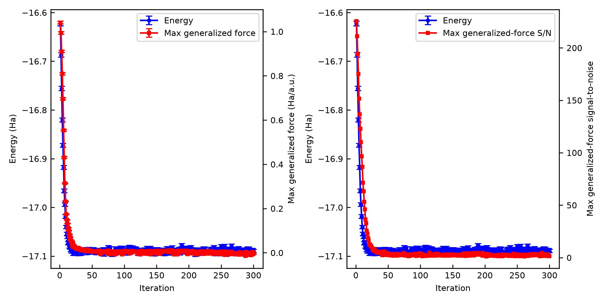
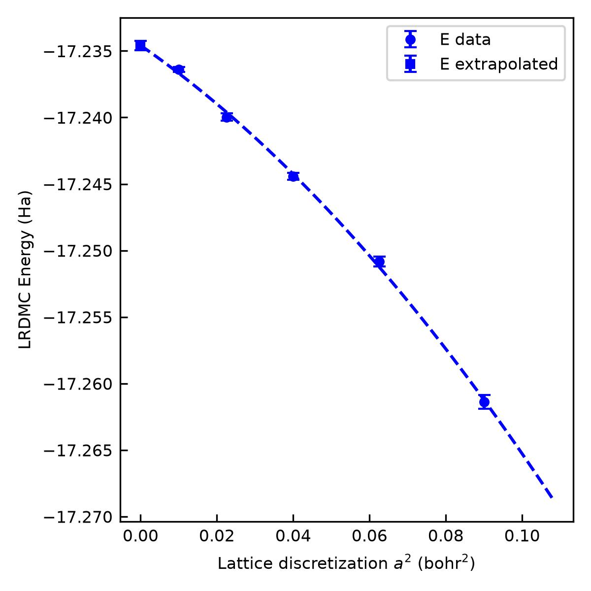

# jqmc-example01: Water VMC and LRDMC energies

Total energy of a water molecule with the ccECP pseudopotential. This
example starts from a PySCF Hartree-Fock (HF) calculation, optimizes a
Jastrow-Slater determinant (JSD) trial wave function with two- and
three-body Jastrow factors (J2 + J3), and obtains the VMC energy and the
LRDMC energy extrapolated to zero lattice spacing.

## Before you start

- You need PySCF with TREXIO export (`python -c "from pyscf.tools import trexio"`
  must succeed).
- All numbers below come from one run of the shipped inputs on one
  128-core CPU node, 128 MPI ranks
  (`mpirun -np 128`), no GPU, except that the MCMC and LRDMC steps sampled
  the single last optimization dump instead of the averaged trial (see the
  note at the MCMC hand-off). Wall times: PySCF a few seconds, VMC
  optimization 55 min, MCMC 20 min, LRDMC 20 min to 2.5 h per lattice
  spacing (see the LRDMC section). Results and timings can vary with the
  machine and software environment. Scale the walker and step counts to your
  machine.
- The analysis commands, the meaning of the main TOML keys and the restart
  rules are summarized in the examples index (`examples/README.md`).

All paths below are relative to `examples/jqmc-example01`; follow the displayed `cd`
commands.

## Generate a trial WF

The first step of ab initio QMC is to generate a trial wave function with a
mean-field method such as DFT or HF. jQMC reads mean-field results through
the TREXIO file format. The following script runs an HF calculation for the
water molecule with PySCF (Cartesian GTOs, because `mol.cart = True`) and
writes a TREXIO file.

> [!NOTE]
> PySCF is an optional dependency and is not installed with jQMC. Verify that
> `python -c "from pyscf.tools import trexio"` succeeds before running this
> example; otherwise install a PySCF build that includes TREXIO support.

<!-- include: 01DFT/run_pyscf.py -->
```python
from pyscf import gto, scf
from pyscf.tools import trexio

filename = "water_ccecp_ccpvtz.h5"

mol = gto.Mole()
mol.verbose = 5
mol.atom = """
               O    5.00000000   7.14707700   7.65097100
               H    4.06806600   6.94297500   7.56376100
               H    5.38023700   6.89696300   6.80798400
               """
mol.basis = "ccecp-ccpvtz"
mol.unit = "A"
mol.ecp = "ccecp"
mol.charge = 0
mol.spin = 0
mol.symmetry = False
mol.cart = True
mol.output = "water.out"
mol.build()

mf = scf.HF(mol)
mf.max_cycle = 200
mf_scf = mf.kernel()

trexio.to_trexio(mf, filename)
```

```bash
cd 01DFT
python run_pyscf.py > out_pyscf
cd ..
```

The SCF log is written to `01DFT/water.out`; `out_pyscf` ends with

```text
converged SCF energy = -16.9437549661298
```

> [!NOTE]
> One can start from any HF/DFT code that can write a TREXIO file. See the [TREXIO website](https://github.com/TREX-CoE/trexio) for details.

You can see the content of a TREXIO file with `jqmc-tool`:

```bash
jqmc-tool trexio show-info 01DFT/water_ccecp_ccpvtz.h5
```

```text
pbc_flag = False
num_ele_up = 4, num_ele_dn = 4, spin_polarized = False
spin_dependent MOs = False
Cartesian basis functions.
**Structure_data
  PBC flag = False
  --------------------------------------------------
  element, label, Z, x, y, z in cartesian (Bohr)
  --------------------------------------------------
  O, O, 8.0, 9.44863062, 13.50601812, 14.45823978
  H, H, 1.0, 7.68753060, 13.12032124, 14.29343676
  H, H, 1.0, 10.16717442, 13.03337116, 12.86522522
  --------------------------------------------------
**AOs_cart_gto_data**
  Number of AOs = 64
  Number of primitive AOs = 110
...
**Coulomb_potential_data
  ecp_flag = True
...
```

You can also inspect the TREXIO HDF5 container with `h5dump -n` (or the
interactive viewer `h5tui`) if it is installed on your machine.

## Optimize a trial WF (VMC)

The next step is to optimize the variational parameters of the generated
wave function: here the two-body Jastrow parameter and the matrix elements
of the three-body Jastrow factor. The determinant is kept fixed
(`opt_geminal = false`) and no one-body Jastrow factor is used
(`opt_J1_param = false`, and the conversion below adds none).

Enter the supplied VMC optimization directory and convert the TREXIO file
to a jQMC wave function:

```bash
cd 02vmc_JSD
cp ../01DFT/water_ccecp_ccpvtz.h5 .
jqmc-tool trexio convert-to water_ccecp_ccpvtz.h5 -j2 1.0 -j3 mo
```

```text
...
Hamiltonian data is saved in hamiltonian_data.h5.
```

The generated `hamiltonian_data.h5` is a wave-function file in the jQMC
format. `-j2` sets the initial value of the two-body Jastrow parameter and
`-j3` the basis of the three-body Jastrow factor: `mo` uses the molecular
orbitals (its matrix starts at zero), the `ao-*` choices use subsets of the
atomic orbitals (see the command-line reference).

Settings in `vmc.toml`: every optimization step samples 500 measurements per
walker (4 walkers per rank), discards 30 and uses 10 bins; `delta = 0.15` is
the SR step prefactor and `use_lm = true` (with the default
`lm_subspace_dim = 0`) selects accelerated SR (aSR), which chooses the
length of each step automatically. `num_opt_steps = 300` is an upper bound,
not a guarantee of convergence. Directly edit `vmc.toml` if you want to
change a parameter.

<!-- include: 02vmc_JSD/vmc.toml -->
```toml
[control]
job_type = "vmc" # Specify the job type. "mcmc", "vmc", "lrdmc-bra", or "lrdmc-tau".
mcmc_seed = 34456 # Random seed for MCMC
number_of_walkers = 4 # Number of walkers per MPI process
max_time = 86400 # Maximum time in sec.
restart = false
restart_chk = "restart.h5" # Restart checkpoint file. If restart is True, this file is used.
hamiltonian_h5 = "hamiltonian_data.h5" # Hamiltonian checkpoint file. If restart is False, this file is used.
verbosity = "high" # Verbosity level. "low", "high", "devel", "mpi-low", "mpi-high", "mpi-devel"

[vmc]
num_mcmc_steps = 500 # Number of observable measurement steps per MPI process and walker. The global total is num_mcmc_steps * mpi_size * number_of_walkers.
num_mcmc_per_measurement = 40 # Number of MCMC updates between successive observable measurements.
num_mcmc_warmup_steps = 30 # Number of initial observable measurements discarded as warmup.
num_mcmc_bin_blocks = 10 # Number of blocks for binning per MPI and Walker. i.e., the total number of binned blocks is num_mcmc_bin_blocks * mpi_size * number_of_walkers.
Dt = 2.0 # Step size for the MCMC update (bohr).
epsilon_AS = 0.0 # Epsilon parameter for Attaccalite-Sorella regularization.
num_opt_steps = 300 # Number of optimization steps.
wf_dump_freq = 1 # Frequency of wavefunction (i.e. hamiltonian_data) dump.
optimizer_kwargs = { method = "sr", delta = 0.15, epsilon = 0.001, cg_flag = true, cg_max_iter = 10000, use_lm = true } # SR optimizer configuration (method plus step/regularization).
opt_J1_param = false
opt_J2_param = true
opt_J3_param = true
opt_geminal = false
fix_geminal_rank = 0
opt_J3_basis_exp = false
opt_J3_basis_coeff = false
opt_lambda_basis_exp = false
opt_lambda_basis_coeff = false

# [precision]
# mode = "full"  # "full" (default, all float64) or "mixed" (recommended mixed precision)
```

Launch the job (on a GPU machine use the launch line of your queueing
system, e.g. `mpiexec -n 4 -map-by ppr:4:node jqmc ...`):

```bash
mpirun -np 128 jqmc vmc.toml > out_vmc 2> out_vmc.e
```

With 128 ranks one optimization step took 11 s (55 min for 300 steps).
Check the convergence with `jqmc-tool`:

```bash
jqmc-tool vmc analyze-output out_vmc
```

```text
------------------------------------------------------
Iter     E (Ha)     Max generalized force (Ha/a.u.)  Max force S/N
------------------------------------------------------
   1  -16.6225(48)  +1.0410(60)   225.449
   2  -16.6867(45)  +0.9940(60)   211.009
   3  -16.7560(43)  +0.9100(50)   194.321
   4  -16.8205(42)  +0.8090(50)   175.197
   5  -16.8727(40)  +0.6960(50)   151.466
...
  10  -17.0404(35)  +0.1740(20)    86.461
...
  20  -17.0900(34)  +0.0350(30)    16.113
...
  30  -17.0899(33)  +0.0170(30)     6.629
...
  50  -17.0901(34)  +0.0050(30)     2.429
...
 100  -17.0867(34)  +0.0030(30)     2.075
...
 200  -17.0919(34)  +0.0040(30)     1.832
...
 296  -17.0919(34)  -0.0110(30)     3.227
 297  -17.0960(33)  -0.0030(30)     2.186
 298  -17.0874(34)  -0.0080(30)     2.827
 299  -17.0884(33)  +0.0040(30)     1.292
 300  -17.0896(33)  -0.0050(30)     1.499
------------------------------------------------------
```

The important criteria are `Max generalized force` and `Max force S/N`.
The generalized forces are the energy derivatives with respect to the
variational parameters; `Max generalized force` should be zero within its
error bar. A practical criterion is `Max force S/N` < 4-5, because then all
residual forces are zero in the statistical sense. The energy should also
have stopped decreasing. Here the energy drops by 0.47 Ha in the first
20 steps, S/N drops to about 2-4 after 40-50 steps (with occasional
statistical excursions above 4), and the remaining steps only fluctuate
around -17.09 Ha; the dumps after step ~50 are converged.

> [!TIP]
> If the optimization does not converge well, try the following:
> - Adjust the `delta` parameter in `optimizer_kwargs`. A smaller `delta` (e.g., `0.05`) makes the optimization more conservative but stable, while a larger one (e.g., `0.30`) is more aggressive but may cause instabilities.
> - Set `use_lm = false` in `optimizer_kwargs` to switch off accelerated SR (aSR) and use plain SR with the fixed step `delta`. This can sometimes help in difficult cases.

You can also plot the energy and forces:

```bash
jqmc-tool vmc analyze-output out_vmc -p -s vmc.jpg
```



If an optimization has not converged, restart it: set `restart = true` in
`vmc.toml` (with `restart_chk = "restart.h5"`) and run
`jqmc vmc.toml > out_vmc_cont 2> out_vmc_cont.e`. With `restart = true`,
`num_opt_steps` is the number of **additional** steps, and the new
`hamiltonian_data_opt_step_N.h5` dumps continue the step numbering. Do not
change `num_mcmc_per_measurement`, `Dt`, `epsilon_AS`, `mcmc_seed` or
`number_of_walkers`: they are restored from `restart.h5`.
`jqmc-tool vmc analyze-output out_vmc out_vmc_cont` analyzes both runs
together. (This run did not need a restart.)

## Compute Energy (MCMC)

The next step is an MCMC (VMC sampling) calculation with the optimized trial
wave function. Enter the supplied MCMC directory; the helper averages the
last 20 optimization dumps by step number (`--step N` ends the window at
another reviewed step; without `--average-last` it copies a single dump).

```bash
cd ../03mcmc_JSD
python ../../copy_optimized_hamiltonian.py --average-last 20 ../02vmc_JSD hamiltonian_data.h5
```

> [!NOTE]
> The helper averages the wave-function parameters of the last 20 dumps (here steps 281-300) with
> `jqmc-tool vmc average-wf`; see [Averaging the last optimization steps](../../doc/notes/wavefunction_optimization.md). The numbers quoted below were not sampled from this average: the reference run handed over the single last dump with
> `python ../../copy_optimized_hamiltonian.py ../02vmc_JSD hamiltonian_data.h5`, which printed
> `Copied optimized trial: ../02vmc_JSD/hamiltonian_data_opt_step_300.h5 -> hamiltonian_data.h5`.

Settings in `mcmc.toml`: 300 walkers per rank, 5000 measurements, 40
electron moves between measurements (to reduce the correlation between
measurements) and a move length `Dt = 2.0` bohr; the first 30 measurements
are discarded and 10 bins per walker are used for the error bar.

<!-- include: 03mcmc_JSD/mcmc.toml -->
```toml
[control]
job_type = "mcmc" # Specify the job type. "mcmc", "vmc", "lrdmc-bra", or "lrdmc-tau".
mcmc_seed = 34456 # Random seed for MCMC
number_of_walkers = 300 # Number of walkers per MPI process
max_time = 86400 # Maximum time in sec.
restart = false
restart_chk = "restart.h5" # Restart checkpoint file. If restart is True, this file is used.
hamiltonian_h5 = "hamiltonian_data.h5" # Hamiltonian checkpoint file. If restart is False, this file is used.
verbosity = "low" # Verbosity level. "low", "high", "devel", "mpi-low", "mpi-high", "mpi-devel"
[mcmc]
num_mcmc_steps = 5000 # Number of observable measurement steps per MPI process and walker. The global total is num_mcmc_steps * mpi_size * number_of_walkers.
num_mcmc_per_measurement = 40 # Number of MCMC updates between successive observable measurements.
num_mcmc_warmup_steps = 30 # Number of initial observable measurements discarded as warmup.
num_mcmc_bin_blocks = 10 # Number of blocks for binning per MPI and Walker. i.e., the total number of binned blocks is num_mcmc_bin_blocks * mpi_size * number_of_walkers.
Dt = 2.0 # Step size for the MCMC update (bohr).
epsilon_AS = 0.0 # Epsilon parameter for Attaccalite-Sorella regularization.

# [precision]
# mode = "full"  # "full" (default, all float64) or "mixed" (recommended mixed precision)
```

```bash
mpirun -np 128 jqmc mcmc.toml > out_mcmc 2> out_mcmc.e
```

The run took 20 min (201 ms per MCMC step). The end of `out_mcmc`:

```text
Acceptance ratio is 47.93 %.  Ideal is ~ 50.00%. Adjust Dt.

Final output(s):
  Total Energy: E = -17.08901 +- 0.00012 Ha.
  Variance: Var = 1.86448 +- 0.00079 Ha^2.
```

### Analyze (MCMC)

To re-analyze the checkpoint with other warmup or bin settings, start from
the TOML values and then discard more measurements:

```bash
jqmc-tool mcmc compute-energy restart.h5 -w 30 -b 10
jqmc-tool mcmc compute-energy restart.h5 -w 500 -b 10
```

```text
Found 128 MPI ranks.
Total number of binned samples = 384000
E = -17.089008181622354 +- 0.00011966281626325541 Ha.
...
Found 128 MPI ranks.
Total number of binned samples = 384000
E = -17.089014065264873 +- 0.00012560763233290353 Ha.
```

The number of binned samples is 10 bins x 300 walkers x 128 ranks. The
energy does not move when 500 instead of 30 measurements are discarded, so
the warmup is sufficient. The VMC (J2 + J3) energy is
**E = -17.08901(12) Ha**, 145 mHa below HF.

## Compute Energy (LRDMC)

The final step is lattice-regularized diffusion Monte Carlo (LRDMC). LRDMC
projects the trial wave function onto the lowest-energy state with the same
nodal surface (fixed-node approximation), so it improves on the VMC energy.
The Hamiltonian is discretized on a lattice of spacing $a$, which introduces
a bias of order $a^2$; we therefore run five spacings and extrapolate to
$a \rightarrow 0$. Extrapolation removes the lattice bias, not the
fixed-node or ECP-localization approximations.

Settings in `lrdmc.toml`: `job_type = 'lrdmc-tau'` with 300 walkers per
rank; the walkers are projected for an imaginary time `tau = 0.10` Ha$^{-1}$
between two branching (population control) steps, and 1500 branching steps
are run, i.e. 150 Ha$^{-1}$ of projection per walker.
`non_local_move = "dltmove"` treats the non-local ECP term; 50 warmup steps,
10 bins and a correcting-factor history of 20 steps are used for the
analysis. `hamiltonian_h5 = '../hamiltonian_data.h5'` points to one shared
optimized trial.

Create one subdirectory per lattice spacing from the supplied TOML (which
has `alat = 0.30`):

```bash
cd ../04lrdmc_JSD
cp ../03mcmc_JSD/hamiltonian_data.h5 .  # the optimized trial used by MCMC
mkdir -p alat_0.10 alat_0.15 alat_0.20 alat_0.25 alat_0.30
cp lrdmc.toml alat_0.30/lrdmc.toml
for a in 0.10 0.15 0.20 0.25; do sed "s/alat = 0.30/alat = ${a}/" lrdmc.toml > alat_${a}/lrdmc.toml; done
grep alat alat_*/lrdmc.toml
```

```text
alat_0.10/lrdmc.toml:  alat = 0.10
alat_0.15/lrdmc.toml:  alat = 0.15
alat_0.20/lrdmc.toml:  alat = 0.20
alat_0.25/lrdmc.toml:  alat = 0.25
alat_0.30/lrdmc.toml:  alat = 0.30
```

<!-- include: 04lrdmc_JSD/lrdmc.toml -->
```toml
[control]
  job_type = 'lrdmc-tau'
  mcmc_seed = 34467
  number_of_walkers = 300
  max_time = 10400
  restart = false
  restart_chk = 'restart.h5'
  hamiltonian_h5 = '../hamiltonian_data.h5'
  verbosity = 'low'

[lrdmc-tau]
  num_mcmc_steps  = 1500
  tau = 0.10
  alat = 0.30
  non_local_move = "dltmove"
  num_gfmc_warmup_steps = 50
  num_gfmc_bin_blocks = 10
  num_gfmc_collect_steps = 20

# [precision]
# mode = "full"  # "full" (default, all float64) or "mixed" (recommended mixed precision)
```

Run `jqmc` in each directory; on a cluster, submit one job per directory.

```bash
for a in 0.10 0.15 0.20 0.25 0.30; do
  (cd alat_${a}; mpirun -np 128 jqmc lrdmc.toml > out_lrdmc 2> out_lrdmc.e)
done
```

The cost of one branching step grows roughly as $1/a^2$, because more
lattice moves fit into the same imaginary time `tau`. With 128 ranks:

| a (bohr) | Projection time per branching | Wall time (1500 steps) | Survived walkers ratio |
|----------|-------------------------------|------------------------|------------------------|
| 0.10     | 5767 msec                     | 153 min                | 96.39 %                |
| 0.15     | 2650 msec                     | 68 min                 | 96.37 %                |
| 0.20     | 1553 msec                     | 40 min                 | 96.33 %                |
| 0.25     | 1048 msec                     | 28 min                 | 96.28 %                |
| 0.30     | 774 msec                      | 20 min                 | 96.20 %                |

The `Final output(s):` blocks of `alat_<a>/out_lrdmc` (analyzed with the
TOML values, i.e. 50 warmup steps):

| a (bohr) | Total Energy (Ha)       | Variance (Ha^2)        |
|----------|-------------------------|------------------------|
| 0.10     | -17.23639 +- 0.00027    | 2.17904 +- 0.00267     |
| 0.15     | -17.23997 +- 0.00028    | 2.19439 +- 0.00190     |
| 0.20     | -17.24452 +- 0.00026    | 2.21629 +- 0.00735     |
| 0.25     | -17.25080 +- 0.00029    | 2.24118 +- 0.01278     |
| 0.30     | -17.26132 +- 0.00035    | 2.26941 +- 0.01102     |

### Analyze (LRDMC)

LRDMC starts from the VMC walker distribution and needs some projection
time to equilibrate. Re-analyze each checkpoint with a longer warmup and
check that the energy is stable, e.g. for the smallest spacing:

```bash
jqmc-tool lrdmc compute-energy alat_0.10/restart.h5 -w 50 -b 10 -c 20
jqmc-tool lrdmc compute-energy alat_0.10/restart.h5 -w 100 -b 10 -c 20
jqmc-tool lrdmc compute-energy alat_0.10/restart.h5 -w 200 -b 10 -c 20
```

```text
...
E = -17.236386025325892 +- 0.00026579190013760977 Ha.
...
E = -17.23639391409489 +- 0.00019703137887340245 Ha.
...
E = -17.236338373194535 +- 0.0002512492725141796 Ha.
```

(For LRDMC the number of jackknife samples equals the number of bins, so
`Total number of binned samples = 10`.) At $a = 0.10$ bohr the energy stays
within its error bar when 50, 100 or 200 steps are discarded, so 50 warmup
steps (5 Ha$^{-1}$) are enough at this spacing; repeat the check at the
other spacings.

Extrapolate to $a \rightarrow 0$ with `jqmc-tool`, from `04lrdmc_JSD`,
discarding 100 steps:

```bash
jqmc-tool lrdmc extrapolate-energy alat_0.10/restart.h5 alat_0.15/restart.h5 alat_0.20/restart.h5 alat_0.25/restart.h5 alat_0.30/restart.h5 -w 100 -b 10 -c 20 -s lrdmc_ext.jpg
```

```text
------------------------------------------------------------------------
Read restart checkpoint files from ['alat_0.10/restart.h5', 'alat_0.15/restart.h5', 'alat_0.20/restart.h5', 'alat_0.25/restart.h5', 'alat_0.30/restart.h5'].
Found 128 MPI ranks in alat_0.10/restart.h5.
  Total number of binned samples = 10
  For a = 0.1 bohr: E = -17.23639391409489 +- 0.00019703137887340245 Ha.
Found 128 MPI ranks in alat_0.15/restart.h5.
  Total number of binned samples = 10
  For a = 0.15 bohr: E = -17.239975493555548 +- 0.00027244700659658796 Ha.
Found 128 MPI ranks in alat_0.20/restart.h5.
  Total number of binned samples = 10
  For a = 0.2 bohr: E = -17.244418390247013 +- 0.0002627092228603692 Ha.
Found 128 MPI ranks in alat_0.25/restart.h5.
  Total number of binned samples = 10
  For a = 0.25 bohr: E = -17.250840571173086 +- 0.0003642624617848744 Ha.
Found 128 MPI ranks in alat_0.30/restart.h5.
  Total number of binned samples = 10
  For a = 0.3 bohr: E = -17.261365411064236 +- 0.0005180799863716069 Ha.
------------------------------------------------------------------------
Extrapolation of the energy with respect to a^2.
  Polynomial order = 2.
  For a -> 0 bohr: E = -17.23458485850484 +- 0.0003580752958172443 Ha.
------------------------------------------------------------------------
Graph is saved in lrdmc_ext.jpg.
------------------------------------------------------------------------
Extrapolation is finished.
```

The command fits $E(a) = E_0 + E_2 a^2 + E_4 a^4$ (`-p 2`, the default
polynomial order in $a^2$) and propagates the error bars of the input
energies in closed form to the error of $E_0$, so repeating the command
gives the same result. A linear fit in $a^2$ (`-p 1`) gives
`For a -> 0 bohr: E = -17.232773149305523 +- 0.0002368512401591743 Ha.`;
the data show a clear curvature (see the plot), so the quadratic fit is
the right choice here.



The energy rises towards $a \rightarrow 0$: the lattice bias is about
-27 mHa at $a = 0.30$ and -1.8 mHa at $a = 0.10$. The final LRDMC (J2 + J3,
fixed-node) energy is **E = -17.2346(4) Ha**, 146 mHa below the VMC energy
-17.08901(12) Ha with the same trial wave function.
