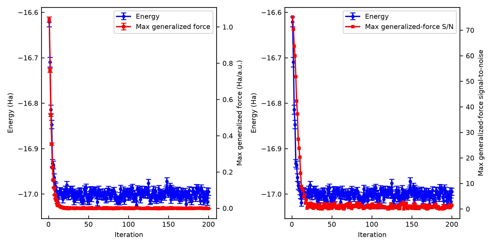

# jqmc-example02: Water with a two-body Jastrow factor

VMC energy and atomic forces of the water molecule (ccECP) with a trial
wave function that has only a two-body Jastrow factor (J2) on top of the
HF Slater determinant, starting from a PySCF HF calculation with Cartesian
GTOs. Comparing it with `jqmc-example01` (J2 + J3) shows what the
three-body Jastrow factor adds.

## Before you start

- You need PySCF with TREXIO export
  (`python -c "from pyscf.tools import trexio"` must succeed).
- The outputs quoted below were obtained with 128 MPI ranks on one 128-core
  CPU node. Wall times: VMC optimization
  4 min, MCMC with forces 19 min (job wall time). Scale `number_of_walkers` or
  `num_mcmc_steps` for other machines. The MCMC checkpoint `restart.h5`
  is about 9 GB; make sure there is enough disk space.
- The analysis commands, the meaning of the main TOML keys and the restart
  rules are summarized in the examples index (`examples/README.md`).

All paths below are relative to `examples/jqmc-example02`; follow the displayed `cd`
commands.

## Generate a trial WF

The first step of ab initio QMC is to generate a trial wave function with a
mean-field method such as DFT or Hartree-Fock (HF). jQMC reads mean-field
results through the TREXIO file format. The following script runs an HF
calculation for the water molecule with PySCF and writes a TREXIO file.

<!-- include: 01DFT/run_pyscf.py -->
```python
from pyscf import gto, scf
from pyscf.tools import trexio

filename = "water_ccecp_ccpvtz.h5"

mol = gto.Mole()
mol.verbose = 5
mol.atom = """
               O    5.00000000   7.14707700   7.65097100
               H    4.06806600   6.94297500   7.56376100
               H    5.38023700   6.89696300   6.80798400
               """
mol.basis = "ccecp-ccpvtz"
mol.unit = "A"
mol.ecp = "ccecp"
mol.charge = 0
mol.spin = 0
mol.symmetry = False
mol.cart = True
mol.output = "water.out"
mol.build()

mf = scf.HF(mol)
mf.max_cycle = 200
mf_scf = mf.kernel()

trexio.to_trexio(mf, filename)
```

Run it in a terminal.

```bash
cd 01DFT
python run_pyscf.py
cd ..
```

The SCF log is written to `water.out`:

```bash
grep "converged SCF energy" 01DFT/water.out
```

```text
converged SCF energy = -16.9437549661298
```

## Optimize a trial WF (VMC)

The next step is to optimize the variational parameters of the generated
wave function; here only the two-body Jastrow parameter. Convert the TREXIO
file to the jQMC format in the VMC optimization directory.

```bash
cd 02vmc
cp ../01DFT/water_ccecp_ccpvtz.h5 .
jqmc-tool trexio convert-to water_ccecp_ccpvtz.h5 -j2 1.0 -j3 none
```

```text
pbc_flag = False
num_ele_up = 4, num_ele_dn = 4, spin_polarized = False
spin_dependent MOs = False
Cartesian basis functions.
Hamiltonian data is saved in hamiltonian_data.h5.
```

The generated `hamiltonian_data.h5` is a wave-function file in the jQMC
format. `-j2` sets the initial value of the two-body Jastrow parameter;
`-j3 none` disables the three-body Jastrow factor.

Settings in `vmc.toml`: 200 optimization steps; each step samples 100
measurements per walker (4 walkers per rank), discards 30 and uses 10 bins;
`delta = 0.15` with `use_lm = true` (default `lm_subspace_dim = 0`) is
accelerated SR (aSR). A dump `hamiltonian_data_opt_step_<N>.h5` is written
every step (`wf_dump_freq = 1`), so that the hand-off below can average the last 20 steps. The reference run behind the quoted numbers wrote a dump every 50 steps; the dump frequency does not change the optimization.

<!-- include: 02vmc/vmc.toml -->
```toml
[control]
job_type = "vmc" # Specify the job type. "mcmc", "vmc", "lrdmc-bra", or "lrdmc-tau".
mcmc_seed = 34456 # Random seed for MCMC
number_of_walkers = 4 # Number of walkers per MPI process
max_time = 42000 # Maximum time in sec.
restart = false
restart_chk = "restart.h5" # Restart checkpoint file. If restart is True, this file is used.
hamiltonian_h5 = "hamiltonian_data.h5" # Hamiltonian checkpoint file. If restart is False, this file is used.
verbosity = "low" # Verbosity level. "low", "high", "devel", "mpi-low", "mpi-high", "mpi-devel"

[vmc]
num_mcmc_steps = 100 # Number of observable measurement steps per MPI process and walker. The global total is num_mcmc_steps * mpi_size * number_of_walkers.
num_mcmc_per_measurement = 40 # Number of MCMC updates between successive observable measurements.
num_mcmc_warmup_steps = 30 # Number of initial observable measurements discarded as warmup.
num_mcmc_bin_blocks = 10 # Number of blocks for binning per MPI and Walker. i.e., the total number of binned blocks is num_mcmc_bin_blocks * mpi_size * number_of_walkers.
Dt = 2.0 # Step size for the MCMC update (bohr).
epsilon_AS = 0.0 # Epsilon parameter for Attaccalite-Sorella regularization.
num_opt_steps = 200 # Number of optimization steps.
wf_dump_freq = 1 # Frequency of wavefunction (i.e. hamiltonian_data) dump.
opt_J1_param = false
opt_J2_param = true
opt_J3_param = false
opt_geminal = false
fix_geminal_rank = 0
opt_J3_basis_exp = false
opt_J3_basis_coeff = false
opt_lambda_basis_exp = false
opt_lambda_basis_coeff = false
optimizer_kwargs = { method = "sr", delta = 0.15, epsilon = 0.001, cg_flag = true, cg_max_iter = 10000, use_lm = true }
```

Launch the job.

```bash
jqmc vmc.toml > out_vmc 2> out_vmc.e # w/o MPI on CPU
mpirun -np N jqmc vmc.toml > out_vmc 2> out_vmc.e # w/ MPI (N = 128 for the outputs below)
```

You can see the outcome using `jqmc-tool`.

```bash
jqmc-tool vmc analyze-output out_vmc
```

```text
------------------------------------------------------
Iter     E (Ha)     Max generalized force (Ha/a.u.)  Max force S/N
------------------------------------------------------
   1  -16.621(11)  +1.041(14)    75.162
   2  -16.710(11)  +0.761(11)    70.306
   3  -16.8144(98)  +0.5140(80)    63.758
   4  -16.8472(93)  +0.3540(60)    60.000
   5  -16.9326(86)  +0.2260(40)    51.786
...
  15  -16.9938(82)  +0.0070(10)     4.853
  16  -16.9961(82)  +0.0080(10)     5.602
  17  -17.0037(80)  +0.0030(10)     2.274
  18  -17.0115(80)  +0.0050(10)     3.620
  19  -16.9979(81)  +0.0000(10)     0.326
  20  -17.0022(81)  +0.0030(10)     2.112
...
 196  -17.0125(80)  -0.0020(10)     1.272
 197  -17.0015(82)  +0.0020(10)     1.580
 198  -16.9944(81)  -0.0010(10)     0.475
 199  -17.0170(81)  -0.0010(10)     1.104
 200  -16.9950(80)  -0.0020(10)     1.454
------------------------------------------------------
```

The important criteria are `Max generalized force` and `Max force S/N`.
`Max generalized force` (the largest energy derivative with respect to a
variational parameter) should be zero within its error bar. A practical
criterion is `Max force S/N` < 4-5, because then all residual forces are
zero in the statistical sense. With a single variational parameter this
is reached after about 20 steps; the remaining steps only fluctuate around
the optimum (the per-step energies have error bars of about 8 mHa because
each step uses few samples).

You can also plot them and make a figure.

```bash
jqmc-tool vmc analyze-output out_vmc -p -s vmc.jpg
```



If the optimization has not converged, restart it; `num_opt_steps` then
counts **additional** steps (see "Restarting a run" in the examples index).

```toml:vmc.toml
[control]
...
restart = true
restart_chk = "restart.h5" # Restart checkpoint file. If restart is True, this file is used.
...
```

```bash
jqmc vmc.toml > out_vmc_cont 2> out_vmc_cont.e
jqmc-tool vmc analyze-output out_vmc out_vmc_cont
```

For example, restarting the 200-step run above with `num_opt_steps = 10`
continues the numbering at step 201, writes dumps up to `hamiltonian_data_opt_step_210.h5`
and gives

```text
...
 199  -17.0170(81)  -0.0010(10)     1.104
 200  -16.9950(80)  -0.0020(10)     1.454
 201  -17.0029(82)  +0.0010(10)     1.147
 202  -17.0081(81)  +0.0000(10)     0.050
...
 210  -16.9978(80)  -0.0000(10)     0.370
------------------------------------------------------
```

The MCMC step below uses the 200-step run without this continuation.

## Compute Energy and Forces (MCMC)

The next step is an MCMC (VMC sampling) calculation of the energy and the
atomic forces with the optimized wave function. Enter the MCMC directory and
hand over the average of the last 20 VMC dumps (steps 181-200) as its input.

```bash
cd ../03mcmc
python ../../copy_optimized_hamiltonian.py --average-last 20 ../02vmc hamiltonian_data.h5
```

> [!NOTE]
> The helper averages the wave-function parameters of the last 20 dumps (here steps 181-200) with
> `jqmc-tool vmc average-wf`; see [Averaging the last optimization steps](../../doc/notes/wavefunction_optimization.md). The numbers quoted below were not sampled from this average: the reference run handed over the single last dump with
> `python ../../copy_optimized_hamiltonian.py ../02vmc hamiltonian_data.h5`, which printed
> `Copied optimized trial: ../02vmc/hamiltonian_data_opt_step_200.h5 -> hamiltonian_data.h5`.
> The reference VMC run also wrote a dump only every 50 steps; the shipped VMC input sets `wf_dump_freq = 1` because this hand-off needs one dump per step (the dump frequency does not change the optimization).

<!-- include: 03mcmc/mcmc.toml -->
```toml
[control]
job_type = "mcmc" # Specify the job type. "mcmc", "vmc", "lrdmc-bra", or "lrdmc-tau".
mcmc_seed = 34456 # Random seed for MCMC
number_of_walkers = 100 # Number of walkers per MPI process
max_time = 86400 # Maximum time in sec.
restart = false
restart_chk = "restart.h5" # Restart checkpoint file. If restart is True, this file is used.
hamiltonian_h5 = "hamiltonian_data.h5" # Hamiltonian checkpoint file. If restart is False, this file is used.
verbosity = "low" # Verbosity level. "low", "high", "devel", "mpi-low", "mpi-high", "mpi-devel"
[mcmc]
num_mcmc_steps = 3000 # Number of observable measurement steps per MPI process and walker. The global total is num_mcmc_steps * mpi_size * number_of_walkers.
num_mcmc_per_measurement = 40 # Number of MCMC updates between successive observable measurements.
num_mcmc_warmup_steps = 30 # Number of initial observable measurements discarded as warmup.
num_mcmc_bin_blocks = 10 # Number of blocks for binning per MPI and Walker. i.e., the total number of binned blocks is num_mcmc_bin_blocks * mpi_size * number_of_walkers.
Dt = 2.0 # Step size for the MCMC update (bohr).
epsilon_AS = 0.0 # Epsilon parameter for Attaccalite-Sorella regularization.
atomic_force = true
use_swct = true # Apply Space Warp Coordinate Transformation (SWCT) to atomic forces.
```

`atomic_force = true` adds the atomic forces to the output, and
`use_swct = true` applies the space-warp coordinate transformation, which
reduces the variance of the force estimator.

```bash
jqmc mcmc.toml > out_mcmc 2> out_mcmc.e # w/o MPI on CPU
mpirun -np N jqmc mcmc.toml > out_mcmc 2> out_mcmc.e # w/ MPI (N = 128 for the outputs below)
```

With 128 ranks x 100 walkers x 3000 measurements the sampling took 15 min
(0.30 s per measurement step) and writing `restart.h5` (9.2 GB, it stores
every per-walker sample including the force terms) a few more minutes.

### Analyze (MCMC)

The `Final output(s):` block at the end of `out_mcmc` gives the energy, the
variance and the atomic forces $F = -dE/dR$ in Ha/bohr:

```bash
grep -A12 "Final output" out_mcmc
```

```text
Final output(s):
  Total Energy: E = -17.00159 +- 0.00027 Ha.
  Variance: Var = 1.40782 +- 0.00062 Ha^2.
  Atomic Forces:
  ------------------------------------------------
  Label   Fx(Ha/bohr) Fy(Ha/bohr) Fz(Ha/bohr)
  ------------------------------------------------
  O       +0.0043(4)   +0.0041(4)   +0.0069(4)
  H       -0.00969(31) -0.00206(21) +0.00092(22)
  H       +0.00543(22) -0.00200(26) -0.00786(30)
  ------------------------------------------------
```

To re-analyze the checkpoint, pass the TOML's warmup and bin values:

```bash
jqmc-tool mcmc compute-energy restart.h5 -w 30 -b 10
jqmc-tool mcmc compute-force restart.h5 -w 30 -b 10
```

```text
Read restart checkpoint file(s) from restart.h5.
Found 128 MPI ranks.
Total number of binned samples = 128000
E = -17.001588596404698 +- 0.00026770324544977525 Ha.
```

```text
Read restart checkpoint file(s) from restart.h5.
Found 128 MPI ranks.
Total number of binned samples = 128000
Atomic Forces:
------------------------------------------------
Label   Fx(Ha/bohr) Fy(Ha/bohr) Fz(Ha/bohr)
------------------------------------------------
O       +0.0043(4)   +0.0041(4)   +0.0069(4)
H       -0.00969(31) -0.00206(21) +0.00092(22)
H       +0.00543(22) -0.00200(26) -0.00786(30)
------------------------------------------------
```

The number of binned samples is 10 bins x 100 walkers x 128 ranks. Both
commands reproduce the run-log values; `compute-energy` does not print the
variance. Reading the 9 GB checkpoint took about 10 s for the energy and
1 min for the forces.

The forces are of order 0.01 Ha/bohr and resolved well beyond their error
bars: the input geometry is not the equilibrium geometry of this J2 trial
wave function. Their sum over the three atoms vanishes within the error
bars (e.g. $F_x$: 0.0043 - 0.00969 + 0.00543 = 0.00004 Ha/bohr), as
required by translational invariance.

Because this trial has no three-body Jastrow factor, its VMC energy is
expected to be higher (less negative) than in `jqmc-example01`, which uses
J2 + J3 with the same determinant. Compare the `Total Energy` and
`Variance` lines of the two `out_mcmc` files to see the effect of the
three-body term.
