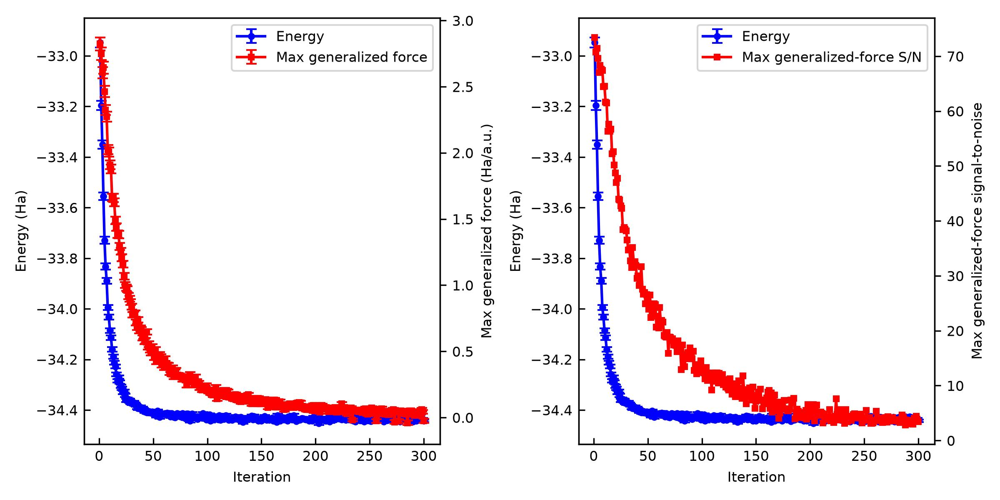
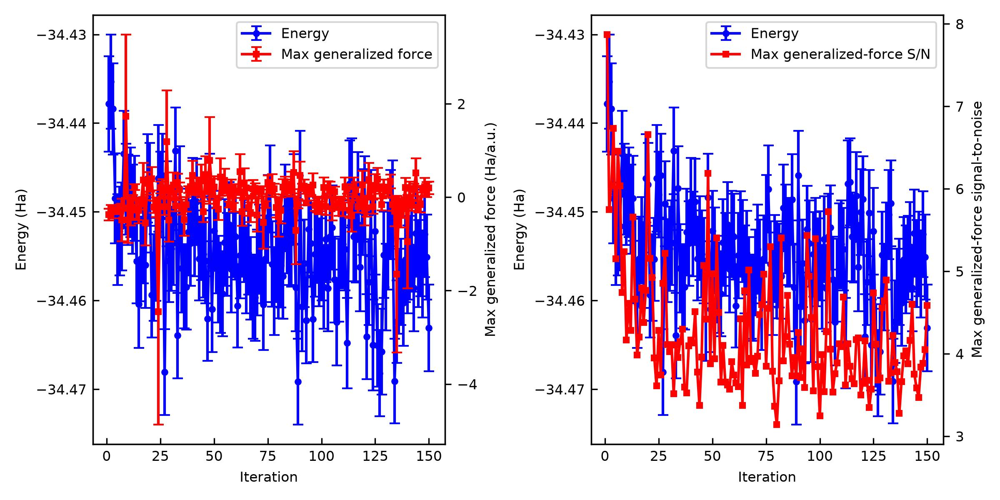

# jqmc-example04: Water-dimer binding energies with JSD and JAGP

Binding energy of the water dimer with the Jastrow-Slater determinant (JSD)
and Jastrow antisymmetrized geminal power (JAGP) ansatzes. Starting from
PySCF LDA calculations, you compute the VMC and LRDMC energies of the dimer
and of the two monomers and combine them into binding energies,

$$E_{\rm bind} = E_{\rm dimer} - E_{\rm monomer1} - E_{\rm monomer2},$$

to see how optimizing the nodal surface (JAGP) and projecting with LRDMC
change the result. The geometries are those of the S22
dataset[^2006JURpccp], whose CCSD(T)/CBS binding energy of the water dimer
(-4.97 kcal/mol) is the usual reference.

[^2006JURpccp]: P. Jurecka, et al. Phys Chem Chem Phys, 8, 1985-1993 (2006) [https://doi.org/10.1039/B600027D](https://doi.org/10.1039/B600027D)

## Before you start

- You need PySCF with TREXIO export
  (`python -c "from pyscf.tools import trexio"` must succeed).
- This is the largest molecular tutorial: three systems, each with
  DFT -> VMC (JSD) -> MCMC -> LRDMC -> VMC (JAGP) -> MCMC -> LRDMC.
- All numbers below were obtained on one 128-core CPU node per job (128 MPI
  ranks, no GPU).
  Wall times of the individual steps:

  | Step                                  | monomer (each) | dimer        |
  |---------------------------------------|----------------|--------------|
  | PySCF LDA                             | 1 s            | 2 s          |
  | VMC JSD, 150 + 150 steps              | 7 + 8 min      | 79 + 111 min |
  | MCMC JSD (8 walkers x 40000 steps)    | 3 min          | 8 min        |
  | LRDMC JSD (8 walkers x 40000 steps)   | 22 min         | 80 min       |
  | VMC JAGP, 150 steps                   | 20 min         | 150 min |
  | MCMC JAGP (8 walkers x 40000 steps)   | 4 min          | 13 min |
  | LRDMC JAGP (8 walkers x 40000 steps)  | 25 min         | 95 min       |

  The JAGP VMC output and timings quoted below were produced with
  `cg_max_iter = 200` instead of the shipped 2000 (see the JAGP VMC step).
  Timings depend on the jQMC version and the machine.

  Everything scales with the number of MPI ranks (walkers per rank x ranks
  is the sample size), so with fewer cores reduce `num_mcmc_steps` and
  expect larger error bars.
- The analysis commands, the meaning of the main TOML keys and the restart
  rules are summarized in the examples index (`examples/README.md`).

All paths below are relative to `examples/jqmc-example04`; follow the
displayed `cd` commands. The directory structure is:

```text
jqmc-example04/
|-- 01_S22_water_monomer_1/     # monomer 1
|   |-- S22_water_monomer_1.xyz
|   |-- 01DFT/run_pyscf.py
|   |-- 02vmc_JSD/vmc.toml, vmc_cont.toml
|   |-- 03mcmc_JSD/mcmc.toml    04lrdmc_JSD/lrdmc.toml
|   `-- 05vmc_JAGP/vmc.toml     06mcmc_JAGP/mcmc.toml   07lrdmc_JAGP/lrdmc.toml
|-- 02_S22_water_monomer_2/     # monomer 2, same layout
|-- 03_S22_water_dimer/         # dimer, same layout
`-- binding_energy.py           # collects the binding energies
```

The `S22_*.xyz` files hold the S22 geometries (in Angstrom) that the
`run_pyscf.py` scripts contain inline; they are for reference and
visualization only. The monomer and dimer TOMLs are identical.

## Generate trial WFs (DFT)

The trial wave functions come from PySCF LDA calculations with the ccECP
pseudopotential and the ccECP aug-cc-pVDZ basis in Cartesian form
(`mol.cart = True`), written to TREXIO files. The double-zeta basis keeps
the JAGP step affordable: the full AGP pairing matrix has one parameter per
pair of atomic orbitals, i.e. 84 x 84 = 7056 for the dimer (with
aug-cc-pVTZ, 208 x 208 = 43264, and the first optimization step took about 18 min
on one node).

> [!NOTE]
> PySCF is an optional dependency and is not installed with jQMC. Verify that
> `python -c "from pyscf.tools import trexio"` succeeds before running this
> example; otherwise install a PySCF build that includes TREXIO support.

### Water dimer

<!-- include: 03_S22_water_dimer/01DFT/run_pyscf.py -->
```python
from pyscf import gto, scf
from pyscf.tools import trexio

filename = "water_dimer.h5"

mol = gto.Mole()
mol.verbose = 5
mol.atom = """
	    O  -1.551007  -0.114520   0.000000
	    H  -1.934259   0.762503   0.000000
	    H  -0.599677   0.040712   0.000000
	    O   1.350625   0.111469   0.000000
	    H   1.680398  -0.373741  -0.758561
	    H   1.680398  -0.373741   0.758561
"""
mol.basis = "ccecp-aug-ccpvdz"
mol.unit = "A"
mol.ecp = "ccecp"
mol.charge = 0
mol.spin = 0
mol.symmetry = False
mol.cart = True
mol.output = "water_dimer.out"
mol.build()

mf = scf.KS(mol).density_fit()
mf.max_cycle = 200
mf.xc = "LDA_X,LDA_C_PZ"
mf_scf = mf.kernel()

trexio.to_trexio(mf, filename)
```

```bash
cd 03_S22_water_dimer/01DFT
python run_pyscf.py
cd ../..
```

`water_dimer.out` ends with

```text
converged SCF energy = -34.302944090687
```

### Water monomer 1

<!-- include: 01_S22_water_monomer_1/01DFT/run_pyscf.py -->
```python
from pyscf import gto, scf
from pyscf.tools import trexio

filename = "water_monomer_1.h5"

mol = gto.Mole()
mol.verbose = 5
mol.atom = """
	    O  -1.551007  -0.114520   0.000000
	    H  -1.934259   0.762503   0.000000
	    H  -0.599677   0.040712   0.000000
"""
mol.basis = "ccecp-aug-ccpvdz"
mol.unit = "A"
mol.ecp = "ccecp"
mol.charge = 0
mol.spin = 0
mol.symmetry = False
mol.cart = True
mol.output = "water_monomer_1.out"
mol.build()

mf = scf.KS(mol).density_fit()
mf.max_cycle = 200
mf.xc = "LDA_X,LDA_C_PZ"
mf_scf = mf.kernel()

trexio.to_trexio(mf, filename)
```

```bash
cd 01_S22_water_monomer_1/01DFT
python run_pyscf.py
cd ../..
```

```text
converged SCF energy = -17.1451612472242
```

### Water monomer 2

<!-- include: 02_S22_water_monomer_2/01DFT/run_pyscf.py -->
```python
from pyscf import gto, scf
from pyscf.tools import trexio

filename = "water_monomer_2.h5"

mol = gto.Mole()
mol.verbose = 5
mol.atom = """
	    O   1.350625   0.111469   0.000000
	    H   1.680398  -0.373741  -0.758561
	    H   1.680398  -0.373741   0.758561
"""
mol.basis = "ccecp-aug-ccpvdz"
mol.unit = "A"
mol.ecp = "ccecp"
mol.charge = 0
mol.spin = 0
mol.symmetry = False
mol.cart = True
mol.output = "water_monomer_2.out"
mol.build()

mf = scf.KS(mol).density_fit()
mf.max_cycle = 200
mf.xc = "LDA_X,LDA_C_PZ"
mf_scf = mf.kernel()

trexio.to_trexio(mf, filename)
```

```bash
cd 02_S22_water_monomer_2/01DFT
python run_pyscf.py
cd ../..
```

```text
converged SCF energy = -17.1450880561159
```

The LDA binding energy, $-34.302944 - (-17.145161) - (-17.145088) = -0.012695$
Ha $= -7.97$ kcal/mol, overbinds, as LDA usually does for hydrogen bonds.

> [!NOTE]
> One can start from any HF/DFT code that can write a TREXIO file. See the [TREXIO website](https://github.com/TREX-CoE/trexio) for details.

---

The following sections show the full workflow for the **water dimer**
(`03_S22_water_dimer`). Repeat every step in `01_S22_water_monomer_1` and
`02_S22_water_monomer_2`, replacing `water_dimer.h5` by `water_monomer_1.h5`
or `water_monomer_2.h5` in the `cp` and `convert-to` commands. All other
commands, including the relative path of `copy_optimized_hamiltonian.py`,
are the same. The monomer results are collected in [Results](#results).

```bash
cd 03_S22_water_dimer
```

## Optimize a trial WF (VMC) -- JSD

The next step optimizes the Jastrow factor (the two-body parameter and the
matrix elements of the three-body Jastrow factor) with the determinant
fixed.

```bash
cd 02vmc_JSD
cp ../01DFT/water_dimer.h5 .
jqmc-tool trexio convert-to water_dimer.h5 -j2 1.0 -j3 ao-medium
```

```text
pbc_flag = False
num_ele_up = 8, num_ele_dn = 8, spin_polarized = False
spin_dependent MOs = False
Cartesian basis functions.
Hamiltonian data is saved in hamiltonian_data.h5.
```

`-j2` sets the initial two-body Jastrow parameter and `-j3 ao-medium` builds
the three-body Jastrow factor on a moderate subset of the atomic orbitals
(`ao-small`, `ao-large`, `ao`/`ao-full` and `mo` are the other choices; see
the command-line reference).

<!-- include: 03_S22_water_dimer/02vmc_JSD/vmc.toml -->
```toml
[control]
job_type = "vmc" # Specify the job type. "mcmc", "vmc", "lrdmc-bra", or "lrdmc-tau".
mcmc_seed = 34456 # Random seed for MCMC
number_of_walkers = 4 # Number of walkers per MPI process
max_time = 10800 # Maximum time in sec.
restart = false
restart_chk = "restart.h5" # Restart checkpoint file. If restart is True, this file is used.
hamiltonian_h5 = "hamiltonian_data.h5" # Hamiltonian checkpoint file. If restart is False, this file is used.
verbosity = "low" # Verbosity level. "low", "high", "devel", "mpi-low", "mpi-high", "mpi-devel"

[vmc]
num_mcmc_steps = 100 # Number of observable measurement steps per MPI process and walker. The global total is num_mcmc_steps * mpi_size * number_of_walkers.
num_mcmc_per_measurement = 40 # Number of MCMC updates between successive observable measurements.
num_mcmc_warmup_steps = 30 # Number of initial observable measurements discarded as warmup.
num_mcmc_bin_blocks = 10 # Number of blocks for binning per MPI and Walker. i.e., the total number of binned blocks is num_mcmc_bin_blocks * mpi_size * number_of_walkers.
Dt = 2.0 # Step size for the MCMC update (bohr).
epsilon_AS = 0.0 # Epsilon parameter for Attaccalite-Sorella regularization.
num_opt_steps = 150 # Number of optimization steps.
wf_dump_freq = 1 # Frequency of wavefunction (i.e. hamiltonian_data) dump.
optimizer_kwargs = { method = "sr", delta = 0.15, epsilon = 0.001, cg_flag = true, cg_max_iter = 10000, use_lm = true } # SR optimizer configuration (method plus step/regularization).
opt_J1_param = false
opt_J2_param = true
opt_J3_param = true
opt_geminal = false
fix_geminal_rank = 0
opt_J3_basis_exp = false
opt_J3_basis_coeff = false
opt_lambda_basis_exp = false
opt_lambda_basis_coeff = false
```

Each optimization step samples 4 walkers x 100 measurements per rank
(51200 samples on 128 ranks, 35840 after the 30 warmup measurements).
Launch the job:

```bash
mpirun -np 128 jqmc vmc.toml > out_vmc 2> out_vmc.e
```

and inspect it with

```bash
jqmc-tool vmc analyze-output out_vmc
```

`Max generalized force` (the largest energy derivative with respect to a
variational parameter) should be zero within its error bar; a practical
criterion is `Max force S/N` below about 4-5. After 150 steps the dimer was
not there yet (S/N = 7.1, energy still drifting down), so the run was
continued for another 150 steps with `vmc_cont.toml`, which differs from
`vmc.toml` only by `restart = true` (`num_opt_steps` then counts
**additional** steps):

```bash
mpirun -np 128 jqmc vmc_cont.toml > out_vmc_cont 2> out_vmc_cont.e
jqmc-tool vmc analyze-output out_vmc out_vmc_cont
```

```text
------------------------------------------------------
Iter     E (Ha)     Max generalized force (Ha/a.u.)  Max force S/N
------------------------------------------------------
   1  -32.947(20)  +2.823(50)    73.443
   2  -33.196(18)  +2.749(47)    70.725
   3  -33.351(16)  +2.606(43)    71.460
...
 150  -34.4429(54)  +0.103(14)     7.148
...
 296  -34.4300(52)  +0.042(13)     4.013
 297  -34.4366(52)  +0.015(14)     3.593
 298  -34.4413(52)  +0.059(13)     4.452
 299  -34.4372(53)  +0.042(14)     3.858
 300  -34.4428(53)  -0.025(15)     3.448
------------------------------------------------------
```

The same protocol (150 + 150 steps) was applied to the monomers, which have
813 instead of 3193 Jastrow parameters; they ended at S/N = 4.1 (monomer 1)
and 3.9 (monomer 2).

```bash
jqmc-tool vmc analyze-output out_vmc out_vmc_cont -s vmc_JSD.jpg
```



> [!TIP]
> If the optimization does not converge well, adjust `delta` in
> `optimizer_kwargs` (smaller is more conservative) or set `use_lm = false`
> to switch off accelerated SR and use plain SR with the fixed step `delta`.

## Compute Energy (MCMC) -- JSD

Average the last 20 saved optimized wave functions and sample the result:

```bash
cd ../03mcmc_JSD
python ../../../copy_optimized_hamiltonian.py --average-last 20 ../02vmc_JSD hamiltonian_data.h5
```

> [!NOTE]
> The helper averages the wave-function parameters of the last 20 dumps (here steps 281-300) with
> `jqmc-tool vmc average-wf`; see [Averaging the last optimization steps](../../doc/notes/wavefunction_optimization.md). The numbers quoted below were not sampled from this average: the reference run handed over the single last dump with
> `python ../../../copy_optimized_hamiltonian.py ../02vmc_JSD hamiltonian_data.h5`, which printed
> `Copied optimized trial: ../02vmc_JSD/hamiltonian_data_opt_step_300.h5 -> hamiltonian_data.h5`.
> The reference VMC run also wrote a dump only every 10 steps; the shipped VMC input sets `wf_dump_freq = 1` because this hand-off needs one dump per step (the dump frequency does not change the optimization).

<!-- include: 03_S22_water_dimer/03mcmc_JSD/mcmc.toml -->
```toml
[control]
job_type = "mcmc" # Specify the job type. "mcmc", "vmc", "lrdmc-bra", or "lrdmc-tau"
mcmc_seed = 34456 # Random seed for MCMC
number_of_walkers = 8 # Number of walkers per MPI process
max_time = 10800 # Maximum time in sec.
restart = false
restart_chk = "restart.h5" # Restart checkpoint file. If restart is True, this file is used.
hamiltonian_h5 = "hamiltonian_data.h5" # Hamiltonian checkpoint file. If restart is False, this file is used.
verbosity = "low" # Verbosity level. "low", "high", "devel", "mpi-low", "mpi-high", "mpi-devel"
[mcmc]
num_mcmc_steps = 40000 # Number of observable measurement steps per MPI process and walker. The global total is num_mcmc_steps * mpi_size * number_of_walkers.
num_mcmc_per_measurement = 40 # Number of MCMC updates between successive observable measurements.
num_mcmc_warmup_steps = 30 # Number of initial observable measurements discarded as warmup.
num_mcmc_bin_blocks = 10 # Number of blocks for binning per MPI and Walker. i.e., the total number of binned blocks is num_mcmc_bin_blocks * mpi_size * number_of_walkers.
Dt = 2.0 # Step size for the MCMC update (bohr).
epsilon_AS = 0.0 # Epsilon parameter for Attaccalite-Sorella regularization.
```

```bash
mpirun -np 128 jqmc mcmc.toml > out_mcmc 2> out_mcmc.e
```

### Analyze (MCMC)

Read the `Final output(s):` block at the end of `out_mcmc`, or re-analyze
the checkpoint with the TOML's settings:

```bash
grep -A2 "Final output" out_mcmc
jqmc-tool mcmc compute-energy restart.h5 -w 30 -b 10
```

```text
Final output(s):
  Total Energy: E = -34.43756 +- 0.00017 Ha.
  Variance: Var = 0.63560 +- 0.00149 Ha^2.
```

```text
Read restart checkpoint file(s) from restart.h5.
Found 128 MPI ranks.
Total number of binned samples = 10240
E = -34.437560563299506 +- 0.00016807299033927607 Ha.
```

> [!NOTE]
> Error bars needed for the binding energy. 1 mHa = 0.6275 kcal/mol and the
> binding energy combines three total energies, so its error bar is
> $\sqrt{\sigma_{\rm dimer}^2 + \sigma_{\rm mono1}^2 + \sigma_{\rm mono2}^2}$.
> The MCMC inputs give 0.17 mHa (dimer) and 0.10 mHa (monomers), i.e. 0.14
> kcal/mol on the binding energy. The error bar decreases as $1/\sqrt{N}$
> with the number of samples $N$ (steps x walkers x ranks).

## Compute Energy (LRDMC) -- JSD

Lattice-regularized diffusion Monte Carlo (LRDMC) projects the trial wave
function onto the lowest state with the same nodal surface (fixed-node
approximation).

```bash
cd ../04lrdmc_JSD
cp ../03mcmc_JSD/hamiltonian_data.h5 .
```

<!-- include: 03_S22_water_dimer/04lrdmc_JSD/lrdmc.toml -->
```toml
[control]
  job_type = 'lrdmc-tau'
  mcmc_seed = 34467
  number_of_walkers = 8
  max_time = 10800
  restart = false
  restart_chk = 'restart.h5'
  hamiltonian_h5 = 'hamiltonian_data.h5'
  verbosity = 'low'

[lrdmc-tau]
  num_mcmc_steps  = 40000
  tau = 0.10
  alat = 0.20
  non_local_move = "dltmove"
  num_gfmc_warmup_steps = 50
  num_gfmc_bin_blocks = 50
  num_gfmc_collect_steps = 20
```

`job_type = "lrdmc-tau"` runs LRDMC with a fixed imaginary-time
projection `tau = 0.10` Ha$^{-1}$ between two branchings (measurements);
the number of lattice moves per branching then follows from the system
(the output reports `Average of the number of projections = 60` for a
monomer and 119 for the dimer).

The LRDMC energy has a lattice-spacing bias of order $a^2$. For total
energies one runs several spacings and extrapolates to $a \rightarrow 0$
(see `jqmc-example01`). Here a single $a = 0.20$ bohr is used for all three
systems, assuming that most of the bias cancels in the energy difference;
this assumption is not checked here (repeat the three LRDMC runs with a
second spacing if you need to verify it). `non_local_move = "dltmove"`
treats the non-local ECP term, and the analysis uses 50 warmup
measurements, 50 bins and a correcting-factor history of 20.

```bash
mpirun -np 128 jqmc lrdmc.toml > out_lrdmc 2> out_lrdmc.e
```

### Analyze (LRDMC)

```bash
grep -A2 "Final output" out_lrdmc
jqmc-tool lrdmc compute-energy restart.h5 -w 50 -b 50 -c 20
```

```text
Final output(s):
  Total Energy: E = -34.47914 +- 0.00018 Ha.
  Variance: Var = 0.78471 +- 0.00183 Ha^2.
```

```text
Read restart checkpoint file(s) from restart.h5.
Found 128 MPI ranks.
Total number of binned samples = 50
E = -34.47913743163413 +- 0.00018422227273138286 Ha.
```

For LRDMC the number of binned samples equals the number of bins. The
output also reports the cost per branching step and the fraction of walkers
that survive a branching:

```text
  Projection time per branching =  106.340 msec.
...
Survived walkers ratio = 97.79 %
Average of the number of projections  = 119
```

## Optimize a trial WF (VMC) -- JAGP

The antisymmetrized geminal power (AGP) generalizes the Slater determinant:
the electron pairs are described by a pairing function (the geminal)
expanded on the atomic orbitals, instead of a fixed set of occupied
orbitals. Optimizing the geminal together with the Jastrow factor changes
the nodal surface and therefore the fixed-node LRDMC energy.

Convert the optimized JSD wave function to JAGP:

```bash
cd ../05vmc_JAGP
cp ../03mcmc_JSD/hamiltonian_data.h5 ./hamiltonian_data_JSD.h5
jqmc-tool hamiltonian conv-wf --convert-to jagp hamiltonian_data_JSD.h5
mv hamiltonian_data_conv.h5 hamiltonian_data.h5
```

```text
Convert SD to AGP.
Hamiltonian data is saved in hamiltonian_data_conv.h5.
```

<!-- include: 03_S22_water_dimer/05vmc_JAGP/vmc.toml -->
```toml
[control]
job_type = "vmc" # Specify the job type. "mcmc", "vmc", "lrdmc-bra", or "lrdmc-tau".
mcmc_seed = 34456 # Random seed for MCMC
number_of_walkers = 4 # Number of walkers per MPI process
max_time = 10800 # Maximum time in sec.
restart = false
restart_chk = "restart.h5" # Restart checkpoint file. If restart is True, this file is used.
hamiltonian_h5 = "hamiltonian_data.h5" # Hamiltonian checkpoint file. If restart is False, this file is used.
verbosity = "low" # Verbosity level. "low", "high", "devel", "mpi-low", "mpi-high", "mpi-devel"

[vmc]
num_mcmc_steps = 100 # Number of observable measurement steps per MPI process and walker. The global total is num_mcmc_steps * mpi_size * number_of_walkers.
num_mcmc_per_measurement = 40 # Number of MCMC updates between successive observable measurements.
num_mcmc_warmup_steps = 30 # Number of initial observable measurements discarded as warmup.
num_mcmc_bin_blocks = 10 # Number of blocks for binning per MPI and Walker. i.e., the total number of binned blocks is num_mcmc_bin_blocks * mpi_size * number_of_walkers.
Dt = 2.0 # Step size for the MCMC update (bohr).
epsilon_AS = 0.05 # Epsilon parameter for Attaccalite-Sorella regularization.
num_opt_steps = 150 # Number of optimization steps.
wf_dump_freq = 1 # Frequency of wavefunction (i.e. hamiltonian_data) dump.
optimizer_kwargs = { method = "sr", delta = 0.15, epsilon = 0.001, cg_flag = true, cg_max_iter = 2000, use_lm = true } # SR optimizer configuration (method plus step/regularization).
opt_J1_param = false
opt_J2_param = true
opt_J3_param = true
opt_geminal = true
fix_geminal_rank = 0
opt_J3_basis_exp = false
opt_J3_basis_coeff = false
opt_lambda_basis_exp = false
opt_lambda_basis_coeff = false
```

> [!IMPORTANT]
> Differences from the JSD optimization:
> - `opt_geminal = true` optimizes the AGP pairing matrix (7056 parameters
>   for the dimer, 1764 for a monomer) together with the Jastrow factor.
> - `epsilon_AS = 0.05` switches on the Attaccalite-Sorella reweighting. The
>   derivatives with respect to determinant parameters diverge near the
>   nodal surface, which makes their variance infinite; the reweighting
>   regularizes them. It is a stabilizer, not a requirement
>   (`jqmc-example03` and `jqmc-example05` optimize determinant parameters
>   with `epsilon_AS = 0.0`).
> - `cg_max_iter = 2000` bounds the conjugate-gradient iterations of the SR
>   linear solve above what the solve needs. With 10249 parameters it
>   needed about 900 to 1350 iterations to converge at the absolute
>   tolerances `1e-4` to `1e-6` of the jQMC version used for this
>   optimization (the current `cg_tol` is relative, default `1e-5`), i.e.
>   90-130 s per step on one node with that version. The output below, and
>   the JAGP results derived from it, were produced with
>   `cg_max_iter = 200`, which truncated every solve (about 60 s per step:
>   10 s sampling, 50 s SR); the truncated solve still gave a descent
>   direction. A cap below the needed count truncates every step, and jQMC
>   reports each truncated solve with an `SR CG did not converge` warning.

```bash
mpirun -np 128 jqmc vmc.toml > out_vmc 2> out_vmc.e
jqmc-tool vmc analyze-output out_vmc
```

```text
------------------------------------------------------
Iter     E (Ha)     Max generalized force (Ha/a.u.)  Max force S/N
------------------------------------------------------
   1  -34.4378(54)   -0.37(13)     7.871
   2  -34.4353(53)  -0.252(81)     5.746
   3  -34.4384(52)   -0.31(14)     6.035
   4  -34.4485(51)  -0.304(45)     6.733
   5  -34.4531(51)  -0.291(75)     5.149
...
 145  -34.4558(49)   -0.21(12)     3.587
 146  -34.4548(47)   -0.16(17)     3.471
 147  -34.4570(49)  +0.169(73)     3.837
 148  -34.4525(48)   +0.23(19)     3.882
 149  -34.4551(48)   +0.16(16)     4.049
 150  -34.4631(49)   +0.20(13)     4.586
------------------------------------------------------
```

How to judge JAGP convergence:

- Use `Max force S/N`: once it stays at or below about 4-5 and the energy
  no longer decreases, the optimization can be regarded as converged.
- Do not expect `Max generalized force` itself to go to zero with a small
  error bar, as it does for a Jastrow-only optimization: for determinant
  parameters it keeps large and occasionally spiking error bars.

Background. The derivatives of the energy with respect to the determinant
parameters, $F \equiv -\cfrac{\partial E}{\partial c_{\rm det}}$, diverge
near the nodes, so their Monte Carlo estimates suffer from the
infinite-variance problem. Reweighting[^2008ATT][^2015UMR] and
regularization[^2020PAT] schemes address it; jQMC implements the
Attaccalite-Sorella reweighting[^2008ATT] (`epsilon_AS`). Pathak and Wagner
showed that for complex nodal surfaces neither approach removes every
divergent contribution, but also that the remaining divergences do not
hamper wave-function optimization in practice[^2020PAT].

[^2008ATT]: [C. Attaccalite and S. Sorella, *Phys. Rev. Lett.* **100**, 114501 (2008)](https://doi.org/10.1103/PhysRevLett.100.114501).

[^2015UMR]: [C. J. Umrigar, *J. Chem. Phys.* **143**, 164105 (2015)](https://doi.org/10.1063/1.4933112).

[^2020PAT]: [S. Pathak and L. K. Wagner, *AIP Advances* **10**, 085213 (2020)](https://doi.org/10.1063/5.0004008).

```bash
jqmc-tool vmc analyze-output out_vmc -s vmc_JAGP.jpg
```



## Compute Energy (MCMC) -- JAGP

```bash
cd ../06mcmc_JAGP
python ../../../copy_optimized_hamiltonian.py --average-last 20 ../05vmc_JAGP hamiltonian_data.h5
```

> [!NOTE]
> The helper averages the wave-function parameters of the last 20 dumps (here steps 131-150) with
> `jqmc-tool vmc average-wf`; see [Averaging the last optimization steps](../../doc/notes/wavefunction_optimization.md). The numbers quoted below were not sampled from this average: the reference run handed over the single last dump with
> `python ../../../copy_optimized_hamiltonian.py ../05vmc_JAGP hamiltonian_data.h5`.
> The reference VMC run also wrote a dump only every 10 steps; the shipped VMC input sets `wf_dump_freq = 1` because this hand-off needs one dump per step (the dump frequency does not change the optimization).

<!-- include: 03_S22_water_dimer/06mcmc_JAGP/mcmc.toml -->
```toml
[control]
job_type = "mcmc" # Specify the job type. "mcmc", "vmc", "lrdmc-bra", or "lrdmc-tau"
mcmc_seed = 34456 # Random seed for MCMC
number_of_walkers = 8 # Number of walkers per MPI process
max_time = 10800 # Maximum time in sec.
restart = false
restart_chk = "restart.h5" # Restart checkpoint file. If restart is True, this file is used.
hamiltonian_h5 = "hamiltonian_data.h5" # Hamiltonian checkpoint file. If restart is False, this file is used.
verbosity = "low" # Verbosity level. "low", "high", "devel", "mpi-low", "mpi-high", "mpi-devel"
[mcmc]
num_mcmc_steps = 40000 # Number of observable measurement steps per MPI process and walker. The global total is num_mcmc_steps * mpi_size * number_of_walkers.
num_mcmc_per_measurement = 40 # Number of MCMC updates between successive observable measurements.
num_mcmc_warmup_steps = 30 # Number of initial observable measurements discarded as warmup.
num_mcmc_bin_blocks = 10 # Number of blocks for binning per MPI and Walker. i.e., the total number of binned blocks is num_mcmc_bin_blocks * mpi_size * number_of_walkers.
Dt = 2.0 # Step size for the MCMC update (bohr).
epsilon_AS = 0.0 # Epsilon parameter for Attaccalite-Sorella regularization.
```

```bash
mpirun -np 128 jqmc mcmc.toml > out_mcmc 2> out_mcmc.e
grep -A2 "Final output" out_mcmc
```

```text
Final output(s):
  Total Energy: E = -34.45655 +- 0.00017 Ha.
  Variance: Var = 0.58219 +- 0.00444 Ha^2.
```

The JAGP VMC energy must be lower than the JSD value (-34.43756(17) Ha);
otherwise the optimization went wrong.

## Compute Energy (LRDMC) -- JAGP

```bash
cd ../07lrdmc_JAGP
cp ../06mcmc_JAGP/hamiltonian_data.h5 .
```

<!-- include: 03_S22_water_dimer/07lrdmc_JAGP/lrdmc.toml -->
```toml
[control]
  job_type = 'lrdmc-tau'
  mcmc_seed = 34467
  number_of_walkers = 8
  max_time = 10800
  restart = false
  restart_chk = 'restart.h5'
  hamiltonian_h5 = 'hamiltonian_data.h5'
  verbosity = 'low'

[lrdmc-tau]
  num_mcmc_steps  = 40000
  tau = 0.10
  alat = 0.20
  non_local_move = "dltmove"
  num_gfmc_warmup_steps = 50
  num_gfmc_bin_blocks = 50
  num_gfmc_collect_steps = 20
```

An LRDMC step with the AGP is somewhat more expensive than with the Slater
determinant: for the dimer, 127 ms instead of 106 ms per branching step,
i.e. 95 instead of 80 min for the whole run.

```bash
mpirun -np 128 jqmc lrdmc.toml > out_lrdmc 2> out_lrdmc.e
grep -A2 "Final output" out_lrdmc
```

```text
Final output(s):
  Total Energy: E = -34.48258 +- 0.00014 Ha.
  Variance: Var = 0.69730 +- 0.00679 Ha^2.
```

The JAGP LRDMC energy should be lower than or equal to the JSD value within
error bars, because a better nodal surface lowers the fixed-node energy.

## Results

### Total energies

All values in Ha, from the `Final output(s):` blocks of the runs above
(LRDMC at $a = 0.20$ bohr):

| System     | VMC JSD          | LRDMC JSD        | VMC JAGP         | LRDMC JAGP       |
|------------|------------------|------------------|------------------|------------------|
| monomer 1  | -17.21661(10)    | -17.23541(14)    | -17.22871(9)     | -17.23816(11)    |
| monomer 2  | -17.21681(10)    | -17.23554(13)    | -17.22884(9)     | -17.23803(10)    |
| dimer      | -34.43756(17)    | -34.47914(18)    | -34.45655(17)    | -34.48258(14)    |

### Binding energies

$E_{\rm bind} = E_{\rm dimer} - E_{\rm monomer1} - E_{\rm monomer2}$, with
the statistical errors added in quadrature and 1 Ha = 627.509 kcal/mol:

<!-- include: binding_energy.py -->
```python
"""Binding energies E_dimer - E_monomer1 - E_monomer2 from the Final output blocks."""

import math
import re
from pathlib import Path

HA_TO_KCAL = 627.509
SYSTEMS = ("03_S22_water_dimer", "01_S22_water_monomer_1", "02_S22_water_monomer_2")
RUNS = (
    ("JSD", "VMC", "03mcmc_JSD/out_mcmc"),
    ("JSD", "LRDMC", "04lrdmc_JSD/out_lrdmc"),
    ("JAGP", "VMC", "06mcmc_JAGP/out_mcmc"),
    ("JAGP", "LRDMC", "07lrdmc_JAGP/out_lrdmc"),
)
ENERGY = re.compile(r"Total Energy: E = (\S+) \+- (\S+) Ha")


def final_energy(path: Path) -> tuple[float, float]:
    """Return the last 'Total Energy' line of a jqmc output."""
    mean, error = ENERGY.findall(path.read_text())[-1]
    return float(mean), float(error)


root = Path(__file__).resolve().parent
for ansatz, method, output in RUNS:
    (e_d, s_d), (e_1, s_1), (e_2, s_2) = (final_energy(root / system / output) for system in SYSTEMS)
    e_bind = e_d - e_1 - e_2
    s_bind = math.sqrt(s_d**2 + s_1**2 + s_2**2)
    print(
        f"{ansatz:4s} {method:5s}  E_bind = {e_bind * 1000:+.2f} +- {s_bind * 1000:.2f} mHa"
        f" = {e_bind * HA_TO_KCAL:+.2f} +- {s_bind * HA_TO_KCAL:.2f} kcal/mol"
    )
```

Run it from `examples/jqmc-example04` after all twelve MCMC/LRDMC runs:

```bash
cd ../..
python binding_energy.py
```

```text
JSD  VMC    E_bind = -4.14 +- 0.22 mHa = -2.60 +- 0.14 kcal/mol
JSD  LRDMC  E_bind = -8.19 +- 0.26 mHa = -5.14 +- 0.16 kcal/mol
JAGP VMC    E_bind = +1.00 +- 0.21 mHa = +0.63 +- 0.13 kcal/mol
JAGP LRDMC  E_bind = -6.39 +- 0.20 mHa = -4.01 +- 0.13 kcal/mol
```

| Ansatz | Method              | Binding energy (kcal/mol) | ref                          |
|--------|---------------------|---------------------------|------------------------------|
| JSD    | VMC                 | -2.60 +- 0.14             | this run                     |
| JSD    | LRDMC ($a = 0.20$)  | -5.14 +- 0.16             | this run                     |
| JAGP   | VMC                 | +0.63 +- 0.13             | this run                     |
| JAGP   | LRDMC ($a = 0.20$)  | -4.01 +- 0.13             | this run                     |
| --     | CCSD(T)/CBS         | -4.97                     | S22[^2006JURpccp]            |

What the numbers show:

- **LRDMC with JSD** gives $-5.14 \pm 0.16$ kcal/mol, within about one error bar
  of the CCSD(T)/CBS value. Both monomers and the dimer use LDA nodes from
  the same basis, so the fixed-node error is similar in the three systems
  and largely cancels.
- **VMC is far less reliable for this energy difference.** A binding
  energy of 5 kcal/mol is 8 mHa, while the VMC total energies here are
  19 mHa per monomer and 42 mHa for the dimer (JSD) above the LRDMC
  ones (9 and 26 mHa for JAGP). Any difference
  in optimization quality between the dimer and the monomers enters the
  binding energy directly. The dimer has four times more Jastrow parameters
  (3193 vs 813) but was optimized with the same number of samples per step,
  and its VMC variance (0.636 Ha$^2$) is larger than the sum of the two
  monomer variances (0.310 + 0.308 = 0.618 Ha$^2$), so it is optimized
  slightly worse: the JSD VMC binding energy, $-2.60 \pm 0.14$
  kcal/mol, is underestimated.
- **JAGP** lowers every total energy (VMC by 12 mHa per monomer and 19 mHa
  for the dimer; LRDMC by 2.8 and 2.5 mHa per monomer and 3.4 mHa for the
  dimer), but the dimer gains less than the two monomers together. Its
  7056 pairing parameters (vs 1764 per monomer) were optimized with only
  150 steps of an SR solve truncated at `cg_max_iter = 200` (the shipped
  input allows 2000), and its VMC variance (0.582 Ha$^2$)
  exceeds the monomer sum (0.274 + 0.272 = 0.546 Ha$^2$) by more than for
  JSD. As a result, the JAGP VMC binding energy is even unbound
  ($+0.63 \pm 0.13$ kcal/mol), and the JAGP LRDMC value ($-4.01 \pm
  0.13$ kcal/mol) is about 1.0 kcal/mol too weak, a difference from the
  JSD LRDMC value ($1.1 \pm 0.2$ kcal/mol) that is well outside the error
  bars. A better JAGP binding
  energy needs a more thoroughly optimized dimer (more samples per step,
  more steps, or a fully converged SR solve), i.e. more computer time than
  this tutorial uses.
- The error bars are statistical only. The $a = 0.20$ bohr lattice error
  and the basis set (aug-cc-pVDZ) were not checked.
