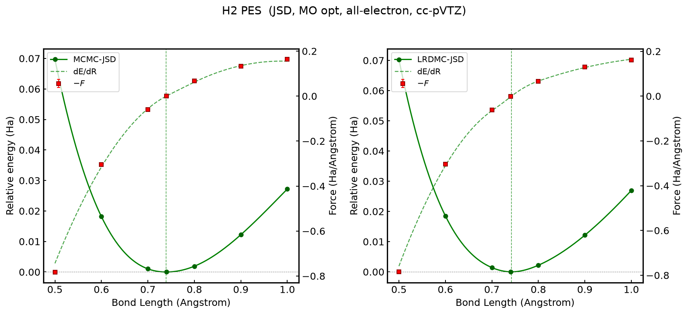

# jqmc-workflow-example01: Hydrogen PES and atomic forces

All-electron H2 with Cartesian cc-pVTZ orbitals, a PySCF **RHF** trial,
and a Jastrow-Slater determinant (JSD) wavefunction whose determinant is
optimized together with the Jastrow factors. The script `run_pes_pipeline.py`
scans seven bond lengths (0.50 to 1.00 Angstrom). For each one it runs:

```text
PySCF RHF -> TREXIO -> WF -> VMC -> MCMC energy and forces
                               -> LRDMC energy and forces (a = 0.3 bohr)
```

It then prints a table of the energies and forces, and plots the
PES next to its spline derivative and the QMC forces.

## Setup and launch

You need jQMC (with `jqmc_workflow`) matching this checkout, PySCF with
TREXIO export, and a workflow machine configuration. The script changes into
its own directory, so the configuration is read from `jqmc_setting_local/`
placed **inside this example directory** if that exists, otherwise from
`~/.jqmc_setting/`. See the **Configuration** section of
`doc/notes/workflows.md` for the machine entry, `queue_data.toml`, and submit
template.

Edit `SERVER` and `QUEUE_LABEL` in the script to match your configuration,
then run (from this directory):

```bash
nohup python run_pes_pipeline.py > driver.log 2>&1 &
```

The driver only runs PySCF and the TREXIO conversion locally (seconds). Then
it submits jobs and polls them, so it can stay on a login node. Each
geometry submits up to 6 batch jobs: a pilot and a production run each for
VMC, MCMC and LRDMC, plus any VMC continuation runs. Geometries run in
parallel. `max_job_submit` in `queue_data.toml` limits how many of this
driver's jobs are in that scheduler queue at once; a submission above the
limit waits until one of them leaves the queue.

## Settings taken from the executable script

Edit the script, not this generated block (it is refreshed from the script by
`examples/sync_examples.py`).

<!-- include: run_pes_pipeline.py#configuration -->
```python
SERVER = "cluster"
QUEUE_LABEL = "cores-120-mpi-120-omp-1-1h"

NUM_OPT_STEPS = 120  # VMC optimization steps
WF_DUMP_FREQ = 1  # dump every step: VMC_Workflow hands on the average of the last 20 steps
Dt = 1.2  # MCMC hopping distance
ALAT = 0.3  # LRDMC lattice spacing
TARGET_SNR = 6.0  # target signal_to_noise for convergence.
ENERGY_SLOPE_THRESHOLD = 2.0  # energy slope sigma threshold for convergence.
TARGET_VMC_ERROR = 5e-4  # Target statistical error (Ha)
TARGET_MCMC_ERROR = 5e-5  # Target statistical error (Ha)
TARGET_LRDMC_ERROR = 5e-5  # Target statistical error (Ha)

# Mixed precision: set to "mixed" to enable float32 for low-risk zones.
# Default "full" keeps all zones in float64. See doc/notes/mixed_precision.md.
PRECISION_MODE = "full"  # "full" or "mixed"

R_VALUES = [
    0.50,
    0.60,
    0.70,
    0.74,
    0.80,
    0.90,
    1.00,
]
```

## Wavefunction and calculation scope

WF conversion initializes J1 at 1.5, Pade J2 at 1.0, and an **AO-small J3**.
VMC optimizes all three together with the determinant, using `opt_geminal=True,
fix_geminal_rank=1` so the determinant stays a single Slater determinant (H2
has one doubly occupied orbital). The optimizer is `sr` with
`delta=0.300, epsilon=0.010, use_lm=True`; with the default
`lm_subspace_dim = 0` this is accelerated SR (aSR).

All three QMC stages run in automatic mode. A short pilot job measures the
statistical error. The workflow then sizes the production run for the
target error, using sigma ~ 1/sqrt(N):
- VMC: `TARGET_VMC_ERROR` per optimization step.
- MCMC and LRDMC: `TARGET_MCMC_ERROR` and `TARGET_LRDMC_ERROR` on the final
  energy.

MCMC and LRDMC compute atomic forces. Both use 50 warmup measurements and
50 bins, and LRDMC also uses 20 correcting-factor steps. The error
targets apply to the energy only. They do not by themselves guarantee
converged forces, and they do not remove the LRDMC lattice-spacing bias
(a continuum value needs an `alat` scan).

## VMC convergence and continuation

Each VMC production run performs `NUM_OPT_STEPS` steps. After each run the
workflow checks two criteria over the last 5 steps:

- `TARGET_SNR`: the average "Max force S/N" (max |f|/std f over the
  generalized forces) must be at or below 6.0.
- `ENERGY_SLOPE_THRESHOLD`: the fitted energy slope must not be more
  negative than 2.0 standard errors, i.e. the energy is no longer
  decreasing.

If either check fails, another run of `NUM_OPT_STEPS` steps continues from
the checkpoint, up to `max_continuation=3` runs. If the checks still fail
after the last run, VMC is marked failed and its MCMC/LRDMC stages are
skipped. In the run quoted below, R = 0.70, 0.74, 0.90 and 1.00 converged
after one run (120 steps), and R = 0.50 and 0.60 after two (240 steps).
R = 0.80 needed three (360 steps): after run 2 the S/N had passed but the
energy was still going down (the log writes the slope error with the
plus-minus sign; it is shown as `+-` here):

```text
  VMC production run 2/3 completed.
  VMC energy: -1.17156 +- 0.0005 Ha
  S/N avg over last 5 step(s): 5.602  (last step: 6.197)
  Energy slope over last 5 step(s): -0.000332 +- 0.000157 Ha/step
  Energy still decreasing: slope (-0.000332 Ha/step) < -0.000157 * 2.0
...
  VMC production run 3/3 completed.
  VMC energy: -1.17129 +- 0.00055 Ha
  S/N avg over last 5 step(s): 4.675  (last step: 7.995)
  Energy slope over last 5 step(s): 0.000060 +- 0.000162 Ha/step
  Energy plateau: slope (0.000060 Ha/step) >= -0.000162 * 2.0
  VMC converged (all active checks passed).
```

Downstream stages receive the trial through
`FileFrom("vmc-R", ValueFrom("vmc-R", "optimized_hamiltonian"))`, renamed to
`hamiltonian_data.h5`. The published value is `hamiltonian_data_opt_averaged.h5`,
the average of the 20 highest-numbered saved steps (here steps 101-120, 221-240
or 341-360); `output_values["optimized_hamiltonian_steps"]` records them.

> [!NOTE]
> `VMC_Workflow` hands the average of the last 20 optimization steps downstream by default
> (`handoff_mode="average"`, `handoff_average_steps=20`, written by `jqmc-tool vmc average-wf` to
> `hamiltonian_data_opt_averaged.h5`), so the script dumps every step (`WF_DUMP_FREQ = 1`). The numbers
> quoted here were not sampled from this average: the reference run dumped every
> 20 steps and handed the single last dump (`hamiltonian_data_opt_step_120.h5`, `_240.h5` or `_360.h5`) to the downstream stages; `handoff_mode="last"` selects this single-step hand-off.

Re-running the script is safe: every stage records its jobs in
`workflow_state.toml`. Completed stages are skipped, and a stage whose job is
still queued resumes polling it. These results were in fact produced by two
launches. The first used `max_continuation=1` for VMC, and R = 0.50, 0.60 and
0.80 stopped as "VMC NOT converged". The script was then changed to
`max_continuation=3` and launched again: it reused every finished job and
only ran the missing continuation runs and the downstream stages.

## Results

Setup for the numbers below:
- A PBS queue running 128 MPI ranks (OMP 1) on one 128-core CPU node, 1 h
  walltime, 4 walkers per rank. Set the server and queue labels of the
  script to entries of your local configuration.
- All other settings as in the block above, except for the VMC dump
  frequency and the hand-off of the optimized trial (see the note above).
- 46 batch jobs in total. Each used at most 6 min of node time; most VMC
  runs took about 2 min, and MCMC and LRDMC productions about 1 min.
- The whole pipeline took about 8 h of wall time, almost all of it queue
  waiting on a busy shared cluster. For this run, submissions were limited
  to 2 jobs at a time by an external wrapper that is not part of this
  example; `max_job_submit = 2` in `queue_data.toml` sets the same limit.

Summary table printed at the end of `driver.log`:

```text
|  R (A) |     E_HF (Ha) |     E_MCMC (Ha) | F_MCMC (Ha/bohr) | MCMC t_net |    E_LRDMC (Ha) | F_LRDMC (Ha/bohr) | LRDMC t_net |
|--------|---------------|-----------------|------------------|------------|-----------------|-------------------|-------------|
|   0.50 |     -1.063416 |   -1.103668(51) |      0.41404(19) |        5.3 |   -1.104352(63) |       0.41550(50) |        24.4 |
|   0.60 |     -1.115461 |   -1.155193(51) |      0.16076(14) |        6.5 |   -1.156156(53) |       0.16121(30) |        44.3 |
|   0.70 |     -1.132102 |   -1.172325(50) |      0.03167(12) |        6.3 |   -1.173264(75) |       0.03290(40) |        24.6 |
|   0.74 |     -1.132989 |   -1.173346(49) |      0.00054(11) |        7.0 |    -1.17467(10) |       0.00055(38) |        26.1 |
|   0.80 |     -1.130309 |   -1.171451(50) |      0.03556(11) |        5.2 |   -1.172483(60) |       0.03468(30) |        38.8 |
|   0.90 |     -1.118740 |   -1.161126(50) |      0.07027(10) |        5.6 |   -1.162536(85) |       0.06921(28) |        36.3 |
|   1.00 |     -1.102071 |   -1.146148(50) |     0.086610(90) |        5.9 |    -1.14773(11) |       0.08537(24) |        33.0 |
```

The force columns give the largest per-atom force **norm**, so they have no
sign. `t_net` is the net sampling time in seconds, without JAX compilation.

How to read the table:
- **Correlation energy:** MCMC lies 0.040 to 0.044 Ha below RHF at every R.
- **LRDMC below VMC:** LRDMC lies a further 0.7 to 1.6 mHa below MCMC.
- **Equilibrium:** both methods have their lowest energy at 0.74 Angstrom.
  There the force is 0.00054(11) Ha/bohr (MCMC) and 0.00055(38) Ha/bohr
  (LRDMC), against about 0.03 Ha/bohr at 0.70 and 0.80 Angstrom.
- **Reference:** the exact non-relativistic Born-Oppenheimer value is about
  -1.1745 Ha at R about 0.741 Angstrom. MCMC is about 1.1 mHa above it, and
  the LRDMC value at a = 0.3 bohr, -1.17467(10) Ha, agrees with it within
  2 sigma.



Each panel of `H2_PES_mcmc_lrdmc.png` (also written as `.pdf`) plots the
energy relative to its minimum, with a cubic spline through the points (solid
line, left axis). The right axis compares the spline derivative dE/dR (dashed)
with the computed force on the second atom, -F_z, converted to Ha/Angstrom
(red squares). The two agree across the scan; the dashed vertical line marks
the spline minimum. The mismatch at R = 0.50 is most likely the spline's end
effect: the curve is steep there and there is no point on the left.

## Output layout and re-analysis

Each `R_0.XX/` contains `00_pyscf/`, `01_wf/`, `02_vmc/`, `03_mcmc/` and
`04_lrdmc/`. Pilot runs live in `_pilot/` (`_pilot_b/` for LRDMC). The
analysis can be repeated by hand for any geometry. For R = 0.74, from this
directory:

```bash
cd R_0.74
jqmc-tool vmc analyze-output 02_vmc/*.out
jqmc-tool mcmc compute-energy 03_mcmc/restart.h5 -w 50 -b 50
jqmc-tool mcmc compute-force 03_mcmc/restart.h5 -w 50 -b 50
jqmc-tool lrdmc compute-energy 04_lrdmc/restart.h5 -w 50 -b 50 -c 20
jqmc-tool lrdmc compute-force 04_lrdmc/restart.h5 -w 50 -b 50 -c 20
```

The optimization history gives one row per step: energy, maximum
generalized force, and its S/N. The energy should flatten out, and the S/N
should drop to the target level, only fluctuating around it:

```text
------------------------------------------------------
Iter     E (Ha)     Max generalized force (Ha/a.u.)  Max force S/N
------------------------------------------------------
   1  -1.0871(69)  +0.617(20)    35.986
   2  -1.1077(56)  +0.528(16)    38.769
   3  -1.1325(43)  +0.426(13)    42.130
...
 116  -1.17366(46)  -0.0040(10)     2.577
 117  -1.17358(46)  -0.0060(20)     4.762
 118  -1.17361(51)  -0.0070(20)     5.445
 119  -1.17343(50)  -0.0070(20)     6.849
 120  -1.17447(47)  -0.0060(10)     4.896
------------------------------------------------------
```

MCMC energy and forces:

```text
Total number of binned samples = 25600
E = -1.173346155203654 +- 4.9381814513854035e-05 Ha.
...
Label   Fx(Ha/bohr) Fy(Ha/bohr) Fz(Ha/bohr)
------------------------------------------------
H       -2(5)e-05    -5(5)e-05    +0.00054(11)
H       +2(5)e-05    +5(5)e-05    -0.00054(11)
```

LRDMC energy and forces (a = 0.3 bohr):

```text
Total number of binned samples = 50
E = -1.174670857893782 +- 0.00010028130042896581 Ha.
...
Label   Fx(Ha/bohr) Fy(Ha/bohr) Fz(Ha/bohr)
------------------------------------------------
H       -0.00010(17) +0.00005(19) -0.0001(4)
H       +0.00000(26) +0.00022(23) +0.0005(4)
```

The molecule lies along z, so Fx and Fy are zero within error. At
equilibrium both Fz values are also close to zero. Away from it the two
atoms carry equal and opposite Fz, as the MCMC values show. The LRDMC
forces have about three times larger error bars than MCMC.
